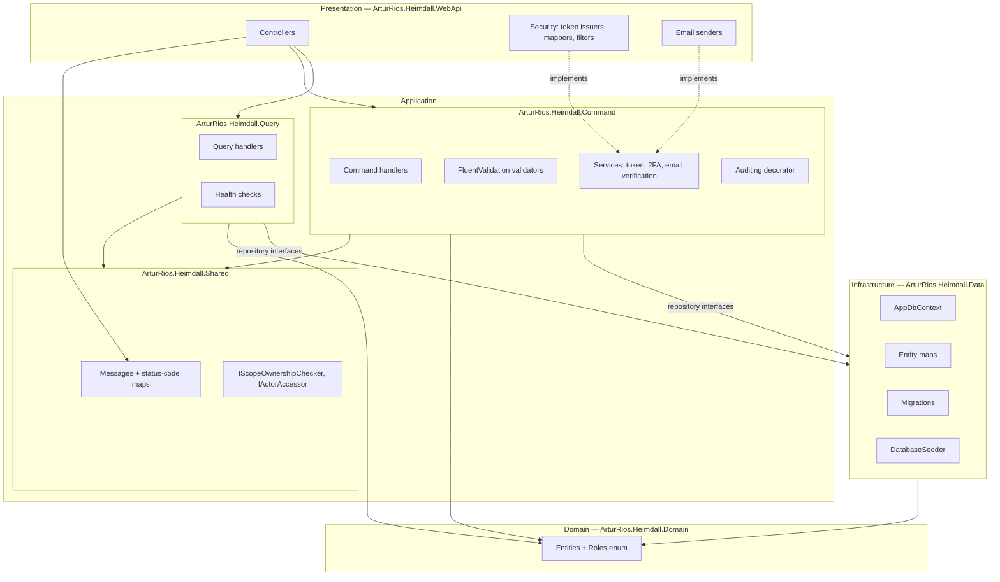
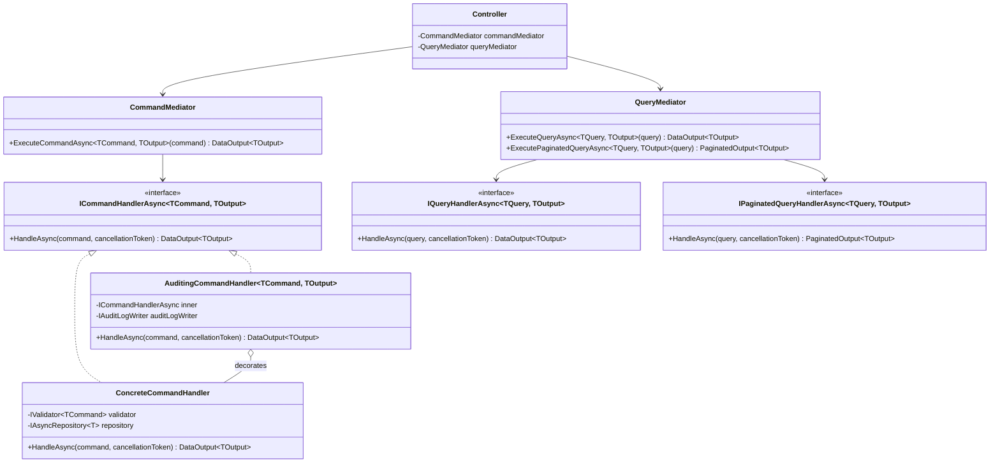

+++
title = 'Architecture'
linkTitle = 'Architecture'
weight = 40
description = 'The four layers, the CQRS mediator, the auditing decorator, and the HTTP request pipeline.'
+++

Heimdall is a layered (DDD-flavoured) solution with **CQRS** in the application layer. Reads and
writes travel different objects, through different mediators, into different handlers.

## The layers



The arrows only ever point inwards or sideways: **Domain depends on nothing**, and Application
depends on Infrastructure only through repository *interfaces* (`IAsyncRepository<T, long>`,
`IAsyncReadOnlyRepository<T, long>`) that Infrastructure implements. Presentation supplies the concrete
adapters for the abstractions the Application layer declares — `IAuthTokenIssuer`,
`IEmailVerificationSender`, `IGoogleIdTokenVerifier` — which is why swapping Mailgun for logging, or
the real Google verifier for the refusing one, is a start-up registration decision and nothing else.

| Project | Responsibility |
| --- | --- |
| `ArturRios.Heimdall.Domain` | Entities and the `Roles` enum. No behaviour beyond data shape. |
| `ArturRios.Heimdall.Command` | Write side: commands, validators, handlers, application services, auditing. |
| `ArturRios.Heimdall.Query` | Read side: queries, validators, handlers, health checks, output DTOs. |
| `ArturRios.Heimdall.Shared` | Cross-cutting contracts and the message/status-code maps both sides use. |
| `ArturRios.Heimdall.Data` | `AppDbContext`, entity maps, migrations, seeding. |
| `ArturRios.Heimdall.WebApi` | Controllers, JWT issuing and validation, filters, email and Google adapters, start-up. |

## CQRS: two mediators, two shapes



A controller action is deliberately thin — bind, dispatch, resolve:

```csharp
[HttpPost]
[RoleRequirement((int)Roles.SystemAdmin)]
public async Task<ActionResult<DataOutput<CreateScopeCommandOutput?>>> Create(
    [FromBody] CreateScopeCommand command)
{
    var result = await commandMediator
        .ExecuteCommandAsync<CreateScopeCommand, CreateScopeCommandOutput>(command);

    return result.ToActionResult(statusMap: ScopeMessageMap.StatusCodes);
}
```

No business rule lives in a controller. The handler returns a `DataOutput<T>` carrying data,
messages, and errors; Util.WebApi's `ToActionResult` turns that into an HTTP status using the per-area
**message map** — a dictionary from message text to status code — so "which error is a 404 and which
is a 409" is a single table per area rather than scattered `return NotFound()` calls.

## Auditing by decoration

Every write handler is registered through `AddAuditedCommandHandler`, which registers the concrete
handler and then registers the *interface* as an `AuditingCommandHandler` wrapping it (**NFR-09**):

```csharp
services.AddScoped<THandler>();
services.AddScoped<ICommandHandlerAsync<TCommand, TOutput>>(provider =>
    new AuditingCommandHandler<TCommand, TOutput>(
        provider.GetRequiredService<THandler>(),
        provider.GetRequiredService<IAuditLogWriter>(),
        provider.GetRequiredService<ILogger<AuditingCommandHandler<TCommand, TOutput>>>()));
```

The decorator writes one `AuditLog` row per **successful** command, resolving the target from the
output's `Id`/`PublicId` by reflection and the actor from `IActorAccessor` (the current request's
identity). A failure to write the audit entry is logged as a warning and never fails the request the
user already succeeded at.

{}
The concrete `THandler` registration exists only so the decorator factory can resolve it. Resolving
`THandler` directly silently bypasses auditing — always depend on
`ICommandHandlerAsync<TCommand, TOutput>`.
{}

See [Audit logging](../flows/audit-logging/) for the sequence.

## How a failure becomes a status

`ToActionResult` resolves the HTTP status from the envelope's first error (or, on success, its
first message) against the map the controller passes it, falling back to 200 on success and 400 on
failure. Each use case owns a `*MessageMap` naming its own outcomes — `InvalidCredentials` is a 401,
`EmailAlreadyExists` a 409, and so on.

Persistence failures are not the use case's vocabulary, and until recently they had none of their
own: a repository handed back the provider's text, which named the violated index, the conflicting
value, or the column and its type. Nothing stable could be keyed off that, so every one of them fell
through to the 400 default — a duplicate that lost a race and a database that had gone away were
both reported as bad requests, and the message leaked schema detail to the caller.

`ArturRios.Data.Relational.Core` (since 4.0.0) classifies each failure into one of five fixed, caller-safe
messages instead, reading the provider text only to decide which. `DataAccessMessageMap` folds four
of them into every use case's map:

| Classified failure | Status |
| --- | --- |
| Unique violation | 409 Conflict |
| Other integrity rule (FK, NOT NULL, CHECK) | 409 Conflict |
| Concurrency conflict | 409 Conflict |
| Transient — the store is unavailable | 503 Service Unavailable |

The fifth, the unclassified `A data-access error occurred.`, is deliberately left unmapped and keeps
the 400 default. It covers both causes a caller can fix — a value longer than its column, where a
validator failed to bound it — and causes only an operator can, so neither 400 nor 500 fits all of
it, and 400 is the safer of the two.

A use case's own entries always win over these, so a map assembled this way can never override the
vocabulary the use case defines.

## The HTTP request pipeline

```mermaid
graph LR
    REQ([Request]) --> FWD["Forwarded headers<br/>trusted proxies only"]
    FWD --> HTTPS[HTTPS redirect]
    HTTPS --> TRACE[TraceActivityMiddleware]
    TRACE --> EX[ExceptionMiddleware]
    EX --> CORS["CORS<br/>configured origins only"]
    CORS --> AUTHN[AuthenticationMiddleware]
    AUTHN --> RL[Rate limiter<br/>credential-checking endpoints only]
    RL --> MFA[MfaPendingGuardFilter]
    MFA --> SRO[SubjectRightsOnlyGuardFilter]
    SRO --> LIVE[ActorLivenessFilter]
    LIVE --> ROLE["RoleRequirement /<br/>AllowAnonymous"]
    ROLE --> CTRL[Controller action]
    CTRL --> MED[Mediator]
    MED --> H[Handler]
    H --> DB[(PostgreSQL)]
    H --> RES[DataOutput]
    RES --> RR["ToActionResult<br/>+ message map"]
    RR --> RESP([HTTP response])
```



Everything from `TraceActivityMiddleware` to `AuthenticationMiddleware` is Util.WebApi's standard
pipeline, which `Startup` derives from `WebApiStartup` to get. What it has no place for is added
around it: the metrics scrape branch (on its own port, ahead of everything — see
[Operations](../operations/)), forwarded headers and HTTPS redirection go in front through a startup
filter, and the rate limiter goes after it. `TraceActivityMiddleware` logs every request with the
caller's IP address — the real caller's when `HEIMDALL_TRUSTED_PROXIES` names the proxy in front of
the API, the proxy's otherwise.

Six things about this pipeline are worth knowing before reading any handler:

**Authentication reads no database.** `AddTokenAuthentication<IdentityUserMapper>` is configured with
`JwtValidationMode.ClaimsOnly` and `TokenSource.Header`: the `IdentityUser` is rebuilt from the
token's claims alone, and nothing is looked up while the token is validated. The library's validator
checks the signature (ES256 only) and lifetime;
`PersonTokenValidator` takes its place, wrapping it, and also requires `HEIMDALL_AUTH_TOKEN_ISSUER` and exactly one of the three person audiences
(**NFR-30**), so a correctly signed token Heimdall did not issue for itself is refused like a forged
one.

**Tokens are signed with ES256 and the keys are published.** `TokenSigningKeys` reads
`HEIMDALL_AUTH_SIGNING_KEY` (and `_PREVIOUS` during a rotation) once at start-up and refuses to start
without a usable P-256 key. The current key signs every token, with its RFC 7638 thumbprint as the
`kid`; the previous key is only published and accepted. `GET /.well-known/jwks.json` serves the
public halves, so consumers verify tokens without holding anything secret. The ES256 configuration
accepts ES256 only, so every reader refuses an HS256 token: the shared secret Heimdall signed with
before 3.0.0 is retired, and 4.0.0 no longer reads it (Threat Model TH-43).

**But the identity it names is checked.** `ActorLivenessFilter` runs globally, right after the
challenge-token guard, and refuses a token whose person or Google User is absent or logically
deleted (**FR-AU-05**, **FR-GO-12**). Without it, `ClaimsOnly` meant a token kept working for its
whole lifetime after the account behind it was deleted — and the handlers compensated unevenly:
`ScopeOwnershipChecker` excluded a deleted Scope Admin, while every System Admin bypass and every
"acting on yourself" branch trusted the role claim alone, leaving the protection in place for the
lesser role and absent for the greater one. It costs one indexed read per authenticated request, and
two for a Google User, since the token does not say which table its subject lives in. A restricted
identity (**NFR-24**) is refused the same way — except on the four actions marked
`[DataSubjectRight]` (export, erasure request, restriction, lifting one's own restriction), where a
restricted or suspended subject still reaches the handler and the use case's own flows answer.

**Single-use state is spent in the database, not in memory.** The repositories write whole rows —
read, change, save — so two requests that read the same recovery code, token, challenge or counter
before either saved would both act on it. `IAtomicWrites` (Domain, implemented in Data on
`ExecuteUpdate`) makes each of those a single conditional `UPDATE … WHERE` whose affected-row count
says who won, and charges every guess budget before the comparison it guards.

**A person's state is written column by column.** The same whole-row save would write every column
of a person back as the request read it, so a profile edit racing a restriction, a deletion or a
lockout could undo it. The mapping therefore lets a whole-row save write a person's plain profile
only — the name, the recorded basis and `UpdatedAt`. The address and its verified flag, the role and
scope, the login lockout, and the deletion, erasure, restriction and anonymisation columns are each
changed by a targeted write in `IAtomicWrites`, conditional on the state the change starts from: a
restriction only while there is none, a deletion only of a live person, an address or role change
only while the person still holds the address and role the request read (#237). Ownership rows are
added and removed the same way, so neither writes the person at all. The plain profile is targeted too:
UC-08 writes the name and `UpdatedAt` only while the person is not deleted, and a promotion removes the
membership row beside the role, so neither saves the person whole (#205). A Google User's deletion,
erasure, restriction and anonymisation columns are mapped and written the same way as a person's. A
scope's details, its deletion flag and each of its settings with an endpoint of its own — Google
sign-in, self-registration and the email links — are written by targeted writes too, each of its own
columns and only while the scope is not deleted, so none writes back another's or revives a deleted
scope.

**One class owns both directions of the claims.** `IdentityUserMapper` writes the claims when a token
is issued and reads them when one is validated, so the two cannot drift. Every claim value is a
`PublicId`; an internal `bigint` never reaches a token (**NFR-15**).

**A challenge token is inert everywhere but one endpoint.** `MfaPendingGuardFilter` is registered
globally and rejects any request whose identity carries `MfaPending` with a 401 (**FR-2F-10**,
**NFR-17**). The second-factor endpoint itself is unaffected because it is `[AllowAnonymous]` and
takes the challenge token as a *body field*, never as a bearer credential. The token also carries an
audience of its own, `HEIMDALL_AUTH_TOKEN_AUDIENCE` + `.2fa-challenge`, so a consumer that pins the
person audience refuses it, and `IdentityUserMapper` reads `mfaPending` only under that audience.

**A subject-rights-only token is confined to four actions.** A restricted identity that signs in
(**NFR-24**, UC-11 AF-11i, UC-25 AF-25e) is issued a token carrying the `subjectRightsOnly` claim
and no scope, under its own audience, `HEIMDALL_AUTH_TOKEN_AUDIENCE` + `.subject-rights`, which
consumers pinning the person audience refuse. `SubjectRightsOnlyGuardFilter`, registered globally
after the challenge-token guard, answers it `403` on every action not marked `[DataSubjectRight]` —
on its claims alone, before the liveness check's read. The liveness check would refuse it there too
while the restriction stands; the guard keeps it confined after the restriction is lifted, so a lift
never turns it into a full token.

## Authorization

Role checks are declarative, via `[RoleRequirement]` on the action:

```csharp
[HttpDelete("{id:guid}/hard")]
[RoleRequirement((int)Roles.SystemAdmin)]
```

Ownership checks — "is this Scope Admin an owner of *this* scope?" — cannot be expressed in an
attribute, so they live behind `IScopeOwnershipChecker`, resolved inside the handler. A handful of
endpoints carry **no** role attribute on purpose: `GET /api/scopes/{scopeId}/google-users/{id}`, for
example, must admit the Google User themselves, whose token is `User`-role, so any attribute strong
enough to exclude other users would exclude the actor the use case grants.

The complete matrix — every action against every role — is §7 of the
[System Requirements Document](../requirements/system-requirements-document/), summarised per
endpoint in the [API reference](../api-reference/).

## Validation

Input validation is FluentValidation, one validator per command or query, registered alongside its
handler (**NFR-10**). Where a command has no validator it is a documented decision, not an omission —
the start-up registrations carry the reason inline. The two recurring reasons:

- **Nothing to validate.** Every field is a typed route value already constrained by the route
  (`{id:guid}`), or the request carries no caller-supplied input at all because the subject comes
  from the bearer token.
- **The rule needs the database.** Which second factor is required depends on the stored
  `AppEnabled`/`EmailEnabled` of the person's configuration — a read only the handler can make.

Every paginated list query *does* have a validator, so page size and filters are checked before a
query reaches the database.

## Persistence

`AppDbContext` applies one **entity map** per entity (`PersonDbMap`, `ScopeDbMap`, …) rather than
annotating the domain classes, keeping storage concerns out of the domain. Handlers never touch the
context: they depend on `IAsyncRepository<T, long>` for writes and `IAsyncReadOnlyRepository<T, long>` for reads,
the latter exposing `Query()` so a handler can compose an `IQueryable` and let the database do the
filtering.

EF diagnostics — sensitive data logging and detailed errors — are enabled outside Production only;
they would otherwise print parameter values including password hashes, salts, and email addresses.

## Where to go next

- [Domain model](../domain-model/) — entities, relationships, and deletion cascades.
- [Flows](../flows/) — the same pipeline traced end-to-end for specific use cases.
- [Operations](../operations/) — migrations, health checks, logging, and rate limiting.
