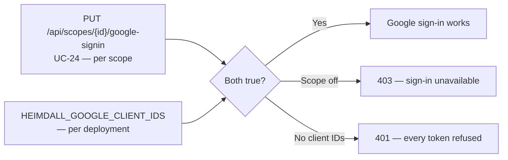
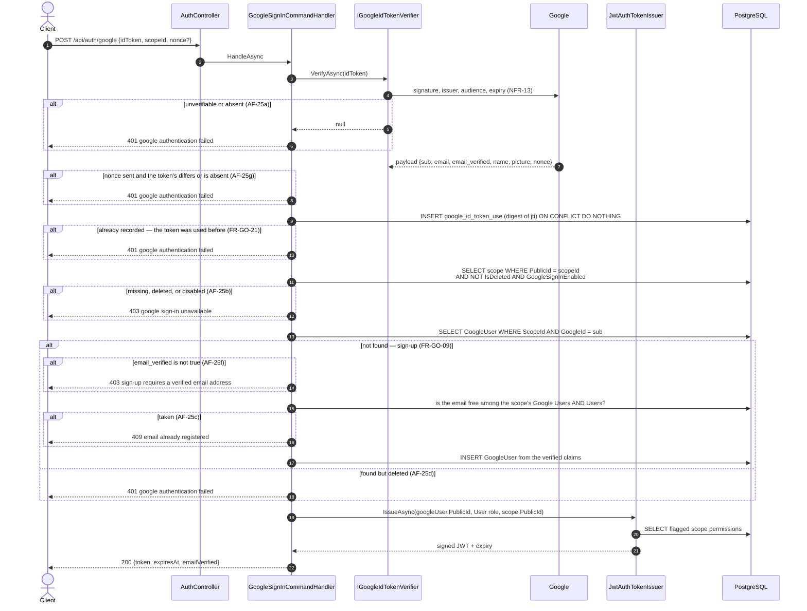

+++
title = 'Google Sign-In'
linkTitle = 'Google Sign-In'
weight = 30
description = 'UC-24 to UC-29 — enabling the feature per scope, sign-up and sign-in down one endpoint, and administering Google Users.'
+++

Google Sign-In is **off by default** and enabled per scope. A Google identity is always
`User`-equivalent — it can never create or authenticate a Scope Admin or System Admin, whatever the
Google account is (**FR-GO-04**).

## Enabling it — two independent switches

With no client IDs configured, the API registers a verifier that **refuses every token** and warns
once at start-up. This is not a convenience fallback: verification needs an audience to check against
(**NFR-13**), and a verifier with no configured client could only reject everything or trust
everything — so it rejects. Every other endpoint keeps working.

## Sign-up and sign-in — UC-25

One endpoint, `POST /api/auth/google`, does both. The first call for a given Google account in a
given scope creates the Google User; every later one authenticates it.

**Verification comes first, before the scope is even read.** An unverified caller learns nothing
about which scopes exist. It is also what answers a request that omitted the token entirely — which
is why UC-25 needs no 400 flow at all.

**A token is accepted once** (**FR-GO-21**). Once it has been verified, and before the scope is
read, its use is recorded under the SHA-256 digest of its `jti` claim — or, when it carries none, of
its signed part, the `header.payload` its signature covers, so that a respelling of the signature
segment is still the same token — by one `INSERT … ON CONFLICT DO NOTHING`. A token already recorded
answers exactly as an invalid one, `401` "Google authentication failed.", and nothing is created; of
two requests presenting one token at the same moment, one is refused. The token is spent from that
moment, even when the request then fails — the scope unavailable (AF-25b), an address conflict
(AF-25c), a deleted account (AF-25d), an unverified address (AF-25f), or a server error — so a retry
with the same token answers `401` too. Clients must therefore ask Google for a new ID token for every
attempt of every call that takes one, including an erasure request's proof of presence. The records
are purged with the single-use tokens once the token has expired and the grace period has passed.

**AF-25b answers alike for three different situations** — the scope is missing, logically deleted, or
has the feature switched off. The alternative flow names all three as one outcome, so one filter
answers for all three.

**A nonce binds the token to the client's own sign-in attempt** (**FR-GO-20**). `nonce` is optional: a
client that sent one to Google when asking for the ID token sends the same value here, and the
token's `nonce` claim must equal it exactly; a token with another nonce, or none, answers as an
unverifiable token does. The nonce is a client-side check that the token it presents was issued for
its own sign-in request; whether a token is accepted rests on its signature, issuer, audience and
expiry (NFR-13), and on its not having been used before (FR-GO-21). A request without `nonce`
compares nothing, as before.

**Only an address Google vouches for can sign up** (**FR-GO-07**, AF-25f). A first sign-in whose
token does not carry `email_verified: true` — false, or absent — creates nothing and answers `403`
"Google sign-up requires a verified email address.". This is checked before the address is compared
with the scope's. A Google User that already exists signs in whatever the claim says; FR-GO-19 keeps
its stored flag current.

**AF-25c is named separately, on purpose.** Being told the address is already registered reveals
something — but the caller has proved to Google that the address is theirs, and Google vouches for
it, so it tells them only about themselves. Uniqueness is checked jointly against the scope's Google
Users **and** its password Users.

## Signing out — UC-26

`POST /api/auth/google/sign-out` ends the client's session and nothing else. Heimdall keeps no
Google session, and its tokens are stateless signed JWTs with an expiry, so there is nothing to
revoke: a copy of the token kept elsewhere stays valid until it expires (**FR-GO-18**). What the
endpoint does is *check* — it confirms the token still names a live Google User and then answers the
success that tells the client to drop the token.

That check is the substance. Authentication reads no database per request, so a token outlives the
account it names; one naming a deleted or unknown Google User is refused here.

## Administering Google Users — UC-27 to UC-29

All four endpoints are nested under the scope the Google User belongs to (**FR-GO-06**), and each
refuses a Google User reached through the wrong scope.

| Endpoint | Use case | Who |
| --- | --- | --- |
| `GET /api/scopes/{scopeId}/google-users` | UC-27 | System Admin, or an owner of the scope |
| `GET /api/scopes/{scopeId}/google-users/{id}` | UC-27 | The above, **or the Google User themselves** |
| `DELETE /api/scopes/{scopeId}/google-users/{id}` | UC-28 | System Admin, or an owner of the scope |
| `DELETE /api/scopes/{scopeId}/google-users/{id}/hard` | UC-29 | System Admin only |

The by-id read is the one that admits a Google User, and it is why that endpoint carries no
`[RoleRequirement]`: a Google User's token is `User`-role, so anything strong enough to keep other
Users out would lock out the actor UC-27 grants. The listing admits none of them.

The logical delete is **idempotent** — repeating it answers 200 with `alreadyDeleted: true` and
writes nothing — and it is honoured everywhere it matters: a deleted account cannot sign in, cannot
sign out, and is absent from reads unless `includeDeleted=true`. The hard delete has no idempotent
path; a second call is a 404. Neither cascades, because a Google User owns nothing.

## Testing without Google

A third verifier exists for the functional suite, which cannot override a DI registration and must
still reach the flows behind verification. It is guarded twice — never in Production, and never
without an explicitly set signing secret — and is checked *before* the real verifier so a test
environment cannot accidentally run both.
