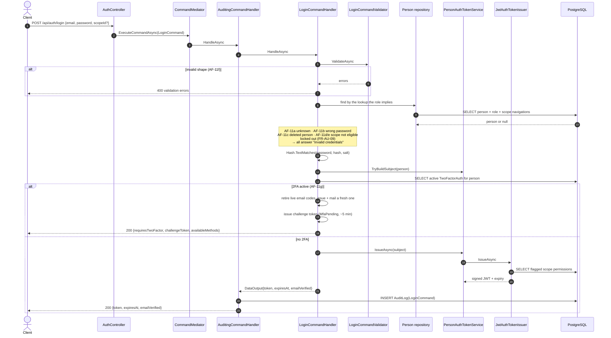
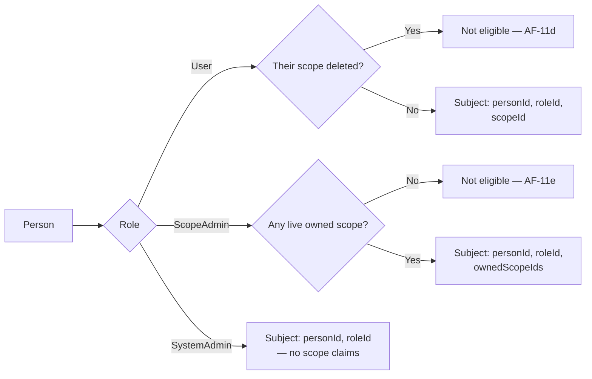

+++
title = 'Login'
linkTitle = 'Login'
weight = 10
description = 'UC-11 — password authentication, the uniform rejection, and the branch into a two-factor challenge.'
+++

`POST /api/auth/login` — anonymous, rate-limited.

## The sequence

## Which lookup, and why

`Person` has no scope column, so *how* the person is found depends on the role being sought:

| Role | Found by |
| --- | --- |
| `User` | Email **within the scope named by the request** — the same address may exist as a User in several scopes. |
| `ScopeAdmin` / `SystemAdmin` | Email alone — those addresses are unique system-wide. |

The lookup deliberately omits an `!IsDeleted` filter. AF-11c exists to *reject* a logically deleted
person, so the person has to be found before they can be rejected.

## One answer for five causes

AF-11a (unknown email), AF-11b (wrong password), AF-11c (deleted person), AF-11d (a `User` whose
scope is logically deleted) and AF-11e (a `ScopeAdmin` with no live owned scope) all return the same
`invalid credentials` error.

The checks still run in the specification's order, so the code reads against UC-11 line by line —
only the *answer* is uniform. An anonymous endpoint that distinguished them would be a directory of
which addresses are registered and which accounts still exist.

**The answer has to be uniform in time as well as in text.** AF-11a used to return without hashing
anything, since there was no stored hash to compare against — so "no such account" came back in
single-digit milliseconds while every other rejection paid a full Argon2id verification (600 MB / 16
threads) and took hundreds. That gap answered the question the shared message refuses, and varying
the scope id turned it into a per-scope directory. The handler now verifies the submitted password
against a decoy hash — of a random secret generated once per process, belonging to nobody — and
discards the result. A lockout takes the same path, so it is not detectable either.

**The lockout counts attempts as they start, not as they fail.** Each attempt reserves itself in
`failed_login_attempts` — one conditional `UPDATE`, refused once the account is locked or ten
attempts are already counted — before the password is derived; a wrong password leaves the
reservation standing, a right one clears the count. The attempt that reaches ten also sets
`locked_out_until` and resets the count in that same `UPDATE`, so a sign-in cut short at the limit
still locks the account for the usual fifteen minutes, and it unlocks by itself. A right password on
the tenth attempt still signs in and clears the lock. Counting after the derivation let ten
simultaneous wrong passwords all read a count of zero and all write one, so the account never locked
(FR-AU-09).

## Scope eligibility

`PersonAuthTokenService.TryBuildSubject` is the single place the eligibility rules live, shared with
[two-factor verification](../two-factor/) so a gated login ends exactly like a direct one:

## What the token carries

Claims are written by `IdentityUserMapper`, the same class that reads them back on validation:

| Claim | Present for |
| --- | --- |
| `id` | Everyone — the person's `PublicId` |
| `roleId` | Everyone |
| `scopeId` | `User` only |
| `ownedScopeIds` | `ScopeAdmin` only, comma-separated |
| `scopePermissions` | Anyone acting within a scope that has flagged permissions ([details](../scope-permission-claims/)) |
| `mfaPending` | **Challenge tokens only** |
| `subjectRightsOnly` | **Subject-rights-only tokens only** — a restricted identity's (**NFR-24**) |
| `sst` | Every **person** token — full, challenge and subject-rights-only — the person's security stamp (**FR-AU-11**). Not on a Google User's token |

The claims are omitted rather than emitted empty, so a token never suggests a scope association the
person does not have. Every value is a `PublicId` — an internal id never reaches a token (**NFR-15**),
except `sst`, a random value that means nothing outside Heimdall.

### Revocation: when a token stops working

A person token is refused, with `401` and "This token has been revoked. Sign in again.", from the
first request after any of these, whoever made the change and whichever token made it:

| Event | Use case |
| --- | --- |
| Password reset | UC-13 |
| Email change, by the person or an administrator | UC-08 |
| Two-factor authentication confirmed | UC-37 |
| Two-factor authentication disabled | UC-39 |
| Recovery codes regenerated | UC-40 |

Each replaces the person's security stamp, and `ActorLivenessFilter`, which already reads the
person's row on every request, refuses a token whose `sst` is missing or no longer matches. The
request that made the change still succeeds, but its token is revoked with the rest, so a client
signs in again after it. A token issued before this mechanism existed carries no `sst` and is refused
the same way. A 2FA challenge token outdated by such a change is refused at
`POST /api/auth/2fa/verify` as an invalid challenge.

Consumers validating person tokens offline do not see a revocation: they still accept the token
until it expires. Heimdall itself refuses it.

### Audiences: what a consumer must pin

Heimdall issues three kinds of person token, signed with the same keys under the same issuer. Only
the full token is a sign-in, and the audience says which kind a token is:

| Token | `aud` |
| --- | --- |
| Full authentication token | `HEIMDALL_AUTH_TOKEN_AUDIENCE`, exactly as configured |
| 2FA challenge token (carries `mfaPending`) | `HEIMDALL_AUTH_TOKEN_AUDIENCE` + `.2fa-challenge` |
| Subject-rights-only token (carries `subjectRightsOnly`) | `HEIMDALL_AUTH_TOKEN_AUDIENCE` + `.subject-rights` |

With `HEIMDALL_AUTH_TOKEN_AUDIENCE=heimdall`, those are `heimdall`, `heimdall.2fa-challenge` and
`heimdall.subject-rights`. The two derived audiences need no configuration of their own, and start-up
logs all three.

> **A consumer that accepts person tokens must validate the audience, pinned to
> `HEIMDALL_AUTH_TOKEN_AUDIENCE` exactly.** It then refuses challenge tokens, subject-rights-only
> tokens and [application tokens](../application-authentication/) with no knowledge of Heimdall's
> claims. A consumer that skips the audience check would take a challenge token, which a password
> alone obtains, for a full sign-in. Set `HEIMDALL_AUTH_TOKEN_AUDIENCE` (it defaults to empty), so
> there is an audience to pin.

Inside Heimdall every bearer token must name `HEIMDALL_AUTH_TOKEN_ISSUER` as its issuer and exactly
one of these three audiences (NFR-30); anything else is refused with `401` "Invalid token", as a bad
signature is. `IdentityUserMapper` then holds each token to its own audience: it maps a token only
when its audience and its `mfaPending` and `subjectRightsOnly` claims agree, and refuses one that
carries either claim under the wrong audience or one of the derived audiences without its claim.

## The 2FA branch

When the person has an **active** two-factor configuration, login does not return an authentication
token at all. It returns a short-lived **challenge token** carrying `mfaPending` under its own
[audience](#audiences-what-a-consumer-must-pin). Only `POST /api/auth/2fa/verify` and the email-code
resend accept it, as a body field; `MfaPendingGuardFilter` rejects it as a bearer token everywhere,
and a consumer pinning the person audience refuses it.

If the Email method is enabled, login retires every live email code for that configuration and mails
a fresh one first — so only the code mailed *for this attempt* can complete it.

Continue at [Two-factor authentication](../two-factor/).
