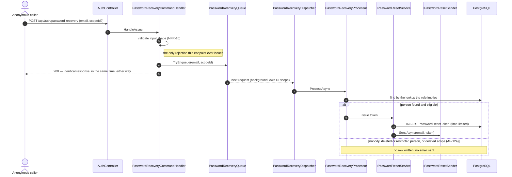
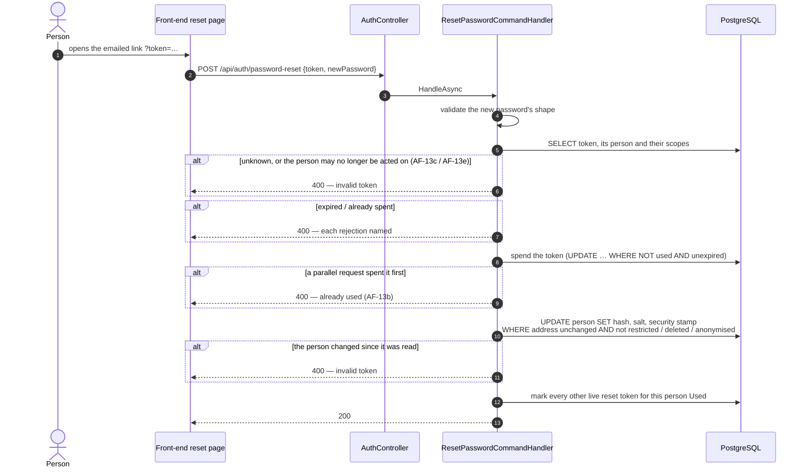

+++
title = 'Password recovery'
linkTitle = 'Password recovery'
weight = 50
description = 'UC-12 and UC-13 — an endpoint whose whole design is about what it must not reveal.'
+++

Two anonymous, rate-limited endpoints: one asks for a link, the other spends it.

## Requesting a link — UC-12

**Every path returns the same success output.** AF-12a — the address belongs to nobody — is not an
error flow but the *absence* of one: the handler issues no token and answers exactly as it would
have. A logically deleted person, and a `User` whose scope is deleted, are treated the same way.

The only thing that distinguishes the two paths is a row that does not get written and an email that
consequently never arrives — neither of which is visible to the caller.

**The same answer, in the same time.** While the lookup, the token insert and the Mailgun call ran on
the request, a registered address answered a Mailgun round trip later than an unknown one — a timing
difference that answered exactly what the uniform response refuses. So the handler only validates and
queues; everything that depends on the address happens afterwards, in `PasswordRecoveryProcessor`,
run by a hosted service in a DI scope of its own (never the finished request's). The queue is in
memory and bounded: a durable outbox would keep every address anybody typed, registered or not, and
a response-time floor would have to outlast Mailgun's slowest send. The cost is that a restart drops
whatever is still queued, which a person who receives nothing simply asks for again.

{}
A Mailgun failure here is **logged, never surfaced**. If a delivery error turned into a 500, the
difference between "your guess was a real account" and "it wasn't" would be an HTTP status code.
{}

### An administrator sending the link — UC-52

`POST /api/persons/{id}/password-reset` lets a System Admin, or the owner of a User's scope, have the
link mailed to the person's own address. Eligibility is UC-12's, from the same code — but because the
caller is authenticated, a refusal is reported instead of hidden: 409 for a deleted or restricted
person, or one whose account could not sign in. The send is not queued, since there is no anonymous
caller to protect from a timing difference. The same per-person cooldown as UC-51 applies (429), and is best-effort: simultaneous requests for
the same person can both pass it.

## Setting the new password — UC-13

Both endpoints are **anonymous** because someone arriving from a link in their mail client holds no
token of any other kind.

Spending a reset token retires every other live reset token the person holds. A second "forgot
password" click cannot be replayed after the first has already changed the password.

**The account is checked again when the link is followed** (**FR-PR-08**). A link lives for an hour,
and the person may be restricted, deleted or anonymised, or lose the scope they sign in through,
while it waits in a mailbox. UC-12's rule is run again, and a person it no longer admits gets exactly
the unknown-token answer, `400` "Invalid token.", with nothing written — the token stays as it was,
and a restricted record is preserved. The password itself is written by one conditional `UPDATE`,
together with a fresh security stamp that revokes every earlier session, which repeats those checks
and requires the address the person was read with. After the row is created nothing else writes the
password columns, so an edit saved from an older copy of the person cannot put the old password back.

**An email change retires the links** (**FR-PE-17**). Whoever changes a person's address, every live
reset and verification link they hold is retired, before the new address is saved and again straight
after.
Following one afterwards answers `400` "Token already used.".

## Why login costs what it costs

Password verification is Argon2id — by this codebase's hashing library defaults, 600 MB and 16
threads per verification. That is deliberate for a stored credential, and it is also precisely why
these endpoints are rate-limited: an unthrottled burst against `/login` is a memory and CPU
exhaustion vector before it is a brute-force one. See
[Operations](../../operations/#rate-limiting).
