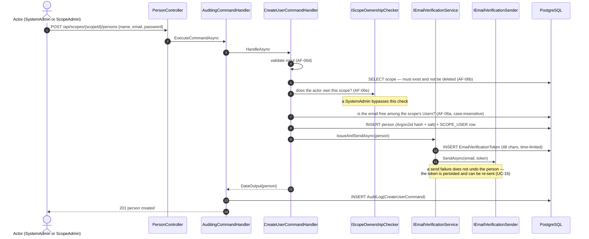
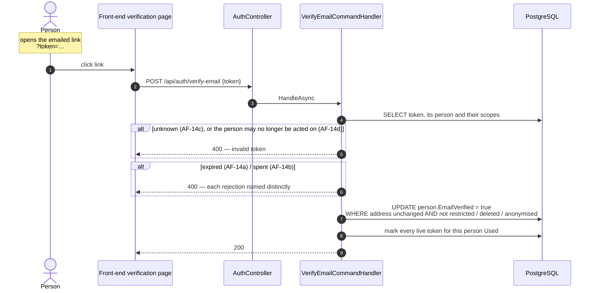
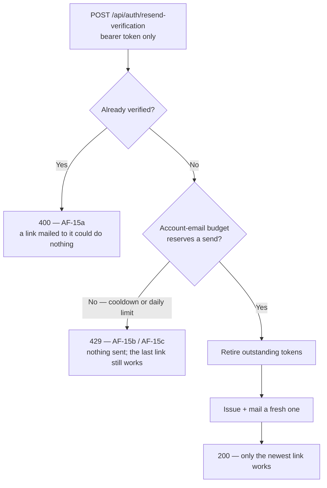
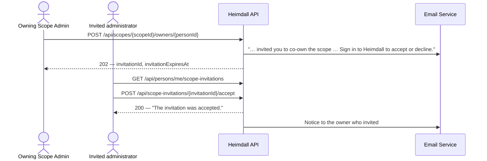

+++
title = 'Person onboarding'
linkTitle = 'Person onboarding'
weight = 40
description = 'UC-06, UC-14, UC-15 and UC-21 — creating a person, the verification email, replacing a lost link, and inviting a co-owner.'
+++

Creating a person is one use case (UC-06) with **three paths**, decided by which endpoint is called
rather than by a field in the body.

| Endpoint | Path | Creates |
| --- | --- | --- |
| `POST /api/persons` | b | A `ScopeAdmin` or `SystemAdmin` with no scope |
| `POST /api/scopes/{scopeId}/persons` | a | A `User` in that scope, with a `SCOPE_USER` row |
| `POST /api/scopes/{scopeId}/owners` | c | A brand-new `ScopeAdmin` directly as a co-owner, with a `SCOPE_OWNER` row |

## Creating a User — UC-06 path a

Email uniqueness is scoped to the role: a `User`'s address must be unique **within their scope**
(compared case-insensitively, `LOWER()` in SQL), while a `ScopeAdmin`'s or `SystemAdmin`'s is unique
system-wide. The same address can therefore be a User in several different scopes — which is exactly
why login needs a scope identifier to find a User.

## Verifying the address — UC-14

The endpoint is **anonymous** — someone arriving from a link in their mail client holds no token of
any other kind.

Spending a token retires every other live token the person holds of that kind, so a verification link
left in an inbox stops working once the address is verified. An address that was **already** verified
answers 200 rather than an error: UC-14 defines no alternative flow for it, and the caller's intent
has been satisfied either way. A person restricted, deleted or anonymised since the link was mailed,
or who can no longer sign in through their scope, gets `400` "Invalid token." and nothing is written
(**FR-EV-08**), as UC-13 answers them.

## Replacing a lost link — UC-15

`POST /api/auth/resend-verification` is **authenticated and takes no body**. The person is read from
the bearer token, so a caller can only ever ask for their own link.

Note the asymmetry with UC-14: verifying an already-verified address answers **200**, but *resending*
to one answers **400**. Verification's job is done either way; a resend would mail a link that could
do nothing when clicked.

A resend is charged to the person's account-email budget (FR-PE-16), which it shares with a
two-factor setup code and the notice an own email change sends: one per
`HEIMDALL_ADMIN_EMAIL_COOLDOWN_IN_SECONDS` (five minutes by default) and five per day-long window from the first, reserved by one
write before anything is sent. Inside the cooldown the answer is **429** "An email of this kind was
sent to you recently. Try again in a few minutes." (AF-15b); once the window's five are spent, **429** "You have
reached the limit for account emails. Try again later." (AF-15c). Both carry `Retry-After`, the
seconds until a send would be accepted. Nothing is sent or retired
either way. A link an administrator sent, at creation or through UC-51, is not charged, so the
person may still ask once straight after. The endpoint is under the credential endpoints' rate limit
too, whose own 429 says "Too many requests." and carries a `Retry-After` header.

### An administrator resending it — UC-51

A System Admin, or the owner of a User's scope, can ask for the link on the person's behalf with
`POST /api/persons/{id}/verification-email`. It is UC-15's send — live links retired, a new one mailed
to the person's own address — refused for a deleted or restricted person (409) or a verified address
(400). At most one such email goes to a person per `HEIMDALL_ADMIN_EMAIL_COOLDOWN_IN_SECONDS` (five
minutes by default), counting any verification email sent to the person in the window, including
the one sent when the account was created; a request inside the window answers 429 and sends
nothing. The check is best-effort: simultaneous requests for the same person can both pass it.

## Making an existing administrator a co-owner — UC-21

`POST /api/scopes/{scopeId}/owners/{personId}` takes an existing `ScopeAdmin` or `SystemAdmin`, and what
it does depends on who asks:

| Caller | Answer | Effect |
| --- | --- | --- |
| System Admin | `201` (`200` if they already own it) | A `SCOPE_OWNER` row at once — how onboarding makes a new Scope Admin an owner |
| Owning Scope Admin | `202` "The invitation was sent." | An invitation, valid for `HEIMDALL_SCOPE_INVITATION_LIFETIME_IN_SECONDS` (seven days by default); the person owns nothing yet |

The notice carries no link and no token: accepting is something the person does signed in as
themselves, so the mail holds nothing worth intercepting or forwarding. A repeat while the invitation
is open answers the same `202` and sends nothing, and a new invitation to someone invited within
`HEIMDALL_ADMIN_EMAIL_COOLDOWN_IN_SECONDS`, or to someone whose processing is restricted, is opened
without a notice. The inviter's notice of an answer goes only to an inviter who can still be mailed: not
deleted, anonymised or processing-restricted. Owners list and withdraw open invitations at
`/api/scopes/{scopeId}/owner-invitations`; the person may decline instead (`…/decline`). Accepting
answers `404` "The invitation was not found or is no longer open." when the invitation was withdrawn,
answered or expired — and voids it when the scope was deleted or the person is no longer an
unrestricted administrator. Erasing a person voids the invitations made to them and clears them as
inviter; an ended invitation is purged 90 days after it ended, an unanswered one 90 days after it
expired.

## Without mail credentials

With Mailgun unconfigured, the API registers logging senders instead: each token is **written to the
log** rather than emailed, with a single warning at start-up. That keeps local runs and the functional
suite working without credentials and off the network.

It is a supported mode, not a broken one — outside Production. An unconfigured **Production**
deployment refuses to start outright, because the fallback would print verification tokens, password
reset tokens, and 2FA codes in plaintext to the logs, which is an account-takeover primitive for
anyone who can read them.

Both emails carry a link built from `HEIMDALL_EMAIL_VERIFICATION_URL` /
`HEIMDALL_PASSWORD_RESET_URL`, with the token appended as a `token` query parameter. If no link is
configured the email carries the bare token instead, which still works — the link is only a
convenience wrapper around it.

A scope may override both links for its own `User`s (`PUT /api/scopes/{id}/email-links`), so a
client system's users are sent to that system's screens; administrators, and a scope with no link
set, use the global ones.
