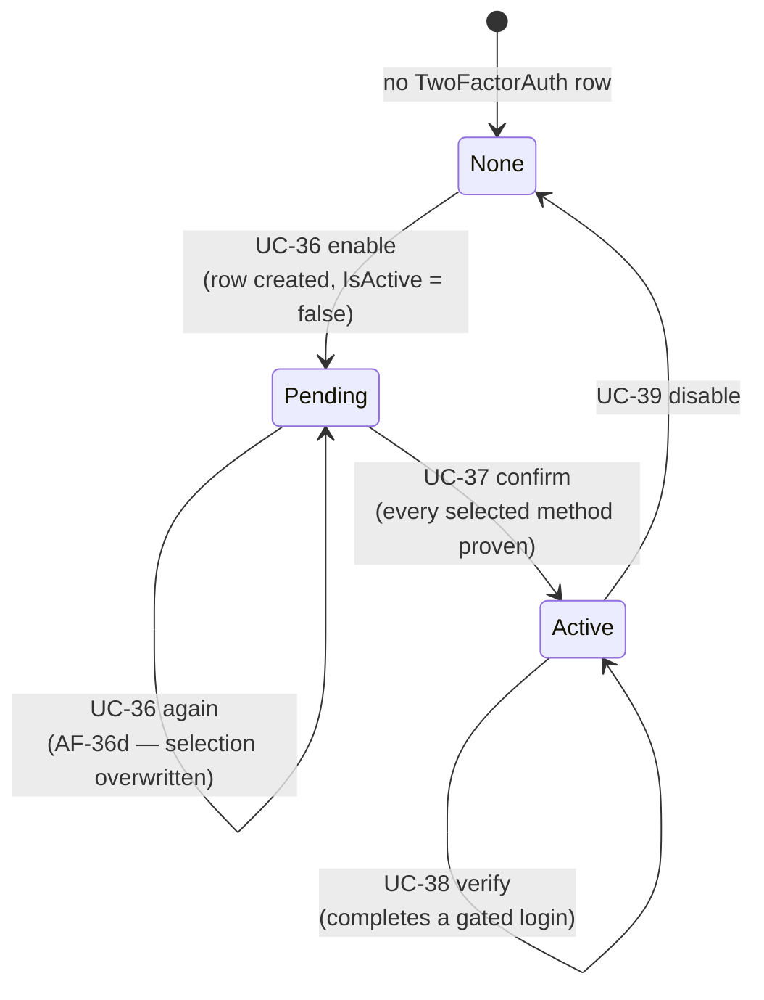
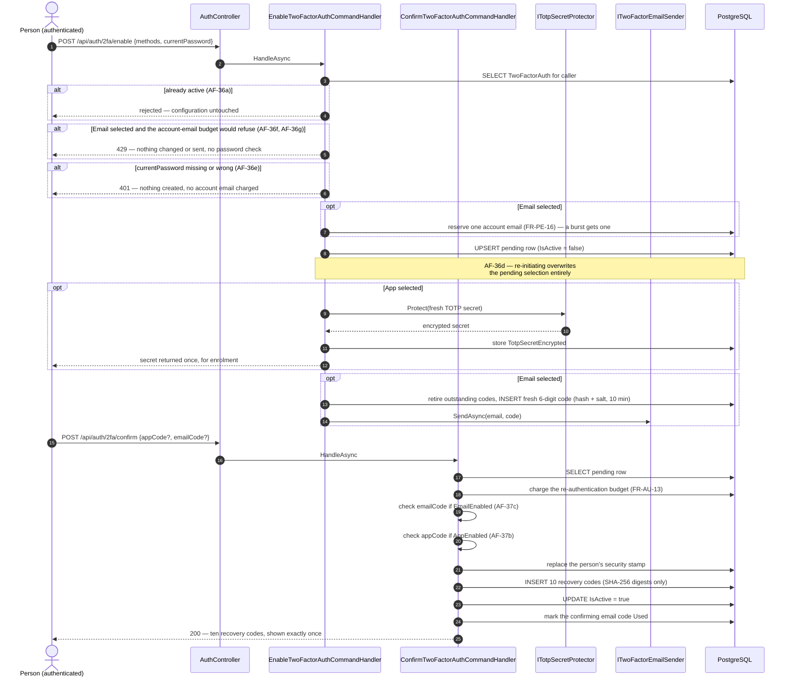
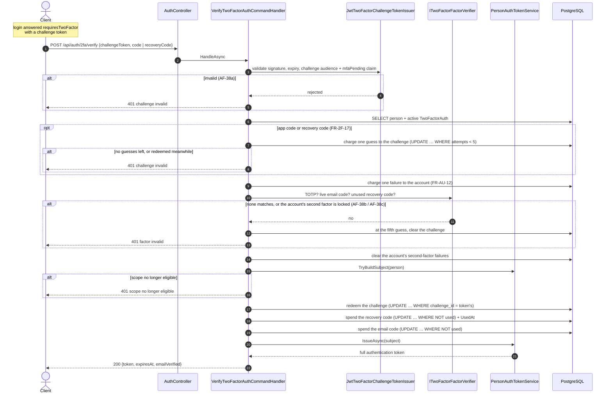

+++
title = 'Two-factor authentication'
linkTitle = 'Two-factor'
weight = 20
description = 'UC-36 to UC-40 — setup, confirmation, the challenge-token round trip, and recovery codes.'
+++

Two-factor authentication is opt-in, per person, and available to `User`, `ScopeAdmin`, and
`SystemAdmin` alike. It is **not** available to Google Users, who are already subject to Google's own
account security.

Every 2FA endpoint acts on the caller themselves — the person comes from the bearer token, never from
a path or body — so no caller can reach another person's configuration.

## The lifecycle

## Setup — UC-36 and UC-37

**Recovery codes are 80 bits** (**FR-2F-20**): ten random bytes written as sixteen characters of
Crockford's base32 — the digits and the uppercase letters without I, L, O and U — and shown as
`XXXX-XXXX-XXXX-XXXX`. A code is accepted with or without its hyphens, with spaces, and in any case,
and an O, I or L typed in one reads as 0, 1 and 1. Codes of the shorter `XXXX-XXXX` shape issued
before keep working until they are used or regenerated; regenerating (UC-40) is how a person gets
the stronger ones.

**Enabling needs the password** (**FR-2F-18**): adding a second factor requires proof of identity,
as removing one does, and a bearer token alone is not that proof. **Confirming
revokes every token** the person holds, the confirming one included (**FR-AU-11**): the client keeps
the recovery codes, then signs in again, now through UC-38.

`IsActive` is what separates a *confirmed* configuration from one still pending. A row with
`IsActive = false` means UC-36 created it and UC-37 has not yet activated it — and only an active
configuration gates a login.

**Confirmation's writes are one transaction.** Spending the email code, replacing the security stamp,
storing the recovery codes and activating the configuration land together or not at all (#209): a
failure among them keeps none of it, so the same email code can be presented again and no session is
revoked for a confirmation that reported failure. The half-write that matters most — "two-factor is
active but the caller holds no recovery codes", which locks someone out of their own account — cannot
happen. An app code the request accepted stays spent; the caller presents the next one. UC-40 orders
its writes for the same reason, creating the replacements before deleting the set they replace, so a
failure leaves the caller with the codes they already hold rather than none at all.

Confirmation requires proof of **every** method selected at setup: an `appCode` if `AppEnabled`, an
`emailCode` if `EmailEnabled`, both if both. A missing or wrong code answers `401` "The password or
code is incorrect.", whichever it was, and is charged to the re-authentication budget below. The email
code is checked first, because an accepted app code is spent: a wrong email code leaves the app code usable
for the retry.

## Completing a gated login — UC-38

Three details in that diagram carry real weight:

**AF-38b and AF-38c answer identically.** A wrong code and an already-used recovery code both return
`factor invalid`, 401 — the same reasoning that collapses UC-11's five rejections into one.

**Scope ineligibility gets its own message.** If the challenge token and the second factor were both
valid but the person's scope eligibility no longer holds, the answer is
`scope no longer eligible`, not `challenge invalid`. Collapsing that case would misdescribe what
actually happened — nothing the caller supplied was wrong.

**Nothing can be replayed.** The redeemed recovery code and the redeemed email code are both marked
used before the token is issued. An app code is single-use too, though it has no row to mark: the
time step it was accepted at is recorded on `TWO_FACTOR_AUTH.last_totp_time_step_used`, and a code
from that step or earlier is refused (**RFC 6238 §5.2**). Without it the ±1-step tolerance meant an
observed code stayed usable for up to ninety seconds, across verify, disable, and regenerate alike.

**A wrong email code costs the code.** Five wrong guesses retire it (`failed_attempts`), so the
million values a six-digit code can take are not a million attempts — guessing again costs a fresh
login, which is rate limited and mails the account holder a code they did not ask for.

**A challenge allows five guesses with an app code or a recovery code** (**FR-2F-17**). Neither has a
row of its own to count on, so they are counted on the challenge (`challenge_attempts`), and at five
the challenge is cleared: its token is refused as AF-38a from then on, and further guessing costs a
fresh password check. A login resets the count with the challenge.

**The account allows ten failures, whatever the challenge** (**FR-AU-12**). Every guess — app code,
email code or recovery code — is also counted on the person, and neither a new challenge nor a
correct password resets that count; only a second factor that checks out does. The tenth failure
locks second-factor verification for fifteen minutes, twice as long at each repeat, up to a day.
While it is locked every code is refused, the right one included, with the same `factor invalid`
answer, and the challenge's own five still run out as usual — so the lock does not show.

**All of it holds when requests arrive together.** Redeeming the challenge, spending a code,
accepting a TOTP step and charging a guess are each one conditional `UPDATE` (`IAtomicWrites`), and
every guess is charged *before* it is compared. Of any number of simultaneous requests carrying the
same challenge or the same code, exactly one gets a token; a parallel burst of guesses gets exactly
the budget compared, no more.

The final token is issued by `PersonAuthTokenService` — the same service a direct login uses — so a
2FA-gated login ends with exactly the token a direct one would have produced.

## Why the guard filter never fires here

`MfaPendingGuardFilter` runs on every controller action and rejects any identity carrying
`MfaPending`. It never trips on `POST /api/auth/2fa/verify` because that endpoint is
`[AllowAnonymous]` and reads the challenge token as a **body field**, not as an
`Authorization: Bearer` credential — so the pipeline never attaches an MFA-pending identity for that
call. The filter only ever fires when a challenge token is misused as a bearer token somewhere
else — exactly the case **FR-2F-10** wants blocked.

## Disable and regenerate — UC-39 and UC-40

Both require a valid second factor as well as authentication, and both reuse
`ITwoFactorFactorVerifier`, so "match against TOTP, or the current email code, or an unused recovery
code" is implemented in exactly one place.

**Every check under a bearer token shares one budget and one answer** (**FR-AU-13**). Enabling,
confirming and disabling two-factor authentication, regenerating recovery codes, an own email change
and a person's erasure request are each charged to the account's re-authentication budget before
anything is compared: five failures within fifteen minutes pause them for fifteen minutes. A wrong or
missing password, a wrong, missing or used code, and a pause all answer `401` "The password or code
is incorrect." — so disabling never says which of its two credentials was wrong. The budget is kept
apart from the login lockout and the second-factor budget, so a stolen token cannot be used to lock
its owner out of signing in.

| | UC-39 disable | UC-40 regenerate |
| --- | --- | --- |
| Requires | Bearer token + second factor | Bearer token + second factor |
| Effect | Removes the configuration | Replaces all ten recovery codes |
| Response | Confirmation | The ten new codes, shown once |
| Afterwards | Every token revoked, the caller's included: sign in again | Every token revoked, the caller's included: keep the codes, then sign in again |

## Storage of secrets

| | Stored as | Returned |
| --- | --- | --- |
| TOTP secret | Encrypted at rest via ASP.NET Core Data Protection | Once, at provisioning |
| Recovery codes | SHA-256 only — 80 random bits need no per-code salt or slow hash (FR-2F-20) | Once, when generated |
| Email codes | Hash **+ per-code salt** — only 10⁶ possible values | Never; mailed |

That is **NFR-16**. See [Domain model](../../domain-model/#secrets-at-rest).
