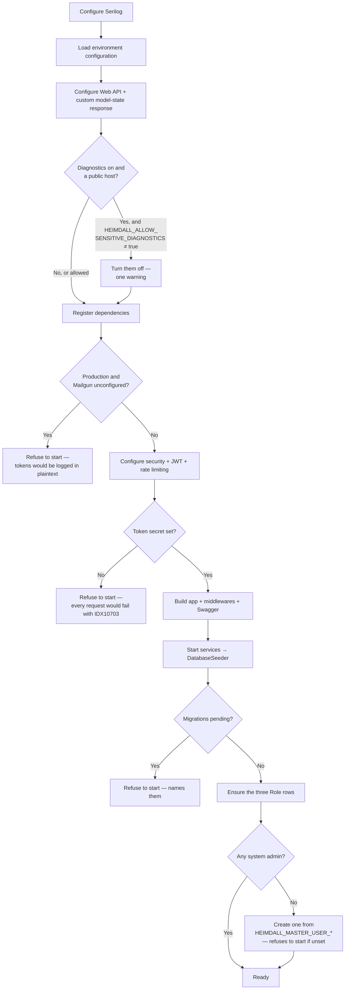

+++
title = 'Operations'
linkTitle = 'Operations'
weight = 80
description = 'Migrations, start-up guards, health checks, metrics, logging, rate limiting, data retention, and the integrations.'
+++

## Migrations

The schema is managed with **EF Core migrations, applied explicitly**:

```bash
python scripts/migrations.py
```

The script asks which environment file to load (for the connection string), then offers **list**,
**create (generate)**, and **apply**. It needs `dotnet tool restore` to have been run once, for the
pinned EF Core CLI tool. Authoring a migration is covered in [Contributing](../contributing/#migrations).

**The API never migrates on startup, and refuses to start when migrations are pending.** The seeder
checks `GetPendingMigrationsAsync` first and throws with the missing migration names:

```
The database is missing 2 migration(s): 20260811_AddAuditLog, 20260812_AddTwoFactorEmailCode.
Apply them with scripts/migrations.py before starting the API.
```

Automatic migration on startup is convenient exactly until two instances start at once, or until a
deployment silently applies a migration nobody reviewed. An explicit step makes schema change a
decision rather than a side effect.

### Shared public ids — before `ProtectIdentityPublicIds` (#199)

`ProtectIdentityPublicIds` and `ProtectEntityPublicIds` make `public_id` immutable on `person`,
`google_user`, `scope`, `application`, `application_credential`, `scope_permission`, `role` and
`pending_registration`, refuse a new row whose `public_id` another of those tables holds or a hard
delete tombstoned, and refuse a new person or Google User whose id an audit entry names. They guard
future writes only and do not look at what is already stored. The API only ever issues fresh random
ids, so a duplicate can exist only if somebody wrote one by hand in SQL. To check for a hand-made
duplicate, run both queries before migrating; each should return no rows.

```sql
-- 1. Any public_id that rows of two or more guarded tables hold.
WITH ids (tbl, public_id) AS (
    SELECT 'person', public_id FROM heimdall.person
    UNION ALL SELECT 'google_user', public_id FROM heimdall.google_user
    UNION ALL SELECT 'scope', public_id FROM heimdall.scope
    UNION ALL SELECT 'application', public_id FROM heimdall.application
    UNION ALL SELECT 'application_credential', public_id FROM heimdall.application_credential
    UNION ALL SELECT 'scope_permission', public_id FROM heimdall.scope_permission
    UNION ALL SELECT 'role', public_id FROM heimdall.role
    UNION ALL SELECT 'pending_registration', public_id FROM heimdall.pending_registration
)
SELECT public_id, string_agg(tbl, ', ' ORDER BY tbl) AS held_by
FROM ids
GROUP BY public_id
HAVING count(*) > 1;

-- 2. Any person or Google User whose id audit entries named before the identity existed, so those
--    entries were about something else. The minute absorbs clock skew between the API and the database.
SELECT 'person' AS tbl, p.public_id, count(*) AS earlier_entries
FROM heimdall.person p
JOIN heimdall.audit_log a ON a.target_id = p.public_id
WHERE a.created_at < p.created_at - interval '1 minute'
GROUP BY p.public_id
UNION ALL
SELECT 'google_user', g.public_id, count(*)
FROM heimdall.google_user g
JOIN heimdall.audit_log a ON a.target_id = g.public_id
WHERE a.created_at < g.created_at - interval '1 minute'
GROUP BY g.public_id;
```

A row from either query is worth investigating before anything else: it is either a hand-made fix-up
or somebody preparing to make audit entries clearable. No rows proves less than it seems. Query 1
sees only rows that are there now. Query 2 trusts `created_at`, which an insert can set, so a
backdated plant passes it. Neither sees a plant that has already run its course — target cleared,
identity tombstoned and deleted — or a scope or other entity sitting on an id that `erased_subject`
records. Once migrated, hand-written SQL that rewrites a `public_id` — a support fix-up, or a
restore that remaps ids — fails with `restrict_violation`.

## Database roles — TH-18

The supported setup runs the migrations as an owner role and the API as a role that owns nothing
(NFR-29). The owner holds the schema and everything in it, including the audit triggers and their
functions; the API's role gets the row privileges it needs and nothing more. Two roles per
environment, which the operator creates and applies:

| Role | Example | Owns | Used by |
| --- | --- | --- | --- |
| Owner | `heimdall_owner` | The database, the `heimdall` schema, every table, sequence and trigger function, and the migrations history | Migrations only: the container entrypoint through `HEIMDALL_MIGRATIONS_CONNECTIONSTRING`, or `scripts/migrations.py` run out of band |
| Runtime | `heimdall_svc` | Nothing | The API, through `HEIMDALL_DATA_CONNECTIONSTRING` (`DB_USER` in the env file) |

The runtime role may connect, read and write rows, and nothing else: `SELECT`, `INSERT`, `UPDATE`
and `DELETE` on the `heimdall` tables, except that `audit_log` gets no `DELETE`; `SELECT` on the
migrations history, which the start-up seeder reads; no `TRUNCATE` anywhere and no `CREATE` on the
database or a schema. `audit_log` keeps `UPDATE` because the retention pass writes the rows it
clears whole; the triggers accept an update only when it clears the attribution or a person target
once due (NFR-21). That covers everything the API does at runtime, `attempt_notice_budget`,
`google_id_token_use` and the budget columns on `person` included.

Use one pair per environment, as the deployment guide does for logins: `heimdall_owner` and
`heimdall_svc` for production, `heimdall_development_owner` and `heimdall_development_svc`, and so on.
The SQL below is for production; substitute the names for another environment.

### The grants

Run as a superuser (`sudo -u postgres psql -d heimdall`). Part 1 can run at any time, before the
first migration too; part 2 needs the `audit_log` table, so it runs after the first migration.

```sql
-- Part 1. Access: connect, use the schema, read and write rows, create nothing.
GRANT CONNECT ON DATABASE heimdall TO heimdall_svc;
REVOKE CREATE ON SCHEMA public FROM PUBLIC;
CREATE SCHEMA IF NOT EXISTS heimdall AUTHORIZATION heimdall_owner;
GRANT USAGE ON SCHEMA heimdall TO heimdall_svc;

-- What exists already.
GRANT SELECT, INSERT, UPDATE, DELETE ON ALL TABLES IN SCHEMA heimdall TO heimdall_svc;
GRANT USAGE, SELECT ON ALL SEQUENCES IN SCHEMA heimdall TO heimdall_svc;
GRANT SELECT ON ALL TABLES IN SCHEMA public TO heimdall_svc;

-- What later migrations create, as the owner, gets the same.
ALTER DEFAULT PRIVILEGES FOR ROLE heimdall_owner IN SCHEMA heimdall
    GRANT SELECT, INSERT, UPDATE, DELETE ON TABLES TO heimdall_svc;
ALTER DEFAULT PRIVILEGES FOR ROLE heimdall_owner IN SCHEMA heimdall
    GRANT USAGE, SELECT ON SEQUENCES TO heimdall_svc;
ALTER DEFAULT PRIVILEGES FOR ROLE heimdall_owner IN SCHEMA public
    GRANT SELECT ON TABLES TO heimdall_svc;

-- Part 2. The audit trail is never deleted from. Its triggers decide which updates it accepts.
REVOKE DELETE ON heimdall.audit_log FROM heimdall_svc;
```

`public` holds nothing but the migrations history (`"__EFMigrationsHistory"`, kept there by the
pinned `Search Path=public`), so the runtime role reads that table and nothing else of it. On
PostgreSQL 15 and later nobody but the database owner may create in `public` anyway, and the
`REVOKE CREATE` only restates it; `CONNECT` is granted to the runtime role by name, and whatever
else `PUBLIC` may do on the database is left as it was. Default privileges are recorded against the
owner, so they apply only to objects the owner creates: never run a migration as a superuser or as
the runtime role, or its tables will not be granted. When a migration adds a table the API must not
write freely — another append-only table, say — its revoke is added to part 2 of the grants here,
and the operator runs it after that migration, as part 2 is run for `audit_log`.

### Checking the setup

As a superuser, connected to the environment's database. Each query must return no rows, and every
column of the last one must be `false`:

```sql
-- 1. Nothing in this database, and no database, still belongs to the runtime login.
SELECT classid::regclass AS catalog, objid FROM pg_shdepend
WHERE deptype = 'o' AND refobjid = 'heimdall_svc'::regrole
  AND dbid IN (0, (SELECT oid FROM pg_database WHERE datname = 'heimdall'));

-- 2. The database, the schema, every table, sequence and index in heimdall and public, and every
--    function in heimdall belong to the owner.
SELECT 'database' AS kind, datname AS name, pg_get_userbyid(datdba) AS owner
FROM pg_database WHERE datname = 'heimdall' AND datdba <> 'heimdall_owner'::regrole
UNION ALL
SELECT 'schema', nspname, pg_get_userbyid(nspowner)
FROM pg_namespace WHERE nspname = 'heimdall' AND nspowner <> 'heimdall_owner'::regrole
UNION ALL
SELECT 'relation', n.nspname || '.' || c.relname, pg_get_userbyid(c.relowner)
FROM pg_class c JOIN pg_namespace n ON n.oid = c.relnamespace
WHERE n.nspname IN ('heimdall', 'public') AND c.relowner <> 'heimdall_owner'::regrole
UNION ALL
SELECT 'function', n.nspname || '.' || p.proname, pg_get_userbyid(p.proowner)
FROM pg_proc p JOIN pg_namespace n ON n.oid = p.pronamespace
WHERE n.nspname = 'heimdall' AND p.proowner <> 'heimdall_owner'::regrole;

-- 3. The runtime login's privileges and flags.
SELECT has_table_privilege(r.oid, 'heimdall.audit_log', 'DELETE') AS audit_delete,
       has_table_privilege(r.oid, 'heimdall.person', 'TRUNCATE') AS truncate,
       has_schema_privilege(r.oid, 'heimdall', 'CREATE') AS create_in_heimdall,
       has_schema_privilege(r.oid, 'public', 'CREATE') AS create_in_public,
       has_database_privilege(r.oid, 'heimdall', 'CREATE') AS create_schema,
       pg_has_role(r.oid, 'heimdall_owner', 'MEMBER') AS member_of_owner,
       r.rolsuper, r.rolcreaterole, r.rolcreatedb, r.rolbypassrls
FROM pg_roles r WHERE r.rolname = 'heimdall_svc';
```

Then, connected as `heimdall_svc`, this must fail with "must be owner of table audit_log". It is
wrapped in a transaction that is rolled back, so it changes nothing even if it is run by mistake as
the owner — in which case it answers `ALTER TABLE`, and the session is the wrong one:

```sql
BEGIN; ALTER TABLE heimdall.audit_log DISABLE TRIGGER USER; ROLLBACK;
```

### A new deployment

1. Create the two logins and the database, owned by the owner:

   ```bash
   sudo -u postgres createuser --pwprompt heimdall_owner
   sudo -u postgres createuser --pwprompt heimdall_svc
   sudo -u postgres createdb --owner heimdall_owner heimdall
   ```

   and give both a `pg_hba.conf` rule like the one in the
   [deployment guide](../environments-and-deployment/) (`heimdall_owner` only needs it while the
   container migrates; a deployment that migrates out of band gives it a local rule instead).
2. Run part 1 of the grants.
3. In the env file, set `DB_USER`/`DB_PASSWORD` to the runtime login and
   `HEIMDALL_MIGRATIONS_CONNECTIONSTRING` to the owner's whole connection string, with the same
   `Search Path` as the API's:
   `Host=host.docker.internal;Port=5432;Database=heimdall;Username=heimdall_owner;Password=…;Search Path=public`.
   Deploy. The entrypoint migrates as the owner, and the API starts as the runtime role, which part
   1's default privileges have already granted the new tables.
4. Run part 2 of the grants.
5. Run the checks above.

### Switching an existing deployment over

A deployment created from the earlier guide has one login, `heimdall_svc`, owning the database and
everything in it. The switch moves the ownership to a new owner and grants the login back what the
API needs, in one transaction.

1. **First deploy a release whose entrypoint reads `HEIMDALL_MIGRATIONS_CONNECTIONSTRING`** — this
   one or later. On an older image the variable is ignored.
2. Create the owner login: `sudo -u postgres createuser --pwprompt heimdall_owner`, and its
   `pg_hba.conf` rule as above.
3. Make sure no deploy runs between steps 4 and 5: once the ownership has moved, a container that
   migrates as `heimdall_svc` fails. Hold the environment's deploys for those minutes, or set
   `HEIMDALL_RUN_MIGRATIONS=false` in its env file until step 5.
4. As a superuser, connected to the environment's database (`sudo -u postgres psql -d heimdall`):

   ```sql
   BEGIN;
   SET LOCAL lock_timeout = '5s';
   ALTER DATABASE heimdall OWNER TO heimdall_owner;
   REASSIGN OWNED BY heimdall_svc TO heimdall_owner;
   -- Part 1 and part 2 of the grants, as above.
   COMMIT;
   ```

   `REASSIGN OWNED` moves everything the login owns in this database — the schema, the tables, their
   sequences, the trigger functions and the migrations history — and any database the login owns.
   It takes a lock on every table it changes and holds them until `COMMIT`, so requests wait for
   that moment; with `lock_timeout` the transaction gives up after five seconds rather than queue
   behind a long one, and rolls back whole. Run it again at a quieter moment if it does. Because it
   is one transaction, the API sees either the old ownership or the new one with its grants.
5. Add `HEIMDALL_MIGRATIONS_CONNECTIONSTRING` (the owner's) to the env file, put
   `HEIMDALL_RUN_MIGRATIONS` back if step 3 changed it, and redeploy. Leave `DB_USER` as it is.
6. Run the checks above.

To undo it, reverse the ownership in one transaction, as a superuser connected to the environment's
database, with the same `lock_timeout` and the same retry as step 4:

```sql
BEGIN;
SET LOCAL lock_timeout = '5s';
ALTER DATABASE heimdall OWNER TO heimdall_svc;
REASSIGN OWNED BY heimdall_owner TO heimdall_svc;
COMMIT;
```

Then remove `HEIMDALL_MIGRATIONS_CONNECTIONSTRING` from the env file. The grants left behind then name
the runtime login on objects it owns again, which changes nothing. On PostgreSQL 14 or earlier, where
`PUBLIC` could create in `public` by default, `GRANT CREATE ON SCHEMA public TO PUBLIC` restores
that too.

**Where the owner's password lives.** With `HEIMDALL_MIGRATIONS_CONNECTIONSTRING` set, the owner's
connection string is in the env file and the container's configuration, beside the other secrets
there. The entrypoint hands it to the migration bundle through the bundle's own environment, never
its command line, and removes it before the API starts, so the API process never holds it. A
deployment that wants it off the container altogether sets `HEIMDALL_RUN_MIGRATIONS=false` and
migrates out of band with `scripts/migrations.py`, from an environment file that names the owner.

## Start-up sequence



The seeder is idempotent, so it runs on every start-up: it ensures every `Roles` member exists as a
row and that at least one system administrator exists to sign in as. It never applies migrations.

Each of those refusals replaces a failure that would otherwise appear far from its cause — an opaque
`IDX10703` on every authenticated request, a plaintext token in a production log, or a runtime error
against a column that does not exist yet. Each is an unhandled exception at start-up: its message is
the last thing the container logs, and the process exits non-zero, so the container restarts and the
health check never turns green.

### Diagnostics on a public host — NFR-28

Every environment but Production asks for EF Core's sensitive data logging and detailed errors,
which put query parameter values in the log, and Development and Local also ask for the developer
exception page, which answers a failed request with its details. That suits a developer's machine.

On an instance that serves a public host they are turned off, all three together, and the instance
starts as usual with one warning:

```
This instance serves a public host (PUBLIC_HOST=heimdall-api-dev.example.com, UI_HOST=heimdall-dev.example.com),
so EF Core sensitive data logging, detailed errors and the developer exception page are off in the
"Development" environment. Set HEIMDALL_ALLOW_SENSITIVE_DIAGNOSTICS=true to keep them on where the
instance holds made-up people only
```

One decision, taken once at start-up, sets both EF Core's options and the exception page, so neither
can stay on while the other is off. It covers the exception page the host adds by itself in
Development too: where the decision turns the page off, a failed request gets the API's usual `500`
body, "Internal server error, please try again later".

A host is public when any of these names anything but `localhost`, a name under `.localhost`, or a
loopback address: `PUBLIC_HOST` or `UI_HOST` (the names Traefik routes to the instance, which
`docker-compose.yml` passes into the container), the host of `HEIMDALL_EMAIL_VERIFICATION_URL` or
`HEIMDALL_PASSWORD_RESET_URL`, or any origin in `HEIMDALL_CORS_ALLOWED_ORIGINS`. A URL or an origin
counts by its host, and one written without a scheme is read as a host name; a template placeholder
(`[[...]]`) does not count. With none of them public, nothing changes: a developer machine and the
functional suite keep their diagnostics.

`HEIMDALL_ALLOW_SENSITIVE_DIAGNOSTICS=true` keeps them on with a public host, and logs a warning at
every start. Set it only where the environment holds no real person's data. The templates leave it
empty.

## Health checks — UC-30

| Endpoint | Who | What it does |
| --- | --- | --- |
| `GET /api/healthcheck` | Anonymous | Liveness. Confirms the process is up and responding. Reads no database. |
| `GET /api/healthcheck/detailed` | System Admin | Reports the status of each verified dependency. |

Both also answer at the root, `/healthcheck` and `/healthcheck/detailed`, which is what the container
health check and yggdrasil's status page call. Use the `/api/` addresses through Traefik: on the web
UI's host, a path outside `/api/` is served by heimdall-ui, not the API.

```json
{
  "status": "Healthy",
  "services": [
    { "name": "Database", "status": "Healthy" }
  ]
}
```

The aggregate `status` is `Healthy` only when **every** entry is healthy (**FR-HC-05**).

The liveness endpoint is anonymous because a load balancer cannot authenticate; the detailed one is
System-Admin-only because "which of my dependencies is down" is operational intelligence.

Each dependency is one `IServiceHealthCheck` registration. `DatabaseHealthCheck` issues a trivial
read through the repository abstraction and catches everything — an unreachable database throws on
execution, and the check reports unhealthy rather than propagating, so the aggregate can still be
reported (AF-30c). Adding a verification is one more registration; the detailed handler resolves them
all as `IEnumerable<IServiceHealthCheck>`.

## Metrics — Prometheus

The API publishes its metrics in Prometheus text format at **`GET /metrics` on port 9464** — and on
that port only. They are collected with OpenTelemetry: request rate, duration and status per route
(`http.server.*`), Kestrel connections, outbound `HttpClient` calls (Mailgun), the .NET runtime (GC,
heap, thread pool, exceptions), EF Core, and the Npgsql connection pool. Every series carries
`service_name="heimdall-api"`.

| Variable | Default | Effect |
| --- | --- | --- |
| `HEIMDALL_METRICS_PORT` | `9464` | The port `/metrics` answers on. Blank means the default; `0` switches metrics off entirely — no exporter is registered and nothing is collected. |

**The endpoint is recognised by the port the connection arrived on, never by the `Host` header.**
On the VPS (development, homologation, production) the API runs behind Traefik, which forwards the
client's own `Host` header — a check on it would be a check on a value any caller chooses. The local
port of the socket is the one thing a caller cannot pick: Traefik reaches the container on 8080,
Prometheus reaches it directly on 9464 over a private Docker network, and a request for `/metrics`
on 8080 falls through to the API, which has no such route (401 without a token, 404 with one).

That guarantee holds only while 9464 stays private, so:

- **Never publish 9464.** `docker-compose.yml` maps only the API's port; the image listens on both
  (`ASPNETCORE_HTTP_PORTS=8080;9464`). Put Prometheus on a network it shares with the `api` service
  and scrape it there — under yggdrasil, `heimdall-api.<environment>:9464` on the `telemetry`
  network.
- **Never route Traefik to 9464.** With two ports exposed, give Traefik the service port explicitly
  (`traefik.http.services.<name>.loadbalancer.server.port=8080`) rather than letting it pick.
- **Moving the port means moving both.** A `HEIMDALL_METRICS_PORT` other than 9464 must also be
  added to `ASPNETCORE_HTTP_PORTS`, or Kestrel never listens where the endpoint waits.

The endpoint is mounted first in the pipeline, as a terminal branch: a scrape never meets CORS,
rate limiting, authentication or authorization, and — not being a controller action — it is not in
the OpenAPI document. The rest of the API is still served on 9464 too; only `/metrics` is special
there, which is harmless for a port nothing outside the private network can reach.

A minimal scrape job:

```yaml
scrape_configs:
  - job_name: heimdall-api
    static_configs:
      - targets: ["api:9464"]
```

Running from source (`dotnet run`), the API listens on 5177 only, so `/metrics` is not served; add
the port to the URLs it listens on (`--urls "http://localhost:5177;http://localhost:9464"`) to try
it.

## Logging

Serilog, configured before anything else so that even configuration failures are recorded:

- **Console** — JSON formatted.
- **Rolling files** — `<HEIMDALL_LOG_DIRECTORY>/<yyyy/MM>/log-<date>.json`, a new file per day inside
  a folder per month. `HEIMDALL_LOG_DIRECTORY` defaults to `logs`.

**EF Core diagnostics are enabled outside Production only.** `SensitiveDataLogging` and
`DetailedErrors` print parameter and column values — password hashes, salts, email addresses — so
they stay off where those logs are retained.

### Retention and redaction — NFR-22

Log files are written flat under the log directory, one per day, and removed once older than
`HEIMDALL_RETENTION_LOG_DAYS` (365 by default). They used to be nested in year/month directories via
Serilog's `Map` sink, which created a new sink per month — a retention limit bounds files *within* a
sink, so it bounded each month's directory and never removed a month. The flat sink is the shape
where the limit applies.

**No log statement writes an email address.** Where a line needs to refer to one so an operator can
correlate, it writes a stable non-reversible reference (`{EmailRef}`) instead. `LogRedactionTests`
scans the source and fails if an `{Email}` placeholder reappears anywhere.

The reference is pseudonymisation, not anonymisation: somebody who already suspects an address can
hash it and look for it. What it defeats is reading addresses out of the logs in bulk.

## Rate limiting and lockout

Brute force is bounded in two independent places, because each covers what the other misses.

**Per caller — a fixed-window limiter** of **10 requests per minute, partitioned by client IP**
(an IPv6 caller by its `/56`, since a subscriber is routinely handed a whole `/56` and counting per
`/64` would give them 256 partitions), applied to
`AuthController`'s anonymous, credential-checking endpoints: login, password recovery, password
reset, email verification, Google sign-in, and second-factor verification and resend. Rejections
answer **429** with a `Retry-After` header (whole seconds) and the usual error envelope. None of these
requires a bearer token, so nothing else bounds how fast one caller can hit them, and each login attempt
costs a full Argon2id verification (600 MB / 16 threads by the hashing library's defaults) — so memory
exhaustion is realistic without it. The authenticated
endpoints that check a password or a second factor — 2FA enable, confirm, disable and recovery-code
regeneration, the erasure request, and the person update (`PUT /api/persons/{id}`, which checks the
password when a person changes their own email) — share the same limit: a bearer token is not the
password, and without it whoever held one could test passwords or six-digit codes against them
unthrottled. The person update is limited whether or not it checks a password, administrators'
updates included. The verification-link resend (`POST /api/auth/resend-verification`) shares it too,
because every call mails the account's address.

**Per administrator — account creation.** The four endpoints that create a person with a password or invite an existing administrator —
`POST /api/persons`, `POST /api/scopes/{id}/persons`, `POST /api/scopes/{id}/owners` and
`POST /api/scopes/{id}/owners/{personId}` — the first three derive an Argon2id hash, and all need
nothing but an administrator's token. They are limited to **30 requests a
minute per acting person and 30 a minute per address**, both at once; a rejection is the same `429`
with `Retry-After`. Only administrators' access tokens count against the address, so other requests
— without a token, or with a User's, a two-factor challenge or a subject-rights token — cannot use
up an address administrators share. Thirty a minute is more than anyone creates by
hand, and a bulk import should pace itself to it. For traffic from many addresses at once, see
[Bounding a distributed flood at the edge](#bounding-a-distributed-flood-at-the-edge).

**Per account — a failure budget**, which is what an attacker spread across many source addresses
defeats the limiter with:

| Target | Budget | On exhaustion |
| --- | --- | --- |
| Password (UC-11) | 10 consecutive failures | The account is locked for 15 minutes. `PERSON.failed_login_attempts` counts, `PERSON.locked_out_until` holds the window; a successful login clears both. |
| 2FA email code (UC-37, UC-38) | 5 wrong guesses per issued code | The code is retired. `TWO_FACTOR_EMAIL_CODE.failed_attempts` counts; guessing again costs a fresh login, which is itself limited and mails the account holder a code they did not ask for. |
| 2FA app code | Single use | `TWO_FACTOR_AUTH.last_totp_time_step_used` records the accepted time step, so an observed code cannot be replayed within the ±1-step verification window (RFC 6238 §5.2). |
| 2FA challenge (UC-38) | Single redemption | `TWO_FACTOR_AUTH.challenge_id` holds the one outstanding challenge, which the challenge token names. Redeeming it clears it and a newer login replaces it, so a challenge token is refused once spent (FR-2F-10). |
| 2FA challenge guesses (UC-38) | 5 guesses with an app code or a recovery code per challenge | The challenge is cleared, so its token is refused and guessing again costs a fresh login (FR-2F-17). `TWO_FACTOR_AUTH.challenge_attempts` counts; a new login resets it. An email-only configuration is bounded by its code's budget instead. |
| Second factor at sign-in (UC-38) | 10 failures per account, across every challenge | Second-factor verification is locked for 15 minutes, twice as long at each repeat, up to 24 hours (FR-AU-12). `PERSON.failed_second_factor_attempts` counts, `PERSON.second_factor_locked_out_until` holds the lock and `PERSON.second_factor_lockouts` the repeats. A correct password resets none of them; a successful second factor resets all three. While locked, every code is refused with the ordinary "factor invalid" answer. |
| Re-authentication under a token (UC-08, UC-36, UC-37, UC-39, UC-40, UC-42) | 5 failures within 15 minutes per account | These checks are paused for 15 minutes (FR-AU-13). `PERSON.failed_reauthentication_attempts` counts within the window that `PERSON.reauthentication_window_started_at` opened, and `PERSON.reauthentication_paused_until` holds the pause; a success clears them. Wrong password, wrong code and pause all answer 401 "The password or code is incorrect.". Never charged to the login lockout or the second-factor budget, so a stolen token cannot lock the owner out of signing in. |

Every budget, and every single-use item — recovery codes, reset and verification tokens, the
challenge, the TOTP step — is charged or spent by **one conditional `UPDATE`** whose `WHERE` clause
is the rule itself ("unused", "under the cap", "still outstanding"), and before the comparison it
guards rather than after it. A burst of parallel requests therefore cannot outrun a budget or spend
one code twice: the database lets exactly as many through as the rule allows. A login attempt is
counted in `failed_login_attempts` while it is in flight and cleared if the password turns out to
be right.

A lockout is a window rather than a latch an administrator clears: reaching the threshold needs
nothing but wrong guesses, so a permanent lock would hand any anonymous caller a denial of service
against any address they know. It answers with UC-11's ordinary `InvalidCredentials`, and spends the
same Argon2id work a real check would, so it is not observable — by message or by timing — to a
caller who does not already know the password.

### Releasing a second-factor lock or a re-authentication pause

Both run out on their own: a second-factor lock after at most 24 hours, a re-authentication pause
after 15 minutes. Heimdall has no endpoint to release either early, on purpose. For a support case
that cannot wait, an operator can clear them in the database.

{}
A second-factor lock means **someone holding the account's password** has been guessing the second
factor. Before releasing it, confirm through a channel you already trust that you are dealing with the
account holder, and have them **change their password first** (UC-12/UC-13). If the password is not
changed, releasing the lock only gives the guesser a fresh budget. A re-authentication pause likewise
means someone holding a token was guessing, so make sure the person's sessions are their own. The
write bypasses the API, so the audit trail does not record it: log the release in your support
ticket.
{}

Replace the id with the person's `public_id` (the `id` the API returns for them):

```sql
-- Second-factor lock at sign-in (FR-AU-12): the count, the lock, and the repeat count that sets
-- how long the next lock lasts.
UPDATE heimdall.person
SET failed_second_factor_attempts = 0,
    second_factor_locked_out_until = NULL,
    second_factor_lockouts = 0
WHERE public_id = '00000000-0000-0000-0000-000000000000';

-- Re-authentication pause (FR-AU-13): the count, the window and the pause.
UPDATE heimdall.person
SET failed_reauthentication_attempts = 0,
    reauthentication_window_started_at = NULL,
    reauthentication_paused_until = NULL
WHERE public_id = '00000000-0000-0000-0000-000000000000';
```

Each statement should report `UPDATE 1`. Run only the one you need. The `person` table's triggers
guard `public_id` alone, so these columns are writable by the API's own role.

{}
The limiter's partition key is the connection's remote IP — the real caller's only when
`HEIMDALL_TRUSTED_PROXIES` names the proxy in front of the API
([Client addresses behind a proxy](#client-addresses-behind-a-proxy)). Without it, **every caller
shares the proxy's partition**. This is a per-instance, defence-in-depth
throttle — not a replacement for a WAF or an API gateway's own rate limiting in front of a real
deployment. The per-account budgets above are in the database, so they hold across instances.
{}

### Bounding a distributed flood at the edge

Every password check passes through `PasswordHashGate`: four Argon2id derivations at a time per
instance, about seven hundred a minute, the rest refused with **503** after a ten-second wait. The
per-caller limit admits ten a minute, so about seventy unrelated networks sending login attempts with
made-up addresses keep the gate full — and while they do, real sign-ins wait and fail. **The API
cannot stop this itself** (Threat Model Document, TH-03): those callers look like real ones, and a
global budget in the API would only let the attacker spend it and deny everybody at a lower cost.
The bound belongs at the edge, where the request costs nothing to refuse.

On the VPS that edge is Traefik (v3.6). Add these labels to the overlay that declares Heimdall's
routers, yggdrasil's `stacks/heimdall-api.proxy.yml`, beside its `heimdall-api-${YGG_ENVIRONMENT}` and
`heimdall-api-${YGG_ENVIRONMENT}-same-origin` routers. Every name carries `${YGG_ENVIRONMENT}`, because
the environments share one Traefik.

```yaml
labels:
  # The credential routes, on both hosts: the API's own and the web UI's same-origin /api/.
  # (?i): Traefik matches paths case-sensitively and ASP.NET does not, so /api/AUTH/login must not
  # slip past on the main router.
  - traefik.http.routers.heimdall-api-${YGG_ENVIRONMENT}-auth.rule=(Host(`${PUBLIC_HOST}`) || Host(`${UI_HOST}`)) && PathRegexp(`(?i)^/api/auth/`)
  - traefik.http.routers.heimdall-api-${YGG_ENVIRONMENT}-auth.entrypoints=websecure
  # The chain is replaced, not extended, so keep the headers every other router has.
  - traefik.http.routers.heimdall-api-${YGG_ENVIRONMENT}-auth.middlewares=secure-headers@file,heimdall-api-${YGG_ENVIRONMENT}-auth-limit
  - traefik.http.routers.heimdall-api-${YGG_ENVIRONMENT}-auth.service=heimdall-api-${YGG_ENVIRONMENT}
  # Per source: 10 a minute with a burst of 10, an IPv6 caller counted by its /56, as the API does.
  - traefik.http.middlewares.heimdall-api-${YGG_ENVIRONMENT}-auth-limit.ratelimit.average=10
  - traefik.http.middlewares.heimdall-api-${YGG_ENVIRONMENT}-auth-limit.ratelimit.period=1m
  - traefik.http.middlewares.heimdall-api-${YGG_ENVIRONMENT}-auth-limit.ratelimit.burst=10
  - traefik.http.middlewares.heimdall-api-${YGG_ENVIRONMENT}-auth-limit.ratelimit.sourcecriterion.ipstrategy.ipv6subnet=56

  # A client system that signs its users in through Heimdall (Fortuna) reaches it from one source,
  # so under the limit above all of its users would share one bucket of 10 a minute. It gets a
  # router and a bucket of its own, matched on that source. Inside the API its users are counted
  # apart only when it names each one's address with HEIMDALL_TRUSTED_CALLER_KEYS; until it does,
  # they share one bucket there too.
  - traefik.http.routers.heimdall-api-${YGG_ENVIRONMENT}-auth-fortuna.rule=Host(`${PUBLIC_HOST}`) && PathRegexp(`(?i)^/api/auth/`) && ClientIP(`<fortuna-source>`)
  - traefik.http.routers.heimdall-api-${YGG_ENVIRONMENT}-auth-fortuna.priority=1000
  - traefik.http.routers.heimdall-api-${YGG_ENVIRONMENT}-auth-fortuna.entrypoints=websecure
  - traefik.http.routers.heimdall-api-${YGG_ENVIRONMENT}-auth-fortuna.middlewares=secure-headers@file,heimdall-api-${YGG_ENVIRONMENT}-auth-fortuna-limit
  - traefik.http.routers.heimdall-api-${YGG_ENVIRONMENT}-auth-fortuna.service=heimdall-api-${YGG_ENVIRONMENT}
  - traefik.http.middlewares.heimdall-api-${YGG_ENVIRONMENT}-auth-fortuna-limit.ratelimit.average=600
  - traefik.http.middlewares.heimdall-api-${YGG_ENVIRONMENT}-auth-fortuna-limit.ratelimit.period=1m
  - traefik.http.middlewares.heimdall-api-${YGG_ENVIRONMENT}-auth-fortuna-limit.ratelimit.burst=100
```

- TLS is set on the `websecure` entrypoint, so the routers need nothing more. No priority is needed on
  the first router: Traefik ranks the longer rule first, and it is longer than the main router's.
  The relay router takes an explicit priority so it always wins over the first.
- **Give each consumer its own bucket.** One router and one middleware per client system that relays
  its users, each matched on that system's source and sized for its users; never one bucket shared
  by every consumer, and never the public bucket for a relaying system. Replace `<fortuna-source>`
  with Fortuna's address as Traefik sees it: the `ClientHost` of its requests in Traefik's access
  log. Size `average` for the sign-ins Fortuna's users make in a minute at their busiest.
- **Only a source that is Fortuna's alone.** If Fortuna's `ClientHost` is a Docker bridge gateway or
  a NAT router's address — which it can be when it reaches Traefik through the public host, and which
  other traffic then shows too (hairpinned clients, or IPv6 clients that Docker's port proxy
  forwards) — do not use `ClientIP` for the exemption: everything behind that address would land in
  the relay's large bucket. Route Fortuna by a source only it has, such as a private network to
  Traefik or a host name of its own.
- **Check the addresses first.** Before relying on any of this, confirm in Traefik's access log that
  `ClientHost` shows real client addresses, IPv6 ones included, rather than a proxy's or Docker's. A
  limiter keyed on the wrong address puts everybody in one bucket.
- This is the same per-source limit the API applies, moved in front of it: a refused request then
  never reaches an instance, and one Traefik counts across every replica behind it, where each
  instance's own limiter counts alone.
- It does not, by itself, stop a flood from enough unrelated networks: that is the definition of one.
  What does is visibility and a decision: the hash gate's 503s and the
  `CREDENTIAL_VERIFICATION_SHEDDING` security signal show it starting; the source networks are in
  Traefik's access log; and a flood that persists is for the host firewall or an upstream filtering
  service, which can drop whole networks before they reach Traefik. Raising the replica count raises
  the gate's total in proportion while it lasts.
- Do **not** add a global limit (one with `sourcecriterion.requesthost=true`) to the credential
  routes. It turns the flood into a denial of every caller at a lower cost, which is exactly what the
  API declines to do.

### Bounds on the mail one address receives

Heimdall sends mail from the operator's Mailgun domain, so mail an attacker can trigger costs the
operator quota and sender reputation as well as annoying its recipient. A per-caller limit does not
bound what one recipient receives from many callers. The sends a caller can repeat are bounded as
follows; mail an administrator causes — the links of UC-51 and UC-52, a new account's verification
link, the notice when they change someone's address — is trusted to administrators, as their other
powers over the accounts they manage are:

| Mail | Bound |
| --- | --- |
| A person's own: verification link asked for again (UC-15), two-factor setup code (UC-36, email method), notice to the previous address after an own email change (UC-08) | One budget per person across all three (FR-PE-16), so an own email change counts toward it and the new address's verification link, asked for straight after, waits out the cooldown: one per `HEIMDALL_ADMIN_EMAIL_COOLDOWN_IN_SECONDS` (five minutes) and five in each day-long window, which starts at the first send, reserved by one conditional write before anything is sent. `429` "An email of this kind was sent to you recently. Try again in a few minutes." inside the cooldown, `429` "You have reached the limit for account emails. Try again later." once the window's five are spent; both carry `Retry-After`, the seconds until a send would be accepted (for the limit, the later of the window's end and the cooldown's) |
| Verification link or password reset an administrator asks for (UC-51, UC-52) | One of each kind per person per cooldown, counting every link of that kind issued for them; not charged to the person's own budget, so an administrator can still help someone who has spent theirs |
| Scope owner invitation notice (UC-21) and the answer to its inviter (UC-60, UC-61) | One notice per new invitation; none for a repeat while one is open, none for a new invitation to someone invited within the cooldown, and none to a processing-restricted invitee; the endpoint shares the account-creation limit (thirty a minute per administrator and per address). One answer per invitation, to whoever invited, unless they are deleted, anonymised or processing-restricted |
| Password recovery requested anonymously (UC-12) | One reset link per person per cooldown — never longer than the link's lifetime — whoever asks; further requests send nothing and are answered as before |
| Two-factor sign-in code (UC-38, UC-46) | One per sign-in, plus at most three reissues per challenge (FR-2F-16), sent to the registered address; a person's own email change is refused while the email method is on (FR-PE-18) |
| Self-registration confirmation (UC-47) | Three live pending registrations per address in a scope; further requests store and mail nothing |
| "Someone tried to register your address" (UC-47) | Three a day per address, across every scope; further notices are not sent. Counted under a SHA-256 digest of the address in `attempt_notice_budget`, purged with the single-use tokens |

The self-registration and recovery bounds are silent by design: the caller gets the same answer
whatever happened, so the bound cannot be used to learn whether an address is registered.

### A client system calling for its users — `HEIMDALL_TRUSTED_CALLER_KEYS`

A client system such as Fortuna's API signs its users in on their behalf, so Heimdall sees **one**
address for all of them — and the 10-a-minute limit on the anonymous endpoints is then shared by
every user it serves. It can instead tell Heimdall whose request this is. Heimdall counts the request
under that user's address when it carries a key from `HEIMDALL_TRUSTED_CALLER_KEYS`:

| Header | Value |
| --- | --- |
| `X-Heimdall-Caller-Key` | One of the configured keys |
| `X-Heimdall-Client-Address` | The end user's own IP address, IPv4 or IPv6 (an IPv6 user is counted by its /56, as everywhere else) |

- `HEIMDALL_TRUSTED_CALLER_KEYS` is a comma-separated list. Entries are trimmed and empty ones
  ignored. **Each key must be at least 32 characters** — they are secrets, so a shorter one stops
  start-up with an error naming its position, not its value. Generate them randomly, for example
  `openssl rand -base64 48`. Unset, no caller is trusted and the headers are ignored.
- The key is compared in constant time against every configured key. A wrong or missing key, or an
  address that does not parse, is **not an error**: the request is counted under the connection
  address as before. The headers can only choose the bucket; they authenticate nobody and open no
  endpoint.
- **Rotating** a key needs no downtime: list the new key beside the old
  (`HEIMDALL_TRUSTED_CALLER_KEYS=<old>,<new>`), restart Heimdall, move the client system to the new
  key, then remove the old one and restart again.
- Send the headers only from the client system's server, over TLS, never from a browser or a mobile
  app, and keep the key in that system's secret store.
- A named address is counted in its own `caller:` namespace, apart from direct connections, so a key
  holder cannot spend the budget of a real caller by naming their address.
- A leaked key lets its holder pick their own bucket, which only spreads credential guesses over
  invented addresses; the per-account budgets still count them. That includes the six authenticated
  endpoints the same limiter guards — `2fa/enable`, `2fa/confirm`, `2fa/disable`,
  `2fa/recovery-codes/regenerate`, `erasure-request` and `PUT /api/persons/{id}` — which share the
  re-authentication budget above, whatever addresses the guesses come from (Threat Model Document,
  TH-32 and TH-36). The seventh, `resend-verification`, is bounded per person by the account-email
  budget below, whatever bucket it is counted in.
- Start-up logs how many keys are configured, never the keys, and neither header's value is logged.

## Database connection encryption — NFR-25

The API warns at start-up when `HEIMDALL_DATA_CONNECTIONSTRING` does not require TLS. Npgsql's
default `SSL Mode` is `Prefer`, which **silently falls back to an unencrypted connection** when the
server offers none — so a deployment can be sending every credential and address in clear text while
looking correctly configured. Set `SSL Mode=Require`, `VerifyCA` or `VerifyFull`.

| Variable | Default | Meaning |
| --- | --- | --- |
| `HEIMDALL_DATA_REQUIRE_TLS` | `false` | `true` refuses start-up instead of warning |

Turn it on once TLS is confirmed. It is opt-in rather than the default so that enabling it is a
decision somebody makes, not one that happens to them during an upgrade — but a deployment that has
verified TLS and left this off is one warning away from not noticing when the setting is lost.

## Data retention — NFR-19

Personal data is kept only as long as its purpose requires (GDPR Art. 5(1)(e), LGPD Art. 15). The
schedule — every table holding personal data, its period, and the reason for it — is the
[Data Retention Schedule Document](../requirements/data-retention-schedule-document/), and it is the
source of truth these settings are configured against.

The schedule marks which periods are enforced and which are not yet, so it never describes a
guarantee the code does not make. Read it there rather than inferring enforcement from the presence
of a setting here.

**Single-use tokens are purged on a schedule.** A hosted service dispatches a purge hourly by
default, removing password reset tokens, email verification tokens, and two-factor email codes that
are past their expiry by the grace period — and, with them, unconfirmed pending registrations, spent
application credentials, self-registration attempt-notice budgets whose day has ended, and the
records of used Google ID tokens past their expiry by the grace period. Each run removes at most a bounded batch per table,
oldest first, so a backlog drains over several runs rather than in one long transaction — a purge is
delete pressure on the same tables the login and recovery paths write to, and the write path
degrades with table size (SRD §6.3.2).

The grace period is not zero, deliberately. UC-13 answers a presented token with `TokenInvalid`,
`TokenExpired` or `TokenAlreadyUsed`, and purging the moment a token expires collapses the last two
into the first — telling someone following a stale link that their token never existed. A live token
is never at risk: the cutoff is strictly in the past.

Every instance runs its own purge and none coordinates with the others (NFR-06). The delete re-reads
its batch, so an instance whose rows another already removed simply deletes fewer than it selected.
Each run writes one audit entry (NFR-09) as an anonymous write — the evidence that the schedule was
enforced, and when. A run that removes nothing is a success; most runs find nothing to do.

**Logically deleted identities are anonymised on a schedule.** A soft delete is a restriction of
processing, not an erasure — the name, the address and the credential material all stay in the row.
A second pass gives it a terminal state: once the retention window has elapsed, the record is
anonymised in place, and the person's single-use tokens and two-factor configuration go with it.

The window depends on why the record was deleted. Where the data subject asked (UC-42), it is 30
days — GDPR Art. 12(3)'s outer limit rather than a chosen period, and refused if configured higher.
Where an administrator deleted it, it is 90 days, a reversal window. Records deleted before this
existed carry no reason and take the longer one.

A subject's request stores its own deadline when it is made, and that stored value wins over the
configured window: a later change to the setting must not move an obligation already owed. Where
NFR-12 blocked a request — the subject was a scope's last owner — the pass retries it once ownership
has been transferred, dating the suspension from the request rather than from the moment the block
cleared, so a long-blocked request is due immediately rather than handed a fresh deadline.
`GET /api/auth/erasure-requests` is the queue that surfaces those before they are late.

Anonymisation overwrites rather than removes, because NFR-07 requires every foreign key to keep
resolving and the audit trail, the scope join rows and an owner's applications all point at the
record. Hard deletion (UC-10) remains available for callers that want the row gone.

**The audit trail stops naming people on its own schedule.** A third pass clears the actor
attribution from entries past their attribution period, and immediately from entries naming an
identity that has been anonymised. On the same two grounds it clears an entry's target when that
target is a person or Google User — a self-service command's own account, or the person an
administrator acted on. Targets naming anything else are kept. The entry itself is never removed and
what it says happened is never altered — what happened, when and how often all survive.

The rule is enforced by a database trigger rather than by the pass, because this is the one table
whose immutability is a security control. It permits the attribution, and a target naming a person,
to be set to null and nothing else: no deletion, no truncation, no change to any other column, and no
reassignment to a different value. A thirty-day floor stops somebody clearing their own attribution,
or the person they acted on, for something they did this week; it is an anti-tamper backstop, not
the retention period, which is eighteen months. A deployment upgrading to `AllowClearingAuditTarget`
has its older person targets cleared over the next runs, one batch at a time.

| Variable | Default | Accepted range | Meaning |
| --- | --- | --- | --- |
| `HEIMDALL_RETENTION_TOKEN_GRACE_DAYS` | `7` | more than 0, up to 3650 | Days a single-use token is kept past expiry |
| `HEIMDALL_RETENTION_PURGE_INTERVAL_MINUTES` | `60` | 1 to 10080 (7 days) | Interval between purge runs |
| `HEIMDALL_RETENTION_PURGE_BATCH_SIZE` | `500` | any positive integer | Most rows removed from one table per run |
| `HEIMDALL_RETENTION_PURGE_ENABLED` | `true` | `true` / `false` | Set `false` to stop scheduling the purge |
| `HEIMDALL_RETENTION_ERASURE_DEADLINE_DAYS` | `30` | more than 0, up to 30 | Days before a requested erasure is anonymised |
| `HEIMDALL_RETENTION_DELETION_WINDOW_DAYS` | `90` | more than 0, up to 730 | Days before an administrative deletion is anonymised |
| `HEIMDALL_RETENTION_ANONYMISATION_ENABLED` | `true` | `true` / `false` | Set `false` to stop scheduling the anonymisation |
| `HEIMDALL_RETENTION_AUDIT_ACTOR_DAYS` | `548` (18 months) | 30 to 3650 | Days an audit entry stays attributed |
| `HEIMDALL_RETENTION_AUDIT_PSEUDONYMISATION_ENABLED` | `true` | `true` / `false` | Set `false` to stop scheduling it |
| `HEIMDALL_RETENTION_LOG_DAYS` | `365` (12 months) | 1 to 3650 | Days a log file is kept |

A deployment that sets none of these still gets the published periods — an unset variable must not
mean "keep forever". A malformed or out-of-range value falls back to the default and is named in a
start-up warning rather than failing start-up: a typo in a retention setting should not take down
the identity provider every client system authenticates against. Falling back *silently* would be
worse than either, since an operator would believe a setting was applied.

Each bound is enforced for a reason. A grace period beyond ten years is a stray unit rather than a
policy. An interval below a minute turns a purge into continuous delete pressure on the tables the
login path writes to; one above seven days is past what `PeriodicTimer` accepts, and the exception
it would throw inside a hosted service stops the host by default.

## Security signal detection — NFR-26

The API records strong signals and, until now, nothing read them. `SecurityMonitoringService` reads
them on a schedule and writes what exceeds its thresholds to the log at **warning** level.

Every line carries the marker `SECURITY_SIGNAL` and a stable `Kind`. **Match on those, not on the
prose** — the wording is written for whoever reads the line afterwards and will change.

| Kind | Raised when |
| --- | --- |
| `REPEATED_REFUSALS` | One identity exceeds the refusal threshold within the window |
| `LOCKOUT_SPIKE` | More accounts are locked out at once than the threshold |
| `CREDENTIAL_VERIFICATION_SHEDDING` | The hash gate refuses more often than the threshold (TH-03) |

| Variable | Default | Accepted range | Meaning |
| --- | --- | --- | --- |
| `HEIMDALL_MONITORING_ENABLED` | `true` | `true` / `false` | Set `false` to stop detecting |
| `HEIMDALL_MONITORING_WINDOW_MINUTES` | `15` | 1 to 1440 | How far back each signal looks, and how often it runs |
| `HEIMDALL_MONITORING_REFUSAL_THRESHOLD` | `20` | any positive integer | Refusals by one identity before alerting |
| `HEIMDALL_MONITORING_LOCKOUT_THRESHOLD` | `10` | any positive integer | Accounts locked out at once before alerting |

Every threshold is a **rate**, not a total: twenty refusals over a year is somebody who forgets their
password, twenty in a quarter of an hour is somebody trying things.

Signals repeat on every run while the condition persists. That is deliberate — an attack that
continues is more interesting on its tenth tick than its first, and a detector that goes quiet while
the thing it detects is still happening is worse than none. Deduplicate in the alerting rule if you
want quiet, not here.

**A signal is not a breach.** It is a reason to look. What follows one is the
[Incident Response Document](../requirements/incident-response-document/), which carries the
notification deadlines and the register.

### What a signal actually looks like

A warning-level log line, written to stdout and to the files in the log directory:

```
SECURITY_SIGNAL REPEATED_REFUSALS: One identity had 23 writes refused in the last
00:15:00. Sustained refusals are what somebody probing for what they may do looks
like. (count 23, actor 3f2a91c4-7d55-4e1a-9b2f-08c7d1e6a934)
```

To see what has been raised so far:

```bash
docker logs heimdall-api 2>&1 | grep SECURITY_SIGNAL
```

```bash
grep -h SECURITY_SIGNAL /path/to/logs/log-*.json
```

### Collecting them — `scripts/security_signals.py`

Detection that tells nobody is not detection: **both breach notification clocks run from awareness**,
so a signal sitting in a log file has not been detected. This job is what closes that. It reads the
log files, finds the signals it has not reported before, and mails them to one address through the
Mailgun account the API already uses.

```bash
python3 scripts/security_signals.py --stdout      # see what it would send, change nothing
python3 scripts/security_signals.py               # report new signals by e-mail
python3 scripts/security_signals.py --stdout --all  # ignore the watermark, print everything
```

| Variable | Required | Meaning |
| --- | --- | --- |
| `HEIMDALL_LOG_DIRECTORY` | If not `./logs` | Where the API writes `log-*.json` — the same variable the API reads |
| `HEIMDALL_SIGNAL_ALERT_TO` | Yes, unless `--stdout` | Where alerts go |
| `HEIMDALL_SIGNAL_ALERT_FROM` | No | Sender, default `heimdall-signals@$MAILGUN_DOMAIN` |
| `HEIMDALL_SIGNAL_STATE_FILE` | No | The watermark, default `<log directory>/.security-signals-state` |
| `MAILGUN_API_KEY`, `MAILGUN_DOMAIN` | Yes, unless `--stdout` | The API's own credentials, unchanged |
| `MAILGUN_API_BASE_URL` | No | Default `https://api.mailgun.net`. Set the EU endpoint here if the account is in the EU region |

**Scheduling it.** Every fifteen minutes matches the monitoring window's default, so nothing waits
longer to be reported than it waited to be detected:

```cron
MAILTO=you@example.com
*/15 * * * * cd /srv/heimdall && /usr/bin/python3 scripts/security_signals.py --quiet
```

The `MAILTO` is not decoration. The job **exits non-zero when it cannot deliver**, and prints the
signals it was holding to stderr — so a broken collector announces itself instead of looking like a
quiet week. Without a `MAILTO`, the failure of the thing that catches failures is itself uncaught.
`--quiet` keeps the ordinary no-signal run silent, so the only mail cron sends is a real problem.

**It needs to read the log files.** `docker-compose.yml` keeps them in a *named* volume
(`logs:/app/logs`), which the host cannot read directly — so run the job against that volume rather
than against a host path:

```bash
docker run --rm \
  --volumes-from heimdall-api \
  -e HEIMDALL_LOG_DIRECTORY=/app/logs \
  -e HEIMDALL_SIGNAL_ALERT_TO -e MAILGUN_API_KEY -e MAILGUN_DOMAIN \
  -v "$PWD/scripts:/scripts:ro" python:3-slim \
  python3 /scripts/security_signals.py --quiet
```

The alternative is to change the volume to a bind mount and run the job on the host, which is
simpler to schedule and puts the logs somewhere a backup can reach them. Either works; what does not
work is scheduling it on the host and pointing it at a path the container owns.

The state file is written next to the logs by default, so it survives in the volume. Point
`HEIMDALL_SIGNAL_STATE_FILE` somewhere writable if the log directory is read-only — and somewhere
*persistent*, because losing it means the next run re-reports the history.

**Exit codes:** `0` ran and delivered whatever it found · `1` signals were found and could **not** be
delivered · `2` the collection itself could not run.

### Why it keeps a watermark

Signals repeat on every monitoring tick while a condition persists — that is deliberate in the
service, and it would be intolerable in an inbox. The job records how far it has read, so each
signal is reported once. An alert that resends its entire history is one that gets filtered into a
folder within a week, and a filtered alert is the same non-detection the job exists to close.

Two details follow from that, and both are the conservative direction:

- **The watermark advances only after delivery succeeds.** A Mailgun outage delays signals rather
  than consuming them.
- **An unreadable state file is treated as a first run**, so the history is re-reported. Noisy, and
  the alternative — a truncated file silently meaning "everything is already handled" — is detection
  switching itself off without saying so.

Signals raised in the same monitoring tick share a timestamp exactly, so the watermark carries the
digests of everything at its own instant. Without that, one of a pair raised together would be lost.

### What is in the alert

The marker, the kind, the count, the timestamp, and the actor's `PublicId`. That is a pseudonym — it
identifies an account to somebody holding the database and to nobody else — so the alert can be read
on a phone without carrying anybody's e-mail address into a mailbox. NFR-22 keeps addresses out of
the logs to begin with; the alert inherits that rather than re-deciding it. **Do not extend the job
to include addresses.**

The alert also says, in its own body, that the moment you read it is when awareness happened — the
timestamp that goes in the Art. 33(5) register, not the time the signal was raised.

## Cross-origin requests

`HEIMDALL_CORS_ALLOWED_ORIGINS` lists the browser front ends allowed to call the API, comma
separated, as scheme and host (`https://app.example.com`). **With the variable unset, no
cross-origin request is allowed.**

Refusing by default is deliberate. The same-origin policy is what stops a page on an unrelated
origin from reading an authenticated response, and an identity API is the last place to switch it
off: any site the caller visited could otherwise read `/api/persons/{id}` with a token it scraped,
and drive the anonymous endpoints from every visitor's browser at once. A missing entry costs a
front end its access until an operator adds one — visible, and quickly fixed. Defaulting to "any
origin" would instead leave a deployment open with nothing to indicate it.

Server-to-server callers are unaffected: CORS is a browser rule, and non-browser clients send no
`Origin` header.

## Client addresses behind a proxy

On the VPS every connection reaches the API from Traefik, so the connection's address is
Traefik's. The caller's own address travels in `X-Forwarded-For`, and the scheme they used in
`X-Forwarded-Proto`. `HEIMDALL_TRUSTED_PROXIES` lists the proxies those headers are believed from —
addresses and CIDR networks, comma separated:

| Traefik reaches the API | Value |
| --- | --- |
| From a container on a Docker network shared with `api` | That network's subnet, e.g. `172.18.0.0/16` — Traefik's own address changes when its container is recreated. The VPS templates use `172.16.0.0/12`, the range Docker allocates every network from, which covers yggdrasil's `edge` network whatever subnet it was given |
| From the host, through the published `API_PORT` | The Compose network's gateway, e.g. `172.19.0.1` — what published-port traffic arrives from |

Two things read the result: the rate limiter, which partitions on it, and the request log, which
records it (`Started request with TraceId … from <address>` on every request). **Unset, nothing is
trusted** and both see Traefik — one rate-limit bucket for every caller, and a log that names the
proxy. Start-up warns when that is the case.

Only the headers' last hop is read: Traefik appends the address it saw to whatever the caller sent,
so the rightmost entry is the only one it vouches for, and an earlier entry a caller forged is
ignored. Never list a range a caller can originate from — anything trusted here can claim any
address it likes. `X-Forwarded-Host` is not read; nothing in the API decides on the host name.

## Integrations

### Email delivery (Mailgun)

> **Region: United States.** This is a deliberate choice, not an inherited default — Mailgun also
> offers an EU region. Data is hosted in Brazil, so every send is an international transfer under
> LGPD Art. 33 whichever region is picked; the choice is about which second jurisdiction is
> involved. The mechanism relied on is recorded in
> [§7 of the Data Protection Document](../requirements/data-protection-document/). Changing the
> region means updating that section and the sub-processor list in the
> [Data Processing Agreement](../requirements/data-processing-agreement/).

Verification (UC-06) and password reset (UC-12) emails, and 2FA email codes, go out through Mailgun
via [`ArturRios.Messaging`](https://github.com/artur-rios/dotnet-messaging). Delivery is enabled only
when **both** credentials are present:

| Variable | Value |
| --- | --- |
| `MAILGUN_API_KEY` | Your Mailgun private API key |
| `MAILGUN_DOMAIN` | The Mailgun sending domain |
| `MAILGUN_API_VERSION` | Optional; defaults to `v3` |
| `MAILGUN_FROM` | Optional; the sender, as `Name <address>` or a bare address, e.g. `Heimdall <no-reply@example.com>`. Unset, mail goes out from a bare `postmaster@<MAILGUN_DOMAIN>` |

| Variable | Value |
| --- | --- |
| `HEIMDALL_EMAIL_VERIFICATION_URL` | Front-end page that verifies an email address |
| `HEIMDALL_PASSWORD_RESET_URL` | Front-end page that sets a new password |

Each page finishes the job by posting its token back — the verification page to
`POST /api/auth/verify-email`, the reset page to `POST /api/auth/password-reset` with the new
password. If no link is configured the email carries the bare token instead, which still works.

#### Pointing a scope at a client application's screens

The two variables above are one link for the whole deployment. A client system such as Fortuna has
its own `/verify-email` and `/password-reset` screens, and its users' emails must lead there. A scope
can carry its own link bases, which replace the global ones for **that scope's `User`s** only:

```http
PUT /api/scopes/{id}/email-links
Authorization: Bearer <System Admin or owning Scope Admin token>

{
  "emailVerificationUrl": "https://app.example.com/verify-email",
  "passwordResetUrl": "https://app.example.com/password-reset"
}
```

- Each must be an absolute `http` or `https` URL of at most 2048 characters; anything else is a `400`.
  The token is appended as a `token` query parameter, as for the global links.
- The body is the whole state of the two links: one left out, `null` or empty is **cleared**, and the
  global link applies to that email again. They have their own endpoint, not fields of
  `PUT /api/scopes/{id}`, because that update replaces every field and would erase them whenever a
  client that does not know them sent it.
- The verification link is used for the sign-up confirmation (UC-47) and for address verification
  (UC-06, UC-15); the password-reset link for password recovery (UC-12). A Google User receives
  neither.
- Administrators have no scope, so their emails always use the global links.
- The client's screens finish the job as the global ones do: the verification screen posts the token
  to `POST /api/auth/verify-email` (with the chosen `password` for a sign-up confirmation), the reset
  screen to `POST /api/auth/password-reset`.
- Both are returned on every scope response (`GET /api/scopes`, `GET /api/scopes/{id}` and the write
  endpoints).

**Password recovery is answered before it is worked.** `POST /api/auth/password-recovery` only
validates the request and puts it on an in-process queue; a background worker then looks the address
up, issues the token and sends the email. So the response takes the same time whether or not the
address is registered — otherwise the Mailgun round trip a registered address waited for would give
away what the uniform answer hides (AF-12a). Two consequences for operators:

- A restart drops whatever is still queued — at most a few seconds' worth. Nobody is told; the
  person asks again, as they would for an email that never arrived.
- The queue holds 1,024 requests. Beyond that a request is dropped and the log says
  `The password recovery queue is full` — a sign that Mailgun is down or very slow, not that the
  endpoint is under attack (the rate limiter caps that first).

| State | Behaviour |
| --- | --- |
| Configured | Emails are sent. |
| Unconfigured, **not** Production | Each token is **logged** instead of emailed, with one warning at start-up. This keeps local runs and the functional suite working without credentials and off the network. |
| Unconfigured, **Production** | **Start-up fails.** The fallback would print verification tokens, reset tokens and 2FA codes in plaintext — an account-takeover primitive for anyone who can read the logs. |

### Google Sign-In

| Variable | Value |
| --- | --- |
| `HEIMDALL_GOOGLE_CLIENT_IDS` | Comma-separated Google OAuth client IDs accepted as an ID token's audience |

Unset, the API registers a verifier that **refuses every token** with a 401 and warns once at
start-up. Unlike the email fallback this is not a convenience mode: verification needs an audience to
check against (**NFR-13**), so a verifier with no configured client could only reject everything or
trust everything. Every other endpoint is unaffected, as is any scope that never enabled the feature.

Google sign-in also requires the scope itself to have it switched on, through
`PUT /api/scopes/{id}/google-signin` — it is off by default. See
[Google Sign-In](../flows/google-sign-in/).

## Rotating the signing secret

`HEIMDALL_AUTH_TOKEN_SECRET` signs every token the API issues, so replacing it used to invalidate
every token in flight the moment the new value took effect. `HEIMDALL_AUTH_TOKEN_SECRET_PREVIOUS`
makes that a rotation instead: both secrets are accepted while only the current one signs.

1. Set `HEIMDALL_AUTH_TOKEN_SECRET_PREVIOUS` to the secret currently in use, set
   `HEIMDALL_AUTH_TOKEN_SECRET` to a new one, and restart. Tokens issued before the restart keep
   working; new ones are signed with the new secret.
2. Wait one `HEIMDALL_AUTH_TOKEN_EXPIRATION_IN_SECONDS` — an hour by default — so that no token
   signed with the old secret can still be alive.
3. Clear `HEIMDALL_AUTH_TOKEN_SECRET_PREVIOUS` and restart again.

Do step 3 immediately when the reason for rotating is that the old secret leaked. Withdrawing a key
invalidates its tokens at once, which is the point: signing everybody out is the correct response to
a compromised key and the wrong response to a routine replacement.

Every instance must carry the same pair, so roll the change out to all of them before step 3 — an
instance that has already dropped the old secret will refuse tokens its neighbours still accept.

Both secrets must be at least 32 bytes of ASCII, or the API refuses to start, naming the variable and
never the value (NFR-31); `openssl rand -base64 48` gives 64. An empty previous variable, including
one holding just `""`, means no previous key, so clearing it in step 3 is safe whatever the env file
quoting.

Application tokens (UC-56) are signed with the same keys, so the same rotation covers them. Step 2
waits out the longer of the two lifetimes, `HEIMDALL_AUTH_TOKEN_EXPIRATION_IN_SECONDS` and
`HEIMDALL_APPLICATION_TOKEN_EXPIRATION_IN_SECONDS` (ten minutes by default), and a consumer that
validates them offline must be given both keys for the same period.

## Environment variables at a glance

| Variable | Required | Default |
| --- | --- | --- |
| `HEIMDALL_DATA_CONNECTIONSTRING` | ✅ | — |
| `HEIMDALL_DATA_DATABASETYPE` | ✅ | — (`PostgreSql`) |
| `HEIMDALL_AUTH_TOKEN_SECRET` | ✅ | — (at least 32 bytes of ASCII) |
| `HEIMDALL_APPLICATION_TOKEN_AUDIENCE` | ✅ | — (must differ from `HEIMDALL_AUTH_TOKEN_AUDIENCE` and the audiences derived from it) |
| `HEIMDALL_MASTER_USER_NAME` / `_EMAIL` / `_PASSWORD` | ✅ | — |
| `HEIMDALL_AUTH_TOKEN_ISSUER` / `_AUDIENCE` | | empty |
| `HEIMDALL_AUTH_TOKEN_EXPIRATION_IN_SECONDS` | | `3600` |
| `HEIMDALL_AUTH_TOKEN_SECRET_PREVIOUS` | | empty (when set, at least 32 bytes of ASCII) |
| `HEIMDALL_APPLICATION_TOKEN_EXPIRATION_IN_SECONDS` | | `600` |
| `HEIMDALL_AUTH_MAX_CONCURRENT_PASSWORD_HASHES` | | `4` |
| `HEIMDALL_EMAIL_VERIFICATION_TOKEN_EXPIRATION_IN_SECONDS` | | `86400` |
| `HEIMDALL_PASSWORD_RESET_TOKEN_EXPIRATION_IN_SECONDS` | | `3600` |
| `HEIMDALL_ADMIN_EMAIL_COOLDOWN_IN_SECONDS` | | `300`; `0` → no cooldown; outside 0–86400 → `300` |
| `HEIMDALL_SCOPE_INVITATION_LIFETIME_IN_SECONDS` | | `604800` (seven days); outside 3600–2592000 → `604800` |
| `HEIMDALL_RETENTION_TOKEN_GRACE_DAYS` | | `7` |
| `HEIMDALL_RETENTION_PURGE_INTERVAL_MINUTES` | | `60` |
| `HEIMDALL_RETENTION_PURGE_BATCH_SIZE` | | `500` |
| `HEIMDALL_RETENTION_PURGE_ENABLED` | | `true` |
| `HEIMDALL_RETENTION_ERASURE_DEADLINE_DAYS` | | `30` |
| `HEIMDALL_RETENTION_DELETION_WINDOW_DAYS` | | `90` |
| `HEIMDALL_RETENTION_ANONYMISATION_ENABLED` | | `true` |
| `HEIMDALL_RETENTION_AUDIT_ACTOR_DAYS` | | `548` |
| `HEIMDALL_RETENTION_AUDIT_PSEUDONYMISATION_ENABLED` | | `true` |
| `HEIMDALL_DATA_REQUIRE_TLS` | | `false` |
| `HEIMDALL_MIGRATIONS_CONNECTIONSTRING` | | unset → the entrypoint migrates with `HEIMDALL_DATA_CONNECTIONSTRING`; read by the entrypoint only (see [Database roles](#database-roles--th-18)) |
| `PUBLIC_HOST` / `UI_HOST` | | unset → these two name no public host (the verification and reset URLs and the CORS origins are read too; see [Diagnostics on a public host](#diagnostics-on-a-public-host--nfr-28)) |
| `HEIMDALL_ALLOW_SENSITIVE_DIAGNOSTICS` | | `false` → with a public host, EF Core's sensitive logging and detailed errors and the developer exception page are off |
| `HEIMDALL_RETENTION_LOG_DAYS` | | `365` |
| `HEIMDALL_MONITORING_ENABLED` | | `true` |
| `HEIMDALL_MONITORING_WINDOW_MINUTES` | | `15` |
| `HEIMDALL_MONITORING_REFUSAL_THRESHOLD` | | `20` |
| `HEIMDALL_MONITORING_LOCKOUT_THRESHOLD` | | `10` |
| `HEIMDALL_LOG_DIRECTORY` | | `logs` |
| `HEIMDALL_METRICS_PORT` | | `9464`; `0` → metrics off |
| `HEIMDALL_CORS_ALLOWED_ORIGINS` | | unset → every cross-origin request is refused |
| `HEIMDALL_TRUSTED_PROXIES` | | unset → forwarded headers ignored; every caller is the proxy |
| `HEIMDALL_TRUSTED_CALLER_KEYS` | | unset → no client system may name its users' addresses; keys under 32 characters stop start-up |
| `HEIMDALL_GOOGLE_CLIENT_IDS` | | unset → Google sign-in refuses every token |
| `MAILGUN_API_KEY` / `MAILGUN_DOMAIN` | | unset → tokens logged (fails start-up in Production) |
| `MAILGUN_API_VERSION` | | `v3` |
| `HEIMDALL_EMAIL_VERIFICATION_URL` / `HEIMDALL_PASSWORD_RESET_URL` | | unset → the email carries the bare token |

A present but unusable value of `HEIMDALL_AUTH_TOKEN_EXPIRATION_IN_SECONDS`,
`HEIMDALL_APPLICATION_TOKEN_EXPIRATION_IN_SECONDS` or `HEIMDALL_ADMIN_EMAIL_COOLDOWN_IN_SECONDS` is
logged as a warning at start-up, naming the variable, the rejected value and the default applied; an
absent one is just the default and logs nothing.

Application tokens (`HEIMDALL_APPLICATION_TOKEN_AUDIENCE`, UC-56) are validated with zero clock skew,
so instances whose clocks differ can refuse a freshly issued token for the length of the drift: keep
instance clocks synchronised (NTP).

The account-email cooldown (`HEIMDALL_ADMIN_EMAIL_COOLDOWN_IN_SECONDS`) began as the administrators'
(UC-51/UC-52) and keeps that name, but it now also sets the cooldown of a person's own account-email
budget (FR-PE-16) — resend, email setup code, email-change notice — and of anonymous password recovery
(UC-12). A shorter value lets people retry sooner. `0` removes the cooldown: a person's own sends are
then bounded only by the budget's five per window and the per-IP limit, and recovery only by the
per-IP limit, so keep it on wherever the API faces the internet. For recovery the cooldown is held to
the reset link's lifetime (`HEIMDALL_PASSWORD_RESET_TOKEN_EXPIRATION_IN_SECONDS`), so a long cooldown
can never leave the owner without a working link.

For the administrators' sends and for recovery, the cooldown is derived from the issued token rows
(`ExpiresAt` minus the token lifetime), not from a separate record. Two consequences:
if `HEIMDALL_RETENTION_TOKEN_GRACE_DAYS` is `0` and a token lifetime is shorter than the cooldown, an expired
token from inside the window may already have been purged, and the cooldown can undercount. And it is
best-effort: simultaneous administrator requests for the same person can both pass it. Recovery requests
are worked one at a time per instance, so only a second instance could overlap one. A person's own
budget is a conditional write on their row and has neither weakness.

`Environments/.env` in the Web API project is a **tracked template** listing every variable; real
values live in per-environment files that are gitignored.

## Scaling

The API is designed for horizontal scaling (**NFR-06**), and the authentication design is what makes
that cheap: tokens are stateless and validated from their claims, so no session store or sticky
routing is needed. The rate limiter's window is per instance as a result, which is why the
per-account failure budgets above live in the database instead.

A token still carries no revocation list, but it no longer outlives the identity it names:
`ActorLivenessFilter` resolves the caller on every authenticated request and refuses a token whose
person or Google User has been deleted (**FR-AU-05**, **FR-GO-12**) or is under a restriction of
processing (**NFR-24**). That costs one indexed read per request — the price of making logical
deletion and restriction take effect immediately rather than whenever the token happens to expire.
The four endpoints through which a subject exercises their own rights — data export, erasure request,
restriction and lifting their own restriction — still admit a restricted or suspended (not yet
anonymised) subject, and leave the answer to the use case.

The full operational specification is the
[Operations & Infrastructure Document](../requirements/operations-infrastructure-document/).
