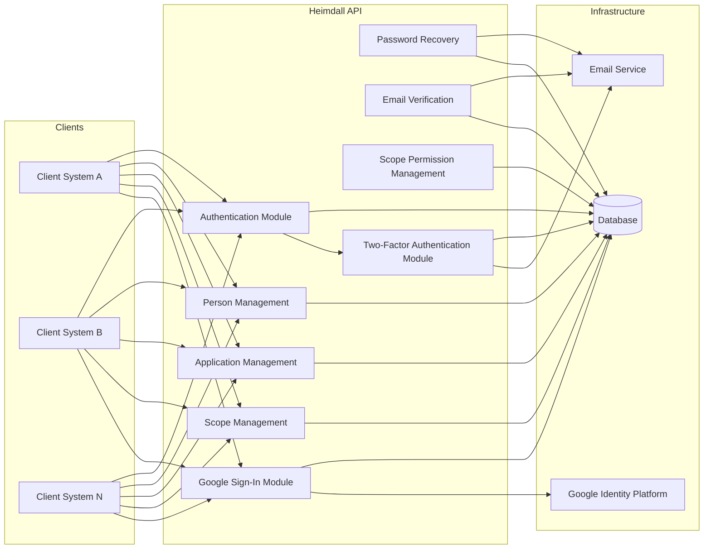
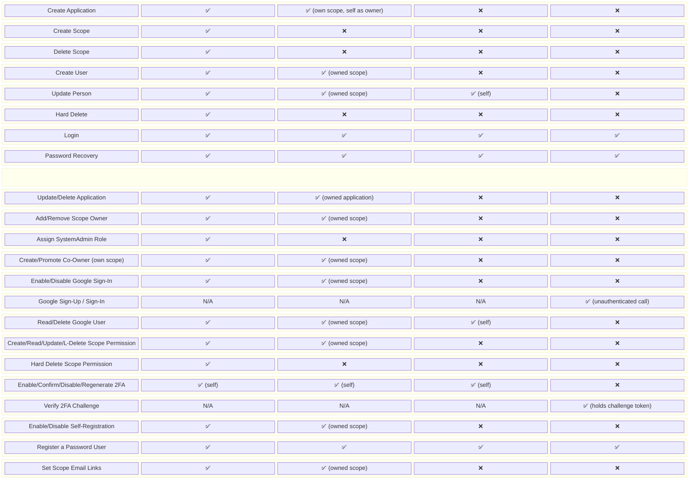
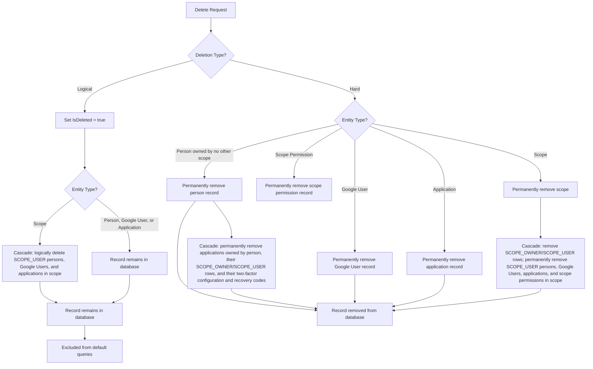

# System Requirements Document — Heimdall API

## 1. Introduction

### 1.1 Purpose

This document specifies the functional and non-functional requirements for the **Heimdall API**, a .NET Web API that provides centralized person management, application management, authentication, and authorization for multiple client systems through scope-based tenancy.

The concrete technology stack — framework and language versions, first-party libraries, database, data-access, and tooling — is defined in the [Technology Stack Document](Technology%20Stack%20Document.md). This document states requirements and refers to that one for specific technologies and versions rather than restating them.

### 1.2 Scope

The system encompasses person CRUD, application CRUD, scope CRUD, scope-specific permission CRUD (permissions that may be folded into the JWT at issue), role-based access control, authentication (including Google Sign-In and optional two-factor authentication), password recovery, email verification, and both logical and hard deletion strategies.

### 1.3 Definitions

| Term | Definition |
| ------ | ----------- |
| Person | A registered identity containing id, name, email, role, and deletion status. Has no direct scope attribute — its relationship to scopes depends on its role |
| Application | A registered non-human identity representing another system, containing id, name, and deletion status, associated with exactly one scope and owned by exactly one `ScopeAdmin` person who owns that scope |
| Scope | A logical boundary that groups owners, persons, and applications belonging to a specific client system |
| Scope Owner | A Person with the `ScopeAdmin` role who owns a scope; a scope may have one or more owners, and a Scope Admin may own one or more scopes (many-to-many relationship) |
| Scope User | A Person with the `User` role who belongs to exactly one scope (many-to-one relationship) |
| Scope Permission | A scope-specific permission associated with exactly one scope, carrying a `Name`, an optional `Description`, and an `IncludeAsJwtClaim` flag. When the flag is set the permission's `Name` is added as a claim on the JWT issued to identities acting within that scope. A scope permission has no separate owner of its own — owning the scope is the whole of the authorization to manage it |
| Google User | A registered identity authenticated via Google Sign-In rather than a password, stored in its own `GOOGLE_USER` table, belonging to exactly one scope, and always equivalent to the `User` role | 
| Two-Factor Authentication (2FA) | An opt-in second authentication step for a `Person` (`User`, `ScopeAdmin`, or `SystemAdmin`; not available to Google Users, who are already subject to Google's own account security). Configured with an authenticator-app method, an email method, or both, and backed by a set of single-use recovery codes | 
| TOTP Secret | A randomly generated shared secret used to compute time-based one-time codes (RFC 6238) for the authenticator-app 2FA method; stored encrypted at rest and never re-exposed once provisioning is confirmed |
| Recovery Code | One of ten single-use codes issued when 2FA is confirmed (or regenerated); stored hashed, shown to the person exactly once, and consumable in place of a normal second-factor code to complete a login |
| Challenge Token | A short-lived, narrowly-scoped token issued in place of a full authentication token when login succeeds for a person with active 2FA; valid only against the second-factor verification endpoint and rejected everywhere else |
| Logical Deletion | Setting the `IsDeleted` flag to `true` without removing the record |
| Hard Deletion | Permanently removing the record from the database |
| Role | A named permission level (`User`, `ScopeAdmin`, or `SystemAdmin`) stored in the `Role` table and referenced by a person via `RoleId` |
| Salt | A randomly generated byte array combined with a person's password prior to hashing, stored alongside the password hash |
| Google ID Token | A signed JSON Web Token issued by Google after a successful Google sign-in, containing identity claims (`sub`, `email`, `email_verified`, `name`, `picture`) that the API verifies and uses to provision or authenticate a Google User |
| Internal Id | An auto-incrementing `bigint` primary key, generated by the database, used only for storage and foreign keys. Never returned in API responses, accepted in API paths, or embedded in tokens |
| Public Id | A GUID generated when a top-level entity (`Scope`, `Role`, `Person`, `Application`, `Google User`, `Scope Permission`) is created, used as its externally-facing identifier everywhere outside the database — API paths, response bodies, and authentication token claims |

---

## 2. System Overview

---

## 3. Functional Requirements

### 3.1 Scope Management

| ID | Requirement | Priority |
| ---- | ------------ | ---------- |
| FR-SC-01 | The system shall allow System Admins to **create** a new scope with a unique name and at least one initial owner (a person with the `ScopeAdmin` or `SystemAdmin` role — the System Admin creating it may own it) | High |
| FR-SC-02 | The system shall allow authorized users to **read** scope details by ID: a System Admin any scope, a Scope Admin the scopes they own, a User the scope they belong to | High |
| FR-SC-03 | The system shall allow System Admins to **list** all scopes, and Scope Admins to list the scopes they own, with pagination and an optional case-insensitive name filter. A Scope Admin's listing is filtered by ownership as recorded in the database — not by the token's owned-scope claim — before pagination, so its total counts their own scopes and nothing about other tenants. The collection endpoint is not exposed to Users, who reach their one scope through FR-SC-02 | High |
| FR-SC-04 | The system shall allow System Admins to **update** scope information | High |
| FR-SC-05 | The system shall allow System Admins to **logically delete** a scope by setting `IsDeleted = true` | High |
| FR-SC-06 | The system shall allow System Admins to **hard delete** a scope, permanently removing it and its associated users and applications | High |
| FR-SC-07 | Logically deleted scopes shall not appear in default query results unless explicitly requested | Medium |
| FR-SC-08 | A scope shall be able to have **one or more owners**, each of which must be a person with the `ScopeAdmin` or `SystemAdmin` role. A System Admin governs every scope whether or not they own it; owning one makes them a named owner of it, which FR-AP-03 and NFR-12 then count | High |
| FR-SC-09 | The system shall allow System Admins to **add** an existing Scope Admin or System Admin as an additional owner of a scope, and existing owners of the scope to **invite** one (FR-SC-14) | High |
| FR-SC-10 | The system shall allow System Admins and existing owners of a scope to **remove** an owner from a scope, provided at least one owner remains | High |
| FR-SC-11 | A scope shall be able to contain **one or more Persons** with the `User` role | High |
| FR-SC-12 | The system shall allow System Admins and existing owners of a scope to add a new co-owner by **creating a brand-new `ScopeAdmin` person**, directly made an owner of that scope | High |
| FR-SC-13 | The system shall allow System Admins and existing owners of a scope to add a new co-owner by **promoting an existing `User` of that scope** to `ScopeAdmin`, making them a co-owner and removing their `User` scope membership | High |
| FR-SC-14 | When an existing owner who is not a System Admin adds an existing Scope Admin or System Admin as an owner, the system shall open an **invitation** instead of the ownership, notify the person by email with no link and no token, and answer `202`; the ownership starts only when the person accepts it (FR-SC-17). A repeat while an invitation is open shall answer with that invitation and send nothing, and no notice shall go to a person who is processing-restricted or was invited within the administrator-mail cooldown. A System Admin's add shall stay immediate | High |
| FR-SC-15 | The system shall allow System Admins and existing owners of a scope to **list** its open owner invitations and to **withdraw** one | High |
| FR-SC-16 | The system shall allow a signed-in Scope Admin or System Admin to **list their own** open owner invitations | High |
| FR-SC-17 | The system shall allow only the invited person, signed in as themselves, to **accept** or **decline** an open invitation. Accepting shall end the invitation and create the ownership in one transaction, only while the scope is live and the person a live, unrestricted administrator, and void the invitation otherwise, including when that stops being so just before the write; every refusal shall answer alike. The inviter shall be told the answer unless they are deleted, anonymised or processing-restricted (NFR-24). When a person is anonymised, their unended invitations shall be voided and they shall be cleared as the inviter of every other | High |
| FR-SC-18 | An invitation shall expire after `HEIMDALL_SCOPE_INVITATION_LIFETIME_IN_SECONDS` (default 604800, accepted 3600 to 2592000); at most one shall be open per scope and person; and one that ended shall be purged 90 days after it ended, and one that ran out unanswered 90 days after it expired | High |

### 3.2 Person Management

| ID | Requirement | Priority |
| ---- | ------------ | ---------- |
| FR-PE-01 | The system shall allow creation of a person with: `Id`, `Name`, `Email`, `PasswordHash`, `Salt`, `RoleId`, `IsDeleted`. A person has no direct `ScopeId` attribute | High |
| FR-PE-02 | A person with the `User` role must be associated with exactly **one** scope, via scope membership, at creation time | High |
| FR-PE-03 | The system shall allow reading a person's details by ID | High |
| FR-PE-04 | The system shall allow listing persons (Users) within a scope, and listing owners (Scope Admins) of a scope, with pagination and optional case-insensitive name and email filters. The person projection reports whether the person has an active two-factor configuration, but never which methods are configured (see FR-2F-15) | High |
| FR-PE-05 | The system shall allow updating person information (name, email, role) | High |
| FR-PE-06 | The system shall allow **logical deletion** of a person by setting `IsDeleted = true` | High |
| FR-PE-07 | The system shall allow **hard deletion** of a person, permanently removing the record | High |
| FR-PE-08 | Logically deleted persons shall not appear in default query results unless explicitly requested | Medium |
| FR-PE-09 | A `User` person's email must be unique among the `User`s of their scope; a `ScopeAdmin` or `SystemAdmin` person's email must be unique among all `ScopeAdmin` and `SystemAdmin` persons system-wide. The two namespaces are independent: an admin address and a scoped `User` address never collide with each other, because login resolves them by different lookups (FR-AU-01/02). Comparison is case-insensitive | High |
| FR-PE-10 | A person with the `SystemAdmin` role must not be associated with any scope, either as an owner or as a user | High |
| FR-PE-11 | A person with the `ScopeAdmin` role must own **at least one** scope, and must not belong to any scope as a `User`. This is an invariant the scope-assignment operations maintain (UC-01, UC-06 path c, UC-21, UC-23); removing the scope itself (UC-05) or the last ownership row (UC-22) can still leave a `ScopeAdmin` owning none — see §8 | High |
| FR-PE-12 | The system shall allow listing the persons who may own a scope — the `ScopeAdmin` persons of the system, and for a `SystemAdmin` caller the `SystemAdmin` persons too — with pagination and optional case-insensitive name and email filters, and optional exclusion of the current owners of a named scope. Readable by a `SystemAdmin` or a `ScopeAdmin`. The projection is the person's identifier, name, and email only — no role, owned scopes, verification, two-factor state, or timestamps. When the exclusion is requested, the caller must be entitled to manage the named scope, since comparing the filtered and unfiltered results would otherwise enumerate that scope's owners | High |
| FR-PE-13 | The system shall allow listing the `SystemAdmin` persons of the system, with pagination and optional case-insensitive name and email filters, ordered by name. Readable by a `SystemAdmin` only. Logically deleted persons and persons whose processing is restricted (NFR-24) are not listed. The projection is the person's identifier, name, and email only, as in FR-PE-12 | Medium |
| FR-PE-14 | A person changing their own email shall prove they are the account holder: the request shall carry their current password (`currentPassword`) and, when their two-factor authentication is active, a current second factor (`twoFactorCode`: an authenticator-app or email code, or an unused recovery code, which is spent; since no endpoint sends an email code to a signed-in caller, a person whose only method is Email uses a recovery code). A missing or wrong password, or a missing or wrong second factor when one is required, shall be refused with `401 Unauthorized` and "The password or code is incorrect." (FR-AU-13), the refusal UC-39 gives for the same failures, before the new address is checked for uniqueness, and nothing shall change. The password is verified through the password-hash gate (TH-03), and the endpoint is under the credential endpoints' rate limit (NFR-18). An administrator changing another person's email presents no credential of that person, and a change that leaves the email as it is asks for none. The email counts as changed unless the trimmed values are equal ordinally, so a change of case is a change, and a changed address is stored trimmed | High |
| FR-PE-15 | On every change of a person's email, whoever made it, the system shall send a notice to the previous address saying that the account's email was changed and that, if the person did not make the change, they should contact an administrator. The notice shall contain neither the new address nor any link. A failed delivery shall be logged and shall not fail the update | High |
| FR-PE-16 | The account emails a person's own requests can have sent — a verification link asked for again (FR-EV-04), a two-factor setup code (FR-2F-03) and the notice an own email change sends to the previous address (FR-PE-15) — shall share one per-person budget: at most one within the cooldown of FR-PR-06 and at most five in each day-long window, which the first send after the previous window ends opens (so up to ten can fall within any 24 hours). Each send shall be reserved by one conditional write before anything is issued, changed or mailed, so that simultaneous requests cannot exceed it (NFR-27), and a refused request shall change and send nothing: `429 Too Many Requests` with "An email of this kind was sent to you recently. Try again in a few minutes." inside the cooldown, and "You have reached the limit for account emails. Try again later." once the window's five are spent; each with a `Retry-After` header giving the seconds until a send would be accepted — the end of the cooldown, or for the window's limit the later of the window's end and the cooldown's. Administrator-initiated mail (FR-EV-06, FR-PR-05) is not charged to it. The budget shall be returned in the data export and cleared by anonymisation | Medium |
| FR-PE-17 | On every change of a person's email, whoever made it, every live password-reset link (FR-PR-02) and email-verification link (FR-EV-02) the person holds shall be retired, so nothing mailed to the previous address can act on the account afterwards. They shall be retired before the new address is written and again immediately after it is saved, before anything slower such as the notice of FR-PE-15, for any mailed to the previous address in between. A reset or verification that read the person before the change shall write only while the person still holds the address it read (FR-PR-08, FR-EV-08), so it cannot write after the change, and a whole-row save of a copy read before a reset or an address change shall write neither the password columns (FR-PR-08) nor the address and its verified flag (§4.2) | High |
| FR-PE-18 | A person shall not change their own email while their email two-factor method is enabled, active or pending: the change shall be refused with `409 Conflict` and "Turn off the email sign-in method before changing your email address.", after the credentials of FR-PE-14 are accepted and before anything is charged or changed and before a recovery or email code is spent (an accepted authenticator-app code's time step is recorded, as FR-2F-14 records any accepted one's). The method sends sign-in codes to the person's registered address; to move it, the person turns it off, changes the address and sets it up again at the new one, which mails a code there that must be confirmed. A change made by an administrator is not affected | Medium |
| FR-PE-19 | A person's scope ownerships, wherever a projection of the person reports them (`ownedScopeIds`: reading a person by ID, listing a scope's Users or owners, the result of updating a person), shall be reported in full to a `SystemAdmin` and to the person themselves, and to anyone else only as far as the reader owns the same scopes: a `ScopeAdmin` reading a co-owner learns the scopes the two share, and nothing of the scopes the co-owner owns in other tenants | High |

### 3.3 Role Assignment

| ID | Requirement | Priority |
| ---- | ------------ | ---------- |
| FR-RO-01 | Every person must reference exactly one role via `RoleId`, pointing to a row in the `Role` table (`User`, `ScopeAdmin`, or `SystemAdmin`) | High |
| FR-RO-02 | Only System Admins shall be able to assign or change a person's role to `SystemAdmin` | High |
| FR-RO-03 | System Admins may assign or change a person's role to `ScopeAdmin` for any scope. Scope Admins (owners) may also grant the `ScopeAdmin` role, but only as a co-owner of a scope they themselves own — either by creating a new `ScopeAdmin` person (FR-SC-12) or by promoting an existing `User` of that scope (FR-SC-13) | High |
| FR-RO-04 | The system shall store passwords as a `PasswordHash` byte array together with a `Salt` byte array used to compute the hash | High |
| FR-RO-05 | Scope Admins (owners of a scope) shall be able to assign the `User` role to persons within that scope | High |
| FR-RO-06 | System Admins have all permissions across the entire system and are exempt from scope-based authorization checks | High |

### 3.4 Authentication

| ID | Requirement | Priority |
| ---- | ------------ | ---------- |
| FR-AU-01 | The system shall authenticate a `User` using email, password, and scope ID (email is only unique within a scope for Users) | High |
| FR-AU-02 | The system shall authenticate a `ScopeAdmin` or `SystemAdmin` using email and password only, without a scope ID (email is unique system-wide for these roles) | High |
| FR-AU-03 | Upon successful authentication, the system shall return an authentication token (e.g., JWT) | High |
| FR-AU-04 | The authentication token shall contain the person's `PublicId`, display name and role, plus: the scope's `PublicId` for a `User`; the list of owned scopes' `PublicId`s for a `ScopeAdmin`; no scope claim for a `SystemAdmin`. Internal `bigint` Ids are never placed in a token | High |
| FR-AU-05 | The system shall reject authentication attempts for logically deleted persons | High |
| FR-AU-06 | The system shall reject authentication attempts for a `User` whose scope is logically deleted | High |
| FR-AU-07 | The system shall reject authentication attempts for a `ScopeAdmin` if all scopes they own are logically deleted | High |
| FR-AU-08 | Upon successful authentication, the system shall fold into the token the distinct `Name`s of the non-logically-deleted `ScopePermission`s of the acting scope(s) whose `IncludeAsJwtClaim` flag is set: the scope a `User` belongs to for a `User`; the union over the scopes a `ScopeAdmin` owns for a `ScopeAdmin`; none for a `SystemAdmin`, who carries no scope. Logically deleted scopes and permissions are excluded, so a deleted resource is never claimed | Medium |
| FR-AU-09 | The system shall count consecutive failed password attempts per person and, on reaching ten, refuse authentication for that person for fifteen minutes regardless of the password supplied. A successful authentication shall reset the count. The refusal shall be indistinguishable from any other authentication failure — the same message as FR-AU-05 through FR-AU-07, and the same cost, so a lockout is not detectable by response time | High |
| FR-AU-10 | The system shall verify a submitted password against a hash on every authentication attempt, including one for an address that belongs to nobody, so that the uniform rejection of FR-AU-05 through FR-AU-07 and FR-AU-09 is uniform in elapsed time as well as in message | High |
| FR-AU-11 | Every token issued to a person — the full authentication token, the two-factor challenge token and the subject-rights-only token — shall carry the person's current security stamp, a random value stored on the person, as the `sst` claim. The stamp shall be replaced when the person's password is reset (UC-13), their email is changed by anyone (UC-08), two-factor authentication is activated (UC-37) or disabled (UC-39), or their recovery codes are regenerated (UC-40), and the replacement shall be a targeted write — of that column alone, or, for a reset, of that column together with the new password (FR-PR-08) — so no concurrent save can restore the old value. A person token whose stamp is missing or is not the person's current one shall be refused on every endpoint with `401 Unauthorized` and "This token has been revoked. Sign in again."; a challenge token so outdated shall be refused by UC-38 as AF-38a and ignored by UC-46 as AF-46a. The token that made the change is revoked with the rest. A Google User's token carries no stamp and is not checked for one | High |
| FR-AU-12 | The system shall count failed second-factor verifications at sign-in (UC-38) per person — authenticator-app codes, email codes and recovery codes alike — across every challenge, so that a fresh challenge does not reset the count. A correct password shall not reset it; only a successful second-factor verification shall, together with the lock and the lockout count below. On the tenth failure the second factor shall be locked: for fifteen minutes the first time, and twice as long each time after, up to twenty-four hours, the lockout count being reset only by a successful second factor. While locked, every second factor shall be refused, the right one included, with UC-38's ordinary refusal (AF-38b), and the challenge's own budgets (FR-2F-13, FR-2F-17) shall run out as they otherwise would, so the lock is not observable. The count shall be charged before the factor is compared, in one write with the lock (NFR-27) | High |
| FR-AU-13 | The system shall count failed re-authentications per person — every check of a password or a second factor made under a bearer token: enabling (UC-36), confirming (UC-37) and disabling (UC-39) two-factor authentication, regenerating recovery codes (UC-40), changing one's own email (UC-08), and a person requesting erasure (UC-42). Five failures within fifteen minutes of the first shall pause these checks for that person for fifteen minutes. A wrong or missing password, a wrong, missing or already-used code, and a paused budget shall all be refused alike: `401 Unauthorized` and "The password or code is incorrect.", so the answer says neither which credential was wrong nor whether any was compared. The count shall be charged before the comparison, in one write with the pause (NFR-27), and a success shall clear it. It shall be kept apart from FR-AU-09 and FR-AU-12, which it shall never charge, so a bearer token cannot be used to lock its owner out of signing in | High |

### 3.5 Password Recovery

| ID | Requirement | Priority |
| ---- | ------------ | ---------- |
| FR-PR-01 | The system shall allow a person to request a password reset by providing their email | High |
| FR-PR-02 | The system shall generate a time-limited password reset token and send it via email. The request shall be answered before the person is looked up and the token issued and sent, so the response is the same in content and in time whether or not the address is registered (AF-12a) | High |
| FR-PR-03 | The system shall allow the person to set a new password using a valid reset token | High |
| FR-PR-04 | Expired or already-used reset tokens shall be rejected | High |
| FR-PR-05 | The system shall allow a `SystemAdmin` for any person, and a `ScopeAdmin` for a `User` of a scope they own, to have a password-reset link sent to the person's own stored address. Eligibility shall be FR-PR-02's: a person whose processing is restricted, who is logically deleted, or whose account could not sign in (FR-AU-06, FR-AU-07) shall be refused, with the reason. No token or password shall be returned, logged or accepted | Medium |
| FR-PR-06 | At most one password-reset email per person shall be sent through FR-PR-05 within a configurable cooldown (5 minutes by default, `HEIMDALL_ADMIN_EMAIL_COOLDOWN_IN_SECONDS`), counting every reset token issued for the person in that window, whoever caused it and whether or not it was used. A request inside the window shall be refused and nothing sent | Medium |
| FR-PR-07 | At most one password-reset email per person shall be sent through FR-PR-01 within the cooldown of FR-PR-06, held to at most the reset token's lifetime so that the owner always holds a working link, counting every reset token issued for the person in that window, whoever caused it and whether or not it was used. A request inside the window shall send nothing and be answered exactly as any other (FR-PR-02). There shall be no daily cap, so that nobody but the owner can exhaust the owner's recovery | Medium |
| FR-PR-08 | When a reset token is presented, the system shall re-check the person by FR-PR-02's eligibility rule, as it stands at that moment: a person whose processing is restricted, who is logically deleted or anonymised, or whose account could not sign in (FR-AU-06, FR-AU-07) shall be refused exactly as an unknown token is (AF-13c) — same status, same message — and nothing shall be written, the token included. The new password shall be written by one conditional write of the password hash, the salt and a fresh security stamp (FR-AU-11) alone, which repeats those checks and requires the address the person was read with; when it is refused, the token stays spent and nothing about the person changes, the stamp included. Once a person row exists, its password hash and salt shall be written only by targeted writes — this one, and the clearing anonymisation makes (NFR-20) — so a whole-row save of a copy read before a reset cannot restore the old password | High |

### 3.6 Email Verification

| ID | Requirement | Priority |
| ---- | ------------ | ---------- |
| FR-EV-01 | Upon person creation, the system shall send a verification email to the person's email address | High |
| FR-EV-02 | The verification email shall contain a time-limited verification token | High |
| FR-EV-03 | The system shall mark the person's email as verified upon receiving a valid verification token | High |
| FR-EV-04 | The system shall allow re-sending the verification email | Medium |
| FR-EV-05 | On successful authentication, the system shall report whether the authenticated person's email address is verified | Medium |
| FR-EV-06 | The system shall allow a `SystemAdmin` for any person, and a `ScopeAdmin` for a `User` of a scope they own, to have a fresh verification link sent to the person's own stored address, retiring their live links as FR-EV-04 does. A person whose processing is restricted, who is logically deleted, or whose address is already verified shall be refused. No token shall be returned, logged or accepted | Medium |
| FR-EV-07 | At most one verification email per person shall be sent through FR-EV-06 within the cooldown of FR-PR-06, counting every verification token issued for the person in that window, whoever caused it and whether or not it was used. A request inside the window shall be refused and nothing sent. A person's own request for the link again (FR-EV-04) is bounded by FR-PE-16 instead | Medium |
| FR-EV-08 | When a verification token is presented, the system shall re-check the person by FR-PR-02's eligibility rule, as FR-PR-08 does, refusing an ineligible person exactly as an unknown token is (AF-14c) and writing nothing. The address shall be marked verified by one conditional write that repeats those checks and requires the address the person was read with | High |

### 3.7 Application Management

| ID | Requirement | Priority |
| ---- | ------------ | ---------- |
| FR-AP-01 | The system shall allow creation of an application with: `Id`, `Name`, `ScopeId`, `OwnerId`, `IsDeleted` | High |
| FR-AP-02 | Every application must be associated with exactly **one** scope at creation time | High |
| FR-AP-03 | Every application must have exactly **one** owner, which must be an existing, non-logically-deleted `ScopeAdmin` or `SystemAdmin` person who owns the application's scope. A `User` may never own an application | High |
| FR-AP-04 | The system shall allow reading an application's details by ID | High |
| FR-AP-05 | The system shall allow listing applications within a scope (with pagination and filtering) | High |
| FR-AP-06 | The system shall allow updating an application's name and owner | High |
| FR-AP-07 | The system shall allow **logical deletion** of an application by setting `IsDeleted = true` | High |
| FR-AP-08 | The system shall allow **hard deletion** of an application, permanently removing the record | High |
| FR-AP-09 | Logically deleted applications shall not appear in default query results unless explicitly requested | Medium |
| FR-AP-10 | The system shall let a System Admin, or a Scope Admin who owns an application and its scope, issue the application a credential: a random secret shown once and stored only as its SHA-256, optionally with an expiry | High |
| FR-AP-11 | An application shall hold at most **two** live credentials (not revoked, not expired), so a new secret can be deployed before the old one is revoked | High |
| FR-AP-12 | The same actors shall be able to list an application's credentials — never the secret or its hash — and revoke any one of them | High |
| FR-AP-13 | The system shall exchange a live credential for an application token: HMAC-SHA256 with the person tokens' keys, a distinct audience, a lifetime of 10 minutes by default, and the claims `tokenKind = application`, `id`, `scopeId`, `credentialId` and `name`, with no role | High |
| FR-AP-14 | Every refused exchange shall answer the same `401` with the same message, revealing nothing about which applications, scopes or credentials exist | High |
| FR-AP-15 | The system shall let a consumer check an application token live, confirming the application, its scope and the issuing credential are still live | High |
| FR-AP-16 | Revoking or expiring a credential, or deleting the application or its scope, shall make every token issued from it fail the live check at once | High |

### 3.8 Google Sign-In

| ID | Requirement | Priority |
| ---- | ------------ | ---------- |
| FR-GO-01 | A scope shall have a boolean `GoogleSignInEnabled` flag, default `false`, controlling whether Google sign-up/sign-in is available for that scope | High |
| FR-GO-02 | Only System Admins and existing owners of a scope shall be able to enable or disable `GoogleSignInEnabled` for that scope | High |
| FR-GO-03 | The system shall allow Google sign-up/sign-in only for scopes where `GoogleSignInEnabled = true` | High |
| FR-GO-04 | Only accounts equivalent to the `User` role may sign up or sign in via Google; Google authentication shall never create or authenticate a `ScopeAdmin` or `SystemAdmin` | High |
| FR-GO-05 | The system shall register a Google User with: `Id`, `GoogleId`, `Name`, `Email`, `EmailVerified`, `ProfilePictureUrl`, `IsDeleted`, `ScopeId` | High |
| FR-GO-06 | A Google User must be associated with exactly **one** scope, matching the scope in which the sign-up/sign-in was initiated | High |
| FR-GO-07 | A Google User's `Email` must be unique within its scope, considered jointly with the emails of `User` persons in that same scope (see FR-PE-09). `User` persons is meant literally: an admin holds no scope membership, so an admin's address does not make one taken in any scope, and the same address can exist as both. Accepted and tested — see Threat Model TH-21. Only an address Google vouches for may take a place in a scope: a sign-up (FR-GO-09) whose verified token does not carry `email_verified` equal to `true` — false, or absent — shall create nothing and be refused with `403 Forbidden` and "Google sign-up requires a verified email address.", before the address is compared with the scope's, so such a token learns nothing about which addresses a scope holds. Sign-in of an existing Google User (FR-GO-10) is not gated on the claim (see TH-40) | High |
| FR-GO-08 | A Google User's `GoogleId` (Google's `sub` claim) must be unique within its scope | High |
| FR-GO-09 | On first sign-in with a given Google account for a scope with Google sign-in enabled, the system shall create (sign up) a new Google User record populated from the verified Google ID token claims | High |
| FR-GO-10 | On subsequent sign-ins with the same Google account and scope, the system shall authenticate the existing Google User by `GoogleId`, without creating a duplicate record | High |
| FR-GO-11 | The system shall verify the Google ID token's signature, issuer, audience, and expiration before trusting its claims | High |
| FR-GO-12 | The system shall reject Google sign-in attempts for logically deleted Google Users | High |
| FR-GO-13 | The system shall reject Google sign-in attempts for a scope that is logically deleted or has `GoogleSignInEnabled = false` | High |
| FR-GO-14 | The system shall allow reading a Google User's details by ID, and listing Google Users within a scope (with pagination and filtering) | High |
| FR-GO-15 | The system shall allow **logical deletion** of a Google User by setting `IsDeleted = true` | High |
| FR-GO-16 | The system shall allow **hard deletion** of a Google User, permanently removing the record | High |
| FR-GO-17 | Logically deleted Google Users shall not appear in default query results unless explicitly requested | Medium |
| FR-GO-18 | The system shall allow a signed-in Google User to sign out. Heimdall keeps no Google session and no record of issued tokens, so signing out ends the client's session: the client discards its token, which otherwise stays valid until it expires (UC-26) | High |
| FR-GO-19 | On each sign-in with an existing Google User, the system shall refresh the stored `EmailVerified` from the verified Google ID token claims; when the token carries no `email_verified` claim, the stored value shall be left unchanged | Medium |
| FR-GO-20 | A Google sign-in request may carry an optional `nonce`, the value the client sent Google when it asked for the ID token. When it is present and not empty, the verified token's `nonce` claim shall equal it exactly (ordinal comparison), and a token with another nonce or none shall be refused as AF-25a: `401 Unauthorized`, "Google authentication failed.". When it is absent or empty, nothing is compared. The nonce binds the token to the client's own sign-in attempt, so a client can refuse a token that was not issued for its request; whether a token is accepted rests on its signature, issuer, audience and expiry (NFR-13, Threat Model TH-19) and on its not having been used before (FR-GO-21) | Medium |
| FR-GO-21 | A Google ID token shall be accepted once. Once a token has been verified (NFR-13, FR-GO-20), and before anything is created, written or issued on its strength — at sign-in, before any scope or account is read; for an erasure request, once the Google User it must name has been read and its subject compared (AF-42a, AF-42c) — its use shall be recorded under the SHA-256 digest of its `jti` claim, or, when it carries none, of its signed part (the `header.payload` its signature covers, so that a respelling of the signature segment is the same token), by one write that also finds an earlier use; a token already recorded shall be refused exactly as an invalid one — `401 Unauthorized`, "Google authentication failed." at sign-in (AF-25a), "The credential presented was not accepted." as an erasure request's proof of presence (AF-42a) — and nothing shall be written. Of simultaneous presentations of one token exactly one is accepted. A token is spent once its use is recorded, even when the request then fails for another reason (AF-25b, AF-25c, AF-25d, AF-25f, or an error), so a client shall obtain a new one for every attempt, a retry included. The record is kept until the token's own expiry plus the single-use grace period, then purged (NFR-19) | High |

### 3.8a Self-Registration

| ID | Requirement | Priority |
| ---- | ------------- | ---------- |
| FR-SR-01 | A scope shall have a boolean `SelfRegistrationEnabled` flag, default `false`, controlling whether anonymous callers may register password `User`s in it | High |
| FR-SR-02 | Only System Admins and existing owners of a scope shall be able to enable or disable `SelfRegistrationEnabled` for that scope | High |
| FR-SR-03 | The system shall let an anonymous caller register a password `User` in an open scope, applying the same name, email and password rules as administrator-created Users | High |
| FR-SR-04 | A self-registered address shall be unique in the scope among live persons and Google Users, compared case-insensitively | High |
| FR-SR-05 | When the address is already held, the system shall create nothing and shall email the holder that a registration was attempted, unless their processing is restricted or, for a Google User, the holder is logically deleted | High |
| FR-SR-06 | The system shall answer a registration for a free and a taken address identically, in content and in time | High |
| FR-SR-07 | No account shall exist for a self-registered address until the link mailed to it is followed; the account is then created with its address verified | High |
| FR-SR-08 | Pending registrations shall expire with the email-verification token lifetime and be purged with the other single-use tokens | High |
| FR-SR-09 | Confirming a self-registration shall require the password chosen at sign-up; a missing or wrong password shall not consume the pending registration, and after 10 wrong passwords the pending registration is discarded; each guess is charged before it is compared (NFR-27), so parallel guesses cannot exceed the 10 | High |
| FR-SR-10 | A scope may override the verification and password-reset link bases for its Users: when `EmailVerificationUrl` or `PasswordResetUrl` is set, the sign-up confirmation, verification and password-reset emails sent to that scope's Users link there instead of to `HEIMDALL_EMAIL_VERIFICATION_URL` / `HEIMDALL_PASSWORD_RESET_URL`; an unset one, and every email to an administrator (who has no scope), uses the global setting. Only System Admins and existing owners of the scope may set them, through their own endpoint rather than the scope update, which would otherwise erase them; each must be an absolute `http` or `https` URL of at most 2048 characters | Medium |
| FR-SR-11 | The system shall allow System Admins and the scope's owners to list a scope's pending self-registrations, paginated and newest first, each with its identifier, name, address, creation and expiry times, the wrong confirmation passwords it may still take (never below zero), and whether it has expired — whether or not the scope is still open to self-registration. The password hash, salt and token hash shall never be returned | Medium |
| FR-SR-12 | The system shall allow System Admins and the scope's owners to discard one of a scope's pending self-registrations, removing it so that its link stops working. A registration of another scope shall be answered exactly as a missing one. The discard shall be audited with the registration as target | Medium |
| FR-SR-13 | An address shall have at most three live (unexpired) pending registrations in one scope at a time, compared case-insensitively. A registration beyond that shall store nothing and mail nothing, and shall be answered exactly as any other (FR-SR-06) | Medium |
| FR-SR-14 | An address shall be sent at most three registration-attempt notices (FR-SR-05) in a day, whichever scopes the attempts named: the first notice opens a one-day window, and the next notice after it ends opens another. A notice beyond that shall not be sent, and the registration shall be answered exactly as any other (FR-SR-06). The count shall be kept under a SHA-256 digest of the address, never the address itself, charged before the notice is sent so that simultaneous attempts cannot exceed it (NFR-27), and purged with the single-use tokens once its window has ended (NFR-19) | Medium |
| FR-SR-15 | A scope shall have at most `HEIMDALL_REGISTRATION_MAX_PENDING_PER_SCOPE` (1000 by default) live (unexpired) pending registrations at a time, whatever their addresses. A registration beyond that shall store nothing and mail nothing, shall be answered exactly as any other (FR-SR-06), and shall be logged at Warning with the marker `REGISTRATION_CAP_REACHED` and the scope's public identifier, never the address (NFR-22) | Medium |

### 3.9 Scope Permission Management

| ID | Requirement | Priority |
| ---- | ------------ | ---------- |
| FR-SP-01 | The system shall allow creation of a scope permission with: `Id`, `PublicId`, `Name`, `Description` (optional), `IncludeAsJwtClaim`, `ScopeId`, `IsDeleted` | High |
| FR-SP-02 | Every scope permission must be associated with exactly **one** scope at creation time, and only System Admins and owners of that scope may create it. A scope permission has no separate owner of its own — owning the scope is the whole of the authorization | High |
| FR-SP-03 | A scope permission shall carry an `IncludeAsJwtClaim` boolean flag (default `false`) controlling whether its `Name` is added as a claim on the JWT issued to identities acting within the owning scope (see FR-AU-08) | High |
| FR-SP-04 | The system shall allow reading a scope permission's details by ID within its scope: a System Admin sees any permission, a Scope Admin only one whose scope they own | High |
| FR-SP-05 | The system shall allow listing the permissions of a scope, with pagination and an optional case-insensitive name filter. A System Admin sees every permission in the scope; a Scope Admin who owns the scope sees every permission in it — there is no per-owner narrowing, since a scope permission has no owner of its own | High |
| FR-SP-06 | The system shall allow updating a scope permission's `Name`, `Description`, and `IncludeAsJwtClaim` flag | High |
| FR-SP-07 | The system shall allow **logical deletion** of a scope permission by setting `IsDeleted = true`. Nothing cascades: a scope permission owns no dependent row | High |
| FR-SP-08 | The system shall allow **hard deletion** of a scope permission, permanently removing the record. Restricted to System Admins; nothing cascades | High |
| FR-SP-09 | Logically deleted scope permissions shall not appear in default query results unless explicitly requested | Medium |

### 3.10 Two-Factor Authentication

| ID | Requirement | Priority |
| ---- | ------------ | ---------- |
| FR-2F-01 | The system shall allow an authenticated `User`, `ScopeAdmin`, or `SystemAdmin` to opt in to two-factor authentication by initiating setup with an authenticator-app method, an email method, or both. Google Users are not eligible — Google already governs their account security | High |
| FR-2F-02 | The authenticator-app method shall use standard TOTP (RFC 6238): a per-person secret, 6-digit codes, 30-second time step, provisioned via an `otpauth://` URI for QR scanning. The secret is stored encrypted at rest and is shown to the person only at initiation | High |
| FR-2F-03 | The email method shall deliver a random 6-digit numeric code through the existing email service (see FR-PR-02, FR-EV-02 for the established pattern), single-use and expiring 10 minutes after issue. The ten minutes is the tolerance this specification allows for mail delivery, which is the one part of the flow outside the system's control; no other lifetime in the second-factor flow may cut it short (NFR-17) | High |
| FR-2F-04 | Setup initiated under FR-2F-01 shall remain inactive until confirmed: the caller must submit a currently valid code for **every** method they selected (both, if both were selected) in one confirmation request | High |
| FR-2F-05 | Confirming setup shall generate exactly ten recovery codes, returned in the confirmation response in plaintext exactly once, and stored thereafter only as hashes. Their shape and hashing are FR-2F-20's | High |
| FR-2F-06 | Each recovery code shall be usable at most once. Consuming a recovery code to complete a login marks it used; a used or unknown recovery code shall be rejected | High |
| FR-2F-07 | When a person with active two-factor authentication completes FR-AU-01/FR-AU-02's password check, the system shall not issue a full authentication token. Instead it shall issue a short-lived challenge token, scoped only to the second-factor verification endpoint, naming the methods available to that person | High |
| FR-2F-08 | If the email method is enabled for the person, issuing a challenge token shall also send a fresh email code, per FR-2F-03 | High |
| FR-2F-09 | The second-factor verification endpoint shall accept a valid, unexpired challenge token together with either a current app/email code or an unused recovery code, and on success issue the full authentication token exactly as FR-AU-03/FR-AU-04 describe | High |
| FR-2F-10 | The system shall reject a challenge token at every endpoint other than second-factor verification, and shall reject an expired or already-redeemed challenge token at that endpoint too | High |
| FR-2F-11 | Disabling two-factor authentication shall require both the person's current password and a valid second factor (an app/email code or a recovery code). On success the system shall remove the two-factor configuration and all of its recovery codes | High |
| FR-2F-12 | Regenerating recovery codes shall require a valid second factor, shall invalidate every previously issued recovery code for the person, and shall return ten new codes in plaintext exactly once, per FR-2F-05 | High |
| FR-2F-13 | The system shall count failed verification attempts against an issued email code and retire the code on the fifth, so a six-digit code cannot be exhausted by guessing. A further code may be obtained against an outstanding challenge without re-authenticating (FR-2F-16), at most **three** times per challenge — so one authentication attempt admits at most twenty guesses, a bound this specification states rather than one the rate limiter happens to impose. A fourth reissue shall require a fresh authentication attempt, as shall any reissue once the challenge itself has expired | High |
| FR-2F-14 | The system shall accept an authenticator-app code at most once: the time step of an accepted code shall be recorded, and a code from that step or any earlier one shall be refused, so a code observed in transit cannot be replayed within the verification window | High |
| FR-2F-15 | The system shall allow an authenticated person to read their own two-factor authentication state: whether it is active, which methods are configured, and how many issued recovery codes remain unused. A person with no configuration shall be answered successfully with every flag false and a zero count, since never having enabled it is an ordinary state rather than a fault. A Google User shall be refused, as under FR-2F-01. No secret is returned — never the TOTP secret, never a recovery code | High |
| FR-2F-16 | The system shall provide an operation, authorized by a challenge token alone, that reissues the email code for an outstanding challenge: it shall retire the person's outstanding codes and send a fresh one per FR-2F-03, inside the existing challenge's lifetime — never extending it, and never issuing a new challenge token — and at most three times per challenge (FR-2F-13). It shall answer identically whether the challenge is valid, unknown, forged, expired, exhausted, or names a person without the email method enabled, so the operation cannot be used to discover whether an address is registered or has email two-factor authentication enabled | High |
| FR-2F-17 | The system shall count the guesses made at an outstanding challenge with an authenticator-app code or a recovery code, and on the fifth retire the challenge, so that further guessing requires a fresh authentication attempt. The count shall be reset whenever a new challenge is issued. A configuration with only the email method is bounded by FR-2F-13 instead | High |
| FR-2F-18 | Initiating two-factor setup (UC-36) shall require the caller's current password (`currentPassword`). A missing or wrong password shall be refused with `401 Unauthorized` and "The password or code is incorrect." (FR-AU-13), and nothing shall be created or sent. The password is verified through the password-hash gate, and the endpoint is under the credential endpoints' rate limit. Confirming setup (UC-37) requires no password, only the codes of the methods selected, which are charged to the re-authentication budget of FR-AU-13 | High |
| FR-2F-19 | A setup request that selects the email method shall be charged to the person's account-email budget (FR-PE-16). The budget shall be read before the password is checked, so a request it would refuse is refused first, with nothing changed or sent, and charged only once the password checks out, so a wrong password never spends it; a request selecting only the authenticator app is not charged | Medium |
| FR-2F-20 | A recovery code shall carry 80 bits from a cryptographically secure generator: ten random bytes written as sixteen characters of Crockford's base32 (the digits and the uppercase letters without I, L, O and U), shown as `XXXX-XXXX-XXXX-XXXX`, and stored as the SHA-256 digest of the sixteen characters without hyphens. A presented code shall be matched ignoring hyphens, whitespace and case, with Crockford's aliases applied (O read as 0, I and L as 1). Codes of the shape issued before this requirement (`XXXX-XXXX` from `[A-Z0-9]`, stored as the digest of that exact uppercase text) shall keep matching, without aliases, until used or regenerated; any other length matches nothing. Unsalted SHA-256 is sufficient at this entropy: see Threat Model TH-16 | High |

### 3.11 Audit Trail

| ID | Requirement | Priority |
| ---- | ------------ | ---------- |
| FR-AT-01 | The system shall allow a `SystemAdmin` to list the audit trail, paginated and newest first (ties broken by write order), optionally filtered by an inclusive range of when entries were recorded (UTC), by the actor's identifier, by the exact action name, by the affected entity's identifier, and by whether the operation succeeded. Filters combine with AND. No other role may read the trail, and reading it is not itself audited | High |
| FR-AT-02 | The audit-trail listing shall show each entry as stored — its identifier, when it was recorded, actor and role, action, target, outcome and canonical failure reason. An actor or target that is absent or has been cleared (NFR-21) shall be reported as null and never reconstructed from other data | High |

---

## 4. Data Model

### 4.0 Identifier Strategy

Every top-level entity (`Scope`, `Role`, `Person`, `Application`, `Google User`, `Scope Permission`, `Scope Owner Invitation`) has two identifiers:

- **`Id`** — an auto-incrementing `bigint`, the physical primary key used for storage and all foreign keys (`ScopeId`, `RoleId`, `OwnerId`, `PersonId`, and the columns of `SCOPE_OWNER`/`SCOPE_USER`). Never exposed outside the database.
- **`PublicId`** — a GUID generated at creation time, used as the entity's identifier everywhere it is addressed from outside the database: API path segments (e.g. `/api/scopes/{id}`), response bodies, and authentication token claims (e.g. the `personId`/`scopeId` claims in FR-AU-04). It is immutable, enforced by trigger, on every table listed above and on `APPLICATION_CREDENTIAL`, `PENDING_REGISTRATION` and `SCOPE_OWNER_INVITATION`, no new row of those tables may take a `PublicId` that another of them holds, and a new `PERSON` or `GOOGLE_USER` row may not take one that an audit entry names (#199): the audit trail's retention rules read it as proof that an id names a person (NFR-21).

`PASSWORD_RESET_TOKEN` and `EMAIL_VERIFICATION_TOKEN` use only an internal `bigint Id` — they are never addressed by ID at all; the caller-facing reference is the random `Token` string already required by FR-PR-02/FR-EV-02. `PENDING_REGISTRATION` is reached the same way by the registrant — through the mailed token, of which only the hash is stored — and also carries a `PublicId`, the administrative reference by which a scope's owners list and discard it (FR-SR-11, FR-SR-12). `SCOPE_OWNER` and `SCOPE_USER` are join rows, not independently addressable resources, so they carry no `PublicId` either — their `ScopeId`/`PersonId` columns are internal `bigint` foreign keys. `SCOPE_OWNER_INVITATION` is the exception among the ownership tables: it carries a `PublicId`, the reference by which a scope's owners withdraw an invitation and the invitee accepts or declines it (UC-58, UC-60, UC-61). `TWO_FACTOR_AUTH` and `TWO_FACTOR_RECOVERY_CODE` follow the same no-`PublicId` pattern as the token tables: a person's two-factor configuration is reached implicitly through their own authenticated identity, never by ID in a path.

This split keeps sequential record counts and creation order — which a raw auto-increment `Id` would reveal — out of anything a caller can see, while still giving the database compact integer keys for joins and indexes.

### 4.1 Entity Relationship Diagram

```mermaid
erDiagram
    SCOPE ||--o{ APPLICATION : "contains"
    ROLE ||--o{ PERSON : "classifies"
    PERSON ||--o{ APPLICATION : "owns"
    SCOPE ||--o{ SCOPE_OWNER : "has"
    PERSON ||--o{ SCOPE_OWNER : "owns"
    SCOPE ||--o{ SCOPE_USER : "has"
    PERSON ||--o| SCOPE_USER : "belongs to"
    SCOPE ||--o{ GOOGLE_USER : "contains"
    SCOPE ||--o{ SCOPE_PERMISSION : "defines"
    SCOPE ||--o{ PENDING_REGISTRATION : "awaits confirmation of"
    SCOPE ||--o{ SCOPE_OWNER_INVITATION : "is offered through"
    PERSON ||--o{ SCOPE_OWNER_INVITATION : "is invited by or invites"
    PERSON ||--o| TWO_FACTOR_AUTH : "configures"
    TWO_FACTOR_AUTH ||--o{ TWO_FACTOR_RECOVERY_CODE : "issues"

    SCOPE {
        bigint Id PK "Internal auto-increment identifier"
        guid PublicId "External identifier, used in API paths/responses"
        string Name "Scope display name"
        string Description "Optional description"
        bool IsDeleted "Logical deletion flag"
        bool GoogleSignInEnabled "Whether Google sign-up/sign-in is enabled for this scope"
        bool SelfRegistrationEnabled "Whether anonymous callers may register password Users in this scope"
        string EmailVerificationUrl "Optional base link of this scope's verification emails, max 2048 characters; null uses the global one (FR-SR-10)"
        string PasswordResetUrl "Optional base link of this scope's password-reset emails, max 2048 characters; null uses the global one (FR-SR-10)"
        datetime CreatedAt "Creation timestamp"
        datetime UpdatedAt "Last update timestamp"
    }

    GOOGLE_USER {
        bigint Id PK "Internal auto-increment identifier"
        guid PublicId "External identifier, used in API paths/responses"
        string GoogleId "Google's stable 'sub' claim, unique within the scope"
        string Name "Full name, from Google's 'name' claim"
        string Email "Email address, from Google's 'email' claim (unique per scope, jointly with User persons)"
        bool EmailVerified "From Google's 'email_verified' claim"
        string ProfilePictureUrl "From Google's 'picture' claim, optional"
        bool IsDeleted "Logical deletion flag"
        bigint ScopeId FK "Associated scope (internal Id)"
        datetime CreatedAt "Creation timestamp"
        datetime UpdatedAt "Last update timestamp"
    }

    ROLE {
        bigint Id PK "Internal auto-increment identifier"
        guid PublicId "External identifier, used in API paths/responses"
        string Name "Role name: User | ScopeAdmin | SystemAdmin"
        string Description "Optional explanation of the role's purpose and permissions"
    }

    PERSON {
        bigint Id PK "Internal auto-increment identifier"
        guid PublicId "External identifier, used in API paths/responses and token claims"
        string Name "Full name"
        string Email "Email address (unique among a scope's Users; unique among Admins system-wide)"
        bytes PasswordHash "Hashed password, stored as a byte array"
        bytes Salt "Random salt used to hash the password, stored as a byte array"
        guid SecurityStamp "Carried by every token issued to the person; replaced on a credential change"
        bool IsDeleted "Logical deletion flag"
        bool EmailVerified "Email verification status"
        bigint RoleId FK "Associated role (internal Id)"
        datetime CreatedAt "Creation timestamp"
        datetime UpdatedAt "Last update timestamp"
    }

    SCOPE_OWNER {
        bigint ScopeId FK "Owned scope (internal Id)"
        bigint PersonId FK "Owning person (internal Id), must have the ScopeAdmin role"
    }

    SCOPE_USER {
        bigint ScopeId FK "Scope the person belongs to (internal Id)"
        bigint PersonId FK "Person (internal Id), must have the User role, unique across this table"
    }

    PASSWORD_RESET_TOKEN {
        bigint Id PK "Internal auto-increment identifier, never exposed"
        bigint PersonId FK "Associated person (internal Id)"
        string Token "Reset token value — the caller-facing reference"
        datetime ExpiresAt "Expiration timestamp"
        bool Used "Whether the token has been consumed"
    }

    EMAIL_VERIFICATION_TOKEN {
        bigint Id PK "Internal auto-increment identifier, never exposed"
        bigint PersonId FK "Associated person (internal Id)"
        string Token "Verification token value — the caller-facing reference"
        datetime ExpiresAt "Expiration timestamp"
        bool Used "Whether the token has been consumed"
    }

    PENDING_REGISTRATION {
        bigint Id PK "Internal auto-increment identifier, never exposed"
        guid PublicId "Administrative reference for listing and discarding (FR-SR-11, FR-SR-12); the registrant's reference is the token"
        bigint ScopeId FK "Scope registered into (internal Id)"
        string Name "Name the registrant gave"
        string Email "Address awaiting confirmation"
        bytes PasswordHash "Password hash computed on the request path"
        bytes Salt "Salt of the password hash, carried to the User on confirmation"
        string TokenHash "SHA-256 of the mailed token — the caller-facing reference is the token itself"
        datetime ExpiresAt "Expiration timestamp"
        datetime CreatedAt "When the registration was stored"
        int FailedAttempts "Wrong confirmation passwords so far; the row is discarded at 10"
    }

    SCOPE_OWNER_INVITATION {
        bigint Id PK "Internal auto-increment identifier, never exposed"
        guid PublicId "External identifier; the reference withdrawn and answered by (UC-58, UC-60, UC-61)"
        bigint ScopeId FK "Scope the invitee is asked to co-own (internal Id)"
        bigint InviteePersonId FK "Person invited (internal Id)"
        bigint InvitedByPersonId FK "Person who invited; optional, cleared on anonymisation"
        datetime CreatedAt "When the invitation was made"
        datetime ExpiresAt "When it stops being acceptable (FR-SC-18)"
        datetime EndedAt "Null while open"
        smallint Outcome "1 accepted, 2 declined, 3 withdrawn, 4 voided; null while open or when unanswered"
    }

    ATTEMPT_NOTICE_BUDGET {
        bigint Id PK "Internal auto-increment identifier, never exposed"
        string AddressHash "SHA-256 of the trimmed, lower-cased address; unique (FR-SR-14)"
        int NoticesSent "Registration-attempt notices sent in the current window"
        datetime WindowEndsAt "End of the current one-day window"
    }

    GOOGLE_ID_TOKEN_USE {
        string TokenHash PK "SHA-256 of an accepted Google ID token's jti, or of its signed part when it has none (FR-GO-21)"
        datetime ExpiresAt "The token's own expiry, which the purge counts from"
    }

    APPLICATION {
        bigint Id PK "Internal auto-increment identifier"
        guid PublicId "External identifier, used in API paths/responses"
        string Name "Application display name"
        bool IsDeleted "Logical deletion flag"
        bigint ScopeId FK "Associated scope (internal Id)"
        bigint OwnerId FK "Owning person (internal Id)"
        datetime CreatedAt "Creation timestamp"
        datetime UpdatedAt "Last update timestamp"
    }

    SCOPE_PERMISSION {
        bigint Id PK "Internal auto-increment identifier"
        guid PublicId "External identifier, used in API paths/responses"
        string Name "Permission display name, max 200 characters"
        string Description "Optional description, max 500 characters"
        bool IncludeAsJwtClaim "When true, the Name is added as a JWT claim at issue"
        bool IsDeleted "Logical deletion flag"
        bigint ScopeId FK "Associated scope (internal Id)"
        datetime CreatedAt "Creation timestamp"
        datetime UpdatedAt "Last update timestamp"
    }

    PERSON ||--o{ PASSWORD_RESET_TOKEN : "requests"
    PERSON ||--o{ EMAIL_VERIFICATION_TOKEN : "receives"

    TWO_FACTOR_AUTH {
        bigint Id PK "Internal auto-increment identifier, never exposed"
        bigint PersonId FK "Owning person (internal Id), unique — one configuration per person"
        bool AppEnabled "Whether the authenticator-app method is configured"
        bool EmailEnabled "Whether the email method is configured"
        bytes TotpSecretEncrypted "Encrypted TOTP secret, present only when AppEnabled"
        bool IsActive "True once every selected method has been confirmed (FR-2F-04)"
        datetime CreatedAt "Creation timestamp"
        datetime UpdatedAt "Last update timestamp"
    }

    TWO_FACTOR_RECOVERY_CODE {
        bigint Id PK "Internal auto-increment identifier, never exposed"
        bigint TwoFactorAuthId FK "Owning two-factor configuration (internal Id)"
        bytes CodeHash "Hashed recovery code — the plaintext is never stored"
        bool Used "Whether the code has been consumed"
        datetime UsedAt "Timestamp the code was consumed, null until then"
        datetime CreatedAt "Creation timestamp"
    }
```

### 4.2 Person Fields

| Field | Type | Constraints |
| ------- | ------ | ------------- |
| Id | BigInt | Primary key, auto-increment, internal only |
| PublicId | GUID | Required, unique, auto-generated on creation; external identifier; immutable, enforced by trigger, and never the `PublicId` of another entity's row, or one an audit entry names, when inserted (#199) |
| Name | String | Required, max 200 characters |
| Email | String | Required, valid email format. Unique among the `User`s of the same scope (via `SCOPE_USER`); unique among all `ScopeAdmin`/`SystemAdmin` persons system-wide. See FR-PE-09 — the two namespaces are independent |
| PasswordHash | Byte array | Required, stores the hash computed from the password and `Salt` |
| Salt | Byte array | Required, randomly generated per person, used to hash the password |
| SecurityStamp | GUID | Required, random, generated on creation (`gen_random_uuid()` for rows inserted without one). Carried by every token issued to the person and replaced, by a write of this column alone, on a password reset, an email change, a two-factor activation or removal, or a recovery-code regeneration, which revokes every earlier token (FR-AU-11). Never written by a whole-row save |
| FailedSecondFactorAttempts | Integer | Default: `0`; second-factor failures at sign-in since the last successful one, across challenges (FR-AU-12). Written only by its targeted write, never by a whole-row save, as are the five fields below |
| SecondFactorLockedOutUntil | DateTime | Null unless the second factor is or was locked; while in the future, every second factor at sign-in is refused (FR-AU-12) |
| SecondFactorLockouts | Integer | Default: `0`; second-factor locks since the last successful second factor, which set how long the next one lasts (FR-AU-12) |
| FailedReauthenticationAttempts | Integer | Default: `0`; failed re-authentications in the current window (FR-AU-13) |
| ReauthenticationWindowStartedAt | DateTime | Null unless a window is open; when its first failure was counted (FR-AU-13) |
| ReauthenticationPausedUntil | DateTime | Null unless re-authentication is or was paused; while in the future, every re-authentication is refused (FR-AU-13) |
| AccountEmailsSent | Integer | Default: `0`; account emails the person's own requests had sent in the current window (FR-PE-16); written only by the conditional write that reserves a send |
| AccountEmailWindowEndsAt | DateTime | Null before the first such send; when the current one-day window ends (FR-PE-16) |
| AccountEmailLastSentAt | DateTime | Null before the first such send; when the last was reserved, which the cooldown counts from (FR-PE-16) |
| IsDeleted | Boolean | Default: `false` |
| EmailVerified | Boolean | Default: `false` |
| RoleId | BigInt | Foreign key to Role.Id (internal), required |
| CreatedAt | DateTime | Auto-set on creation |
| UpdatedAt | DateTime | Auto-set on update |

Once a person row exists, its lifecycle columns — the address and `EmailVerified`, the role and the
scope it implies, the login lockout, and the deletion, erasure-request, restriction and anonymisation
columns — are written only by targeted, conditional writes of the columns each change concerns, like
the password, the security stamp and the budgets above, never by a whole-row save. A save of a copy
read before one of those changes therefore cannot put the earlier value back; what a whole-row save
still writes is the plain profile, `Name` and the recorded basis among it, and `UpdatedAt` (#237).

Two residuals are recorded rather than closed:

- **`Name` is still written whole-row.** A save of a copy read before an anonymisation could put the
  real name back over the placeholder. Anonymisation reaches only rows deleted for the whole retention
  window, which no profile edit spans (UC-08 reads live persons only), so the one overlap is an
  operator running `ReapplyErasures` after a restore, racing a name edit or another save that has the
  person tracked, within one request's duration. Writing the name by a targeted write that requires
  the person live and not anonymised would close it.
- **Two removals of a scope's last two owners at the same moment can both succeed.** Removing an
  owner (UC-22) deletes the `SCOPE_OWNER` row only while another live owner remains, checked in the
  same statement, but under `READ COMMITTED` each of two simultaneous removals can still see the
  other's row. The same check-then-act gap is in the other last-owner checks (UC-08's role change,
  UC-09, UC-42's block decision). The scope is then left with no live owner until a System Admin adds
  one (UC-21). Locking the scope row in one check that all four share would close it.

A person's relationship to scopes is derived from its role:

- `User`: exactly one row in `SCOPE_USER`.
- `ScopeAdmin`: one or more rows in `SCOPE_OWNER`.
- `SystemAdmin`: no rows in either `SCOPE_OWNER` or `SCOPE_USER`.

The person row also carries a `ScopeId` column: a copy of a `User`'s `SCOPE_USER` scope, `null` for an
admin, and not a second source of truth. It exists so that FR-PE-09's per-scope uniqueness of an
address can be enforced by a unique index over `PERSON`, and it is written with the membership — set
when a `User` is created, cleared by a promotion (UC-23) or a role change (UC-08).

### 4.3 Role Fields

| Field | Type | Constraints |
| ------- | ------ | ------------- |
| Id | BigInt | Primary key, auto-increment, internal only |
| PublicId | GUID | Required, unique, auto-generated on creation; external identifier; immutable, enforced by trigger, and never the `PublicId` of another entity's row when inserted (#199) |
| Name | String | Required, unique — `User`, `ScopeAdmin`, or `SystemAdmin` |
| Description | String | Optional, human-readable explanation of the role's purpose and permissions |

### 4.4 Application Fields

| Field | Type | Constraints |
| ------- | ------ | ------------- |
| Id | BigInt | Primary key, auto-increment, internal only |
| PublicId | GUID | Required, unique, auto-generated on creation; external identifier; immutable, enforced by trigger, and never the `PublicId` of another entity's row when inserted (#199) |
| Name | String | Required, max 200 characters |
| IsDeleted | Boolean | Default: `false` |
| ScopeId | BigInt | Foreign key to Scope.Id (internal), required |
| OwnerId | BigInt | Foreign key to Person.Id (internal), required |
| CreatedAt | DateTime | Auto-set on creation |
| UpdatedAt | DateTime | Auto-set on update |

### 4.5 Scope Owner Fields

| Field | Type | Constraints |
| ------- | ------ | ------------- |
| ScopeId | BigInt | Foreign key to Scope.Id (internal), part of composite primary key |
| PersonId | BigInt | Foreign key to Person.Id (internal), part of composite primary key; the referenced person must have the `ScopeAdmin` or `SystemAdmin` role (FR-SC-08) |

A scope may have many rows (one or more owners); a person may have many rows (a Scope Admin may own several scopes). Composite key `(ScopeId, PersonId)` must be unique. This join table has no `PublicId` — it is not an independently addressable API resource.

### 4.5a Scope Owner Invitation Fields

| Field | Type | Constraints |
| ------- | ------ | ------------- |
| Id | BigInt | Primary key, auto-increment, internal only |
| PublicId | GUID | Required, unique, auto-generated on creation; external identifier; immutable, enforced by trigger, and never the `PublicId` of another entity's row when inserted (#199) |
| ScopeId | BigInt | Foreign key to Scope.Id (internal), required; deleted with the scope |
| InviteePersonId | BigInt | Foreign key to Person.Id (internal), required; deleted with the person |
| InvitedByPersonId | BigInt | Foreign key to Person.Id (internal), optional; set to null when that person is hard-deleted, cleared when they are anonymised |
| CreatedAt | DateTime | Auto-set on creation |
| ExpiresAt | DateTime | Required; `CreatedAt` + `HEIMDALL_SCOPE_INVITATION_LIFETIME_IN_SECONDS` |
| EndedAt | DateTime | Null while open; set once when it ends — to `ExpiresAt` when a new invitation for the pair closes an expired one |
| Outcome | SmallInt | Null while open and when it ran out unanswered; 1 accepted, 2 declined, 3 withdrawn, 4 voided; only on an ended row |

At most one row per `(ScopeId, InviteePersonId)` has a null `EndedAt` (a partial unique index).

### 4.6 Scope User Fields

| Field | Type | Constraints |
| ------- | ------ | ------------- |
| ScopeId | BigInt | Foreign key to Scope.Id (internal), required |
| PersonId | BigInt | Foreign key to Person.Id (internal), required and unique; the referenced person must have the `User` role |

`PersonId` is unique across this table, enforcing that a `User` belongs to exactly one scope. A scope may have many rows (one or more users). This join table has no `PublicId`.

### 4.7 Google User Fields

| Field | Type | Constraints |
| ------- | ------ | ------------- |
| Id | BigInt | Primary key, auto-increment, internal only |
| PublicId | GUID | Required, unique, auto-generated on creation; external identifier; immutable, enforced by trigger, and never the `PublicId` of another entity's row, or one an audit entry names, when inserted (#199) |
| GoogleId | String | Required, from Google's `sub` claim; unique within the scope |
| Name | String | From Google's `name` claim, max 200 characters |
| Email | String | Required, from Google's `email` claim; unique within the scope, considered jointly with `User` persons' emails in that scope |
| EmailVerified | Boolean | From Google's `email_verified` claim |
| ProfilePictureUrl | String | Optional, from Google's `picture` claim |
| IsDeleted | Boolean | Default: `false` |
| ScopeId | BigInt | Foreign key to Scope.Id (internal), required |
| CreatedAt | DateTime | Auto-set on creation |
| UpdatedAt | DateTime | Auto-set on update |

`GOOGLE_USER` is a separate table from `PERSON`. Unlike `PERSON`, it has a direct `ScopeId` column rather than going through `SCOPE_USER`, because a Google User always represents the `User` role and single-scope membership — it never needs the ownership/multi-scope semantics that `SCOPE_OWNER` exists for. It has no `PasswordHash`, `Salt`, or `RoleId`: authentication is delegated to Google, and the role is implicitly `User`.

### 4.8 Scope Permission Fields

| Field | Type | Constraints |
| ------- | ------ | ------------- |
| Id | BigInt | Primary key, auto-increment, internal only |
| PublicId | GUID | Required, unique, auto-generated on creation; external identifier; immutable, enforced by trigger, and never the `PublicId` of another entity's row when inserted (#199) |
| Name | String | Required, max 200 characters |
| Description | String | Optional, max 500 characters |
| IncludeAsJwtClaim | Boolean | Default: `false`; controls whether `Name` is added as a JWT claim at issue (FR-SP-03, FR-AU-08) |
| IsDeleted | Boolean | Default: `false` |
| ScopeId | BigInt | Foreign key to Scope.Id (internal), required; cascade-deleted when the scope is hard-deleted |
| CreatedAt | DateTime | Auto-set on creation |
| UpdatedAt | DateTime | Auto-set on update |

A scope permission belongs to exactly one scope, and unlike `APPLICATION` it has no separate owner — owning the scope is the whole of the authorization to manage it. The `IncludeAsJwtClaim` flag has no enforcement role of its own; it is read at login time by FR-AU-08, which folds every flagged, non-deleted permission name of the acting scope into the issued token as a `scopePermissions` claim.

### 4.9 Two-Factor Auth Fields

| Field | Type | Constraints |
| ------- | ------ | ------------- |
| Id | BigInt | Primary key, auto-increment, internal only |
| PersonId | BigInt | Foreign key to Person.Id (internal), required and unique — one row per person |
| AppEnabled | Boolean | Default: `false` |
| EmailEnabled | Boolean | Default: `false`; at least one of `AppEnabled`/`EmailEnabled` must be `true` |
| TotpSecretEncrypted | Byte array | Required when `AppEnabled = true`, otherwise null; encrypted at rest, never returned once FR-2F-04 confirmation succeeds |
| IsActive | Boolean | Default: `false`; set `true` only once every selected method is confirmed (FR-2F-04) |
| LastTotpTimeStepUsed | BigInt | Null until an app code is accepted; the time step of the last accepted one, so no code from that step or earlier is accepted again (FR-2F-14) |
| EmailCodeReissueCount | Integer | Default: `0`; reissues the outstanding challenge has spent, reset when a login issues a new challenge (FR-2F-13, FR-2F-16) |
| ChallengeId | GUID | Null unless a challenge is outstanding; set when a login issues a challenge token, which carries the same value, and cleared when it is redeemed, so a challenge is redeemable once (FR-2F-10) |
| ChallengeAttempts | Integer | Default: `0`; guesses made at the outstanding challenge with an app code or a recovery code, reset when a login issues a new challenge; at five the challenge is cleared (FR-2F-17) |
| CreatedAt | DateTime | Auto-set on creation |
| UpdatedAt | DateTime | Auto-set on update |

A person has at most one `TWO_FACTOR_AUTH` row. Its absence means the person has never initiated setup; `IsActive = false` with a row present means setup was initiated but not yet confirmed.

### 4.10 Two-Factor Recovery Code Fields

| Field | Type | Constraints |
| ------- | ------ | ------------- |
| Id | BigInt | Primary key, auto-increment, internal only |
| TwoFactorAuthId | BigInt | Foreign key to TwoFactorAuth.Id (internal), required; cascade-deleted when the two-factor configuration is removed |
| CodeHash | Byte array | Required, the SHA-256 digest of the code's canonical form (FR-2F-20) — the plaintext code exists only in the FR-2F-05 response |
| Used | Boolean | Default: `false` |
| UsedAt | DateTime | Set when `Used` transitions to `true`; null until then |
| CreatedAt | DateTime | Auto-set on creation |

Exactly ten rows are created together at confirmation (FR-2F-05) or regeneration (FR-2F-12); regeneration deletes the previous ten and inserts ten new ones in the same operation.

---

## 5. API Endpoints Overview

Every `{id}`, `{scopeId}`, `{personId}` (etc.) path segment below refers to the entity's `PublicId` (GUID), never its internal `bigint Id` (see §4.0).

### 5.1 Scope Endpoints

| Method | Endpoint | Description | Auth Required |
| -------- | ---------- | ------------- | --------------- |
| POST | `/api/scopes` | Create a new scope with at least one initial owner | SystemAdmin |
| GET | `/api/scopes` | List scopes — all of them for a SystemAdmin, the ones they own for a ScopeAdmin | SystemAdmin, ScopeAdmin |
| GET | `/api/scopes/{id}` | Get scope by ID | Authenticated |
| PUT | `/api/scopes/{id}` | Update a scope | SystemAdmin |
| DELETE | `/api/scopes/{id}` | Logically delete a scope | SystemAdmin |
| DELETE | `/api/scopes/{id}/hard` | Hard delete a scope | SystemAdmin |
| POST | `/api/scopes/{id}/owners/{personId}` | Add an existing Scope Admin or System Admin as an owner (SystemAdmin: `201`, or `200` if already one), or invite them (existing Owner: `202`, FR-SC-14) | SystemAdmin, existing Owner |
| POST | `/api/scopes/{id}/owners` | Create a brand-new `ScopeAdmin` person, directly made an owner of the scope | SystemAdmin, existing Owner |
| POST | `/api/scopes/{id}/users/{personId}/promote` | Promote an existing `User` of the scope to `ScopeAdmin`, making them a co-owner | SystemAdmin, existing Owner |
| GET | `/api/scopes/{id}/owners` | List the owners of a scope | SystemAdmin, existing Owner |
| DELETE | `/api/scopes/{id}/owners/{personId}` | Remove an owner from the scope (at least one must remain) | SystemAdmin, existing Owner |
| GET | `/api/scopes/{id}/owner-invitations` | List the scope's open owner invitations (FR-SC-15) | SystemAdmin, existing Owner |
| DELETE | `/api/scopes/{id}/owner-invitations/{invitationId}` | Withdraw an open owner invitation; `204` (FR-SC-15) | SystemAdmin, existing Owner |
| PUT | `/api/scopes/{id}/google-signin` | Enable or disable Google Sign-In for the scope (`{ enabled: bool }`) | SystemAdmin, existing Owner |
| PUT | `/api/scopes/{id}/self-registration` | Open or close self-registration for a scope (FR-SR-01, FR-SR-02) | SystemAdmin, existing Owner |
| PUT | `/api/scopes/{id}/email-links` | Set, or with null or empty clear, the scope's verification and password-reset link bases (FR-SR-10) | SystemAdmin, existing Owner |
| GET | `/api/scopes/{id}/pending-registrations` | List the scope's self-registrations awaiting confirmation (FR-SR-11) | SystemAdmin, existing Owner |
| DELETE | `/api/scopes/{id}/pending-registrations/{registrationId}` | Discard a pending self-registration; its link stops working (FR-SR-12) | SystemAdmin, existing Owner |

### 5.2 Person Endpoints

| Method | Endpoint | Description | Auth Required |
| -------- | ---------- | ------------- | --------------- |
| POST | `/api/persons` | Create a `SystemAdmin` or `ScopeAdmin` person (no scope) | SystemAdmin |
| POST | `/api/scopes/{scopeId}/persons` | Create a `User` person within a scope | ScopeAdmin (owner)+ |
| GET | `/api/scopes/{scopeId}/persons` | List Users within a scope | ScopeAdmin (owner)+ |
| GET | `/api/persons/{id}` | Get person by ID | Authenticated |
| GET | `/api/persons/scope-admins` | List the persons who may own a scope (FR-PE-12) | SystemAdmin, ScopeAdmin |
| GET | `/api/persons/system-admins` | List the `SystemAdmin` persons (FR-PE-13) | SystemAdmin |
| PUT | `/api/persons/{id}` | Update a person; an own email change also needs the current password, and the second factor when active (FR-PE-14) | ScopeAdmin (owner)+ / self |
| DELETE | `/api/persons/{id}` | Logically delete a person | ScopeAdmin (owner)+ |
| DELETE | `/api/persons/{id}/hard` | Hard delete a person | SystemAdmin |
| POST | `/api/persons/{id}/verification-email` | Send a fresh verification link to the person's own address (FR-EV-06, FR-EV-07) | SystemAdmin, ScopeAdmin (Users of an owned scope) |
| POST | `/api/persons/{id}/password-reset` | Send a password-reset link to the person's own address (FR-PR-05, FR-PR-06) | SystemAdmin, ScopeAdmin (Users of an owned scope) |
| GET | `/api/persons/me/scope-invitations` | List the caller's own open owner invitations (FR-SC-16) | SystemAdmin, ScopeAdmin |
| POST | `/api/scope-invitations/{invitationId}/accept` | Accept an owner invitation (FR-SC-17) | The invitee |
| POST | `/api/scope-invitations/{invitationId}/decline` | Decline an owner invitation (FR-SC-17) | The invitee |

### 5.3 Application Endpoints

| Method | Endpoint | Description | Auth Required |
| -------- | ---------- | ------------- | --------------- |
| POST | `/api/scopes/{scopeId}/applications` | Create an application in a scope | SystemAdmin / ScopeAdmin (owner of the scope, self as owner) |
| GET | `/api/scopes/{scopeId}/applications` | List applications in a scope — every one for a SystemAdmin, only the caller's own for a ScopeAdmin | SystemAdmin / ScopeAdmin (owner of the scope) |
| GET | `/api/scopes/{scopeId}/applications/{id}` | Get application by ID | SystemAdmin / ScopeAdmin (owner of the application) |
| PUT | `/api/scopes/{scopeId}/applications/{id}` | Update an application | SystemAdmin / ScopeAdmin (owner of the application) |
| DELETE | `/api/scopes/{scopeId}/applications/{id}` | Logically delete an application | SystemAdmin / ScopeAdmin (owner of the application) |
| DELETE | `/api/scopes/{scopeId}/applications/{id}/hard` | Hard delete an application | SystemAdmin |
| POST | `/api/scopes/{scopeId}/applications/{id}/credentials` | Issue a credential; the secret is returned once | SystemAdmin / ScopeAdmin (owner of the application) |
| GET | `/api/scopes/{scopeId}/applications/{id}/credentials` | List the application's credentials | SystemAdmin / ScopeAdmin (owner of the application) |
| DELETE | `/api/scopes/{scopeId}/applications/{id}/credentials/{credentialId}` | Revoke a credential | SystemAdmin / ScopeAdmin (owner of the application) |
| POST | `/api/applications/token` | Exchange a credential for an application token | No (the secret authenticates) |
| GET | `/api/applications/self` | Check an application token live | Application token (validated by the endpoint) |

### 5.4 Authentication Endpoints

| Method | Endpoint | Description | Auth Required |
| -------- | ---------- | ------------- | --------------- |
| POST | `/api/auth/login` | Authenticate by email + password | No |
| POST | `/api/auth/password-recovery` | Request password reset email | No |
| POST | `/api/auth/password-reset` | Reset password with token | No |
| POST | `/api/auth/verify-email` | Verify email with token; a token that names a pending self-registration confirms it and also takes the optional `password` chosen at sign-up (FR-SR-09) | No |
| POST | `/api/auth/register` | Register a password User in an open scope (FR-SR-03 … FR-SR-09) | No (anonymous) |
| POST | `/api/auth/resend-verification` | Resend verification email | Authenticated |
| POST | `/api/auth/2fa/enable` | Initiate two-factor setup, selecting App, Email, or both; needs the current password (FR-2F-18) | Authenticated |
| POST | `/api/auth/2fa/confirm` | Confirm setup with a code per selected method; activates 2FA and returns the ten recovery codes | Authenticated |
| POST | `/api/auth/2fa/verify` | Exchange a challenge token plus a code or recovery code for a full authentication token | No (holds a challenge token) |
| POST | `/api/auth/2fa/challenge/resend` | Reissue the email code for an outstanding challenge, inside its existing window | No (holds a challenge token) |
| POST | `/api/auth/2fa/disable` | Disable two-factor authentication (requires password + a valid second factor) | Authenticated |
| POST | `/api/auth/2fa/recovery-codes/regenerate` | Invalidate the current recovery codes and issue ten new ones | Authenticated |

### 5.5 Google Sign-In Endpoints

| Method | Endpoint | Description | Auth Required |
| -------- | ---------- | ------------- | --------------- |
| POST | `/api/auth/google` | Sign up or sign in with Google (`{ scopeId, idToken }`); creates a Google User on first use, authenticates on subsequent uses | No |
| POST | `/api/auth/google/sign-out` | Sign out a Google User, invalidating/discarding their token | Authenticated (Google User) |
| GET | `/api/scopes/{scopeId}/google-users` | List Google Users within a scope | ScopeAdmin (owner)+ |
| GET | `/api/scopes/{scopeId}/google-users/{id}` | Get a Google User by ID | Authenticated |
| DELETE | `/api/scopes/{scopeId}/google-users/{id}` | Logically delete a Google User | ScopeAdmin (owner)+ |
| DELETE | `/api/scopes/{scopeId}/google-users/{id}/hard` | Hard delete a Google User | SystemAdmin |

### 5.6 Scope Permission Endpoints

| Method | Endpoint | Description | Auth Required |
| -------- | ---------- | ------------- | --------------- |
| POST | `/api/scopes/{scopeId}/permissions` | Create a scope permission within a scope | SystemAdmin / ScopeAdmin (owner of the scope) |
| GET | `/api/scopes/{scopeId}/permissions` | List the permissions of a scope | SystemAdmin / ScopeAdmin (owner of the scope) |
| GET | `/api/scopes/{scopeId}/permissions/{id}` | Get a scope permission by ID within its scope | SystemAdmin / ScopeAdmin (owner of the scope) |
| PUT | `/api/scopes/{scopeId}/permissions/{id}` | Update a scope permission | SystemAdmin / ScopeAdmin (owner of the scope) |
| DELETE | `/api/scopes/{scopeId}/permissions/{id}` | Logically delete a scope permission | SystemAdmin / ScopeAdmin (owner of the scope) |
| DELETE | `/api/scopes/{scopeId}/permissions/{id}/hard` | Hard delete a scope permission | SystemAdmin |

### 5.7 Audit Trail Endpoints

| Method | Endpoint | Description | Auth Required |
| -------- | ---------- | ------------- | --------------- |
| GET | `/api/audit-log` | List the audit trail, newest first, filtered by `from`/`to`, `actorId`, `action`, `targetId`, `succeeded` (FR-AT-01, FR-AT-02) | SystemAdmin |

---

## 6. Non-Functional Requirements

The security requirements below state what this API does. What they defend against, and what is left
after them, is in the [Threat Model Document](Threat%20Model%20Document.md) — including two cases
where a control is narrower than the threat it appears to cover.

| ID | Category | Requirement |
| ---- | ---------- | ------------- |
| NFR-01 | Technology | The API shall be built using ASP.NET Core on the .NET platform (specific framework/language versions and libraries: see the [Technology Stack Document](Technology%20Stack%20Document.md)) |
| NFR-02 | Security | Passwords shall be hashed using a strong algorithm (e.g., bcrypt, Argon2) combined with a per-person random `Salt`, both stored as byte arrays |
| NFR-03 | Security | Authentication tokens shall be signed and have configurable expiration |
| NFR-04 | Security | Every endpoint shall require a valid authentication token, except those a caller cannot yet hold one for or is not expected to: the authentication endpoints themselves (UC-11 login, UC-12/UC-13 password recovery and reset, UC-14 email verification, UC-25 Google sign-in, UC-38 second-factor verification, UC-47 self-registration) and the public liveness check (FR-HC-01). Each is marked `AllowAnonymous`; no other endpoint may be |
| NFR-05 | Performance | Every endpoint except those that verify a password shall complete within **100 ms at the median and 250 ms at the tail** — the slowest of a single caller's samples (§6.1), the 99th percentile under load (§6.3) — and shall hold that while **128 callers are in flight at once**, answering all of them without a failed or 5xx response. Both conditions are measured on the reference configuration. The write path meets the load condition with the least margin and is sensitive to how many rows the table already holds (§6.3.2). Password-verifying endpoints are governed by NFR-18 |
| NFR-06 | Availability | The API shall hold no state in a process or on a local filesystem that a second instance would need: authentication is validated from token claims with no server-side session, and the Data Protection key ring that TOTP secrets are encrypted with (NFR-16) is kept in the database. The per-IP rate limiter's window is the one deliberate exception, and is per instance by design (§6.2) |
| NFR-07 | Data Integrity | After any logical deletion, including UC-04's cascade across a scope's Users, Google Users and applications, every foreign key in the schema shall still resolve to an existing row. Logical deletion removes no rows, so the rows it leaves behind must remain reachable |
| NFR-08 | Data Integrity | Hard deletion of a scope must cascade to its `SCOPE_USER`/`SCOPE_OWNER` rows, its Users, and its Applications |
| NFR-09 | Logging | Every attempted write shall produce one audit entry, whether it succeeded, was refused or failed with an exception (the exception continues to the caller; its text is never recorded, and a refusal by the password-hash gate records its canonical message), recording the acting identity, the operation, the affected entity where one was resolved, the outcome, and — on a refusal — the reason. The reason is drawn from the application's own messages, never from caller-supplied input |
| NFR-10 | Validation | All inputs shall be validated before processing. An input that cannot be bound — a body that is not JSON, or a value of the wrong type in the body or query string — is refused with `400 Bad Request` and the message "The request is malformed.", before the action runs. Authentication and role checks come first, so an unauthenticated caller still receives `401` and a caller of the wrong role `403`; refusals that depend on data, made in a handler, come after |
| NFR-11 | Data Integrity | Hard deletion of a person must cascade to the applications they own |
| NFR-12 | Data Integrity | A scope must always retain at least one owner; removing the last owner or hard-deleting the last owning person must be rejected |
| NFR-13 | Security | Google ID tokens must be verified (signature, issuer `accounts.google.com`/`https://accounts.google.com`, audience matching the configured OAuth client ID, and expiration) before their claims are trusted |
| NFR-14 | Data Integrity | Hard deletion of a scope must also cascade to its Google Users |
| NFR-15 | Security | Internal `bigint` primary/foreign keys must never appear in API responses, API paths, or token claims; only `PublicId` (GUID) values may be exposed to callers |
| NFR-16 | Security | A TOTP secret shall be stored encrypted at rest, and a recovery code shall be stored only as a hash; neither is ever returned to a caller after the response that first generates it |
| NFR-17 | Security | A two-factor challenge token shall carry a distinct claim marking it as MFA-pending, expire **10 minutes** after issue — a fixed lifetime, not a configurable one, and the same ten minutes FR-2F-03 gives the email code issued alongside it, so a login attempt has one deadline rather than two — and be rejected by every endpoint except second-factor verification |
| NFR-18 | Performance | An endpoint that verifies a password is bounded by the cost of the password hash, not by NFR-05, and that cost is deliberate: it is what makes an offline attack on a stolen hash expensive. Every outcome shall pay it, including a rejection for an address that belongs to nobody (FR-AU-10). On the reference configuration this measures **347–491 ms at the median and 534–582 ms at the slowest**, the spread being idle versus contended (§6.1). Concurrency moves it much further: the ten logins a minute the rate limiter admits from one IP are released together and measured **2.8 seconds** each (§6.3.1), because each is a 600 MB / 16-thread derivation competing with nine others. The figure moves with the hashing parameters, the hardware and the load, and is republished rather than held constant |
| NFR-19 | Data Protection | Personal data shall be kept in identifiable form only as long as its purpose requires (GDPR Art. 5(1)(e), LGPD Art. 15). Every table holding personal data shall carry a stated retention period, published in the [Data Retention Schedule Document](Data%20Retention%20Schedule%20Document.md) together with the reason for it, and each period the API enforces itself shall be enforced by a scheduled pass rather than by hand. A single-use token — password reset, email verification, two-factor email code — shall be removed once it is past its expiry by the configured grace period, and never before: the grace period is what keeps UC-13's `TokenExpired` and `TokenAlreadyUsed` answers truthful. A period the schedule states but nothing enforces shall be marked as such, so the document never claims a guarantee the code does not make |
| NFR-20 | Data Protection | A logically deleted identity shall reach a terminal state. Once the retention window its deletion kind carries has elapsed ([Data Retention Schedule](Data%20Retention%20Schedule%20Document.md) §4), the record shall retain no value identifying a natural person — name, address, credential material and behavioural counters, and for a Google User the Google subject identifier and profile picture — and the material its dependents hold, the single-use tokens and the two-factor configuration, shall be removed with it. Every foreign key shall still resolve (NFR-07) and no `SCOPE_OWNER` row shall change, so NFR-12 is undisturbed. The record is anonymised in place rather than removed, because removing it is what breaks NFR-07; hard deletion (UC-10) remains available for callers that want the row gone |
| NFR-21 | Data Protection | An audit entry shall stop naming the identity that produced it once its attribution period has elapsed, or immediately once that identity has been anonymised (NFR-20), whichever comes first. An entry whose target is a person or Google User shall stop naming that target on the same two grounds — the period has elapsed, or the target has been anonymised — and an entry whose target was hard-deleted shall stop naming it on the next pass, at any age: each hard delete shall first record the removed id as a tombstone, and a target whose id is tombstoned and resolves to no person or Google User row any more is due. A tombstone shall hold only the id, its kind and when it was written, and shall be removed once it is older than one day and no audit entry names it. Clearing the attribution and clearing a person target are the only changes `AUDIT_LOG` shall ever permit: every other column stays immutable, the attribution and the target may be set to null but never to another value, a target naming anything other than a person or Google User — on record, or tombstoned and gone — may not be cleared, no row may be deleted or truncated, and the rule shall be enforced by the database rather than by the application. The resulting guarantee is that an action can never be denied, and who took it, or which person it was taken on, can never be reassigned — only forgotten |
| NFR-22 | Data Protection | Application log files shall be removed once they are older than the configured retention period, and no log statement shall write an email address. Where a line needs to refer to an address so an operator can correlate, it shall write a stable non-reversible reference to it instead. The two halves are ordered: the redaction lands no later than the retention limit, since bounding the files without redacting them would give identifiable data a longer life than it had before |
| NFR-23 | Data Protection | Every identity shall record, at creation, the lawful basis its data is processed on and the version of the privacy notice then in force (GDPR Art. 5(2) and 30(1)(c), LGPD Art. 8 §2). A scope may declare the basis for the identities within it, since the tenant is usually their controller; where it declares none, contract performance applies. Consent shall not be selectable while no withdrawal path exists, and identities predating this requirement shall be marked as unrecorded rather than backfilled with a guess |
| NFR-24 | Data Protection | A data subject may have processing of their identity restricted (GDPR Art. 18, LGPD Art. 18 III–IV) — suspended without anything being deleted — on one of Art. 18(1)'s four grounds. Restriction and logical deletion shall be independent states: neither implies the other, and a restricted record shall be preserved exactly as it stands rather than entering NFR-20's anonymisation window. While restricted, the identity shall not authenticate for anything but its subject's own rights, shall receive no email but a second-factor code its subject asks for when signing in, and shall be withheld from tenant-facing listings, while remaining reachable by its own subject's export and by a System Admin. Signing in (UC-11, UC-25, UC-38) shall issue it a subject-rights-only token instead of a full one, so the subject can always reach their rights, however long ago their last token expired. That token, and any token the identity already holds, shall be refused everywhere except where the subject exercises their own rights — export (UC-41), erasure (UC-42), restriction (UC-44) and lifting their own restriction (UC-45); a subject-rights-only token shall stay so confined after the restriction is lifted, and a restricted System Admin, or one holding such a token, shall not lift anybody else's. A restriction imposed at the subject's request shall not be lifted by anyone else until the subject has been informed (Art. 18(3)). The subject's own erasure request (UC-42) shall lift their restriction as their own lift would; a restriction imposed after the request shall hold it |
| NFR-25 | Security | The database and its backups shall be encrypted at rest, and the API's connection to the database shall require TLS (GDPR Art. 32, LGPD Art. 46). Backups shall have a stated schedule, retention period, location and restore-testing cadence, published in the [Operations & Infrastructure Document](Operations%20%26%20Infrastructure%20Document.md). Because a backup is a full copy that is never edited, a restore shall be followed by re-applying every erasure completed since it was taken, from a ledger kept outside the database |
| NFR-26 | Security | The signals the system already records — refused writes, account lockouts, credential-verification shedding — shall be read on a schedule and the ones exceeding their thresholds written to the log at warning level, with a stable marker and kind an alerting rule can match. Each threshold shall be measured over a window rather than as a total, because the same count means different things at different rates. Detection shall not declare a breach: a signal is a reason to look, and the [Incident Response Document](Incident%20Response%20Document.md) is what turns looking into a declaration. The signals shall additionally be **collected and delivered to a person on a schedule**, reporting each signal once and failing loudly when delivery does not succeed — writing a signal nobody receives satisfies the letter of detection and none of its purpose, since both notification clocks run from awareness rather than from recording |
| NFR-27 | Security | Single-use credentials — recovery codes, email codes, password reset and email verification tokens, the two-factor challenge, and an authenticator-app time step — shall be spent at most once, and the bounded budgets of FR-AU-09, FR-AU-12, FR-AU-13, FR-PE-16, FR-SR-09, FR-SR-14, FR-2F-13, FR-2F-16 and FR-2F-17 shall never admit more attempts than they state, **including when requests arrive concurrently**. Each check shall be made by the same database write that spends or charges, and every budget shall be charged before the comparison it guards rather than after it fails |
| NFR-28 | Security | An instance that serves a public host — `PUBLIC_HOST`, `UI_HOST`, the host of the verification or password-reset URL, or a CORS origin naming anything but a loopback name or address — shall run with every diagnostic that exposes data off: EF Core's sensitive data logging and detailed errors, and the developer exception page, decided once at start-up for all three. It shall still start, and log one warning naming the hosts and the way to keep them on. They shall stay on only with `HEIMDALL_ALLOW_SENSITIVE_DIAGNOSTICS=true`, the operator's statement that the instance holds made-up people only ([Operations & Infrastructure Document](Operations%20%26%20Infrastructure%20Document.md) §0.2), and such a start shall log a warning too |
| NFR-29 | Security | The API shall run as a database role that owns no schema object. Migrations shall be applicable with a different connection — the container entrypoint uses `HEIMDALL_MIGRATIONS_CONNECTIONSTRING` for its migration bundle when it is set, and the API's own connection string otherwise — and the repository shall carry the scripts (`scripts/sql`) that create the two roles for a new database, move a database the API's login owns to a separate owner, and give the API's role the grants that let it do everything it does at runtime and nothing else: no `DELETE` on the audit trail, no `TRUNCATE`, no `CREATE`, and no ownership of a table, a trigger or a trigger function (Threat Model TH-18), with default privileges so that tables later migrations add are granted too. The roles are created and the scripts run by the operator; without the migrations connection the API migrates and runs as one login, as before |
| NFR-30 | Security | Every token the API reads — a bearer token, a two-factor challenge token, an application token at UC-57 — shall be accepted only when, besides its signature and lifetime, it names the configured `HEIMDALL_AUTH_TOKEN_ISSUER` as its issuer (no issuer when none is configured) and exactly one audience, one the reader accepts: the person, challenge and subject-rights-only audiences on a bearer token, the challenge audience on a challenge token, the application audience on an application token. Any other token shall be refused as an invalid token, `401 Unauthorized`, however correct its signature (Threat Model TH-43) |
| NFR-31 | Security | The token signing key `HEIMDALL_AUTH_SIGNING_KEY`, and `HEIMDALL_AUTH_SIGNING_KEY_PREVIOUS` when it is set, shall each be the base64 of a P-256 PKCS#8 PEM, or start-up shall fail with a message that names the variable and never its value. A previous key that is unset, blank or two double quotes (`""`) shall mean no previous key. Tokens shall be signed ES256 with the current key and carry its `kid`; each key shall verify its own algorithm only, and no HS256 token shall be accepted. The retired HS256 secret `HEIMDALL_AUTH_TOKEN_SECRET` and its `_PREVIOUS` shall not be read; while either is set, start-up shall log a warning that names the variable and never its value (Threat Model TH-22, TH-43) |

### 6.1 The reference configuration

The figures in NFR-05 and NFR-18 are measurements, not estimates. They were taken by
`ResponseTimeMeasurementTests`, which drives the running API against the suite's PostgreSQL
container and writes `TestResults/response-times.md`. Reproducing them is a test run, not an
exercise in trusting this document.

Two runs are quoted, because the difference between them is itself a finding. *Idle* is the
measurement suite running alone. *Loaded* is the same suite as part of a full solution test run, with
the rest of the functional tests and their container competing for the same machine.

| Endpoint | Class | Median (idle) | Slowest (idle) | Median (loaded) | Slowest (loaded) |
| --- | --- | ---: | ---: | ---: | ---: |
| `GET /HealthCheck` | unauthenticated | 0.3 ms | 0.5 ms | 0.4 ms | 1.0 ms |
| `GET /api/persons/{id}` | authenticated read | 3.0 ms | 3.3 ms | 3.4 ms | 8.3 ms |
| `POST /api/scopes/{id}/permissions` | authenticated write | 5.5 ms | 8.2 ms | 16.8 ms | 38.2 ms |
| `GET /api/scopes/{id}/persons` | list, 50 rows, page of 25 | 5.7 ms | 17.2 ms | 14.4 ms | 18.8 ms |
| `POST /api/auth/login` | password verification | 346.6 ms | 533.6 ms | 491.4 ms | 581.9 ms |

Reference configuration: 32 logical processors, PostgreSQL in a local container, server-side time
only — no network between caller and API. Median and slowest of 12 samples after 3 discarded
warm-up requests, which pay for JIT, the EF model and the first query plan: costs a process meets
once rather than costs a caller meets per request.

The loaded column is why NFR-05's budget is set at 100 ms rather than at the idle figures. Contention
moves a write from 5.5 ms to 16.8 ms and its slowest sample from 8.2 ms to 38.2 ms — a factor of
three to five, on a machine with thirty-two cores and no other tenant. A budget written to the idle
numbers would be a budget that fails whenever the machine is busy, which is precisely when a
response-time requirement is supposed to hold.

Two things follow from the table, and both were invisible while NFR-05 was a single unmeasured
number. Everything that is not a password check runs one to two orders of magnitude inside the old
500 ms budget, so that budget constrained nothing. And the one endpoint it should have constrained
already exceeded it — 534 ms at the slowest when idle, 582 ms under load, on hardware more generous
than most production deployments — because Argon2id is expensive on purpose. A single figure could
describe neither.

The automated ceilings in the measurement tests are set well above these numbers. They exist to
catch an order-of-magnitude regression — an accidental N+1 in a listing, a password check running
twice — not to certify conformance on a shared runner, where a scheduling hiccup would otherwise
fail a build for no defect.

### 6.2 What horizontal scaling depends on

NFR-06 is a statement about shared state, and verifying it found a place where the claim did not
hold. ASP.NET Core's Data Protection stores its key ring on the local filesystem by default; the
container image does not persist that directory and two instances do not share it. The TOTP secrets
of UC-36 are encrypted with those keys, so a second instance — or the same instance after being
recreated — could not decrypt them. Nothing announced it: the protector throws, the verifier reports
a wrong code, and every caller whose second factor is an authenticator app is quietly locked out of
it. The key ring is now kept in the database, and `DataProtectionKeyRingTests` builds two providers
the way two instances would and requires one to read the other's payload.

What remains per-instance is the rate limiter's fixed window (§ Operations). That is deliberate and
documented there: it is a defence-in-depth throttle, and the per-account budgets of FR-AU-09,
FR-AU-12, FR-AU-13, FR-PE-16 and FR-2F-13, the per-address notice budget of FR-SR-14 and the
token-derived cooldowns of FR-EV-07, FR-PR-06 and FR-PR-07 — which are in the database — are what hold
across instances.

### 6.3 Under load

NFR-05 used to promise a response time "under normal load" while nothing in the repository generated
any, so the clause could be neither met nor missed and the phrase was removed. It is back, with a
number behind it: `scripts/load_test.py` drives a deployment through
`tools/ArturRios.Heimdall.LoadTest`, and the figures below are what that produced.

Two runs, at 32 and at 128 callers in flight, 20 seconds per scenario, against the container image
served over loopback with PostgreSQL in a second container, each from a freshly migrated database
and each after the harness warmed the scenario at the same concurrency.

Throughput and latency describe the requests the API *answered*. Attempts counts everything sent,
which for login is overwhelmingly what the rate limiter refused — see below.

| Callers | Scenario | Attempts | 2xx | 2xx/s | p50 | p95 | p99 | Max | 429 | Failed |
| ---: | --- | ---: | ---: | ---: | ---: | ---: | ---: | ---: | ---: | ---: |
| 32 | `GET /HealthCheck` | 347,535 | 347,535 | 17,377 | 1.6 ms | 3.7 ms | 5.0 ms | 18.2 ms | 0 | 0 |
| 32 | `GET /api/scopes` | 82,465 | 82,465 | 4,123 | 7.5 ms | 10.4 ms | 12.6 ms | 32.3 ms | 0 | 0 |
| 32 | `POST /api/scopes` | 24,969 | 24,969 | 1,249 | 25.3 ms | 33.9 ms | 38.1 ms | 47.3 ms | 0 | 0 |
| 32 | `POST /api/auth/login` | 581,363 | 10 | 0.5 | 2,787 ms | — | — | 2,880 ms | 581,353 | 0 |
| 128 | `GET /HealthCheck` | 438,858 | 438,858 | 21,943 | 5.5 ms | 9.9 ms | 12.6 ms | 29.7 ms | 0 | 0 |
| 128 | `GET /api/scopes` | 93,364 | 93,364 | 4,668 | 26.9 ms | 38.1 ms | 44.4 ms | 73.6 ms | 0 | 0 |
| 128 | `POST /api/scopes` | 26,577 | 26,577 | 1,329 | 94.7 ms | 133.9 ms | 154.5 ms | 229.9 ms | 0 | 0 |
| 128 | `POST /api/auth/login` | 962,514 | 10 | 0.5 | 2,890 ms | — | — | 2,980 ms | 962,504 | 0 |

Nothing failed, timed out or answered 5xx in either run, across 2.5 million requests.

NFR-05's load condition is set at 128 because every non-password endpoint still meets it there — but
the write meets it by 5%, not by an order of magnitude. `POST /api/scopes` runs at 94.7 ms against a
100 ms median budget, where the reads sit ten to sixty times inside theirs. The write is the endpoint
that will breach NFR-05 first, and §6.3.2 is why that matters sooner than the margin suggests.

#### 6.3.1 Login is limited to ten requests a minute, and that is the design

Both runs sent login well over half a million times and were answered ten times. That is not a
defect: the per-IP fixed window in §Operations permits 10 requests a minute, and it refused
everything else in under a millisecond. The limiter is doing exactly what it was written to do.

What the run adds is the cost of the ten that got through: **2.8 seconds each**, against the 534–582
ms NFR-18 documents for a single caller. The window releases its whole budget at once, so ten
Argon2id verifications start together, each configured for 600 MB and 16 threads. Ten of them is
6 GB of working set and 160 threads of demand on a 32-core machine, and they queue behind each other.

The consequence was not what a reader of NFR-18 would expect: **the rate limiter was not only
anti-brute-force, it was the only thing bounding login's memory demand.** One IP could ask for 6 GB
of Argon2id working set every minute and be within policy, and because the limiter is per-instance
and per-IP (§6.2), callers spread across addresses multiplied that budget rather than sharing it.

There is now a second bound that does not depend on where the callers come from. `PasswordHashGate`
permits four derivations at once across the whole process — about 2.4 GB — and refuses the rest with
`503` after ten seconds rather than queueing them. It covers every derivation on a request path, not
only login: an authenticated caller creating persons in a loop reaches the same memory, and a bound
with a way around it is not a bound. `HEIMDALL_AUTH_MAX_CONCURRENT_PASSWORD_HASHES` raises or lowers
it (Threat Model TH-03).

Measuring it settled a question the change raised. Bounding concurrency looked like it should make
login slower, since the ten the limiter admits now queue behind four permits. It did not: the same
128-caller run measured **2,314 ms at the median against 2,890 ms without the gate**. Ten concurrent
600 MB derivations contend for memory bandwidth badly enough that doing four at a time finishes the
same work no slower. The reading is "the bound cost nothing measurable", not "the bound made login
faster" — the two runs were taken on a machine in different states, and the figure moves with both.

What a load run from one address cannot show is the gate shedding, because the rate limiter admits
only ten a minute from one IP and the gate permits four at once. The `503` path is verified by test
instead — a functional test holds the only permit and requires login to answer 503 with a
`Retry-After` rather than 500.

#### 6.3.2 The write degrades with the size of the table

The 128-caller write figures above are from an empty database. Repeating the run against the same
deployment after roughly 45,000 scopes had accumulated from earlier runs gave 168 ms at the median
and 264 ms at the 99th — **breaching NFR-05 on both counts**, on the same hardware at the same
concurrency, with nothing changed but the row count.

The indexes are not the explanation: `scope` carries a unique index on `name` and another on
`public_id`, so neither the uniqueness check nor the lookup degrades into a scan. What grows is the
insert-side work — index maintenance across the row's own indexes, the `scope_owner` insert, and the
audit entry NFR-09 requires on every write — under sustained insert pressure with autovacuum trying
to keep up.

So NFR-05's write budget is met at a row count the load run creates in twenty seconds and missed at a
row count it creates in a few minutes. That is a real limit rather than a measurement artefact, and
it is the strongest argument in this document for treating these figures as a baseline to compare
against rather than a service level to quote. It also names the next performance question worth
asking, which none of these runs answers: how the write path behaves at a production row count,
against a database that has been vacuumed and analysed rather than filled in one burst.

These numbers are not comparable to §6.1's and must not be read against them. §6.1 measures
server-side handler time for one caller; this measures wall-clock at the client and therefore
includes every queue between the two, which is the whole reason to run it.

Warm-up dominates a cold deployment badly enough to invalidate a run, which is why the harness
discards an opening phase at the same concurrency before it starts sampling. Measured before that
existed, a run against a freshly started container reported the authenticated read and the health
check at two to four times their warm medians — the JIT, the EF model and the first query plans,
all charged to the first few seconds of traffic.

The harness is a closed loop — each caller waits for its own response before sending the next — so
the offered rate falls as the API slows, and the latencies are optimistic against a fixed-rate
arrival. Correcting for that would mean building a benchmark harness, which is not what NFR-05 needs.
Compare these runs against each other across releases; do not publish them as a service level.

The run is deliberately not part of `dotnet test`. It needs a deployment, takes minutes, and its
figures depend on the machine it is driven from — none of which belongs in a suite that gates a
merge.

### 6.4 Accepted exception to NFR-15

**`Person.RoleId`.** `RoleId` is an internal `bigint` foreign key into
the `Role` table, and is exposed as `Role` in `PersonOutput`/`CreatePersonCommandOutput`/
`UpdatePersonCommandOutput` and as a `roleId` JWT claim, rather than `Role.PublicId` or a symbolic
name. This is accepted rather than fixed: `Role` is not an addressable resource — there is no
endpoint that looks a role up by ID, nothing to enumerate, and no per-tenant data behind it — it is a
closed, fixed set of three rows (`SystemAdmin=1`, `ScopeAdmin=2`, `User=3`) that already correspond
1:1 to the public `Roles` enum every caller of this API already knows. NFR-15 exists to keep an
attacker from inferring the existence or count of *other tenants' rows* (scopes, persons,
applications) from a sequential ID; a fixed three-value role lookup carries none of that
information, so threading a second identifier through every response and claim for it would add
surface area without closing a real gap.

---

## 7. Authorization Matrix

| Action | SystemAdmin | ScopeAdmin | User | Anonymous |
| -------- | :-----------: | :----------: | :----: | :---------: |
| Create Scope | ✅ | ❌ | ❌ | ❌ |
| Read Scope by ID | ✅ | ✅ (owned) | ✅ (belongs to) | ❌ |
| List Scopes | ✅ | ✅ (owned scopes only) | ❌ | ❌ |
| Update Scope | ✅ | ❌ | ❌ | ❌ |
| Delete Scope (logical) | ✅ | ❌ | ❌ | ❌ |
| Delete Scope (hard) | ✅ | ❌ | ❌ | ❌ |
| Add/Remove Scope Owner (existing ScopeAdmin) | ✅ | ✅ (owned scope) | ❌ | ❌ |
| Create User (in scope) | ✅ | ✅ (owned scope) | ❌ | ❌ |
| Create new ScopeAdmin as co-owner (own scope) | ✅ | ✅ (owned scope) | ❌ | ❌ |
| Promote existing User to co-owner (own scope) | ✅ | ✅ (owned scope) | ❌ | ❌ |
| Create ScopeAdmin (no scope, or SystemAdmin) | ✅ | ❌ | ❌ | ❌ |
| Read Person | ✅ | ✅ (owned scope) | ✅ (self) | ❌ |
| Update Person | ✅ | ✅ (owned scope) | ✅ (self) | ❌ |
| Delete Person (logical) | ✅ | ✅ (owned scope, Users only) | ❌ | ❌ |
| Delete Person (hard) | ✅ | ❌ | ❌ | ❌ |
| Login | ✅ | ✅ | ✅ | ✅ |
| Password Recovery | ✅ | ✅ | ✅ | ✅ |
| Email Verification | ✅ | ✅ | ✅ | ❌ |
| Send a Verification Email on a Person's Behalf | ✅ | ✅ (Users of owned scope) | ❌ | ❌ |
| Send a Password Reset on a Person's Behalf | ✅ | ✅ (Users of owned scope) | ❌ | ❌ |
| Create Application | ✅ | ✅ (owned scope, self as owner) | ❌ | ❌ |
| Read Application | ✅ (any scope) | ✅ (owned application) | ❌ | ❌ |
| Update Application | ✅ | ✅ (owned application) | ❌ | ❌ |
| Delete Application (logical) | ✅ | ✅ (owned application) | ❌ | ❌ |
| Delete Application (hard) | ✅ | ❌ | ❌ | ❌ |
| Issue/List/Revoke Application Credentials | ✅ | ✅ (owned application) | ❌ | ❌ |
| Obtain an Application Token | — | — | — | ✅ (with a live secret) |
| Check an Application Token | — | — | — | ✅ (with an application token) |
| Enable/Disable Google Sign-In | ✅ | ✅ (owned scope) | ❌ | ❌ |
| Enable/Disable Self-Registration | ✅ | ✅ (owned scope) | ❌ | ❌ |
| Set Scope Email Links | ✅ | ✅ (owned scope) | ❌ | ❌ |
| Register a Password User | ✅ | ✅ | ✅ | ✅ |
| List Pending Registrations | ✅ | ✅ (owned scope) | ❌ | ❌ |
| Discard a Pending Registration | ✅ | ✅ (owned scope) | ❌ | ❌ |
| Google Sign-Up / Sign-In | N/A | N/A | N/A | ✅ (unauthenticated call) |
| Google Sign-Out | N/A | N/A | ✅ (self, as a Google User) | ❌ |
| Read Google User | ✅ | ✅ (owned scope) | ✅ (self) | ❌ |
| Delete Google User (logical) | ✅ | ✅ (owned scope) | ❌ | ❌ |
| Delete Google User (hard) | ✅ | ❌ | ❌ | ❌ |
| Create Scope Permission | ✅ | ✅ (owned scope) | ❌ | ❌ |
| Read Scope Permission | ✅ | ✅ (owned scope) | ❌ | ❌ |
| Update Scope Permission | ✅ | ✅ (owned scope) | ❌ | ❌ |
| Delete Scope Permission (logical) | ✅ | ✅ (owned scope) | ❌ | ❌ |
| Delete Scope Permission (hard) | ✅ | ❌ | ❌ | ❌ |
| Enable / Confirm / Disable / Regenerate 2FA | ✅ (self) | ✅ (self) | ✅ (self) | ❌ |
| Verify 2FA Challenge | N/A | N/A | N/A | ✅ (holds a valid challenge token) |
| Export Own Personal Data | ✅ (self) | ✅ (self) | ✅ (self, person or Google User) | ❌ |
| Request Erasure of Own Identity | ✅ (self) | ✅ (self) | ✅ (self, person or Google User) | ❌ |
| Restrict Processing of Own Identity | ✅ (self) | ✅ (self) | ✅ (self, person or Google User) | ❌ |
| Lift a Restriction | ✅ (self, or anyone) | ✅ (self only) | ✅ (self only) | ❌ |
| List Outstanding Erasure Requests | ✅ | ❌ | ❌ | ❌ |
| List the Audit Trail | ✅ | ❌ | ❌ | ❌ |

---

## 8. Deletion Strategy

### 8.1 What each strategy means under GDPR and LGPD

The two strategies are not merely different mechanics; they discharge different obligations, and §8
described only the mechanics.

**Logical deletion is a restriction of processing, not an erasure.** It removes the identity from
default queries and stops it authenticating, which is what GDPR Art. 18 and LGPD Art. 18 IV
describe. It is a legitimate state and the system needs it — an administrator must be able to undo a
mistake, and a contested record must be suspendable without being destroyed. What it is not is an
answer to GDPR Art. 17 or LGPD Art. 16: the name, the address and the credential material are all
still there.

**Anonymisation is the terminal state, and the one that discharges erasure.** After the retention
window (NFR-20), the record retains no value identifying a natural person. GDPR Recital 26 and LGPD
Art. 12 both place anonymised data outside the law's scope, so an anonymised row is no longer
personal data being retained. It is reached automatically by a scheduled pass, not by a caller.

Anonymisation overwrites rather than removes, and that is a consequence of NFR-07 rather than a
preference: the audit trail, the scope membership and ownership rows, and the applications an owner
held all point at the record, and deleting it breaks every one of those references.

**Hard deletion removes the row**, along with the cascades §8 lists. It remains available (UC-05,
UC-10, UC-20, UC-29, UC-35) for callers that want the record gone rather than emptied, and it is the
right answer when nothing needs the reference to keep resolving.

Notes on cascading behavior:

- Logically deleting a scope logically deletes its `SCOPE_USER` persons (Users), its Google Users, and its applications, but does **not** affect Scope Admins who own it — they may own other, active scopes.
- Hard deleting a scope permanently removes its `SCOPE_OWNER` and `SCOPE_USER` rows, its Users, its Google Users, its applications, and its scope permissions (the latter via the `scope_permission → scope` foreign key's `ON DELETE CASCADE`). It does not remove Scope Admin person records themselves, since they may still own other scopes. NFR-12 does **not** guard this direction: it protects a scope from losing its owners, and a scope that no longer exists has nothing to protect. A `ScopeAdmin` whose only scope was hard-deleted is therefore left owning none — see the note below.
- Hard deleting a `User` person removes their `SCOPE_USER` row. A `User` cannot own an application (FR-AP-03), so there is nothing further to cascade.
- Hard deleting a `ScopeAdmin` person removes all of their `SCOPE_OWNER` rows and any applications they own; per NFR-12, this is rejected if it would leave any owned scope with zero owners.
- Hard deleting a Google User simply removes its record. A Google User cannot own an application (FR-AP-03 restricts application ownership to a `ScopeAdmin` or `SystemAdmin` who owns the scope), so no further cascade is needed.
- Hard deleting a scope permission simply removes its record. A scope permission is a leaf in the data model — no entity carries a foreign key to it — so nothing further cascades (FR-SP-08).
- Logically deleting a scope permission flips only its own `IsDeleted` flag (FR-SP-07); nothing cascades, for the same leaf reason.
- Hard deleting a person permanently removes their `TWO_FACTOR_AUTH` row and its `TWO_FACTOR_RECOVERY_CODE` rows, via the `two_factor_recovery_code → two_factor_auth → person` foreign keys' `ON DELETE CASCADE`. Logical deletion of a person does not touch two-factor state — a restored person keeps whatever 2FA configuration they had.

- Logical deletion of a person or a Google User now records **when** it happened and **why** (`DeletedAt`, `DeletionKind`), because NFR-20's window is measured from the deletion and the two kinds carry different deadlines. `UpdatedAt` cannot serve: any later write moves it, which would silently restart the window.
- Anonymisation removes the person's single-use tokens and their `TWO_FACTOR_AUTH` row, whose `ON DELETE CASCADE` foreign keys take the recovery codes and email codes with it. It does **not** touch `SCOPE_USER`, `SCOPE_OWNER`, the applications an owner held, or the audit trail — all are references NFR-07 requires to keep resolving, and none identifies a person once the record it points at has been anonymised. The audit trail's own actor reference is governed separately (see the retention schedule).

> **On scope permissions and a logically deleted scope.** Unlike applications, scope permissions are **not** cascaded when their scope is logically deleted (UC-04): the scope's permissions are left with whatever `IsDeleted` state they already had. They become unreachable through the listing endpoint, which gates on the scope's `IsDeleted` (AF-31a reused), and they are excluded from the JWT-claim fold at login (FR-AU-08), which reads only permissions of non-deleted scopes. They are not purged, so a restored scope recovers its permission set unchanged; and a hard delete of the scope (UC-05) does purge them, via the cascade above.

**On a `ScopeAdmin` left owning no scope.** Hard-deleting a scope (UC-05) — and removing an owner (UC-22) — can leave a `ScopeAdmin` person with zero `SCOPE_OWNER` rows, which FR-PE-11 says should not happen. The record is deliberately left in place rather than deleted along with the scope: the person may be about to be given another scope (UC-21), and destroying a person as a side effect of a scope operation is not something either use case promises. Until they own a scope again they cannot authenticate — FR-AU-07 rejects a `ScopeAdmin` with no live owned scope — so the dangling state grants no access. Cleaning it up is UC-10 (Hard Delete Person). Read FR-PE-11 as an invariant the *scope-assignment* operations maintain (UC-01, UC-06 path c, UC-21, UC-23), not one that survives the removal of the scope itself.

---

## 9. Traceability

| Feature | Requirements |
| --------- | ------------- |
| Person CRUD | FR-PE-01 through FR-PE-19 |
| Application CRUD and authentication | FR-AP-01 through FR-AP-16 |
| Scope CRUD & Ownership | FR-SC-01 through FR-SC-18 |
| Role Assignment | FR-RO-01 through FR-RO-06 |
| Authentication | FR-AU-01 through FR-AU-13 |
| Password Recovery | FR-PR-01 through FR-PR-08 |
| Email Verification | FR-EV-01 through FR-EV-08 |
| Google Sign-In | FR-GO-01 through FR-GO-21 |
| Self-Registration | FR-SR-01 through FR-SR-14 |
| Scope Permission CRUD | FR-SP-01 through FR-SP-09 |
| Two-Factor Authentication | FR-2F-01 through FR-2F-20 |
| Audit Trail | FR-AT-01 through FR-AT-02 |
| Health & monitoring | FR-HC-01 through FR-HC-07 — specified in the [Operations & Infrastructure Document](Operations%20%26%20Infrastructure%20Document.md), §3.4, together with UC-30, since they describe how the system is run rather than what it does for an actor |
| Cross-cutting | NFR-01 through NFR-18 (§6). These are not tied to a single feature; each is listed against the feature it constrains in the sections above where it applies |
