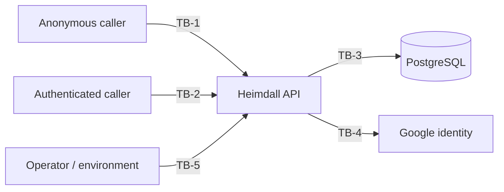

# Threat Model Document — Heimdall API

## 1. Purpose

The [System Requirements Document](System%20Requirements%20Document.md) states the security controls
this API implements. It does not state what they defend against, and a control without a stated
threat cannot be judged: there is no way to tell whether it is sufficient, whether it is the right
control, or whether removing it would matter.

This document states the threats. Each one names the asset at risk, what an attacker must already be
able to do, the control that addresses it — cited as an existing FR or NFR rather than restated — and
how anybody knows the control works. Where nothing addresses a threat, that is written down as a
finding rather than left out.

It uses the same three verification methods as the [Testing Specification
Document](Testing%20Specification%20Document.md) §11, for the same reason:

- **Test** — executed by the suite. Fails the build when the property stops holding.
- **Inspection** — established by reading the code or configuration, and re-established when it
  changes.
- **Measurement** — a number produced by a run and published.

And the same rule: **a threat whose verification method is "none" is a finding.** §11 collects them.

This is a design-level review. It is not a penetration test, and nothing here was established by
attacking a deployment.

## 2. Method

Threats are numbered `TH-nn` and grouped by the trust boundary they cross, not by the feature they
affect. Feature-organised threat models miss the crossings, and the crossings are where the defects
are: two features can each be correct and still combine into a boundary that leaks.

Residual risk is what is left *after* the control, judged on this codebase rather than in the
abstract:

- **Low** — the control addresses the threat and something checks the control.
- **Medium** — the control addresses the threat, but its coverage has a stated limit, or nothing
  checks it.
- **High** — no control, or the control does not cover the case described.

## 3. Trust boundaries

| Boundary | Crossing | What is on the other side |
| --- | --- | --- |
| TB-1 | Anonymous internet → the authentication endpoints | Credentials, tokens, and every account in the system |
| TB-2 | An authenticated caller → data belonging to a tenant | Every other tenant's persons, applications and permissions |
| TB-3 | The API → its database | Password hashes, TOTP secrets, reset tokens, the key ring |
| TB-4 | The API → Google | Whoever a Google ID token claims to be |
| TB-5 | An operator → configuration, logs and images | The signing secret, the master account, delivered tokens |

## 4. TB-1 — Anonymous internet to the authentication endpoints

Every endpoint here is `AllowAnonymous` by necessity (NFR-04): a caller cannot hold a token yet. They
are therefore the only endpoints reachable by someone with nothing at all, and they are where the
expensive work is.

| ID | Threat | Control | Verification | Residual |
| --- | --- | --- | --- | --- |
| TH-01 | Password guessing against a known address | Per-account lockout after 10 failures for 15 minutes (FR-AU-09), each attempt counted before its password is derived so a parallel burst cannot outrun it (NFR-27); per-IP fixed window of 10 requests a minute | Test | Low |
| TH-02 | Enumerating which addresses and scopes exist, from the response or its timing | One message for every rejection, and a decoy Argon2id verification when no person matches (FR-AU-10). Password recovery answers before it looks anybody up — the lookup, the token and the email run in the background — so a registered address no longer answers a Mailgun round trip later than an unknown one (FR-PR-02) | Test + measurement (SRD §6.1) | Low |
| TH-03 | Exhausting the API's memory through login | `PasswordHashGate` bounds concurrent Argon2id derivations process-wide and sheds with `503`, behind the per-IP rate limiter | Test + measurement (SRD §6.3.1) | Low |
| TH-04 | Guessing a 6-digit second-factor code | Five attempts per email code, hashed at rest, short lifetime, and at most three reissues per challenge — twenty attempts per authentication, after which a further code costs a fresh password check (FR-2F-13, FR-2F-16). Five app-code or recovery-code guesses per challenge, after which the challenge is retired (FR-2F-17). Every budget is charged before the comparison, so parallel guesses get no more (NFR-27) | Test | Low |
| TH-05 | Guessing a password-reset or verification token | 48 characters from a CSPRNG, single-use, expiring | Inspection | Low |
| TH-06 | Using an MFA-pending challenge token as a full token | Distinct claim, 10-minute fixed lifetime matching the email code it is issued with, rejected everywhere but second-factor verification (NFR-17) | Test | Low |
| TH-25 | Telling a taken address from a free one by registering, then signing in (UC-47) | Registering creates no `Person`, only a `PendingRegistration` that nothing can sign in with, so a sign-in before the link is followed answers the 401 a wrong password gets (UC-11 AF-11a). The registration's own answer is one message whether the address was free or taken (FR-SR-06) | Test | Low |
| TH-26 | Registering an address one does not own, to hold it before its owner does (squatting) | No account exists until the mailed link is followed (FR-SR-07), so an unconfirmed registration holds nothing: confirmation re-checks that the address is still free, and the others for the same address are removed. What remained was the owner confirming a registration made by someone else, and so inheriting the squatter's password; confirmation now requires the password chosen at sign-up (FR-SR-09), which only the squatter knows, so that case is closed. A scanner or a mistaken click on the link creates nothing | Test | Low |
| TH-27 | Flooding the holder of a taken address with registration-attempt notices | Per-IP rate limit only, as UC-12's reset mail has; the notice is sent after the response, so the flood is not visible to the caller. Nothing bounds the notices one holder receives from an attacker using many source IP addresses | Inspection | Medium |
| TH-28 | Using registration to send verification mail to addresses of third parties | Per-IP rate limit only. The mail says that ignoring it creates nothing, and nothing is created unless the link is followed with the password chosen at sign-up (FR-SR-07, FR-SR-09) | Inspection | Medium |
| TH-29 | Filling the registration queue so that later requests are lost | The queue holds 1024 and drops further requests silently, as UC-12's does (accepted): until it drains, every registrant's request is lost, not only the attacker's, and each is left looking for an email that never comes | Inspection | Medium |
| TH-30 | A person following a link they never requested, and ending with an account whose password someone else chose | Closed by FR-SR-09: following the link creates nothing without the password chosen at sign-up, so a scanner, a mistaken click or the wrong one of two identical emails cannot hand anyone an account whose password they do not know. The link is also single-use and expires with the email-verification token (FR-SR-08), and the email says that ignoring it creates nothing | Test | Low |
| TH-31 | A leaked registration link (a forwarded email, a proxy log) used to guess the sign-up password | The link alone confirms nothing (FR-SR-09), and each guess is charged atomically before the comparison (NFR-27), so parallel requests cannot exceed the budget: the 10th wrong password discards the registration, the login lockout's threshold, and the link then answers "Invalid token". The guesses also pass the per-IP rate limit and `PasswordHashGate`. Whoever holds the link without the password has ten tries at it | Test | Low |
| TH-32 | A leaked trusted caller key (`HEIMDALL_TRUSTED_CALLER_KEYS`) lets its holder choose the rate-limit bucket their `AuthAnonymous` requests are counted in, by naming any address in `X-Heimdall-Client-Address` | The key grants nothing but that choice: it authenticates nobody and opens no endpoint, and a wrong or missing key or an unusable address silently falls back to the connection address. A named address is counted in its own `caller:` namespace, apart from direct connections, so a key holder cannot spend the budget of a real caller by naming their address. On the credential endpoints the bucket is not the only bound: the per-account lockouts (FR-AU-09, FR-SR-09) and the process-wide `PasswordHashGate` (TH-03) do not depend on it, so a leaked key alone buys more guesses spread over invented addresses, each still limited to 10 requests a minute (a rejection answers 429 with a `Retry-After` header). Keys are at least 32 characters, compared by SHA-256 digest in constant time against every configured key, held in the deployment secret store and never logged (only their count is); two may be listed at once so one can be rotated without downtime. **Accepted residual risk:** the same policy also guards the authenticated `2fa/confirm`, `2fa/disable`, `2fa/recovery-codes/regenerate` and `erasure-request`, which have no per-account budget. A holder of both a leaked key and a stolen bearer token could spread password or second-factor guesses against those four over invented addresses, bounded then only by the password-hash gate. It needs two independent secrets | Test | Low |
| TH-33 | A stolen application secret used to obtain tokens as that application (UC-56) | Shown once and stored only as SHA-256, so neither the database nor the logs hold it; `hds_`-prefixed so a scanner recognises a leak; revocable one at a time, with a second live slot so rotation needs no downtime (FR-AP-11); optional expiry; every exchange audited with the application as target and `LastUsedAt` stamped; `AuthAnonymous` rate limit; one uniform refusal (FR-AP-14). **Residual:** until revoked, the holder authenticates as the application | Test | Medium |
| TH-34 | A leaked application token replayed (a log, a proxy) | Ten-minute lifetime by default; UC-57's live check refuses it as soon as its credential is revoked or expires or its application or scope is deleted (FR-AP-16), and consumers re-check before every sensitive release | Test | Low |
| TH-35 | Token confusion: an application token taken for a person, or a person token for an application | A distinct, required audience (start-up refuses a missing or equal one), so a consumer pinning the person audience refuses application tokens. Inside Heimdall, which checks no audience on person routes, `IdentityUserMapper` refuses any token carrying `tokenKind`, and an application token has no role. UC-57 accepts only the application audience with `tokenKind = application`, so person, Google User, challenge and subject-rights-only tokens all fail it | Test | Low |

**TH-03 was the one to read twice, and it is now closed.** Each login costs a full Argon2id
verification at 600 MB and 16 threads. The rate limiter admits ten a minute per IP and releases them
together, so one address could demand roughly **6 GB of working set per minute** and remain entirely
within policy — measured at 2.8 seconds per login when it happened (SRD §6.3.1). The limiter is
partitioned by remote IP and is per-instance, so callers spread across addresses multiplied that
budget rather than sharing it, and nothing behind it bounded what got through.

`PasswordHashGate` is that second bound, and it is deliberately not partitioned by anything: four
derivations at once for the whole process, the rest refused with `503` and a `Retry-After` after ten
seconds. Two properties matter and both are tested. It covers every derivation on a request path
rather than login alone — an authenticated caller creating persons in a loop reaches the same memory,
and a bound with a way around it is not a bound. And it refuses rather than queues, because an
unbounded queue is this threat with the pressure moved from memory into the thread pool.

The refusal is a load condition, not a rejection, so it answers 503 rather than 500 and says nothing
about the account: the decoy verification AF-11a spends passes through the same gate as a real check,
so saturation cannot be used to tell an existing address from an absent one.

What remains, and is why this is Low rather than absent: the gate bounds one process. Two instances
behind a load balancer will each permit four, so the deployment's total is the bound times the
replica count — which is the ordinary arithmetic of horizontal scaling (§6.2) rather than a gap, but
it means the number to size against is per instance.

## 5. TB-2 — An authenticated caller to another tenant's data

Authentication runs in `ClaimsOnly` mode: the caller is rebuilt from the token's claims and no data
store is consulted, which is what keeps an ordinary request free of a per-request lookup. Everything
in this section follows from that decision — a claim is a statement about the past, and the question
each threat asks is what happens when the present disagrees with it.

| ID | Threat | Control | Verification | Residual |
| --- | --- | --- | --- | --- |
| TH-07 | A Scope Admin reaching a scope they do not own | `ScopeOwnershipChecker` re-reads ownership from the database on every attempt, and excludes a deleted person | Test | Low |
| TH-08 | A demoted person keeping the authority they held when their token was issued | `ActorLivenessFilter` compares the role claim against the stored role on every request, and refuses the token when they disagree | Test | Low |
| TH-09 | A deleted or removed identity continuing to act on an unexpired token | `ActorLivenessFilter` re-reads both identity tables per request (FR-AU-05, FR-GO-12) | Test | Low |
| TH-10 | Inferring another tenant's row counts from sequential identifiers | Only `PublicId` GUIDs cross the boundary (NFR-15) | Test | Low |
| TH-11 | Granting oneself or another person the System Admin role | `UpdatePersonCommandHandler` refuses any role change unless the acting role is System Admin, and supports no transition other than *to* System Admin (UC-08) | Test | Low — the claim it reads is now verified against the row by TH-08's fix |
| TH-12 | Acting on a scope after being removed as its owner | `ScopeOwnershipChecker` re-reads, so removal takes effect immediately | Test | Low |

**TH-08 is the finding this section exists for, and it is now fixed.** As first written the role was
carried in the `roleId` claim and never re-read: `ActorLivenessFilter` asked only whether the person
existed and was not deleted, and `ScopeOwnershipChecker` grants an unconditional bypass when the
acting role is `SystemAdmin`, taken from the claim without a lookup.

So demoting a System Admin does not take effect until their token expires — an hour by default, and
configurable upward. For that hour the demoted account keeps cross-tenant authority over every scope
in the system, and the bypass means it does so without any query that could have noticed. This is the
one case where the design's decision to trust claims has a consequence that deletion does not: an
account that is *deleted* is stopped within one request, and an account that is merely *demoted* is
not stopped at all.

**And the window is enough to make itself permanent.** A role change is refused unless the acting
role is System Admin — read, like everything else, from the claim — and the one transition the
handler supports is a promotion *to* System Admin. A demoted account therefore spends its remaining
token lifetime able to promote itself straight back, or to promote an account it controls, and that
promotion is a database write that outlives every token involved. What looks like a bounded window of
stale privilege is a path to an unbounded one, which is why TH-11 is Medium rather than Low: its own
control is sound, and it inherits this one's weakness through the claim it trusts.

The fix is the mechanism TH-09 and TH-12 were already Low for: `ActorLivenessFilter` was reading the
`Person` row on every request anyway, so it now selects the role out of that row instead of asking
whether it exists, and refuses the request when the claim disagrees. No extra query. A promotion is
refused on the same rule as a demotion — a check that only rejected claims *above* the stored role
would be the one worth writing carefully and then getting backwards.

Two things fell out of making it true. A token whose role is out of date now gets its own message
rather than the deliberately vague one deletion gets, because a role change is not an existence
question and the caller can act on it. And a functional test that had been minting a System Admin
claim for a person stored as a User stopped passing — it was relying on exactly the forgery this
closes, and now names an actor whose claim and row agree.

## 6. TB-3 — The API to its database

The threats here assume an attacker who can read the database and nothing else: a leaked backup, a
compromised read replica, a restored snapshot, or an injection that yields rows. The question each
one asks is what that reader can do with what they find.

| ID | Threat | Control | Verification | Residual |
| --- | --- | --- | --- | --- |
| TH-13 | Recovering passwords from stolen rows | Argon2id with a per-person salt (NFR-02) | Test | Low |
| TH-14 | Taking over an account using a stolen password-reset or email-verification token | Both are stored as a SHA-256 digest and never in the form a caller presents (`SingleUseTokenHash`) | Test | Low |
| TH-15 | Recovering TOTP secrets from stolen rows | Encrypted at rest with ASP.NET Data Protection (NFR-16) | Test | Medium |
| TH-16 | Replaying a stolen second-factor recovery code | Stored as a SHA-256 hash, single-use (NFR-16) — spent by a conditional write, so two simultaneous requests cannot both redeem it (NFR-27) | Test | Low |
| TH-17 | Injecting SQL through a caller-supplied value | EF Core parameterises every query; no string-concatenated SQL | Inspection | Low |
| TH-18 | Denying an action that was taken | Every write produces an audit entry (NFR-09); database triggers refuse `DELETE` and `TRUNCATE` outright and permit exactly two kinds of `UPDATE` — clearing the actor attribution once due, and clearing a target that names a person or Google User — on record, or tombstoned by a hard delete and gone — once due (NFR-21); a trigger on `ERASED_SUBJECT` accepts a tombstone only for a person or Google User that exists, `public_id` is immutable on `PERSON`, `GOOGLE_USER` and every table whose ids the identity check trusts, no new row of those tables may take an id another holds, and a new person or Google User may not take an id an audit entry names (#199), so with DML alone no existing target that is not a person's can be made clearable | Test | Low — but see below on DDL and §6.1's insert race |

**TH-14 was a straightforward inconsistency, and it is now fixed.** `PasswordResetService` and
`EmailVerificationService` both used to write the token they had just generated straight into the
row — `Token = token` — while a second-factor recovery code, which is *weaker* as an
account-takeover primitive since it still requires the password, was stored as a hash, and a 2FA
email code hashed and salted. A reader of the `password_reset_token` table could complete a reset for
any account holding a live token, which did not break the Argon2id work protecting the password so
much as walk around it.

Both now store a SHA-256 through `SingleUseTokenHash`, and the presented token is hashed and looked
up against a unique index on the digest. Unsalted, deliberately: these are 48 characters from a
CSPRNG, so there is no precomputed table for a salt to defend against, and a per-row salt would force
a scan of every live token on every attempt — the caller presents the token alone, with nothing to
narrow the candidates by. The migration computes the digest from the column it replaces rather than
discarding rows, so links already sitting in inboxes keep working.

What it cost is worth recording, because it is the kind of loss a table of green ticks hides. Two
functional tests used to drive issue-then-spend end to end by reading the token back out of the row.
They cannot: the suite has no inbox and no seam to substitute a sender through. They now assert what
UC-12 and UC-06 *stored*, and the spending half is covered where the plaintext is still in the test's
hands — the service tests capture it from the sender, the handler tests seed through the same helper.
Both halves go through `SingleUseTokenHash`, so they would fail together if it changed.

**TH-15 is Medium rather than Low for a reason worth stating.** The TOTP secrets are encrypted, and
since the key ring is persisted to the database so that a second instance can decrypt them (SRD
§6.2), the ciphertext and the keys that open it now live in the same store. That was the right call
for availability — before it, a recreated container silently locked every authenticator user out —
but it means the encryption at rest defends against a stolen *table* and not against a stolen
*database*. Naming that is the point of writing it down; moving the key ring to a separate secret
store is a real change with its own operational cost, and is not being recommended here without one.

**TH-18 was Medium because the audit log was append-only by convention.** `AuditLog` had said
"append-only: never updated or logically deleted after creation" since it was written, and nothing
enforced it: the API's own credentials were sufficient to rewrite the trail, so it was evidence
against an ordinary caller and none at all against anyone who reached the database.

A trigger now refuses `UPDATE`, `DELETE` and `TRUNCATE` on the table. A trigger rather than a
permission grant, because a grant depends on the deployment connecting as a role that lacks those
rights, and this repository's compose file, the functional suite and most development setups all
connect as the owner; a trigger holds regardless of who is connected and travels with the schema.
`TRUNCATE` needs naming separately because it skips `BEFORE DELETE` entirely, and the triggers fire
per statement rather than per row so that a `DELETE` matching nothing is refused too — otherwise the
rule would depend on what the statement happened to hit.

It does not defend against somebody who can also run DDL: a superuser can drop the trigger and then
rewrite history. That is smaller than the hole it closes — it leaves a schema change behind, where an
`UPDATE` left nothing — but it is not zero, which is why the row above is qualified rather than
simply Low.

### 6.1 The writes the trail now permits, and why it is still Low

NFR-21 narrowed the rule. `AUDIT_LOG` no longer refuses every `UPDATE`: it permits the actor
attribution to be cleared and, since #184, a target that names a person or Google User — since #195
also one whose row was hard-deleted, recognised by its tombstone — and nothing else. That is a real
reduction in what the triggers guarantee, and it is recorded here rather than left for a reader to
discover in a migration.

**Why it was necessary.** `actor_person_id` holds a person's `PublicId`. An indefinitely retained,
unalterable row naming somebody who has exercised their right to erasure is personal data processed
with no remaining basis, so a table that refused every write made erasure impossible by
construction. The two obligations were in direct conflict, and one of them had to give ground.
`target_id` raised the same conflict a second time: for a command somebody runs on their own account
it is their own `PublicId`, and for an administrator's action on a person it is that person, so an
entry with its actor cleared could still name the person it was about.

**Why the ground given is narrow.** The trigger permits a write only when every column except
`actor_person_id`, `actor_role` and `target_id` is identical, each of those is either unchanged or
being set to `NULL` rather than to another value, and each clearing is due — the entry is older than
thirty days, or the identity it names has been anonymised. A target may be cleared only when it is
the `PublicId` of a `PERSON` or `GOOGLE_USER` row; one naming a scope, an application, a credential
or a permission, or nobody at all, stays immutable. The one exception (#195) is an id that no row
has any more but that `ERASED_SUBJECT` records as a hard-deleted person's or Google User's: that
target may be cleared at any age, as an anonymised person's may. `DELETE` and `TRUNCATE` remain
refused outright, per statement.

**The tombstone table is guarded too (#195, R1).** A row in `ERASED_SUBJECT` is what makes a target
with no row clearable, so a table anyone could write to would have reopened what the triggers close:
insert a live scope's id, then clear every target naming it, with the planted row removed by the
retention pass a day later. A `BEFORE INSERT OR UPDATE` trigger on the table therefore refuses any
row whose `public_id` is not, at that moment, a `PERSON` or `GOOGLE_USER` row's. Every legitimate
write passes, because a hard delete writes its tombstones before deleting, and so does the retry's
upsert, which only happens while the row survives. Checking `UPDATE` as well stops a legitimate
tombstone being rewritten to another id afterwards.

**What an attacker gains.** Somebody holding the application's database credentials can clear an
attribution or a person target older than thirty days, or one of any age naming an identity they
have first managed to anonymise. They cannot remove an entry, alter what it says, reassign its actor
or its target to somebody else, clear a target that is not a person's, or clear their own
attribution, or the person they acted on, for something they did this week. Anonymising an identity
through the API is itself an audited write, and doing it to their own account destroys their access.

The tombstone ground adds one path, and the guard bounds it, stated plainly. The same credentials
can tombstone a person or Google User that exists and then delete their row with plain SQL, which
the API would have audited and SQL does not; after that, the targets naming them clear at any age.
That is the power they already had — delete a person outright, or anonymise them first and clear the
same targets — exercised on the same people, and it is destructive and visible, since the person is
gone. What the guard stops is tombstoning an id that is not a person's, so two statements no longer
make a target naming a scope, an application or a credential clearable, as they would have without
it.

**The ids are guarded too (#199).** The guard, and #184's rule before it, read a `PERSON` or
`GOOGLE_USER` row's `public_id` as proof that an id is a person's, and until #199 that proof could
be forged with DML alone: give a person or Google User row a scope's, an application's or a
credential's `public_id`, by rewriting an existing row or by inserting a new one, then anonymise or
tombstone it and clear the targets naming that entity. Three rules now close every such path.

- **Ids are immutable.** A `BEFORE UPDATE` trigger refuses any change to `public_id` on `PERSON`,
  `GOOGLE_USER`, `SCOPE`, `APPLICATION`, `APPLICATION_CREDENTIAL`, `SCOPE_PERMISSION`, `ROLE` and
  `PENDING_REGISTRATION`, every table the identity check trusts. Every other column stays writable,
  so names, addresses, anonymisation and soft deletes are unaffected. Without it the check below
  could be walked round: move a scope off its id, insert a person with the freed id, clear the
  scope's targets, move the scope back.
- **Ids are not shared.** A `BEFORE INSERT` trigger on the same eight tables refuses a `public_id`
  that a row of any other of them holds, soft-deleted or not; a table's own unique index covers
  itself. It runs on every table, not only the identity ones, so the order of the two inserts does
  not matter: a person inserted first refuses a scope inserted with its id after it.
- **An identity may not take an id the trail names.** The same trigger refuses, for `PERSON` and
  `GOOGLE_USER` only, an id that an audit entry's `target_id` names. After an ordinary hard delete
  of a scope, an application or anything else, no row holds its id any more, and an anonymised
  person planted with it would have made every entry about that entity clearable. Only the identity
  tables need it, because the target rule reads only them, and the tombstones, to tell a person's
  id. It keeps nothing new, since the trail already holds the id, and once the trail no longer names
  it the id is free again.

The application only ever creates fresh random ids, and writes an identity's own entries after its
row, so no legitimate write is refused. `IdentityPublicIdTests` and `EntityPublicIdTests` pin each
rule, each table, and the rename-then-reuse chain end to end.

What remains is stated as plainly. No registry of issued ids is kept, because it would keep a
removed person's id for good, so an id that neither a row nor the trail holds any more may be taken
again; it then names nothing the trail could clear. The triggers guard future writes and do not
inspect rows already stored; Operations gives the queries to check them. The insert check takes no
lock, so two concurrent transactions that both choose the same id can both pass it, and an actor
controls both. That race reaches only a row the actor inserts by SQL at that moment, never one that
already exists or that the API creates, whose id cannot be known in advance; entries written later
about such a planted row could be cleared. Closing it would need one unique index across all eight
tables, which is a registry, and is out of scope. And an actor who can run DDL, or disable triggers
(`ALTER TABLE … DISABLE TRIGGER`, or `session_replication_role` as a superuser), can do anything
here, as with the audit triggers themselves; that is out of scope for the reason given under TH-18.

**Residual risk: Low.** The property this threat is about — that an action cannot be denied — is
intact: with DML alone, a target can be cleared only when it names an identity that has held its id
since it was created, or one the actor planted in the same moment as the entity it shares an id
with. What became time-limited is attribution, which is what storage limitation requires of it, and
the person an action was taken on is forgotten on the same terms. `AuditActorClearingTests` and
`AuditTargetClearingTests` pin every case against real PostgreSQL, each refusal by its own reason,
the tombstone cases included; `ErasedSubjectsTests` pins the tombstone table's guard, and
`IdentityPublicIdTests` and `EntityPublicIdTests` the `public_id` triggers.

## 7. TB-4 — The API to Google

| ID | Threat | Control | Verification | Residual |
| --- | --- | --- | --- | --- |
| TH-19 | Presenting a forged or replayed Google ID token | Signature, issuer, audience and expiry are all verified before any claim is trusted (NFR-13) | Test (audience) + inspection (Google's own checks) | Low |
| TH-20 | Presenting a token minted for a different OAuth client | The configured client IDs are the trusted audience, and a test requires that constraint to be present | Test | Low |
| TH-21 | Reaching an existing password account by signing in with the same address through Google | The two identity tables are never joined on email: the sign-in resolves by Google's `sub` within the scope, the token names the Google User's own `PublicId`, and UC-25 issues the `User` role unconditionally | Test | Low |

**TH-21 was the one gap this document opened against itself, and it has now been traced.** The answer
is that a Google sign-in cannot reach a password account, for three independent reasons: the account
is looked up by Google's `sub` within the scope and never by email, so a Person is never a candidate;
the token names the Google User's own `PublicId`, which is a different GUID from any Person's; and
UC-25 mints the `User` role unconditionally, which `ActorLivenessFilter` now enforces for any Google
identity. Two tests pin it — one that the colliding sign-in creates a separate row and leaves the
admin's record untouched, one that the token it returns is refused by an endpoint the admin whose
address it shares could reach.

What the trace did turn up is narrower, and is recorded here as accepted rather than as a defect.
AF-25c asks whether the address is free *within the scope*, and asks the person half of that question
only of persons holding a `SCOPE_USER` row. An admin has none — UC-06 path b creates them with no
scope association — so an admin's address does not read as taken and the sign-up proceeds. The
address then exists twice across the two tables.

That is left as it is on purpose. The alternative is that any address belonging to a system-wide
admin blocks Google sign-up in every scope, which is a worse rule than the one being avoided: it
turns a system-wide account into a veto over per-scope sign-ups, for no gain that the three
separations above do not already provide. Nothing in the system keys off an email across the two
tables — login and password recovery read Persons, Google sign-in reads Google Users — so the
duplicate is an operational surprise rather than a way in. It is written down because a reader of
FR-GO-07 would not expect it.

## 8. TB-5 — An operator to configuration, logs and images

| ID | Threat | Control | Verification | Residual |
| --- | --- | --- | --- | --- |
| TH-22 | Minting a valid token for any identity, using the signing secret | The secret is supplied by environment and never logged, and can be rotated: `HEIMDALL_AUTH_TOKEN_SECRET_PREVIOUS` keeps the retired key acceptable while the new one signs | Test + inspection | Low |
| TH-23 | Reading a delivered verification, reset or 2FA code — or a recipient address — out of the logs | Production fails startup when email delivery is unconfigured, rather than falling back to logging the token; and no log statement writes an address in any environment, a reference to it instead (NFR-22) | Inspection + test | Medium |
| TH-24 | Using the seeded master account | Credentials are supplied by environment and required at startup | Inspection | Medium |

**TH-22 was Medium because there was no rotation story, and it now has one.** A leaked signing
secret is total — it mints any identity at any role — and the only remediation available was a hard
cutover: change the secret, and every token in flight dies at once. A remediation that is also an
outage is one nobody performs pre-emptively, which is why the secret was in practice never rotated.

`HEIMDALL_AUTH_TOKEN_SECRET_PREVIOUS` is the other half. Both secrets are handed to
`JwtConfiguration.Keys`, so a token signed with either is accepted while new tokens are signed with
the current one. Rotating is three steps and no outage: set the previous variable to the secret in
use, set the current variable to a new one, restart; then an hour later — one token lifetime — clear
the previous variable and restart again. Withdrawing a key still invalidates its tokens immediately,
which is what makes the shortened version of that procedure the right response to a leak.

No `kid` is written to the tokens, deliberately. The library supports it, but the identifiers here are
positional — today's "current" is tomorrow's "previous" — so stamping one would make every token
issued before a rotation name the wrong key afterwards and be refused, which is precisely the failure
this closes. Deriving stable identifiers from the secrets instead would publish something computed
from a signing key on every token, a poor trade for saving one HMAC against two keys. Validation
tries both.

**TH-23 now covers the address as well as the token, and the two halves differ in scope.** The
token control is environmental: Production refuses to start with delivery unconfigured, so the
logging senders that write a token never run there. The address control is not environmental — no
statement writes an address in any environment, and `LogRedactionTests` fails the build if one
reappears. That closes a gap the original entry did not name: the token was only ever logged outside
Production, but `MailgunSender` wrote the recipient's address on every successful send *in*
Production, into files that were then kept forever.

**TH-23's token control covers Production and by design does not cover anything else.** A developer or
staging deployment without Mailgun credentials logs verification tokens, reset tokens and 2FA codes
in plaintext, which is deliberate and documented: the functional suite and a local run both need
those flows to work without credentials or network. It is listed here because a staging deployment
with real users' addresses in it turns a convenience into an account-takeover primitive for anyone
who can read a log. The development and homologation environments (the latter running as `Staging`) are exactly
such deployments, which is why they hold made-up people only — §0.2 of the
[Operations & Infrastructure Document](Operations%20%26%20Infrastructure%20Document.md).

## 8.1 Detection

Every control in this model is preventive. Until NFR-26 there was nothing that noticed a control
being *tested* — the audit trail recorded each refusal with its reason, the lockout counters tracked
per-account guessing, and the hash gate shed under load, and none of it reached anybody. A trail
nobody reads does not make anyone aware of anything, and awareness is what starts GDPR Art. 33's
seventy-two hours.

`SecurityMonitoringService` now reads those signals on a schedule and writes what exceeds its
thresholds to the log with a matchable marker. It is deliberately not a decision procedure: what
follows a signal is the [Incident Response Document](Incident%20Response%20Document.md), because
automating the declaration would put the notification clock in the hands of a threshold.

## 9. What this model does not cover

- **Risk to the data subject.** This model asks what an attacker can do to the system. What the
  system does to the people in it — including where a control works exactly as designed and is still
  a harm, as an account lockout is — is the
  [Data Protection Impact Assessment](Data%20Protection%20Impact%20Assessment.md). The two are
  complementary and neither substitutes for the other.

- **No dynamic testing.** Nothing here was found by attacking a running deployment. A design review
  finds missing and mismatched controls; it does not find the ones that are present and broken.
- **Denial of service beyond TH-03.** The load runs (SRD §6.3) establish what the API delivers under
  concurrency, not what it does under a hostile request pattern chosen to be expensive.
- **The infrastructure the API runs on.** Container escape, host access, network position and
  PostgreSQL's own configuration are all out of scope, and the Operations & Infrastructure Document
  is where they would belong.
- **The api-client.** The published client is not modelled here; every threat above is stated from
  the API's side of the boundary.
- **Supply chain beyond known advisories.** `scripts/vulnerabilities.py` fails the build on a
  published advisory. It says nothing about a dependency that is malicious and not yet reported.

## 10. Adding a threat

The same rule as a use case and a non-functional requirement: it does not exist until something
checks it.

A change that crosses a trust boundary in §3 — a new anonymous endpoint, a new claim trusted for
authorization, a new table holding a secret, a new external identity source — needs a `TH-nn` entry
before it merges, with a control and a verification method. If the method is "none", that is
permitted and it goes in §11, because an acknowledged gap is worth more than a table of green ticks
that hides one. What is not permitted is the entry being absent.

## 11. Findings register

Every threat above now has a control and a verification method, so this table is empty for the first
time since the document was written. That is a statement about coverage, not about safety: §9 lists
what this model does not look at, and the register can only be as complete as §4 to §8 are.

### 11.1 A correction

An earlier revision of this section said TH-22 could not be closed in this repository and needed a
change to `ArturRios.Jwt` and `ArturRios.Util.WebApi` first. That was wrong, and wrong in a way worth
recording rather than quietly editing out.

It was based on reading `JwtMiddleware` as taking a single `JwtConfiguration`, and concluding there
was no seam for a second key. There was: `AuthenticationMiddleware` runs a collection of
`ITokenValidator`s, that interface is public, and `JwtHandler.IsTokenValidAsync` already took the
secret as a parameter — so this API could always have registered its own validator and rotated
without either library changing at all.

The libraries were changed anyway, because the alternative was every consumer rebuilding the same
validator, and because a rotation belongs where the tokens are signed. But the reason recorded here
for not doing it sooner was a misreading, and a threat model that cites an obstacle should be right
about the obstacle.

### 11.2 Closed

Kept rather than deleted, because a register that only ever lists open items gives no sense of what
this document has been worth.

| Threat | What it was | What closed it |
| --- | --- | --- |
| TH-14 | Password-reset and email-verification tokens were stored in plaintext, while the weaker recovery codes beside them were hashed | `SingleUseTokenHash`: both are stored as a SHA-256 digest, the migration converts existing rows rather than dropping them, and the issue and spend paths share one helper |
| TH-08 | A demoted account kept its authority until its token expired, and could spend that window promoting itself back permanently | `ActorLivenessFilter` compares the role claim against the row it was already reading, and refuses a token whose role is out of date |
| TH-21 | Nobody had established what a Google sign-in does with an address that already belongs to a password account | Traced: resolution is by Google's `sub`, the token names the Google User's own `PublicId`, and the role is always `User`. Two tests state the answer |
| TH-03 | The per-IP rate limiter was the only bound on login's memory demand, and one address could ask for 6 GB of Argon2id working set a minute within policy | `PasswordHashGate`: four concurrent derivations process-wide, every derivation on a request path, `503` rather than an unbounded queue. Measured at no latency cost |
| TH-18 | The audit log was append-only by convention; the API's own credentials could rewrite the trail | Triggers refusing `DELETE` and `TRUNCATE` per statement, so an empty `DELETE` is refused too, and permitting only the two `UPDATE`s NFR-21 requires, clearing the actor attribution and clearing a person target, on record or tombstoned, with tombstones accepted only for a person or Google User that exists, `public_id` immutable on the identity tables and every table they are checked against, never shared by a new row of any of them, and never one the trail names on a new identity — see §6.1 |
| TH-22 | The signing secret could not be replaced without invalidating every token in flight, so it was never rotated | `HEIMDALL_AUTH_TOKEN_SECRET_PREVIOUS`: both keys are accepted while the current one signs, on `ArturRios.Jwt` 1.1.0 and `ArturRios.Util.WebApi` 3.2.0 |
| TH-35 | Finding: Heimdall's middleware validates signature and lifetime only, not the audience (`ArturRios.Jwt` `IsTokenValidAsync`), so an application token, signed with the person tokens' keys, would pass it | Response: `IdentityUserMapper` refuses any token carrying `tokenKind`; a functional test pins an application token's `401` on a person endpoint |

TH-14 and TH-08 were found by reading the code while writing this document, and neither was visible
from the requirements they were supposed to follow from. TH-21 was found by this document admitting
it did not know — the case for the rule that an unanswered question is written down rather than
assumed safe. TH-03, TH-18 and TH-22 were known limits from the first draft, closed later once their
cost was understood. Two of those are worth a second look: TH-03's fix was worth measuring rather
than reasoning about, since the obvious prediction — that bounding concurrency would slow login down
— turned out to be wrong; and TH-22 sat open partly because this document had the reason for it
wrong (§11.1).
