# Use Case Specification Document — Heimdall API

## 1. Introduction

### 1.1 Purpose

This document specifies the actor-facing use cases for the **Heimdall API** — UC-01 through UC-29 and UC-31 through UC-40. Each describes actor interactions, preconditions, postconditions, main flows, and alternative/exception flows.

UC-30 (Check API Health) is specified in the [Operations & Infrastructure Document](Operations%20%26%20Infrastructure%20Document.md), §3.5, alongside the FR-HC requirements it realises: it describes how the system is operated rather than what it does for an actor, and keeping it with the monitoring requirements keeps the two together.

Note on identifiers: every `{id}` / `{scopeId}` / `{personId}` referenced in these flows is the entity's `PublicId` (a GUID). Internally, each entity also has an auto-increment `bigint Id` used only for storage and joins — it is never seen by any actor in these use cases (see the System Requirements Document, §4.0).

### 1.2 Actors

| Actor | Description |
| ------- | ------------- |
| **System Admin** | Has full access to all scopes, persons, and applications across the entire system; belongs to no scope |
| **Scope Admin** | Owns one or more scopes and manages the users and applications within those scopes; can add co-owners to a scope they own by creating a new Scope Admin or promoting an existing User |
| **User** | An authenticated person belonging to exactly one scope, with basic access to their own profile |
| **Anonymous** | An unauthenticated caller (can only access public endpoints) |
| **Email Service** | External system that delivers emails for verification and password recovery |
| **Google User** | A person authenticated via Google Sign-In rather than a password; always equivalent to the `User` role, stored in a separate table from Person |
| **Google Identity Platform** | External system (Google) that authenticates the end user and issues a signed ID token containing their identity claims |

### 1.3 Use Case Overview

```mermaid
graph LR
    subgraph Actors
        SA(("System Admin"))
        SCA(("Scope Admin"))
        U(("User"))
        AN(("Anonymous"))
        ES(("Email Service"))
        GU(("Google User"))
        GIP(("Google Identity Platform"))
    end

    subgraph "Scope Management"
        UC01[UC-01: Create Scope]
        UC02[UC-02: View Scope]
        UC03[UC-03: Update Scope]
        UC04[UC-04: Logical Delete Scope]
        UC05[UC-05: Hard Delete Scope]
        UC21[UC-21: Add Scope Owner]
        UC22[UC-22: Remove Scope Owner]
        UC23[UC-23: Promote User to Scope Owner]
    end

    subgraph "Person Management"
        UC06[UC-06: Create Person]
        UC07[UC-07: View Person]
        UC08[UC-08: Update Person]
        UC09[UC-09: Logical Delete Person]
        UC10[UC-10: Hard Delete Person]
    end

    subgraph "Authentication & Security"
        UC11[UC-11: Login]
        UC12[UC-12: Password Recovery]
        UC13[UC-13: Reset Password]
        UC14[UC-14: Email Verification]
        UC15[UC-15: Resend Verification Email]
    end

    subgraph "Application Management"
        UC16[UC-16: Create Application]
        UC17[UC-17: View Application]
        UC18[UC-18: Update Application]
        UC19[UC-19: Logical Delete Application]
        UC20[UC-20: Hard Delete Application]
    end

    subgraph "Google Sign-In"
        UC24[UC-24: Enable/Disable Google Sign-In]
        UC25[UC-25: Sign Up / Sign In via Google]
        UC26[UC-26: Sign Out via Google]
        UC27[UC-27: View Google User]
        UC28[UC-28: Logical Delete Google User]
        UC29[UC-29: Hard Delete Google User]
    end

    subgraph "Scope Permission Management"
        UC31[UC-31: Create Scope Permission]
        UC32[UC-32: View Scope Permission]
        UC33[UC-33: Update Scope Permission]
        UC34[UC-34: Logical Delete Scope Permission]
        UC35[UC-35: Hard Delete Scope Permission]
    end

    subgraph "Two-Factor Authentication"
        UC36[UC-36: Enable Two-Factor Authentication]
        UC37[UC-37: Confirm Two-Factor Authentication Setup]
        UC38[UC-38: Verify Second Factor]
        UC39[UC-39: Disable Two-Factor Authentication]
        UC40[UC-40: Regenerate Recovery Codes]
    end

    SA --> UC01 & UC02 & UC03 & UC04 & UC05
    SA --> UC21 & UC22 & UC23
    SCA --> UC02 & UC21 & UC22 & UC23
    SA --> UC06 & UC07 & UC08 & UC09 & UC10
    SCA --> UC06 & UC07 & UC08 & UC09
    U --> UC07 & UC08
    SA & SCA & U --> UC11 & UC15
    AN --> UC11 & UC12 & UC13 & UC14
    UC12 --> ES
    UC14 --> ES
    UC06 --> ES
    UC15 --> ES
    SA --> UC16 & UC17 & UC18 & UC19 & UC20
    SCA --> UC16 & UC17 & UC18 & UC19
    SA --> UC24 & UC27 & UC28 & UC29
    SCA --> UC24 & UC27 & UC28
    AN --> UC25
    UC25 --> GIP
    GU --> UC26 & UC27
    UC25 -.-> GU
    SA --> UC31 & UC32 & UC33 & UC34 & UC35
    SCA --> UC31 & UC32 & UC33 & UC34
    SA & SCA & U --> UC36 & UC37 & UC39 & UC40
    AN --> UC38
    UC36 --> ES
    UC38 --> ES
```

---

## 2. Use Case Specifications

---

### UC-01: Create Scope

| Field | Value |
| ------- | ------- |
| **ID** | UC-01 |
| **Name** | Create Scope |
| **Actors** | System Admin |
| **Description** | Allows a System Admin to create a new scope to onboard a client system, designating at least one Scope Admin as its initial owner |
| **Preconditions** | Actor is authenticated and has the `SystemAdmin` role; each specified initial owner is an existing, non-logically-deleted person with the `ScopeAdmin` or `SystemAdmin` role |
| **Postconditions** | A new scope record exists in the system, with one or more `SCOPE_OWNER` rows linking it to its initial owners |

**Main Flow:**

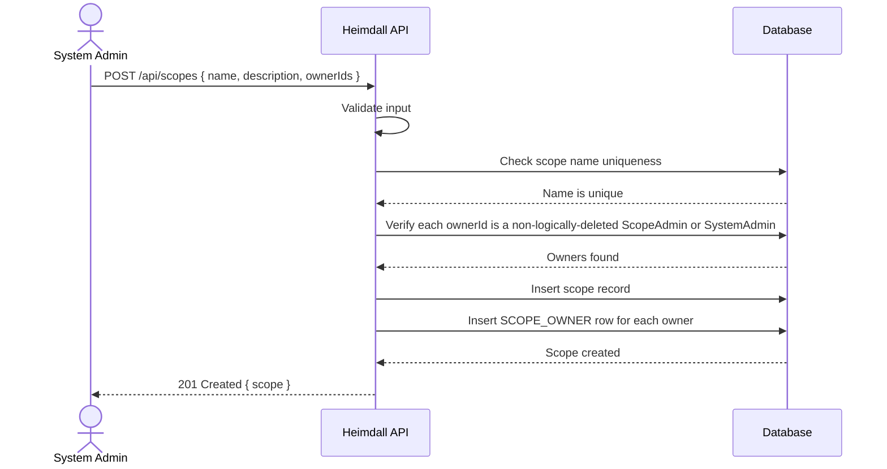

1. System Admin sends a request with scope name, optional description, and at least one owner ID.
2. The system validates the input fields.
3. The system verifies the scope name is unique.
4. The system verifies each referenced owner is an existing, non-logically-deleted person with the `ScopeAdmin` or `SystemAdmin` role (FR-SC-08).
5. The system creates the scope record with `IsDeleted = false` and a `SCOPE_OWNER` row for each initial owner.
6. The system returns the created scope.

**Alternative Flows:**

| ID | Condition | Outcome |
| ---- | ----------- | --------- |
| AF-01a | Scope name already exists | Return `409 Conflict` |
| AF-01b | Invalid input data, or no owner specified | Return `400 Bad Request` with validation errors |
| AF-01c | Actor is not System Admin | Return `403 Forbidden` |
| AF-01d | An owner ID does not reference an existing, non-logically-deleted `ScopeAdmin` or `SystemAdmin` | Return `400 Bad Request` |

---

### UC-02: View Scope

| Field | Value |
| ------- | ------- |
| **ID** | UC-02 |
| **Name** | View Scope |
| **Actors** | System Admin, Scope Admin, User |
| **Description** | Retrieve scope details by ID, or list scopes. There are two distinct reads: (a) a single scope by ID, via `GET /api/scopes/{id}`, open to any authenticated actor; or (b) the list of scopes, via `GET /api/scopes`, open to System Admins (every scope) and Scope Admins (the scopes they own) |
| **Preconditions** | Actor is authenticated |
| **Postconditions** | Scope information is returned |

**Main Flow (read a — scope by ID):**

1. Actor requests scope details by ID.
2. The system loads the scope, filtering out logically deleted scopes unless explicitly requested.
3. The system checks authorization:
   - System Admin: can view any scope.
   - Scope Admin: can view only the scopes they own.
   - User: can view only the scope they belong to.
4. The system returns the scope data.

**Main Flow (read b — list scopes):**

1. A System Admin or a Scope Admin requests a list of scopes, optionally filtering by name
   (case-insensitive) and paging the result (FR-SC-03).
2. For a Scope Admin, the system keeps only the scopes they own, as the scope-owner records stand now.
3. The system filters out logically deleted scopes unless explicitly requested.
4. The system returns the page of scopes, its total counting only what the caller may see.

**Alternative Flows:**

| ID | Condition | Outcome |
| ---- | ----------- | --------- |
| AF-02a | Scope not found, or logically deleted and not explicitly requested (read a) | Return `404 Not Found` |
| AF-02b | Actor not authorized for the requested scope (read a); actor is a User (read b) | Return `403 Forbidden` |

> **On who may list.** A Scope Admin's console has a scopes screen, and building it from the
> `ownedScopeIds` claim plus one read (a) per scope made the screen depend on a sign-in-time snapshot
> and cost a request per row. So read (b) is open to Scope Admins, filtered to the scopes they own
> before pagination: the total they see is their own count, and the number of scopes other tenants
> hold — the fact that kept the listing System-Admin-only — stays out of reach. Ownership is read
> from the scope-owner records, so an owner removed by UC-22 stops seeing the scope at once rather
> than when their token expires. A User has exactly one scope and reads it by ID; the collection
> stays closed to them. System Requirements Document §5.1 and §7 record the same.

---

### UC-03: Update Scope

| Field | Value |
| ------- | ------- |
| **ID** | UC-03 |
| **Name** | Update Scope |
| **Actors** | System Admin |
| **Description** | Modify an existing scope's name or description |
| **Preconditions** | Actor is authenticated with `SystemAdmin` role; scope exists and is not logically deleted |
| **Postconditions** | Scope record is updated |

**Main Flow:**

1. System Admin sends an update request with the scope ID and new field values.
2. The system validates the input.
3. The system verifies the scope exists and is not logically deleted.
4. The system applies the updates and sets `UpdatedAt`.
5. The system returns the updated scope.

**Alternative Flows:**

| ID | Condition | Outcome |
| ---- | ----------- | --------- |
| AF-03a | Scope not found or logically deleted | Return `404 Not Found` |
| AF-03b | Name conflicts with another scope | Return `409 Conflict` |

---

### UC-04: Logical Delete Scope

| Field | Value |
| ------- | ------- |
| **ID** | UC-04 |
| **Name** | Logical Delete Scope |
| **Actors** | System Admin |
| **Description** | Soft-delete a scope by setting `IsDeleted = true` |
| **Preconditions** | Actor is authenticated with `SystemAdmin` role; scope exists |
| **Postconditions** | Scope `IsDeleted` is set to `true`; all Users belonging to the scope (via `SCOPE_USER`), all Google Users in the scope, and all applications in the scope are also logically deleted. Scope Admins who own the scope are unaffected, since they may own other active scopes. The response reports the scope's identifier and the total number of Users, Google Users, and applications belonging to the scope |

**Main Flow:**

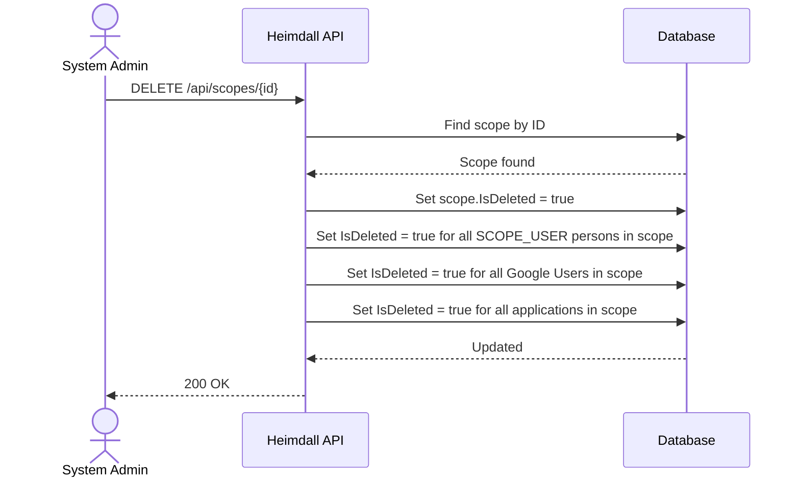

1. System Admin sends a delete request for a scope.
2. The system locates the scope.
3. The system sets `IsDeleted = true` on the scope.
4. The system sets `IsDeleted = true` on all Users belonging to the scope (via `SCOPE_USER`), all Google Users in the scope, and all applications in the scope. Scope Admins who own the scope are not modified.
5. The system returns success, including the scope's identifier and the total number of Users, Google Users, and applications belonging to the scope (counted regardless of their individual deletion state).

**Alternative Flows:**

| ID | Condition | Outcome |
| ---- | ----------- | --------- |
| AF-04a | Scope not found | Return `404 Not Found` |
| AF-04b | Scope already logically deleted | Return `200 OK` (idempotent); the scope and its Users/Google Users/applications are left unchanged, and the response still reports the scope's identifier and its User/Google User/application totals |

---

### UC-05: Hard Delete Scope

| Field | Value |
| ------- | ------- |
| **ID** | UC-05 |
| **Name** | Hard Delete Scope |
| **Actors** | System Admin |
| **Description** | Permanently remove a scope, its Users, its applications, and its scope permissions |
| **Preconditions** | Actor is authenticated with `SystemAdmin` role; scope exists |
| **Postconditions** | Scope, its `SCOPE_OWNER`/`SCOPE_USER` rows, its Users, its Google Users, its applications, and its scope permissions are permanently removed from the database. Scope Admin person records are not removed, since they may own other scopes |

**Main Flow:**

1. System Admin sends a hard delete request.
2. The system locates the scope.
3. The system records a tombstone in `ERASED_SUBJECT` for each User and Google User it is about to remove — their `PublicId`, which kind, and when — before anything is deleted, so the audit entries naming them can still be cleared once their rows are gone (NFR-21, #195). Scope Admins are not removed and get none; nor does the scope.
4. The system permanently deletes all Users belonging to the scope (via `SCOPE_USER`), all Google Users in the scope, and all applications in the scope.
5. The system removes all `SCOPE_OWNER` and `SCOPE_USER` rows referencing the scope, and cascade-deletes any remaining scope permissions.
6. The system permanently deletes the scope record.
7. The system returns success, including the count of scope permissions removed.

**Alternative Flows:**

| ID | Condition | Outcome |
| ---- | ----------- | --------- |
| AF-05a | Scope not found | Return `404 Not Found` |

> **On NFR-12 and this use case.** There is deliberately no last-owner guard here, unlike UC-10.
> NFR-12 protects a scope from losing its owners; a scope being removed outright has nothing left to
> protect. An already logically deleted scope can be hard-deleted too — soft deletion is a state a
> cleanup pass starts from, not a block on it.
>
> **On an owner left with no scope.** A `ScopeAdmin` whose only scope this removes is left owning
> none, which FR-PE-11 describes as a state that should not exist. Their person record is kept
> anyway: they may be given another scope next (UC-21), and destroying a person as a side effect of
> deleting a scope is not something this use case promises. They cannot authenticate meanwhile
> (AF-11e), so the dangling state grants nothing; removing them is UC-10. See §8 of the System
> Requirements Document.

---

### UC-06: Create Person

| Field | Value |
| ------- | ------- |
| **ID** | UC-06 |
| **Name** | Create Person |
| **Actors** | System Admin, Scope Admin |
| **Description** | Register a new person. There are three distinct paths depending on the target role and actor: (a) a `User`, created by a Scope Admin (owner) or System Admin within a specific scope, via `POST /api/scopes/{scopeId}/persons`; (b) a `ScopeAdmin` or `SystemAdmin`, created by a System Admin with no scope, via `POST /api/persons`; or (c) a `ScopeAdmin`, created by an existing owner of a scope (or a System Admin) directly as a co-owner of that scope, via `POST /api/scopes/{scopeId}/owners` |
| **Preconditions** | Actor is authenticated; for paths (a) and (c), the target scope exists and is not logically deleted |
| **Postconditions** | A new person record exists (with a `SCOPE_USER` row for path (a), a `SCOPE_OWNER` row for path (c), and no scope association for path (b)); a verification email is sent |

**Main Flow (path a — Create User in a scope):**

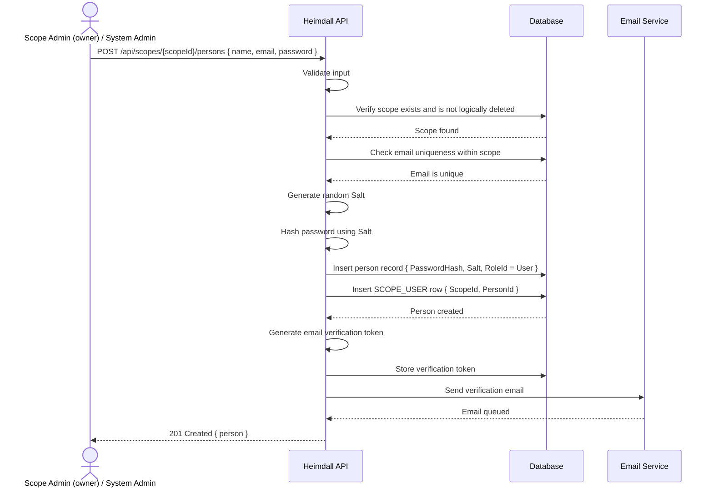

1. Scope Admin (an owner of the scope) or System Admin sends a request with person data (name, email, password) targeting a scope.
2. The system validates all fields and verifies the scope exists and is not logically deleted.
3. The system checks that the email is unique within the scope.
4. The system generates a random `Salt` and hashes the password using it.
5. The system creates the person record with `RoleId = User`, `IsDeleted = false`, `EmailVerified = false`, storing `PasswordHash` and `Salt` as byte arrays, and inserts a `SCOPE_USER` row linking the person to the scope.
6. The system generates a verification token and sends a verification email.
7. The system returns the created person (excluding `PasswordHash` and `Salt`).

**Main Flow (path b — Create Scope Admin / System Admin, no scope):**

1. System Admin sends a request to `POST /api/persons` with person data (name, email, password, roleId referencing `ScopeAdmin` or `SystemAdmin`).
2. The system validates all fields and verifies the email is not already held by another
   `ScopeAdmin` or `SystemAdmin` anywhere in the system (FR-PE-09).
3. The system generates a random `Salt` and hashes the password using it.
4. The system creates the person record with the requested `RoleId`, `IsDeleted = false`, `EmailVerified = false`. No `SCOPE_OWNER` or `SCOPE_USER` row is created (a `ScopeAdmin` created this way becomes an owner separately, via UC-21).
5. The system generates a verification token and sends a verification email.
6. The system returns the created person.

**Main Flow (path c — Scope Admin creates a new co-owner):**

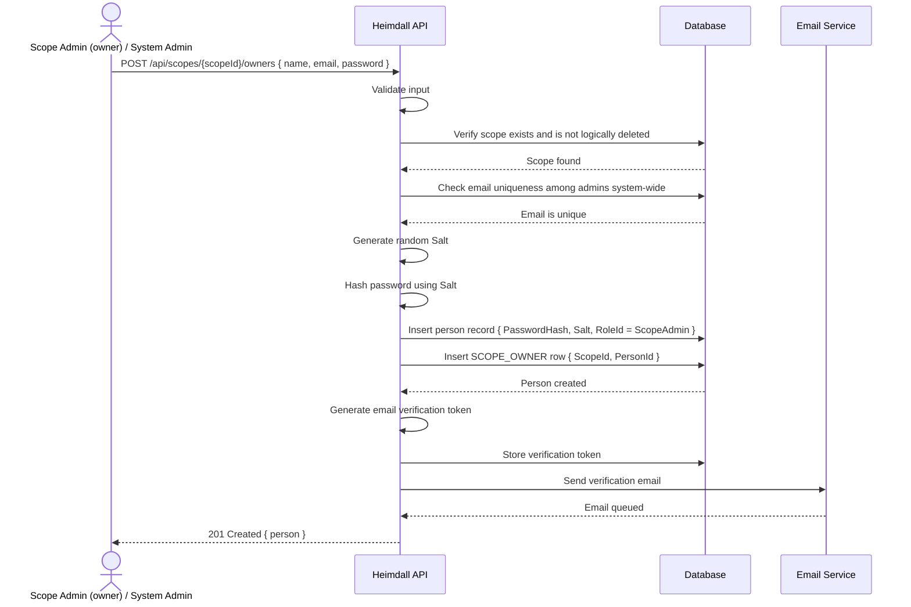

1. A Scope Admin who owns the scope, or a System Admin, sends a request with person data (name, email, password) targeting the scope.
2. The system validates all fields and verifies the target scope exists and is not logically deleted.
3. The system checks that the email is not already held by another `ScopeAdmin` or `SystemAdmin`
   anywhere in the system (since `ScopeAdmin` emails are not scoped — FR-PE-09).
4. The system generates a random `Salt` and hashes the password using it.
5. The system creates the person record with `RoleId = ScopeAdmin`, `IsDeleted = false`, `EmailVerified = false`, and inserts a `SCOPE_OWNER` row linking the person to the scope as a co-owner.
6. The system generates a verification token and sends a verification email.
7. The system returns the created person.

**Alternative Flows:**

| ID | Condition | Outcome |
| ---- | ----------- | --------- |
| AF-06a | Email already belongs to a `User` of the target scope (path a), or to a `ScopeAdmin`/`SystemAdmin` anywhere in the system (paths b, c) — see FR-PE-09 | Return `409 Conflict` |
| AF-06b | Scope not found or logically deleted (paths a, c) | Return `404 Not Found` |
| AF-06c | Actor other than System Admin attempts path (b) | Return `403 Forbidden` |
| AF-06d | Invalid input | Return `400 Bad Request` |
| AF-06e | Scope Admin attempts path (a) or (c) on a scope they do not own | Return `403 Forbidden` |

---

### UC-07: View Person

| Field | Value |
| ------- | ------- |
| **ID** | UC-07 |
| **Name** | View Person |
| **Actors** | System Admin, Scope Admin, User |
| **Description** | Retrieve a person's details or list persons. There are five distinct reads: (a) a single person by ID, via `GET /api/persons/{id}`; (b) the `User` persons of a scope, via `GET /api/scopes/{scopeId}/persons`; (c) the owners of a scope, via `GET /api/scopes/{scopeId}/owners`; (d) the persons who may own a scope, via `GET /api/persons/scope-admins`; or (e) the system's System Admins, via `GET /api/persons/system-admins` |
| **Preconditions** | Actor is authenticated; for reads (b) and (c), the target scope exists and is not logically deleted; for read (d), the scope named for exclusion — if any — exists and is not logically deleted |
| **Postconditions** | Person information is returned, never including `PasswordHash` or `Salt` |

**Main Flow (read a — person by ID):**

1. Actor requests a person by ID.
2. The system loads the person, excluding logically deleted persons unless `includeDeleted` is explicitly requested (FR-PE-08).
3. The system checks authorization, allowing the read when any of the following holds:
   - The actor is a System Admin — they may view any person.
   - The actor is the requested person — every actor may view their own record.
   - The actor is a Scope Admin and the requested person is a `User` of a scope the actor owns.
   - The actor is a Scope Admin and the requested person is another Scope Admin co-owning one of the actor's scopes.
4. The system returns the person data (excluding `PasswordHash` and `Salt`).

**Main Flow (read b — list the Users of a scope):**

1. A System Admin or a Scope Admin requests the Users of a scope, optionally filtering by name or email and paging the result (FR-PE-04).
2. The system verifies the scope exists and is not logically deleted.
3. The system verifies the actor may read the scope: a System Admin always may; a Scope Admin must own it.
4. The system returns the scope's `User` persons, excluding logically deleted persons unless explicitly requested. The scope's owners are not part of this listing.

**Main Flow (read c — list the owners of a scope):**

1. A System Admin or a Scope Admin requests the owners of a scope, optionally filtering by name or email and paging the result (FR-PE-04).
2. The system applies the same scope and authorization checks as read (b).
3. The system returns the scope's owners, excluding logically deleted persons unless explicitly requested. The scope's Users are not part of this listing.

**Main Flow (read d — list the system's Scope Admins):**

1. A System Admin or a Scope Admin requests the persons who may own a scope, optionally filtering by name or email, optionally naming a scope whose current owners are to be excluded, and paging the result (FR-PE-12).
2. If a scope was named for exclusion, the system verifies it exists, is not logically deleted, and that the actor may manage it: a System Admin always may; a Scope Admin must own it.
3. The system returns every `ScopeAdmin` person that is not logically deleted — and, for a System Admin caller, every such `SystemAdmin` person too — less the named scope's current owners if one was named, projected to the person's identifier, name, and email only.

**Main Flow (read e — list the system's System Admins):**

1. A System Admin requests the system's `SystemAdmin` persons, optionally filtering by name or email and paging the result (FR-PE-13).
2. The system returns every `SystemAdmin` person that is not logically deleted and whose processing is not restricted, ordered by name, projected to the person's identifier, name, and email only.

**Alternative Flows:**

| ID | Condition | Outcome |
| ---- | ----------- | --------- |
| AF-07a | Person not found, or logically deleted and not explicitly requested (read a); target scope not found or logically deleted (reads b, c); scope named for exclusion not found or logically deleted (read d) | Return `404 Not Found` |
| AF-07b | Actor not authorized to view the requested person (read a); actor is not an owner of the target scope (reads b, c); actor is not an owner of the scope named for exclusion (read d) | Return `403 Forbidden` |

> **On read d being open to a Scope Admin.** Read a's visibility rule lets a Scope Admin see only
> the Scope Admins co-owning the scopes they own. Read d is deliberately wider: the client's UI-14
> (Manage scope owners, specified in the `heimdall-ui` repository) has a Scope Admin add a co-owner
> through UC-21, and that person by definition does not own the scope yet, so under read a's rule
> that person could never be found and the flow could not be completed at all. What makes the widening
> safe is the projection, not the audience — identifier, name, and email, and nothing else. A Scope
> Admin learns that an administrator with a given address exists, which they can already establish
> by submitting that address to UC-06 path c and reading the duplicate-email refusal. The
> exclusion parameter is gated separately, because it is a different question: subtracting a
> scope's owners from a list reveals them by comparison, so only an actor entitled to manage that
> scope may ask for it.

> **On read e being System Admin only.** Read d already offers System Admins to a System Admin
> caller, but mixed with the Scope Admins and with no role to tell them apart, because it answers a
> different question — who may own a scope. Read e answers who else holds full access to the
> deployment. Its only actor is the System Admin, and the endpoint's
> `[RoleRequirement(SystemAdmin)]` settles that: a `ScopeAdmin` or `User` is refused with `403`
> before the handler runs, and an unauthenticated caller with `401`. No data-dependent rule is left,
> which is why read e adds no alternative flow — the same reasoning UC-35 and UC-43 follow. A Scope
> Admin is excluded because a System Admin's address is not tenant-facing, the reason read d
> withholds System Admins from them too.

---

### UC-08: Update Person

| Field | Value |
| ------- | ------- |
| **ID** | UC-08 |
| **Name** | Update Person |
| **Actors** | System Admin, Scope Admin, User |
| **Description** | Modify person's name, email, or role |
| **Preconditions** | Actor is authenticated; person exists and is not logically deleted |
| **Postconditions** | Person record is updated. When the email changed, every token the person held is revoked (FR-AU-11), every live password-reset and verification link is retired (FR-PE-17), and the previous address has been sent a notice (FR-PE-15) |

**Main Flow:**

1. Actor sends an update request to `PUT /api/persons/{id}` with the person ID and new values. `Name`
   and `Email` are replaced; `RoleId` is optional and, when omitted, leaves the role unchanged. An
   actor changing their **own** email also sends `currentPassword`, and `twoFactorCode` when their
   two-factor authentication is active (step 4).
2. The system validates the input.
3. The system checks authorization, allowing the update when any of the following holds:
   - The actor is a System Admin — they may update any person, including `RoleId`.
   - The actor **is** the person being updated — every actor may update their own name and email.
   - The actor is a Scope Admin and the person is a `User` of a scope the actor owns — name and email
     only; a Scope Admin may never change `RoleId`.
4. If email changes — compared exactly, after trimming, so a change of case is a change too:
   - When the actor **is** the person being updated, the system first re-authenticates them
     (FR-PE-14): `currentPassword` must match their password, checked as UC-39 checks it (AF-08h), and
     when their two-factor authentication is active, `twoFactorCode` must be a current authenticator-app
     or email code or an unused recovery code, checked as UC-38 checks it (AF-08i). A recovery code is
     spent, as everywhere. No endpoint sends an email code to a signed-in caller, so a person whose only
     method is Email uses a recovery code here. This happens before the uniqueness check, so a caller without them learns
     nothing about the new address. An administrator changing someone else's email presents no
     credential of that person: their own authorisation (step 3) covers it. A change of name alone asks
     for nothing.
   - The system checks uniqueness per FR-PE-09 — among the scope's `User`s for a `User`, among all
     `ScopeAdmin`/`SystemAdmin` persons for an admin, evaluated against the role the person will hold
     after this update — and resets `EmailVerified = false`. No verification email is sent — issuing a
     fresh token is UC-14 / UC-15's responsibility.
   - The system retires every live password-reset link and verification link the person holds
     (FR-PE-17): they were mailed to the address being replaced. It does so before the new address
     is saved and again immediately after, before the notice below, for any mailed to the old
     address in between; a reset or verification that read the person before the change writes only
     while the address is the one it read, so it cannot write after the change (FR-PR-08, FR-EV-08).
     Following a retired link answers UC-13's AF-13b or UC-14's AF-14b.
   - Just before the update is saved, the system replaces the person's security stamp, which revokes
     every token they hold (FR-AU-11) — whoever made the change — and replaces it once more after the
     save. The first replacement means a save that fails costs one extra sign-in rather than leaving
     old sessions live; the second ends any session opened while the save was in flight. The new
     address is stored trimmed; an address that differs only by surrounding whitespace is no change and
     is not written. An actor who changed their own email is answered `200 OK`, but the token that made
     the request is revoked with the rest: the client signs in again, with the new address.
   - The system sends a notice to the **previous** address (FR-PE-15): the account's email was changed,
     and if that was not the person, they should contact an administrator. The notice names neither the
     new address nor any link. A failed delivery is logged and does not fail the update.
5. If `RoleId` changes (System Admin only), the system supports **only a change to `SystemAdmin`**,
   and removes the person's `SCOPE_USER` or `SCOPE_OWNER` rows so that a System Admin holds no scope
   association (FR-PE-10). Any other target role is refused: making someone a `ScopeAdmin` requires
   naming the scope they will own (FR-PE-11) and making someone a `User` requires naming the scope
   they will join (FR-PE-02), neither of which this request carries. Those transitions belong to
   UC-21 (Add Scope Owner) and UC-23 (Promote User to Scope Owner).
6. The system applies updates and sets `UpdatedAt`.
7. The system returns the updated person (excluding `PasswordHash` and `Salt`).

> **On re-authenticating an email change.** An address change requires proof of identity, because
> account recovery follows the address and a bearer token is not proof that the account holder is
> present. An own email change therefore asks for what UC-39 and UC-42 ask for. The previous address
> is told, so a change its owner did not make does not go unnoticed, and the stamp rotation ends the
> sessions opened before it.
>
> **On FR-RO-05.** FR-RO-05 states that Scope Admins may assign the `User` role to persons within
> their scope. That is satisfied by UC-06 path (a), where a Scope Admin creates a person in a scope
> they own with `RoleId = User`. UC-08 keeps role changes System-Admin-only, per step 3 and AF-08c.

**Alternative Flows:**

| ID | Condition | Outcome |
| ---- | ----------- | --------- |
| AF-08a | Person not found or logically deleted | Return `404 Not Found` |
| AF-08b | New email conflicts within the person's scope, or among admins system-wide (FR-PE-09) | Return `409 Conflict` |
| AF-08c | Unauthorized role change (only System Admin may change `RoleId`) | Return `403 Forbidden` |
| AF-08d | Actor not authorized to update the person at all | Return `403 Forbidden` |
| AF-08e | Invalid input | Return `400 Bad Request` |
| AF-08f | Role change to a role that would require naming a target scope | Return `400 Bad Request` |
| AF-08g | Role change would leave a scope with no owner (NFR-12) | Return `409 Conflict` |
| AF-08h | Actor changes their own email and `currentPassword` is missing or wrong (FR-PE-14), or their re-authentication budget is paused (FR-AU-13) | Return `401 Unauthorized` — "The password or code is incorrect." (UC-39's AF-39b). Nothing is changed |
| AF-08i | Actor changes their own email, their two-factor authentication is active, and `twoFactorCode` is missing, wrong, expired or already used (FR-PE-14) | Return `401 Unauthorized` — "The password or code is incorrect.", the same answer as AF-08h (UC-39's AF-39c). Nothing is changed |
| AF-08j | Actor changes their own email (which mails the previous address, FR-PE-15) and their account-email budget refuses it (FR-PE-16): one such email within the cooldown, or five in the current day-long window. Checked once the password and second factor are accepted, and before the factor is spent | Return `429 Too Many Requests` — "An email of this kind was sent to you recently. Try again in a few minutes." inside the cooldown, or "You have reached today's limit for account emails. Try again tomorrow." Nothing is changed or sent, and the second factor is not spent |
| AF-08k | Actor changes their own email while their email two-factor method is enabled, active or pending (FR-PE-18). Checked once the password and second factor are accepted | Return `409 Conflict` — "Turn off the email sign-in method before changing your email address." Nothing is charged, spent, changed or sent. The person disables the method (UC-39), or re-initiates a pending setup without it (UC-36), changes the address, and sets the method up again at the new one |

---

### UC-09: Logical Delete Person

| Field | Value |
| ------- | ------- |
| **ID** | UC-09 |
| **Name** | Logical Delete Person |
| **Actors** | System Admin, Scope Admin |
| **Description** | Soft-delete a person by setting `IsDeleted = true` |
| **Preconditions** | Actor is authenticated; person exists; the actor is not the person being deleted |
| **Postconditions** | Person's `IsDeleted` is `true`. Nothing else changes: their `SCOPE_USER`/`SCOPE_OWNER` rows, tokens, and owned applications are left untouched (see §8 of the System Requirements Document) |

**Main Flow:**

1. Actor sends `DELETE /api/persons/{id}` for a person.
2. The system loads the person **in any deletion state** — an already-deleted person must be found so
   AF-09b can answer idempotently rather than as a `404`.
3. The system checks authorization: System Admin may delete any person; a Scope Admin may only delete
   a `User` within a scope they own.
4. The system sets `IsDeleted = true` on the person record and stamps `UpdatedAt`.
5. The system returns success, reporting whether the person was already deleted.

**Alternative Flows:**

| ID | Condition | Outcome |
| ---- | ----------- | --------- |
| AF-09a | Person not found | Return `404 Not Found` |
| AF-09b | Already logically deleted | Return `200 OK` (idempotent) |
| AF-09c | Actor not authorized to delete the person (a Scope Admin targeting a person who is not a `User` of a scope they own) | Return `403 Forbidden` |
| AF-09d | Actor is the person being deleted | Return `403 Forbidden` |
| AF-09e | Person is the sole owner of one or more scopes, whatever their role (NFR-12) | Return `409 Conflict` — "Cannot remove the last owner of a scope" |

> **On AF-09e.** NFR-12 names only *removing* an owner (UC-22) and *hard*-deleting the last owning
> person (UC-10). It is applied to a logical deletion too because a soft-deleted `ScopeAdmin` can no
> longer authenticate, so a scope whose only owner is soft-deleted is effectively ownerless — the
> state NFR-12 exists to prevent. UC-08 resolves the same tension the same way for its role change.
>
> **On the order of AF-09b and AF-09e.** An already-deleted person is answered before the last-owner
> check runs. Such an owner is already out of the scope, so re-checking would turn the idempotent
> success AF-09b requires into a conflict.
>
> **On AF-09d.** UC-09 grants a System Admin the right to delete "any person", which would literally
> include themselves. Self-deletion is refused so a single call cannot lock an administrator out of
> the system.

---

### UC-10: Hard Delete Person

| Field | Value |
| ------- | ------- |
| **ID** | UC-10 |
| **Name** | Hard Delete Person |
| **Actors** | System Admin |
| **Description** | Permanently remove a person record from the database |
| **Preconditions** | Actor is authenticated with `SystemAdmin` role; person exists; the actor is not the person being deleted; if the person owns any scope, removing them must not leave it without an owner |
| **Postconditions** | Person record, all associated tokens, their `SCOPE_USER`/`SCOPE_OWNER` rows, and any applications they own are permanently removed |

**Main Flow:**

1. System Admin sends a hard delete request to `DELETE /api/persons/{id}/hard`.
2. The system loads the person **in any deletion state** — a logically deleted person is exactly what a
   cleanup pass starts from, so soft deletion must not block a hard one.
3. If the person owns any scope, the system verifies that every scope they own has at least one other owner.
4. The system records a tombstone for the person in `ERASED_SUBJECT` — their `PublicId`, that it was a person, and when — before anything is deleted, so the audit entries naming them, this hard delete's own among them, can still be cleared once the row is gone (NFR-21, #195). A retry records it again without error.
5. The system permanently deletes all tokens (password reset, email verification) associated with the person.
6. The system permanently deletes any applications owned by the person.
7. The system removes the person's `SCOPE_USER` row (if a `User`) or `SCOPE_OWNER` rows (if they own any scope).
8. The system permanently deletes the person record.
9. The system returns success, reporting how many applications and tokens went with the person.

**Alternative Flows:**

| ID | Condition | Outcome |
| ---- | ----------- | --------- |
| AF-10a | Person not found | Return `404 Not Found` |
| AF-10b | Person is the sole owner of one or more scopes | Return `409 Conflict` — "Cannot remove the last owner of a scope" |
| AF-10c | Actor is the person being deleted | Return `403 Forbidden` |

> **On AF-10c.** UC-10 grants a System Admin the right to remove a person, which would literally include
> themselves. Self-deletion is refused so a single, irreversible call cannot destroy the caller's own
> account. UC-09 refuses the same thing for the same reason (AF-09d).
>
> **On AF-10b and an already-deleted target.** The last-owner check runs even when the person is
> *already* logically deleted — deliberately the opposite of UC-09, where the idempotent AF-09b is
> answered before the guard. NFR-12 names hard-deleting the last owning person outright, and applying
> the guard unconditionally keeps every scope backed by at least one `SCOPE_OWNER` row. Removing a
> soft-deleted sole owner therefore takes two steps: add another owner (UC-21) or hard-delete the scope
> (UC-05) first.
>
> **On the cascade.** Hard deletion is the mirror image of UC-09: where a logical deletion touches
> nothing but the flag, this removes the person's tokens, the applications they own (NFR-11), and their
> join rows (System Requirements Document §8). Google Users are unaffected — they belong to a scope
> rather than to a person, and cannot own an application.

---

### UC-11: Login

| Field | Value |
| ------- | ------- |
| **ID** | UC-11 |
| **Name** | Login (Authenticate) |
| **Actors** | Anonymous, User, Scope Admin, System Admin |
| **Description** | Authenticate a person with email and password to obtain a token. A `User` must also provide their scope ID, since their email is only unique within that scope; a `ScopeAdmin` or `SystemAdmin` logs in with email and password only |
| **Preconditions** | None |
| **Postconditions** | An authentication token is issued, and the response reports whether the person's email is verified |

**Main Flow (User):**

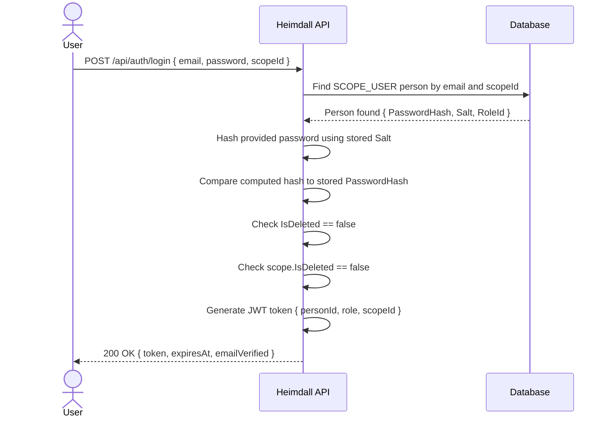

**Main Flow (Scope Admin / System Admin):**

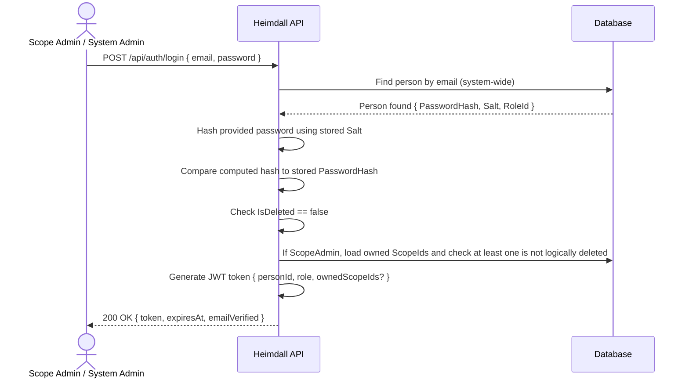

1. Caller sends email and password to `POST /api/auth/login` (a `User` also sends their scope ID). The endpoint is open to anonymous callers — it is where every other endpoint's token comes from.
2. The system locates the person: a `User` is looked up by email within the given scope; a `ScopeAdmin`/`SystemAdmin` is looked up by email system-wide. Emails are compared case-insensitively, and the lookup does not filter logically deleted persons — AF-11c rejects them at step 4.
3. The system hashes the provided password using the person's stored `Salt` and compares it to the stored `PasswordHash`.
4. The system confirms the person is not logically deleted.
5. For a `User`, the system confirms their scope is not logically deleted. For a `ScopeAdmin`, the system confirms at least one owned scope is not logically deleted.
   If processing of the person is restricted (NFR-24), steps 4 and 5 do not apply and the login ends in AF-11i instead.
6. If the person does not have active two-factor authentication (`TWO_FACTOR_AUTH.IsActive`), the system generates and returns the full authentication token containing the person's `PublicId`, display name and role, plus: the scope's `PublicId` for a `User`; the list of owned scopes' `PublicId`s for a `ScopeAdmin` — only those not logically deleted; no scope claim for a `SystemAdmin`. The response also reports when the token expires. Every token issued to a person — this one, AF-11g's challenge token and AF-11i's subject-rights-only token — also carries the person's current security stamp, and is refused on every later request once the stamp has been replaced by a credential change (FR-AU-11). If the person does have active two-factor authentication, go to AF-11g instead.

**Alternative Flows:**

| ID | Condition | Outcome |
| ---- | ----------- | --------- |
| AF-11a | Person not found | Return `401 Unauthorized` |
| AF-11b | Password mismatch | Return `401 Unauthorized` |
| AF-11c | Person is logically deleted | Return `401 Unauthorized` |
| AF-11d | User's scope is logically deleted | Return `401 Unauthorized` |
| AF-11e | Scope Admin's owned scopes are all logically deleted | Return `401 Unauthorized` |
| AF-11f | Email missing or malformed, or password missing | Return `400 Bad Request` |
| AF-11g | Person has active two-factor authentication (FR-2F-07) | Return `200 OK` with a short-lived challenge token and the available second-factor methods, instead of the full authentication token; if the Email method is enabled, also send a fresh email code (FR-2F-08). See UC-38 for how the login is completed |
| AF-11h | The person's account is locked out after ten consecutive failed password attempts (FR-AU-09); the tenth attempt locks the account when it is counted, and a correct password on that tenth attempt still signs in and clears the lock | Return `401 Unauthorized`, the same answer and the same message as AF-11a through AF-11e |
| AF-11i | The password checks out and processing of the person is restricted (NFR-24, UC-44), whether or not they are logically deleted | Return `200 OK` with a **subject-rights-only token** and `processingRestricted: true`, instead of the full token. The token names the person and their role and claims no scope; it is accepted only by UC-41, UC-42, UC-44 and UC-45, and every other endpoint answers it `403 Forbidden`. A person with active two-factor authentication gets AF-11g's challenge first, and UC-38 ends the same way |

> **On the lockout.** AF-11h joins the collapse deliberately. Answering it distinctly would tell an
> anonymous caller that an address is registered *and* that they have made it stop responding,
> which is the pair of facts the uniform rejection exists to withhold. FR-AU-10 keeps the timing
> uniform too, so the lockout is not detectable by how quickly the refusal arrives. It expires on
> its own after fifteen minutes — no operator action clears it — because reaching the threshold
> needs nothing but wrong guesses, and a lock that persisted would hand any caller a denial of
> service against any address they know.
>
> **On the single rejection.** AF-11a through AF-11e are five different conditions with one
> indistinguishable response: the same `401` and the same message. Telling them apart would turn the
> login endpoint into a directory — confirming which emails are registered, which accounts have been
> deleted, and which scopes still exist — to a caller who has proved nothing. UC-12 takes the same
> position for password recovery.
>
> **On AF-11i.** A restriction used to be a refusal here, folded into the uniform `401`. That left
> a restricted subject only the token they held when they asked for it — an hour by default — to
> lift their own restriction (UC-45), export (UC-41) or erase (UC-42); after that only a System Admin
> could act for them. A token confined to those four endpoints gives the subject their rights back
> without letting the restricted record be processed for anything else. It comes after the password
> and lockout checks, so only someone holding the credential learns that the account is restricted,
> and it skips the deletion and scope checks because a suspended subject keeps their rights until
> the record is anonymised (NFR-20), and a token that claims no scope has no scope to check. It stays
> confined once the restriction is lifted: the subject signs in again for a full token.
>
> **On AF-11f.** NFR-10 requires every input to be validated, so a request missing an email or
> password is refused as malformed before any lookup happens. The validation deliberately stops
> short of a minimum password length, unlike person creation: at login a short password is a wrong
> password (401), and answering `400` to it would tell the caller their guess was too short to be
> anyone's password.

---

### UC-12: Password Recovery

| Field | Value |
| ------- | ------- |
| **ID** | UC-12 |
| **Name** | Request Password Recovery |
| **Actors** | Anonymous |
| **Description** | Request a password reset email |
| **Preconditions** | None |
| **Postconditions** | A password reset token is generated and emailed to the person |

**Main Flow:**

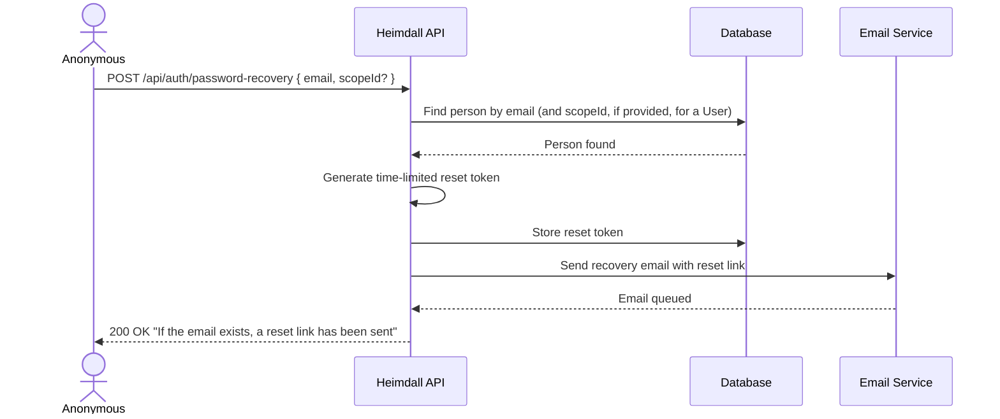

1. Caller provides their email (and scope ID, if they are a `User`, since email is only unique within a scope for Users).
2. The system locates the person.
3. The system generates a time-limited password reset token.
4. The system stores the token and sends a recovery email.
5. The system returns a generic success message (does not reveal whether the email exists).

Steps 2 to 4 run after step 5, outside the request: the API validates the request, queues it, and
answers; a background worker then does the lookup, the token and the email (FR-PR-02). The answer
is therefore identical in time as well as in content for a registered and an unknown address —
while the work ran on the request, a registered address answered a Mailgun round trip later, which
gave away exactly what AF-12a withholds. The queue lives in memory, so a restart drops pending
requests; a person who receives nothing asks again, as for any email that does not arrive.

**Alternative Flows:**

| ID | Condition | Outcome |
| ---- | ----------- | --------- |
| AF-12a | Email not found, or the person is logically deleted, restricted (NFR-24), or cannot sign in because their scope or scopes are deleted | Return `200 OK` with the same generic message, in the same time (prevents enumeration). No token is issued and nothing is sent |
| AF-12b | A reset token was issued for the person within the cooldown (`HEIMDALL_ADMIN_EMAIL_COOLDOWN_IN_SECONDS`, five minutes by default), by an earlier request or by UC-52, used or not (FR-PR-07) | Return `200 OK` with the same generic message. Nothing is issued or sent; the link already mailed keeps working |

---

### UC-13: Reset Password

| Field | Value |
| ------- | ------- |
| **ID** | UC-13 |
| **Name** | Reset Password |
| **Actors** | Anonymous |
| **Description** | Set a new password using a valid reset token |
| **Preconditions** | A valid, non-expired reset token exists |
| **Postconditions** | Person's password is updated; the token is marked as used; every token the person held is revoked (FR-AU-11) |

**Main Flow:**

1. Caller provides the reset token and a new password.
2. The system validates the token (exists, its person may still be acted on, not expired, not used).
   The person is checked by UC-12's rule as they stand now (FR-PR-08, AF-13e).
3. The system generates a new random `Salt` and hashes the new password using it.
4. The system marks the token as used, then writes the new `PasswordHash` and `Salt` together with a
   fresh security stamp, which revokes every token issued to the person before the reset (FR-AU-11) —
   full, challenge and subject-rights-only alike. It is one conditional write that repeats step 2's
   checks on the person and requires the address they were read with, so no sign-in can read the new
   password beside the old stamp, and a write refused because the person changed meanwhile leaves the
   person, stamp included, as it was (answered as AF-13e).
5. The system returns success. The person signs in again with the new password; a session opened with
   the old one, by them or by anybody else, ends at its next request.

**Alternative Flows:**

| ID | Condition | Outcome |
| ---- | ----------- | --------- |
| AF-13a | Token expired | Return `400 Bad Request` — "Token expired" |
| AF-13b | Token already used — including by a request carrying the same token at the same time (NFR-27): exactly one of them sets a password | Return `400 Bad Request` — "Token already used" |
| AF-13c | Token not found | Return `400 Bad Request` — "Invalid token" |
| AF-13d | New password fails validation | Return `400 Bad Request` with validation errors |
| AF-13e | The token's person may no longer be acted on: since the link was mailed they were put under a restriction on processing (NFR-24), logically deleted or anonymised, or can no longer sign in (FR-AU-06, FR-AU-07); checked before the token's expiry and use, and again by the write in step 4 (FR-PR-08) | As AF-13c: `400 Bad Request` — "Invalid token". Nothing is written, the token included, so a restricted record is preserved |

---

### UC-14: Email Verification

| Field | Value |
| ------- | ------- |
| **ID** | UC-14 |
| **Name** | Verify Email |
| **Actors** | Anonymous (via email link) |
| **Description** | Confirm a person's email address |
| **Preconditions** | A valid, non-expired verification token exists |
| **Postconditions** | Person's `EmailVerified` is set to `true`; the token is marked as used |

**Main Flow:**

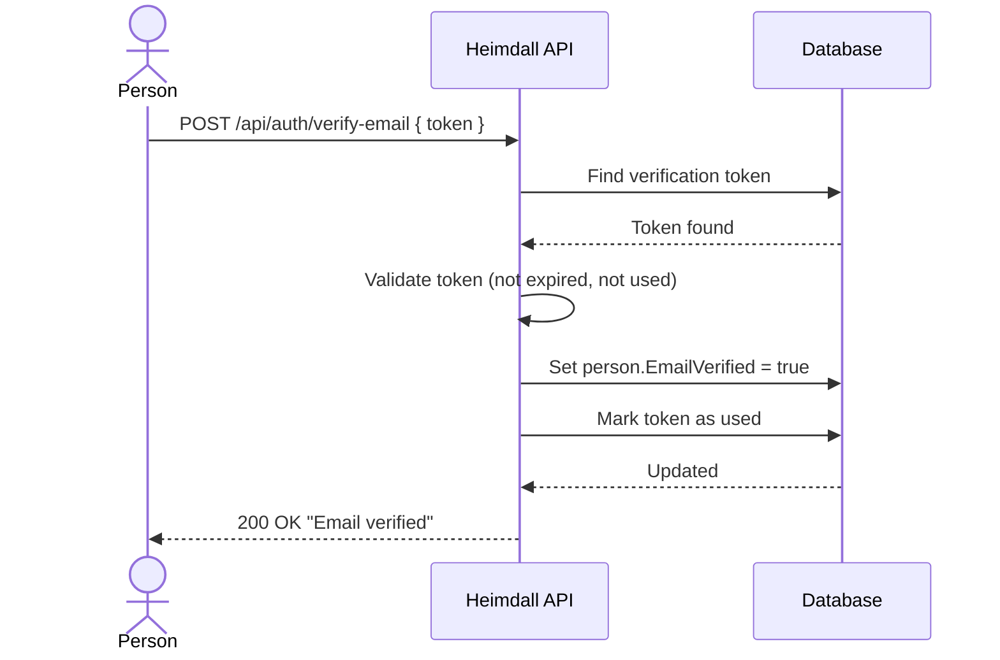

1. Person clicks the verification link which calls the API with the token.
2. The system locates and validates the token, and checks the person by UC-12's rule as they stand
   now (FR-EV-08, AF-14d).
3. The system sets `EmailVerified = true` on the person record, in one conditional write that repeats
   step 2's checks and requires the address the person was read with.
4. The system marks the token as used.
5. The system returns success.

**Alternative Flows:**

| ID | Condition | Outcome |
| ---- | ----------- | --------- |
| AF-14a | Token expired | Return `400 Bad Request` — "Token expired" |
| AF-14b | Token already used — including by a request carrying the same token at the same time (NFR-27) | Return `400 Bad Request` — "Token already used" |
| AF-14c | Token not found | Return `400 Bad Request` — "Invalid token" |
| AF-14d | The token's person may no longer be acted on, as UC-13's AF-13e (FR-EV-08) | As AF-14c: `400 Bad Request` — "Invalid token". Nothing is written, the token included |

> **A token may name a pending registration.** A token that matches no verification token is looked up among pending registrations (UC-47). If one matches, the request must also carry `password`, the one chosen at sign-up (FR-SR-09), and with it the confirmation creates the account: the system checks the password, claims the row, re-checks that the scope is still open and the address still free, creates the `User` with its address verified, and removes the address's other pending registrations. An expired one answers AF-14a. Without a password the answer is `422 Unprocessable Entity`, and with a wrong one `401 Unauthorized`; neither consumes the registration, so the registrant may try again, but each guess is charged before it is compared, and after 10 wrong passwords the registration is discarded and the token answers AF-14c. A link followed again once the account exists finds no registration and answers AF-14c — "Invalid token" — not AF-14b, which here means only a concurrent request that claimed the registration first. One the system refuses to act on, because the scope closed or the address was taken, also answers AF-14c. `password` is ignored for an ordinary verification token.

---

### UC-15: Resend Verification Email

| Field | Value |
| ------- | ------- |
| **ID** | UC-15 |
| **Name** | Resend Verification Email |
| **Actors** | User, Scope Admin, System Admin |
| **Description** | Resend the email verification message |
| **Preconditions** | Actor is authenticated; email is not already verified |
| **Postconditions** | A new verification token is generated and emailed |

**Main Flow:**

1. Authenticated person requests a new verification email.
2. The system checks that the email is not already verified, and reserves the send against the person's account-email budget (FR-PE-16).
3. The system invalidates any existing verification tokens.
4. The system generates a new time-limited verification token.
5. The system sends the verification email.
6. The system returns success.

**Alternative Flows:**

| ID | Condition | Outcome |
| ---- | ----------- | --------- |
| AF-15a | Email already verified | Return `400 Bad Request` — "Email already verified" |
| AF-15b | The person's own requests had an account email sent within the cooldown (`HEIMDALL_ADMIN_EMAIL_COOLDOWN_IN_SECONDS`, five minutes by default) — a resend, a setup code or an email-change notice (FR-PE-16) | Return `429 Too Many Requests` — "An email of this kind was sent to you recently. Try again in a few minutes." Nothing is retired or sent, so the link already mailed keeps working |
| AF-15c | The person's own requests have had five account emails sent in the current day-long window (FR-PE-16) | Return `429 Too Many Requests` — "You have reached today's limit for account emails. Try again tomorrow." Nothing is retired or sent |

> **On the cooldown and the rate limit.** The endpoint mails the account's own address on every
> successful call, and a bearer token is all it asks for, so without a bound whoever held one could
> mail that address once per request — and the address may be one the account holder set without
> proving it. The resend shares one budget with the person's other self-service account mail (FR-PE-16),
> reserved by one write before anything is sent, so even a burst of simultaneous requests sends one.
> A link an administrator sent (UC-06, UC-51) is not charged to it, so the person may still ask once
> straight after. The endpoint is also under the credential endpoints' rate limit, whose own `429` is
> "Too many requests." with a `Retry-After` header.

---

### UC-16: Create Application

| Field | Value |
| ------- | ------- |
| **ID** | UC-16 |
| **Name** | Create Application |
| **Actors** | System Admin, Scope Admin |
| **Description** | Register a new application (a non-person identity representing another system) within a scope |
| **Preconditions** | Actor is authenticated; target scope exists and is not logically deleted; the owner is an existing, non-logically-deleted `ScopeAdmin` or `SystemAdmin` who owns the scope (via `SCOPE_OWNER`) |
| **Postconditions** | A new application record exists, associated with the scope and owned by the specified owner |

**Main Flow:**

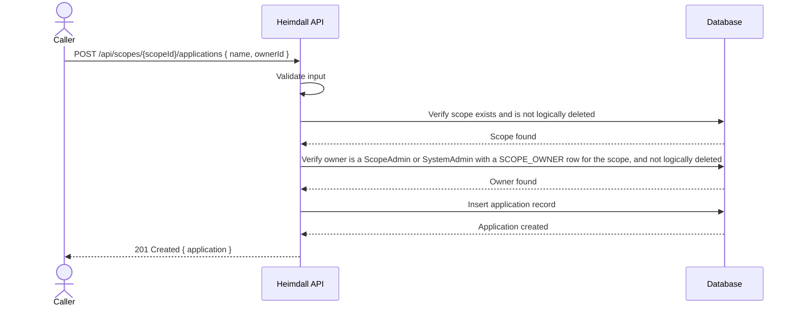

1. Caller sends a request with application data (name, ownerId) targeting a scope.
2. The system validates all fields.
3. The system verifies the target scope exists and is not logically deleted.
4. The system verifies the owner is an existing, non-logically-deleted `ScopeAdmin` or `SystemAdmin` who owns the scope.
5. The system creates the application record with `IsDeleted = false`.
6. The system returns the created application.

**Alternative Flows:**

| ID | Condition | Outcome |
| ---- | ----------- | --------- |
| AF-16a | Scope not found or logically deleted | Return `404 Not Found` |
| AF-16b | Owner not found, logically deleted, neither a `ScopeAdmin` nor a `SystemAdmin`, or not an owner of the scope (no `SCOPE_OWNER` row) | Return `400 Bad Request` |
| AF-16c | Scope Admin attempts to set an owner other than themself | Return `403 Forbidden` |
| AF-16d | Invalid input | Return `400 Bad Request` |
| AF-16e | Scope Admin does not own the target scope | Return `403 Forbidden` |

---

### UC-17: View Application

| Field | Value |
| ------- | ------- |
| **ID** | UC-17 |
| **Name** | View Application |
| **Actors** | System Admin, Scope Admin |
| **Description** | Retrieve an application's details or list applications within a scope |
| **Preconditions** | Actor is authenticated |
| **Postconditions** | Application information is returned |

**Main Flow:**

1. Actor requests an application by ID, or a list of the applications within a scope.
2. The system checks authorization:
   - System Admin: can view every application, in any scope.
   - Scope Admin: can view only the applications they own. To list a scope's applications they must also own that scope.
3. Logically deleted applications are excluded unless explicitly requested.
4. The system returns application data.

**Alternative Flows:**

| ID | Condition | Outcome |
| ---- | ----------- | --------- |
| AF-17a | Application not found, or — when listing — the scope is not found or is logically deleted | Return `404 Not Found` |
| AF-17b | Actor not authorized: a Scope Admin who does not own the requested application, a Scope Admin who does not own the scope being listed, or a `User` | Return `403 Forbidden` |

---

### UC-18: Update Application

| Field | Value |
| ------- | ------- |
| **ID** | UC-18 |
| **Name** | Update Application |
| **Actors** | System Admin, Scope Admin |
| **Description** | Modify an application's name or owner |
| **Preconditions** | Actor is authenticated; application exists and is not logically deleted |
| **Postconditions** | Application record is updated |

**Main Flow:**

1. Actor sends an update request with the application ID and new values.
2. The system validates the input.
3. The system checks authorization:
   - System Admin: can update any application.
   - Scope Admin: can update only the applications they own.
4. If the owner changes, the system verifies the new owner is an existing, non-logically-deleted `ScopeAdmin` or `SystemAdmin` who owns the application's scope.
5. The system applies the updates and sets `UpdatedAt`.
6. The system returns the updated application.

**Alternative Flows:**

| ID | Condition | Outcome |
| ---- | ----------- | --------- |
| AF-18a | Application not found or logically deleted | Return `404 Not Found` |
| AF-18b | New owner not found, logically deleted, neither a `ScopeAdmin` nor a `SystemAdmin`, or not an owner of the application's scope | Return `400 Bad Request` |
| AF-18c | Actor not authorized | Return `403 Forbidden` |

---

### UC-19: Logical Delete Application

| Field | Value |
| ------- | ------- |
| **ID** | UC-19 |
| **Name** | Logical Delete Application |
| **Actors** | System Admin, Scope Admin |
| **Description** | Soft-delete an application by setting `IsDeleted = true` |
| **Preconditions** | Actor is authenticated; application exists |
| **Postconditions** | Application's `IsDeleted` is `true` |

**Main Flow:**

1. Actor sends a delete request for an application.
2. The system checks authorization (System Admin, or the `ScopeAdmin` who owns the application).
3. The system sets `IsDeleted = true` on the application record.
4. The system returns success.

**Alternative Flows:**

| ID | Condition | Outcome |
| ---- | ----------- | --------- |
| AF-19a | Application not found | Return `404 Not Found` |
| AF-19b | Already logically deleted | Return `200 OK` (idempotent) |
| AF-19c | Actor not authorized | Return `403 Forbidden` |

---

### UC-20: Hard Delete Application

| Field | Value |
| ------- | ------- |
| **ID** | UC-20 |
| **Name** | Hard Delete Application |
| **Actors** | System Admin |
| **Description** | Permanently remove an application record from the database |
| **Preconditions** | Actor is authenticated with `SystemAdmin` role; application exists |
| **Postconditions** | Application record is permanently removed, and with it, by cascade, every credential issued to it (UC-53), live, revoked or expired |

**Main Flow:**

1. System Admin sends a hard delete request.
2. The system permanently deletes the application record.
3. The system returns success.

**Alternative Flows:**

| ID | Condition | Outcome |
| ---- | ----------- | --------- |
| AF-20a | Application not found | Return `404 Not Found` |

---

### UC-21: Add Scope Owner

| Field | Value |
| ------- | ------- |
| **ID** | UC-21 |
| **Name** | Add Scope Owner |
| **Actors** | System Admin, Scope Admin (existing owner) |
| **Description** | Add an existing `ScopeAdmin` or `SystemAdmin` person as an additional owner of a scope. To make a brand-new person a co-owner, see UC-06 (path c); to make an existing `User` of the scope a co-owner, see UC-23 (Promote User to Scope Owner) |
| **Preconditions** | Actor is authenticated with `SystemAdmin` role, or is an existing owner of the target scope; the target person exists, is not logically deleted, and has the `ScopeAdmin` or `SystemAdmin` role |
| **Postconditions** | A new `SCOPE_OWNER` row links the scope to the person |

**Main Flow:**

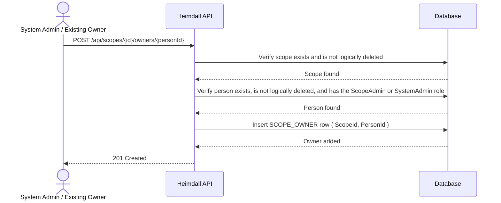

1. Actor sends a request to add a person as an owner of a scope.
2. The system verifies the scope exists and is not logically deleted.
3. The system verifies the person exists, is not logically deleted, and has the `ScopeAdmin` or `SystemAdmin` role.
4. The system inserts a `SCOPE_OWNER` row linking the scope to the person (no-op if it already exists).
5. The system returns success.

**Alternative Flows:**

| ID | Condition | Outcome |
| ---- | ----------- | --------- |
| AF-21a | Scope not found or logically deleted | Return `404 Not Found` |
| AF-21b | Person not found, logically deleted, or neither a `ScopeAdmin` nor a `SystemAdmin` | Return `400 Bad Request` |
| AF-21c | Actor not authorized (not System Admin nor an existing owner) | Return `403 Forbidden` |
| AF-21d | Person is already an owner of the scope | Return `200 OK` (idempotent) |

---

### UC-22: Remove Scope Owner

| Field | Value |
| ------- | ------- |
| **ID** | UC-22 |
| **Name** | Remove Scope Owner |
| **Actors** | System Admin, Scope Admin (existing owner) |
| **Description** | Remove a Scope Admin's ownership of a scope |
| **Preconditions** | Actor is authenticated with `SystemAdmin` role, or is an existing owner of the target scope; the scope has more than one owner |
| **Postconditions** | The `SCOPE_OWNER` row linking the scope to the person is removed |

**Main Flow:**

1. Actor sends a request to remove a person's ownership of a scope.
2. The system verifies the scope exists and that the person is currently an owner.
3. The system verifies the scope has more than one owner.
4. The system removes the `SCOPE_OWNER` row.
5. The system returns success.

**Alternative Flows:**

| ID | Condition | Outcome |
| ---- | ----------- | --------- |
| AF-22a | Scope not found, or person is not an owner of it | Return `404 Not Found` |
| AF-22b | Scope has only one owner (this one) | Return `409 Conflict` — "Cannot remove the last owner of a scope" |
| AF-22c | Actor not authorized (not System Admin nor an existing owner) | Return `403 Forbidden` |

---

### UC-23: Promote User to Scope Owner

| Field | Value |
| ------- | ------- |
| **ID** | UC-23 |
| **Name** | Promote User to Scope Owner |
| **Actors** | System Admin, Scope Admin (existing owner) |
| **Description** | Promote an existing `User` of a scope to `ScopeAdmin`, making them a co-owner of that scope |
| **Preconditions** | Actor is authenticated with `SystemAdmin` role, or is an existing owner of the target scope; the target person exists, is not logically deleted, and is currently a `User` belonging to that scope (via `SCOPE_USER`) |
| **Postconditions** | The person's `RoleId` is changed to `ScopeAdmin`; their `SCOPE_USER` row is removed; a new `SCOPE_OWNER` row links them to the scope |

**Main Flow:**

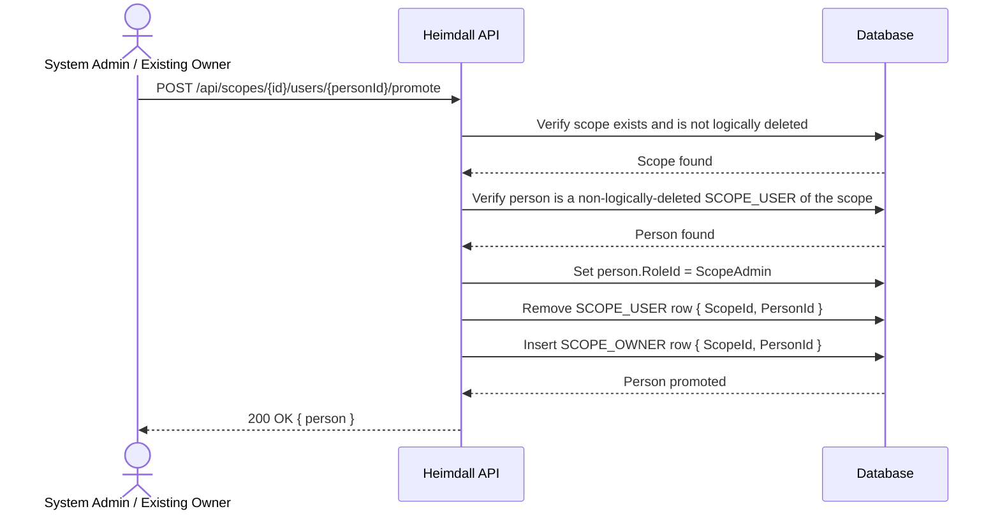

1. Actor sends a request to promote a person to owner of a scope.
2. The system verifies the scope exists and is not logically deleted.
3. The system verifies the person exists, is not logically deleted, and is currently a `User` belonging to that scope.
4. The system changes the person's `RoleId` to `ScopeAdmin`.
5. The system removes the person's `SCOPE_USER` row and inserts a `SCOPE_OWNER` row linking them to the scope.
6. The system returns the updated person.

**Alternative Flows:**

| ID | Condition | Outcome |
| ---- | ----------- | --------- |
| AF-23a | Scope not found or logically deleted | Return `404 Not Found` |
| AF-23b | Person not found, logically deleted, or not a `User` of that scope | Return `400 Bad Request` |
| AF-23c | Actor not authorized (not System Admin nor an existing owner) | Return `403 Forbidden` |
| AF-23d | Person is already a `ScopeAdmin` | Return `409 Conflict` — "Person already holds the ScopeAdmin role" |
| AF-23e | Person's email collides with an existing `ScopeAdmin`/`SystemAdmin` elsewhere in the system (FR-PE-09) — the promoted person moves from the scope-local `User` email namespace to the global admin namespace | Return `409 Conflict` |

> **On AF-23e.** A `User`'s email is unique only within their scope; a `ScopeAdmin`'s is unique
> system-wide (FR-PE-09). Promotion moves the person between those two namespaces, so the same email
> that was fine as a `User` can collide with an existing admin the moment it becomes global. This is
> checked the same way UC-08's role change re-checks uniqueness against the role the person is about
> to hold.

---

### UC-24: Enable/Disable Google Sign-In

| Field | Value |
| ------- | ------- |
| **ID** | UC-24 |
| **Name** | Enable/Disable Google Sign-In |
| **Actors** | System Admin, Scope Admin (existing owner) |
| **Description** | Turn Google Sign-In on or off for a scope, controlling whether Users of that scope may sign up/sign in with a Google account |
| **Preconditions** | Actor is authenticated with `SystemAdmin` role, or is an existing owner of the target scope; the scope exists |
| **Postconditions** | The scope's `GoogleSignInEnabled` flag is updated |

**Main Flow:**

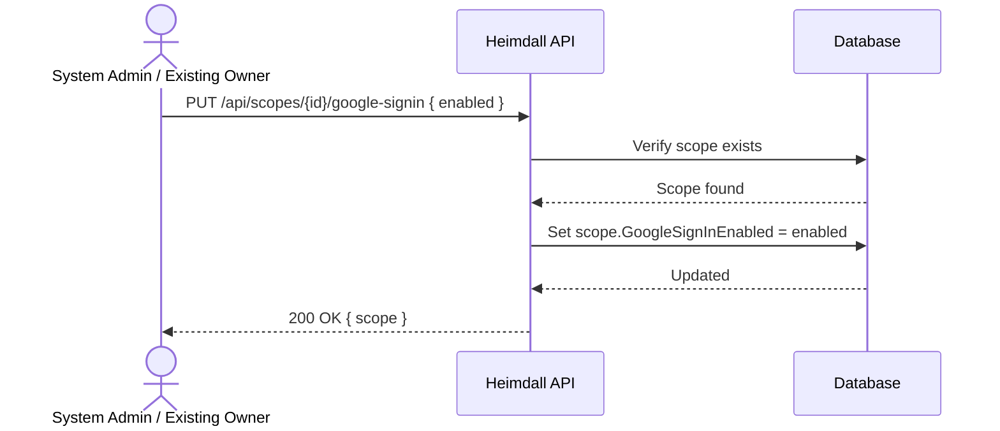

1. Actor sends a request to enable or disable Google Sign-In for a scope.
2. The system validates the input fields.
3. The system verifies the scope exists.
4. The system checks authorization: System Admin, or an existing owner of the scope.
5. The system sets `GoogleSignInEnabled` to the requested value.
6. The system returns the updated scope.

**Alternative Flows:**

| ID | Condition | Outcome |
| ---- | ----------- | --------- |
| AF-24a | Scope not found | Return `404 Not Found` |
| AF-24b | Actor not authorized (not System Admin nor an existing owner) | Return `403 Forbidden` |
| AF-24c | `enabled` not supplied | Return `400 Bad Request` |

> **On AF-24c.** The request body carries a single boolean, so an omitted `enabled` cannot be
> distinguished from an explicit `false` once bound — a malformed request would silently perform the
> *disable* half of this use case. The value is therefore required rather than defaulted, and is
> checked before the scope is looked up (step 2, as in UC-01). NFR-10 already asks for this; the flow
> is named here so the refusal is specified rather than incidental.

---

### UC-25: Sign Up / Sign In via Google

| Field | Value |
| ------- | ------- |
| **ID** | UC-25 |
| **Name** | Sign Up / Sign In via Google |
| **Actors** | Anonymous, Google Identity Platform |
| **Description** | Authenticate with a Google account against a specific scope. If no Google User exists yet for that Google account in that scope, one is created (sign-up); otherwise the existing Google User is authenticated (sign-in). Only usable for scopes with `GoogleSignInEnabled = true`, and only ever produces a `User`-equivalent identity |
| **Preconditions** | The target scope exists, is not logically deleted, and has `GoogleSignInEnabled = true`; the caller holds a valid Google ID token |
| **Postconditions** | A Google User record exists for this Google account within the scope (created if this was the first sign-in), with its stored `EmailVerified` refreshed from the token's claims when they differ, or left unchanged when the token carries no `email_verified` claim (FR-GO-19); an authentication token is issued, and the response reports whether the account's email is verified |

**Main Flow:**

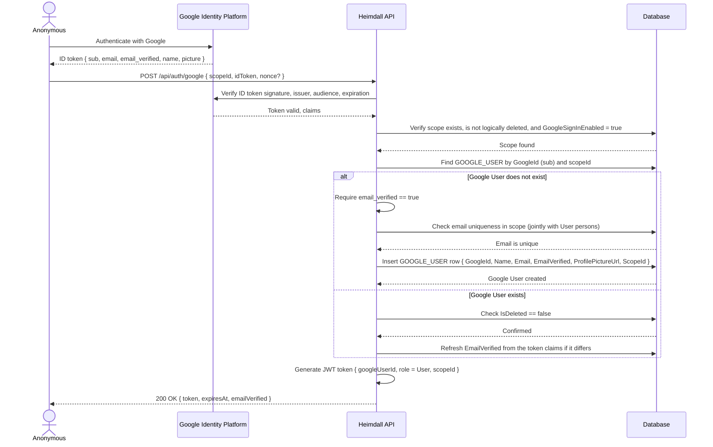

1. The caller authenticates with Google (outside this API) and obtains a signed ID token.
2. The caller sends the ID token and target scope ID to the API, and optionally the `nonce` it sent Google when asking for the token.
3. The system verifies the ID token's signature, issuer, audience, and expiration. When the request carries a `nonce`, the token's `nonce` claim must equal it (FR-GO-20, AF-25g).
4. The system verifies the target scope exists, is not logically deleted, and has `GoogleSignInEnabled = true`.
5. The system looks up a Google User by `GoogleId` (the token's `sub` claim) within the scope.
6. If none exists: the system requires the token's `email_verified` claim to be `true` (AF-25f), verifies the token's `email` is unique within the scope (jointly with `User` persons' emails), then creates a new Google User populated from the token's claims (`Name`, `Email`, `EmailVerified`, `ProfilePictureUrl`).
7. If one exists: the system confirms it is not under a restriction on processing (AF-25e) and not logically deleted, and refreshes the stored `EmailVerified` from the token's claims when the two differ (FR-GO-19). A token carrying no `email_verified` claim asserts nothing about the address, so the stored value is left as it stands.
8. The system issues an authentication token containing the Google User's ID, display name, `role = User`, and the scope ID. When Google supplied no name, the verified email is used as the display name.

**Alternative Flows:**

| ID | Condition | Outcome |
| ---- | ----------- | --------- |
| AF-25a | ID token invalid, expired, or fails verification | Return `401 Unauthorized` |
| AF-25b | Scope not found, logically deleted, or `GoogleSignInEnabled = false` | Return `403 Forbidden` |
| AF-25c | Email from the token already used by another Google User or `User` person in the scope | Return `409 Conflict` |
| AF-25d | Existing Google User is logically deleted, and not under a restriction on processing | Return `401 Unauthorized` |
| AF-25e | Existing Google User is under a restriction on processing (NFR-24), whether or not logically deleted | Return `200 OK` with a subject-rights-only token and `processingRestricted: true`, as UC-11's AF-11i. Nothing is refreshed from the ID token, since that would be processing the record |
| AF-25f | No Google User exists yet and the token's `email_verified` claim is not `true` — false or absent (FR-GO-07); checked before AF-25c | Return `403 Forbidden` — "Google sign-up requires a verified email address." Nothing is created |
| AF-25g | The request carries a `nonce` and the token's `nonce` claim is absent or differs (FR-GO-20); checked with AF-25a, before the scope is read | As AF-25a: `401 Unauthorized` — "Google authentication failed." |

---

### UC-26: Sign Out via Google

| Field | Value |
| ------- | ------- |
| **ID** | UC-26 |
| **Name** | Sign Out via Google |
| **Actors** | Google User |
| **Description** | End a Google User's session in the client |
| **Preconditions** | The caller holds a valid authentication token issued via UC-25 |
| **Postconditions** | The client has been told to discard the token. Heimdall keeps no Google session and records no issued token, so nothing server-side ends: a copy of the token kept elsewhere stays valid until it expires (FR-GO-18) |

**Main Flow:**

1. The Google User sends a sign-out request with their current token.
2. The system confirms the token still names a live Google User and instructs the client to discard it. It revokes nothing: Heimdall's tokens are stateless (NFR-03), a Google User's token carries no security stamp (FR-AU-11), and Heimdall holds no session with Google to end.
3. The system returns success.

**Alternative Flows:**

| ID | Condition | Outcome |
| ---- | ----------- | --------- |
| AF-26a | Token missing or already invalid | Return `401 Unauthorized` |

---

### UC-27: View Google User

| Field | Value |
| ------- | ------- |
| **ID** | UC-27 |
| **Name** | View Google User |
| **Actors** | System Admin, Scope Admin, Google User |
| **Description** | Retrieve a Google User's details or list Google Users within a scope |
| **Preconditions** | Actor is authenticated |
| **Postconditions** | Google User information is returned |

**Main Flow:**

1. Actor requests a Google User by ID or a list of Google Users within a scope.
2. The system checks authorization:
   - System Admin: can view any Google User.
   - Scope Admin: can view the Google Users of the scopes they own.
   - Google User: can view only their own record.
3. Logically deleted Google Users are excluded unless explicitly requested.
4. The system returns Google User data.

**Alternative Flows:**

| ID | Condition | Outcome |
| ---- | ----------- | --------- |
| AF-27a | Google User not found | Return `404 Not Found` |
| AF-27b | Actor not authorized | Return `403 Forbidden` |

---

### UC-28: Logical Delete Google User

| Field | Value |
| ------- | ------- |
| **ID** | UC-28 |
| **Name** | Logical Delete Google User |
| **Actors** | System Admin, Scope Admin |
| **Description** | Soft-delete a Google User by setting `IsDeleted = true` |
| **Preconditions** | Actor is authenticated; Google User exists |
| **Postconditions** | Google User's `IsDeleted` is `true` |

**Main Flow:**

1. Actor sends a delete request for a Google User.
2. The system checks authorization: System Admin, or an owner of the Google User's scope.
3. The system sets `IsDeleted = true` on the Google User record.
4. The system returns success.

**Alternative Flows:**

| ID | Condition | Outcome |
| ---- | ----------- | --------- |
| AF-28a | Google User not found | Return `404 Not Found` |
| AF-28b | Already logically deleted | Return `200 OK` (idempotent) |
| AF-28c | Actor not authorized | Return `403 Forbidden` |

---

### UC-29: Hard Delete Google User

| Field | Value |
| ------- | ------- |
| **ID** | UC-29 |
| **Name** | Hard Delete Google User |
| **Actors** | System Admin |
| **Description** | Permanently remove a Google User record from the database |
| **Preconditions** | Actor is authenticated with `SystemAdmin` role; Google User exists |
| **Postconditions** | Google User record is permanently removed |

**Main Flow:**

1. System Admin sends a hard delete request.
2. The system records a tombstone for the Google User in `ERASED_SUBJECT` — their `PublicId`, that it was a Google User, and when — before the record is deleted, so the audit entries naming them, this hard delete's own among them, can still be cleared once the row is gone (NFR-21, #195). A retry records it again without error.
3. The system permanently deletes the Google User record.
4. The system returns success.

**Alternative Flows:**

| ID | Condition | Outcome |
| ---- | ----------- | --------- |
| AF-29a | Google User not found | Return `404 Not Found` |

---

### UC-31: Create Scope Permission

| Field | Value |
| ------- | ------- |
| **ID** | UC-31 |
| **Name** | Create Scope Permission |
| **Actors** | System Admin, Scope Admin |
| **Description** | Register a new scope-specific permission within a scope. The permission carries a `Name`, an optional `Description`, and an `IncludeAsJwtClaim` flag controlling whether the `Name` is folded into the JWT issued to identities acting within the scope (FR-AU-08). A scope permission has no separate owner of its own — owning the scope is the whole of the authorization |
| **Preconditions** | Actor is authenticated; target scope exists and is not logically deleted; for a Scope Admin, the actor must own the target scope |
| **Postconditions** | A new scope permission record exists, associated with the scope, with `IsDeleted = false` and `IncludeAsJwtClaim` set as supplied (default `false`) |

**Main Flow:**

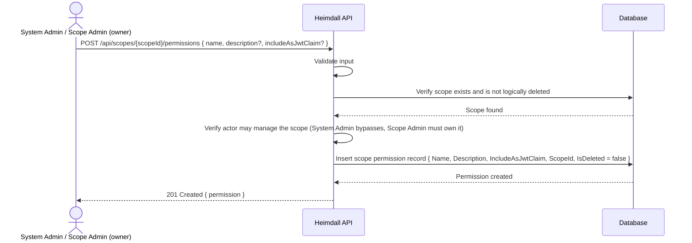

1. Caller sends a request with the permission `Name`, an optional `Description`, and an optional `IncludeAsJwtClaim` flag, targeting a scope.
2. The system validates the input shape: `Name` is required and at most 200 characters; `Description`, when supplied, is at most 500 characters.
3. The system verifies the target scope exists and is not logically deleted.
4. The system verifies the actor may manage the scope — a System Admin bypasses the check; a Scope Admin must own it.
5. The system creates the scope permission record with `IsDeleted = false` and `IncludeAsJwtClaim` as supplied (defaulting to `false` when omitted).
6. The system returns the created permission.

**Alternative Flows:**

| ID | Condition | Outcome |
| ---- | ----------- | --------- |
| AF-31a | Scope not found or logically deleted | Return `404 Not Found` |
| AF-31d | Invalid input — `Name` missing or over 200 characters, or `Description` over 500 characters | Return `400 Bad Request` with validation errors |
| AF-31e | Scope Admin does not own the target scope | Return `403 Forbidden` |

> **On the role gate.** The endpoint carries `[RoleRequirement(SystemAdmin, ScopeAdmin)]`, so a `User` is refused with `403` before the handler runs — independently of the data-dependent AF-31e. The same framework-level refusal applies to every scope-permission endpoint in UC-31 through UC-34; only UC-35 restricts further, to `SystemAdmin` alone. These framework refusals are not listed as separate alternative flows because they are settled by the attribute, not by the use case's data rules.

---

### UC-32: View Scope Permission

| Field | Value |
| ------- | ------- |
| **ID** | UC-32 |
| **Name** | View Scope Permission |
| **Actors** | System Admin, Scope Admin |
| **Description** | Retrieve a scope permission's details or list the permissions within a scope. There are two distinct reads: (a) a single permission by ID, via `GET /api/scopes/{scopeId}/permissions/{id}`; or (b) the permissions of a scope, via `GET /api/scopes/{scopeId}/permissions` |
| **Preconditions** | Actor is authenticated |
| **Postconditions** | Scope permission information is returned |

**Main Flow (read a — permission by ID):**

1. Actor requests a scope permission by ID within a scope.
2. The system loads the permission, qualifying the lookup by the route's `scopeId`, and excluding logically deleted permissions unless `includeDeleted` is explicitly requested (FR-SP-09).
3. The system checks authorization: a System Admin sees any permission; a Scope Admin must own the permission's scope.
4. The system returns the permission data.

**Main Flow (read b — list a scope's permissions):**

1. A System Admin or a Scope Admin requests the permissions of a scope, optionally filtering by `Name` (case-insensitive) and paging the result (FR-SP-05).
2. The system verifies the scope exists and is not logically deleted.
3. The system verifies the actor may manage the scope: a System Admin always may; a Scope Admin must own it.
4. The system returns the page of the scope's permissions, excluding logically deleted permissions unless explicitly requested. There is no per-owner narrowing — a scope permission has no owner of its own, so owning the scope is the whole of the rule.

**Alternative Flows:**

| ID | Condition | Outcome |
| ---- | ----------- | --------- |
| AF-32a | Permission not found under the addressed scope, or logically deleted and not explicitly requested (read a) | Return `404 Not Found` |
| AF-32b | Scope not found or logically deleted (read b — reuses AF-31a) | Return `404 Not Found` |
| AF-32e | Actor not authorized — a Scope Admin who does not own the target scope (reads a, b) | Return `403 Forbidden` |

---

### UC-33: Update Scope Permission

| Field | Value |
| ------- | ------- |
| **ID** | UC-33 |
| **Name** | Update Scope Permission |
| **Actors** | System Admin, Scope Admin |
| **Description** | Modify a scope permission's `Name`, `Description`, and `IncludeAsJwtClaim` flag |
| **Preconditions** | Actor is authenticated; permission exists under the addressed scope and is not logically deleted |
| **Postconditions** | Scope permission record is updated |

**Main Flow:**

1. Actor sends an update request to `PUT /api/scopes/{scopeId}/permissions/{id}` with the new `Name`, `Description`, and `IncludeAsJwtClaim` values.
2. The system validates the input shape, reusing UC-31's rules.
3. The system loads the permission inside the addressed scope, excluding logically deleted permissions.
4. The system checks authorization: a System Admin may update any permission; a Scope Admin must own the permission's scope.
5. The system applies the updates and stamps `UpdatedAt`.
6. The system returns the updated permission.

**Alternative Flows:**

| ID | Condition | Outcome |
| ---- | ----------- | --------- |
| AF-33a | Permission not found under the addressed scope, or logically deleted | Return `404 Not Found` |
| AF-33d | Invalid input (reuses AF-31d) | Return `400 Bad Request` with validation errors |
| AF-33e | Scope Admin does not own the permission's scope | Return `403 Forbidden` |

---

### UC-34: Logical Delete Scope Permission

| Field | Value |
| ------- | ------- |
| **ID** | UC-34 |
| **Name** | Logical Delete Scope Permission |
| **Actors** | System Admin, Scope Admin |
| **Description** | Soft-delete a scope permission by setting `IsDeleted = true`. Nothing cascades — a scope permission owns no dependent row |
| **Preconditions** | Actor is authenticated; the permission exists under the addressed scope |
| **Postconditions** | The permission's `IsDeleted` is `true` |

**Main Flow:**

1. Actor sends `DELETE /api/scopes/{scopeId}/permissions/{id}`.
2. The system locates the permission inside the addressed scope in **any** deletion state — an already-deleted permission must be found so AF-34b can answer idempotently rather than as a `404`.
3. The system checks authorization: a System Admin may delete any permission; a Scope Admin must own the permission's scope. This runs before the idempotent check, so an already-deleted permission cannot be used to probe for scopes the caller may not act on.
4. If the permission is already logically deleted, the system returns success with `alreadyDeleted = true` and writes nothing.
5. Otherwise the system sets `IsDeleted = true`, stamps `UpdatedAt`, and returns success with `alreadyDeleted = false`.

**Alternative Flows:**

| ID | Condition | Outcome |
| ---- | ----------- | --------- |
| AF-34a | Permission not found under the addressed scope | Return `404 Not Found` |
| AF-34b | Already logically deleted | Return `200 OK` (idempotent), with `alreadyDeleted = true` |
| AF-34e | Scope Admin does not own the permission's scope | Return `403 Forbidden` |

---

### UC-35: Hard Delete Scope Permission

| Field | Value |
| ------- | ------- |
| **ID** | UC-35 |
| **Name** | Hard Delete Scope Permission |
| **Actors** | System Admin |
| **Description** | Permanently remove a scope permission record from the database |
| **Preconditions** | Actor is authenticated with `SystemAdmin` role; the permission exists under the addressed scope |
| **Postconditions** | The scope permission record is permanently removed. Nothing cascades — a scope permission is a leaf in the data model |

**Main Flow:**

1. System Admin sends `DELETE /api/scopes/{scopeId}/permissions/{id}/hard`.
2. The system locates the permission inside the addressed scope in **any** deletion state — a logically deleted permission is exactly what a cleanup pass starts from, so soft deletion must not block a hard one.
3. The system permanently deletes the record. No dependent is removed first — no entity carries a foreign key to a scope permission.
4. The system returns success.

**Alternative Flows:**

| ID | Condition | Outcome |
| ---- | ----------- | --------- |
| AF-35a | Permission not found under the addressed scope (includes a repeated call — the row is already gone, and UC-35 has no idempotent path) | Return `404 Not Found` |

> **On UC-35's only refusals.** Authorization is settled entirely by the endpoint's `[RoleRequirement(SystemAdmin)]`: a `ScopeAdmin` or `User` is refused with `403` before the handler runs, and an unauthenticated caller is refused with `401`. No data-dependent authorization rule is left for the handler to apply, which is why no AF-35e appears here — unlike UC-31 through UC-34, whose scope-ownership rule is data-dependent and lives in the handler.

---

### UC-36: Enable Two-Factor Authentication

| Field | Value |
| ------- | ------- |
| **ID** | UC-36 |
| **Name** | Enable Two-Factor Authentication (Initiate Setup and Read Status) |
| **Actors** | User, Scope Admin, System Admin |
| **Description** | Begin opting an authenticated person into two-factor authentication, selecting an authenticator-app method, an email method, or both; and read a person's own current two-factor state. Setup is inactive until confirmed by UC-37. There are two operations: (a) initiate setup, via `POST /api/auth/2fa/enable`; and (b) read the caller's own status, via `GET /api/auth/2fa` |
| **Preconditions** | Actor is authenticated; for (a), the person has no active two-factor configuration (`TWO_FACTOR_AUTH.IsActive` is not already `true`); for (b), none beyond authentication |
| **Postconditions** | For (a): a `TWO_FACTOR_AUTH` row exists for the person with `IsActive = false`; for the App method, a TOTP secret has been generated and returned; for the Email method, a first code has been emailed. For (b): nothing is changed |

**Main Flow (a — initiate setup):**

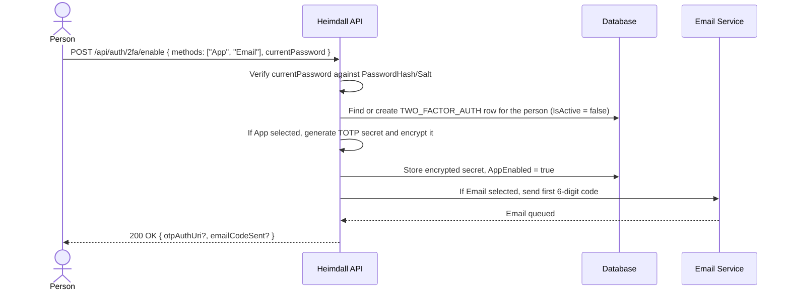

1. Caller sends `POST /api/auth/2fa/enable` with the method(s) they want: `App`, `Email`, or both, and their `currentPassword` (FR-2F-18).
2. The system confirms the caller has no already-active two-factor configuration, that their account-email budget would admit a send when `Email` is selected (AF-36f, AF-36g), and that `currentPassword` matches their password (AF-36e); with `Email`, it then reserves the send (FR-2F-19), and creates (or reuses a not-yet-confirmed) `TWO_FACTOR_AUTH` row for them.
3. If `App` was selected, the system generates a random TOTP secret (RFC 6238), stores it encrypted, and returns an `otpauth://` provisioning URI for QR scanning. The plaintext secret is never stored — only the encrypted form.
4. If `Email` was selected, the system generates a random 6-digit code, stores it (hashed, 10-minute expiry), and sends it through the email service.
5. The system returns success, confirming which method(s) are pending confirmation. Nothing is active yet — UC-37 finishes the job.

**Main Flow (b — read the caller's own status):**

1. An authenticated person requests their own two-factor state through `GET /api/auth/2fa` (FR-2F-15). The person read is always the caller, taken from their token — a configuration is never addressed by an identifier in a path.
2. The system loads the caller's `TWO_FACTOR_AUTH` row, if one exists.
3. The system returns whether two-factor authentication is active, which methods are configured, and how many issued recovery codes remain unused. No secret is returned: never the TOTP secret, never a recovery code.
4. A caller with no `TWO_FACTOR_AUTH` row is answered successfully, with every flag false and a zero count. Never having enabled two-factor authentication is an ordinary state, not a fault, and a setup initiated but not yet confirmed is reported as inactive with its selected methods set.

**Alternative Flows:**

| ID | Condition | Outcome |
| ---- | ----------- | --------- |
| AF-36a | Two-factor authentication is already active for the person | Return `409 Conflict` |
| AF-36b | Caller is not a person eligible for two-factor authentication — a Google User, or a token naming no live person (either operation) | Return `403 Forbidden` — Google Users are not eligible (FR-2F-01) |
| AF-36c | Neither `App` nor `Email` selected | Return `400 Bad Request` |
| AF-36e | `currentPassword` missing or wrong (FR-2F-18), or the re-authentication budget is paused (FR-AU-13) | Return `401 Unauthorized` — "The password or code is incorrect." (UC-39's AF-39b). Nothing is created or sent |
| AF-36d | Re-initiating setup while a prior, unconfirmed setup exists | Overwrite the pending configuration with the new selection (regenerates the TOTP secret and/or resends the email code); return `200 OK` exactly as the main flow |
| AF-36f | `Email` is selected and the person's own requests had an account email sent within the cooldown (`HEIMDALL_ADMIN_EMAIL_COOLDOWN_IN_SECONDS`, five minutes by default), FR-PE-16, FR-2F-19 | Return `429 Too Many Requests` — "An email of this kind was sent to you recently. Try again in a few minutes." Checked after AF-36a and before the password, so it costs no password check and no re-authentication charge. Nothing is changed or sent; a code already mailed still confirms. Selecting `App` alone is not affected |
| AF-36g | As AF-36f, but five account emails have been sent in the current day-long window | Return `429 Too Many Requests` — "You have reached today's limit for account emails. Try again tomorrow." As AF-36f otherwise |

> **On requiring the password.** Adding a second factor requires proof of identity, as removing one
> does (UC-39): the method chosen here is what UC-38 demands at every later login, and a bearer token
> is not proof that the account holder is present.

---

### UC-37: Confirm Two-Factor Authentication Setup

| Field | Value |
| ------- | ------- |
| **ID** | UC-37 |
| **Name** | Confirm Two-Factor Authentication Setup |
| **Actors** | User, Scope Admin, System Admin |
| **Description** | Prove control of every method selected in UC-36 to activate two-factor authentication and receive the one-time set of recovery codes |
| **Preconditions** | A pending (`IsActive = false`) `TWO_FACTOR_AUTH` row exists for the person, from UC-36 |
| **Postconditions** | `TWO_FACTOR_AUTH.IsActive` is `true`; exactly ten recovery codes exist, hashed, and were returned to the caller in plaintext this one time; every token the person held is revoked, the one that confirmed included (FR-AU-11) |

**Main Flow:**

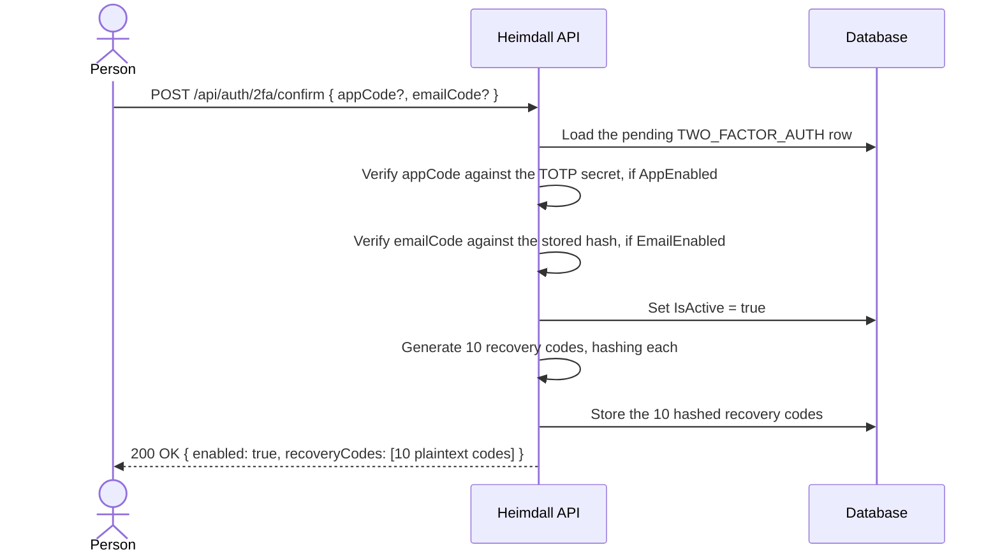

1. Caller sends `POST /api/auth/2fa/confirm` with a code for every method they selected in UC-36 (an `appCode` if `AppEnabled`, an `emailCode` if `EmailEnabled` — both, if both).
2. The system verifies each provided code against its method: the TOTP code against the stored secret, the email code against its stored hash and expiry.
3. Only once every required code checks out, the system replaces the person's security stamp, which
   revokes every token issued before the second factor was required, the caller's own included
   (FR-AU-11).
4. The system generates ten random recovery codes, hashes each, and stores the hashes. Each is 80 bits, sixteen characters of Crockford's base32 shown as `XXXX-XXXX-XXXX-XXXX` (FR-2F-20).
5. The system sets `IsActive = true`.
6. The system returns the ten recovery codes in plaintext. This is the only response that will ever contain them — they are not retrievable again (only regenerable, via UC-40). The client keeps them, then signs in again; that login now goes through UC-38.

**Alternative Flows:**

| ID | Condition | Outcome |
| ---- | ----------- | --------- |
| AF-37a | No pending setup exists for the person | Return `404 Not Found` |
| AF-37b | `appCode` missing or incorrect, when `AppEnabled` — or the re-authentication budget is paused (FR-AU-13) | Return `401 Unauthorized` — "The password or code is incorrect." |
| AF-37c | `emailCode` missing, incorrect, expired, already used, or retired after five wrong guesses (FR-2F-13), when `EmailEnabled` | Return `401 Unauthorized` — "The password or code is incorrect.", the same answer as AF-37b. The code is not spent |
| AF-37d | Setup is already active (repeated confirm) | Return `409 Conflict` |

> **On requiring every selected method's code.** If both `App` and `Email` were chosen in UC-36, both codes are required in the same confirmation request. Confirming with only one channel would activate a method whose configuration was never actually exercised — for the app, that a QR code was scanned into a real authenticator; for email, that the address reliably receives mail — leaving a silently broken second factor discovered only at the next login.

---

### UC-38: Verify Second Factor (Login Challenge)

| Field | Value |
| ------- | ------- |
| **ID** | UC-38 |
| **Name** | Verify Second Factor |
| **Actors** | Anonymous (holding a challenge token from UC-11) |
| **Description** | Complete a login for a person with active two-factor authentication by exchanging a short-lived challenge token and a code — app, email, or a recovery code — for the real authentication token |
| **Preconditions** | UC-11's password check succeeded for a person with `TWO_FACTOR_AUTH.IsActive = true`, and UC-11 issued a challenge token instead of a full authentication token |
| **Postconditions** | A full authentication token is issued, exactly as FR-AU-03/FR-AU-04 describe for a direct login; if a recovery code was used, it is marked used |

**Main Flow:**

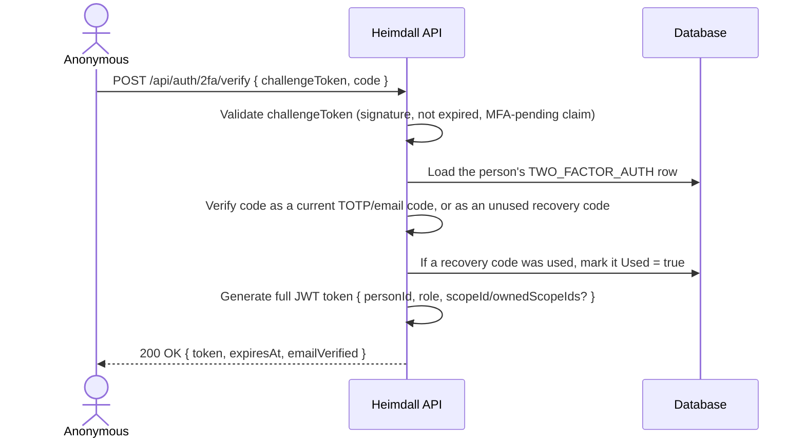

1. Caller sends the challenge token from UC-11's login response, together with either a current app/email code or a recovery code.
2. The system validates the challenge token: signature, expiration, and that it carries the MFA-pending claim (FR-2F-10) — this endpoint is the only one that accepts such a token. The token must also still name the person's outstanding challenge: redeeming a challenge spends it, and a newer login replaces it, so a challenge is redeemable once (FR-2F-10).
3. The system checks the supplied value: a TOTP code against the stored secret, an email code against its stored hash and expiry, or a recovery code against the stored hashes — ignoring its hyphens, whitespace and case, and reading an O, I or L in a sixteen-character code as 0, 1 and 1; a code of the shorter `XXXX-XXXX` shape issued before still matches as it was stored (FR-2F-20). A guess with an app code or a recovery code is first charged to the challenge, which allows five (FR-2F-17); an email code's guesses are charged to the code (FR-2F-13). Every guess is also charged to the person, across challenges, and a correct password does not reset that count: the tenth failure locks the second factor, for fifteen minutes and twice as long at each repeat, up to a day, and only a second factor that checks out resets it (FR-AU-12).
4. If a recovery code was used, the system marks it consumed — it cannot be used again.
5. The system marks the challenge redeemed, then generates and returns the full authentication token, identical in shape to a direct UC-11 success. A person whose processing is restricted (NFR-24) — including one restricted after the challenge was issued — gets UC-11's AF-11i subject-rights-only token instead, and AF-38d's scope check does not apply to them.

**Alternative Flows:**

| ID | Condition | Outcome |
| ---- | ----------- | --------- |
| AF-38a | Challenge token expired or invalid, already redeemed — by an earlier request or a simultaneous one (NFR-27) — or superseded by a newer login (FR-2F-10), retired after five app-code or recovery-code guesses (FR-2F-17), issued before the person's last credential change, so its security stamp is no longer theirs (FR-AU-11), or naming a person who is anonymised, or logically deleted and not under a restriction on processing (NFR-24) | Return `401 Unauthorized` |
| AF-38b | Code does not match any valid app code, email code, or unused recovery code — including an app code already accepted once (FR-2F-14) and an email code retired after five wrong guesses (FR-2F-13) — or the person's second factor is locked (FR-AU-12), whatever the code | Return `401 Unauthorized`. A locked second factor answers exactly as a wrong code does. The code is still checked, so a correct app code's time step is used up (FR-2F-14) and an email code's guess is counted (FR-2F-13), but no recovery or email code is spent and no token is issued |
| AF-38c | Recovery code already used | Return `401 Unauthorized`, same message as AF-38b (does not reveal that the code existed) |
| AF-38d | The submitted factor checks out, but the person's scope eligibility (AF-11d/AF-11e) no longer holds by the time this runs | Return `401 Unauthorized` with a distinct message, since — unlike AF-38a through AF-38c — nothing about the challenge token or the factor was wrong |

> **On the single rejection.** As with UC-11's own AF-11a..e, AF-38a through AF-38c collapse to one indistinguishable `401` — telling an unauthenticated caller which part of their guess was wrong would leak whether a challenge token is merely expired versus outright forged, or whether a recovery code was ever real.
>
> **On AF-38d being separate.** AF-38d is not folded into that collapse: the caller who reaches it proved both a valid challenge token and a genuine factor, so the failure is not "you guessed wrong" but "your account stopped qualifying between UC-11 and now." There is nothing to hide by distinguishing it — the caller already holds proof they are who they say they are.

---

### UC-39: Disable Two-Factor Authentication

| Field | Value |
| ------- | ------- |
| **ID** | UC-39 |
| **Name** | Disable Two-Factor Authentication |
| **Actors** | User, Scope Admin, System Admin |
| **Description** | Turn off two-factor authentication for the caller's own account |
| **Preconditions** | Actor is authenticated; `TWO_FACTOR_AUTH.IsActive = true` for the person |
| **Postconditions** | The person's `TWO_FACTOR_AUTH` row and all of its recovery codes are permanently removed; every token the person held is revoked, the caller's own included (FR-AU-11) |

**Main Flow:**

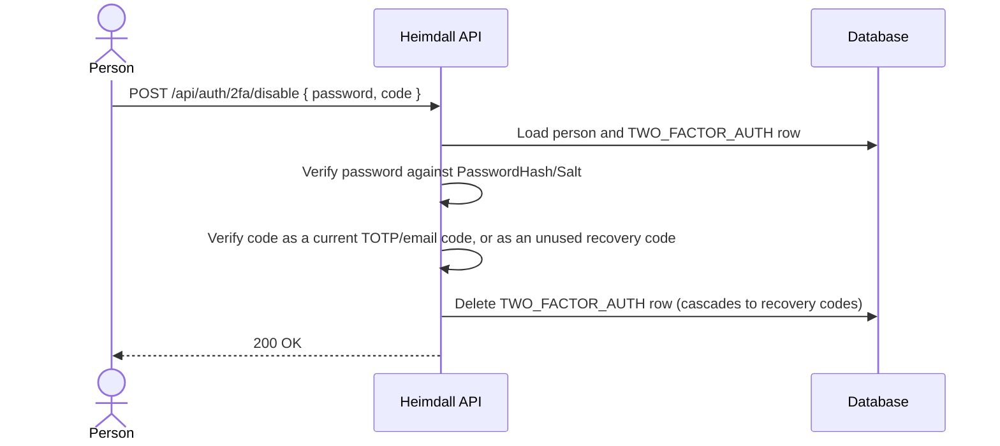

1. Caller sends their current password together with a valid second factor — an app/email code or a recovery code.
2. The system verifies the password, exactly as UC-11 does.
3. The system verifies the second factor, exactly as UC-38 does.
4. Only when both check out, the system replaces the person's security stamp, revoking every token
   issued while the factor stood (FR-AU-11), then deletes the `TWO_FACTOR_AUTH` row, which cascades to
   its recovery codes.
5. The system returns success. The token that made the request is revoked with the rest, so the client signs in again; two-factor authentication no longer applies to that login.

**Alternative Flows:**

| ID | Condition | Outcome |
| ---- | ----------- | --------- |
| AF-39a | Two-factor authentication is not active for the person | Return `404 Not Found` |
| AF-39b | Password mismatch, or the re-authentication budget is paused (FR-AU-13) | Return `401 Unauthorized` — "The password or code is incorrect." |
| AF-39c | Second factor invalid (per AF-38b/AF-38c) | Return `401 Unauthorized` — "The password or code is incorrect.", the same answer as AF-39b, so it does not say which of the two was wrong |

> **On requiring both factors to disable.** Password alone is not enough: an attacker holding only a stolen session or a leaked password should not be able to strip two-factor protection off an account they don't fully control. Requiring the second factor too makes disabling exactly as hard as a login.

---

### UC-40: Regenerate Recovery Codes

| Field | Value |
| ------- | ------- |
| **ID** | UC-40 |
| **Name** | Regenerate Recovery Codes |
| **Actors** | User, Scope Admin, System Admin |
| **Description** | Invalidate the caller's current recovery codes and issue a fresh set of ten |
| **Preconditions** | Actor is authenticated; `TWO_FACTOR_AUTH.IsActive = true` for the person |
| **Postconditions** | The previous ten recovery codes no longer validate; ten new ones exist, hashed, and were returned to the caller in plaintext this one time; every token the person held is revoked, the caller's own included (FR-AU-11) |

**Main Flow:**

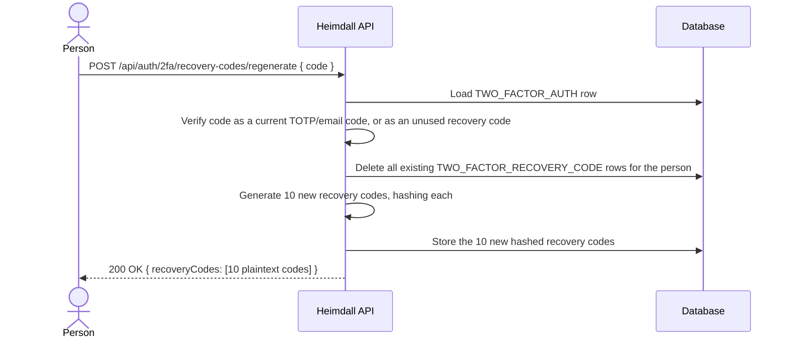

1. Caller sends a valid second factor — an app/email code, or one of their remaining recovery codes.
2. The system verifies it, exactly as UC-38 does.
3. The system replaces the person's security stamp, revoking every token issued before (FR-AU-11): the
   codes are usually replaced because the old set may be known to somebody else, and so may a session
   opened with one.
4. The system generates ten new codes of the current shape (FR-2F-20), hashes each, and stores them,
   then deletes every earlier recovery code row for the person, including any still unused. This is
   also how a person holding the shorter codes issued before FR-2F-20 gets the stronger ones.
5. The system returns the ten new codes in plaintext — the only response that will ever contain them. The client keeps them, then signs in again.

**Alternative Flows:**

| ID | Condition | Outcome |
| ---- | ----------- | --------- |
| AF-40a | Two-factor authentication is not active for the person | Return `404 Not Found` |
| AF-40b | Second factor invalid (per AF-38b/AF-38c), or the re-authentication budget is paused (FR-AU-13) | Return `401 Unauthorized` — "The password or code is incorrect." |

> **On invalidating the whole set.** Regeneration replaces all ten codes at once rather than topping up the used ones back to ten: a partial refill would leave old, already-distributed codes valid alongside new ones, defeating the point of rotating them.

---

### UC-46: Resend Second-Factor Email Code

| Field | Value |
| ------- | ------- |
| **ID** | UC-46 |
| **Name** | Resend Second-Factor Email Code |
| **Actors** | Anonymous (holding a challenge token from UC-11) |
| **Description** | Reissue the email code for a challenge that is still outstanding, so a person who never received the first one can ask for another without restarting sign-in |
| **Preconditions** | UC-11 issued a challenge token for a person whose `TWO_FACTOR_AUTH` has `EmailEnabled = true`, and that token has not yet expired |
| **Postconditions** | The person's outstanding email codes are retired and a fresh one is mailed to them; the challenge's reissue count is incremented. The challenge token itself is unchanged and its expiry is not moved |

**Main Flow:**

```mermaid
sequenceDiagram
    actor U as Anonymous
    participant API as Heimdall API
    participant DB as Database
    participant M as Mail

    U->>API: POST /api/auth/2fa/challenge/resend { challengeToken }
    API->>API: Validate challengeToken (signature, not expired, MFA-pending claim)
    API->>DB: Load the person and their active TWO_FACTOR_AUTH row
    API->>DB: Increment the challenge's reissue count (refuse past the cap)
    API->>DB: Mark outstanding email codes Used = true
    API->>DB: Store a fresh 6-digit code, hashed, expiring per FR-2F-03
    API->>M: Send the code to the person's stored address
    API-->>U: 200 OK
```

1. Caller sends the challenge token UC-11's login response returned. Nothing else — no address, no scope, no credential.
2. The system validates the challenge token exactly as UC-38 step 2 does: signature, expiration, and the MFA-pending claim (FR-2F-10).
3. The system resolves the person the token names and their active two-factor configuration, and confirms the email method is enabled for them.
4. The system confirms the challenge has reissues left (FR-2F-13) and charges one against it.
5. The system retires the person's outstanding email codes and stores a fresh one, hashed, expiring per FR-2F-03.
6. The system mails the code to the person's stored address.
7. The system answers `200 OK`, carrying no data.

**Alternative Flows:**

| ID | Condition | Outcome |
| ---- | ----------- | --------- |
| AF-46a | Challenge token missing, malformed, unsigned by this API, expired, or not carrying the MFA-pending claim — or no longer the person's outstanding challenge, because it was redeemed or a newer login replaced it (FR-2F-10), or issued before the person's last credential change (FR-AU-11) | Return `200 OK`, identical to the main flow. Nothing is sent |
| AF-46b | The challenge names a person who no longer exists, is anonymised, or is logically deleted and not under a restriction on processing (NFR-24) | Return `200 OK`, identical to the main flow. Nothing is sent. A restricted person's code is sent: they asked for it to finish signing in for their own rights (UC-11 AF-11i), which is the consent Art. 18(2) asks for |
| AF-46c | The person has no active two-factor configuration, or has one without the email method — an authenticator-app holder has no code to resend | Return `200 OK`, identical to the main flow. Nothing is sent |
| AF-46d | The challenge has already authorized its maximum reissues (FR-2F-13) | Return `200 OK`, identical to the main flow. Nothing is sent |
| AF-46e | A full authentication token is presented in place of a challenge token | Treated as AF-46a — the MFA-pending claim is absent, so it is not a challenge token (FR-2F-10) |

> **On the single answer.** Every flow above, and the main flow, return the same `200 OK` with the same message and no data. That is the point of the endpoint's design rather than an economy in writing it: this route is anonymous, and an answer that varied would say whether an address is registered, whether it has email two-factor enabled, and how much of its guessing budget is left. It is the same reasoning behind UC-11's AF-11a…AF-11e and UC-38's AF-38a…AF-38c, with the sign flipped — those collapse to one `401` because the caller asked to be let in; this collapses to one `200` because they asked for something to be sent, and "we have sent it if there was anything to send" is the most that can be said without answering a question they did not earn the right to ask.
>
> **On the challenge not being extended.** A reissue puts a fresh code inside the existing challenge's window; it never lengthens it and never returns a new challenge token. This is forced rather than chosen: a new token could only be returned for a challenge that was genuine, so returning one would be precisely the oracle the paragraph above rules out. The window's ceiling is therefore NFR-17's, which is the same ten minutes FR-2F-03 gives the code — so a reissue inside the window is worth having rather than a formality.
>
> **On the reissue cap.** FR-2F-13 retires an email code after five wrong guesses. Without a cap, this use case would turn that bound into five guesses times however many reissues a caller could obtain, which would make it a property of the rate limiter's configuration rather than of the specification. Three reissues per challenge keeps it stated: at most twenty guesses at a six-digit code per authentication, after which a further code costs a fresh password check — which is what FR-2F-13 always charged.

---

### UC-47: Register a Password User

| Field | Value |
| ------- | ------- |
| **ID** | UC-47 |
| **Name** | Register a Password User |
| **Actors** | Anonymous |
| **Description** | Create a password `User` in a scope without an administrator, where the scope's owners have opened self-registration |
| **Preconditions** | The scope exists, is not logically deleted, and has `SelfRegistrationEnabled = true` (FR-SR-01, FR-SR-02) |
| **Postconditions** | Either a pending registration exists and its link was sent, or the holder of the address was told of the attempt. The caller cannot tell which. No `User` exists until the link is followed with the password chosen at sign-up (FR-SR-07, FR-SR-09) |

**Main Flow:**

```mermaid
sequenceDiagram
    actor U as Anonymous
    participant API as Heimdall API
    participant Q as Registration queue
    participant DB as Database
    participant M as Mail

    U->>API: POST /api/auth/register { name, email, password, scopeId }
    API->>API: Validate the request
    API->>DB: Confirm the scope is open
    API->>API: Hash the password
    API->>Q: Queue { scopeId, name, email, hash, salt }
    API-->>U: 202 Accepted
    Q->>DB: Re-check the scope, look the address up in the scope
    Q->>DB: Write a pending registration (address free)
    Q->>M: Send the confirmation email (UC-14 link)
    U->>API: POST /api/auth/verify-email { token, password } (UC-14)
    API->>API: Check the password against the stored hash
    API->>DB: Re-check the scope and the address
    API->>DB: Create the User, verified; remove the address's pending registrations
    API-->>U: 200 OK
```

1. Caller sends a name, an email address, a password and the scope's `PublicId`.
2. The system validates the request with the rules UC-06 path a applies (FR-SR-03).
3. The system confirms the scope exists, is live and is open to self-registration.
4. The system hashes the password, queues the request and answers `202 Accepted` with a fixed message.
5. Afterwards, the system re-checks the scope and confirms the address is held by no live person and no Google User of the scope (FR-SR-04).
6. The system writes a pending registration — name, address, password hash and salt, and the hash of a single-use token, expiring with the email-verification token lifetime (FR-SR-08) — and mails the token's link (FR-EV-01/02), in a message that tells the registrant to enter the password chosen at sign-up. It creates no `User`.
7. The person follows the link (UC-14) and enters the password chosen at sign-up (FR-SR-09).
8. The system checks the password against the stored hash, re-checks that the scope is still open and the address still free, creates the `User`, verified, records its legal basis (NFR-23), and removes the address's pending registrations (FR-SR-07).

**Alternative Flows:**

| ID | Condition | Outcome |
| ---- | ----------- | --------- |
| AF-47a | The scope is missing, logically deleted, or has self-registration off | `403 Forbidden` with one message for all three. Nothing is queued |
| AF-47b | The address is already held in the scope by a live person or a Google User | `202 Accepted`, identical to the main flow. Nothing is created; the holder is emailed, at the address on their record, that someone tried to register their address, unless their processing is restricted (NFR-24) or they are a Google User who has been logically deleted, who could not act on it (FR-SR-05) |
| AF-47c | The request is malformed | `400 Bad Request` with the field's message. Nothing is queued |
| AF-47d | The scope is closed or deleted while the request waits | Nothing is created or sent |
| AF-47e | The link is followed after it expired | UC-14 AF-14a: `400 Bad Request` — "Token expired". No `User` is created |
| AF-47f | The scope is closed or deleted, or the address is taken, before the link is followed | UC-14 AF-14c: `400 Bad Request` — "Invalid token". No `User` is created |
| AF-47g | The registrant signs in before following the link | UC-11 AF-11a: `401 Unauthorized`, identical to a wrong password — no `Person` exists to find |
| AF-47h | The link is followed without the password chosen at sign-up | `422 Unprocessable Entity` — "Enter the password you chose when you signed up to finish creating your account." The registration is not consumed (FR-SR-09) |
| AF-47i | The link is followed with a wrong password | `401 Unauthorized` — "That password does not match the one chosen when signing up." The registration is not consumed, but the guess is charged before it is compared (NFR-27): on the 10th wrong password the registration is discarded, that attempt is still answered `401`, and the link then answers UC-14 AF-14c (FR-SR-09) |
| AF-47j | The link is followed again after the account exists | UC-14 AF-14c: `400 Bad Request` — "Invalid token". The registration was removed when the account was created, so there is nothing to claim and nothing is created |
| AF-47k | The address already has three live pending registrations in the scope (FR-SR-13) | `202 Accepted`, identical to the main flow. Nothing is stored or mailed; the three links already sent keep working |
| AF-47l | The address is held (AF-47b), and three attempt notices have gone to it within the current day, whichever scopes they were for (FR-SR-14) | `202 Accepted`, identical to the main flow. Nothing is created and no notice is sent |

> **On the single answer.** As UC-12 and UC-46 do, this anonymous route answers a free and a taken address alike, in content and in time (FR-SR-06). Everything whose cost depends on the answer runs after the response. The scope check stays on the request path because it says nothing about any address.

> **On the mail an address can be sent.** Each request may mail the address it names, and the caller
> cannot see whether it did, so the bound has to be on the recipient rather than the caller: the
> per-IP rate limit does nothing against a sender with many source addresses. AF-47k bounds the
> confirmation mail to three live links per scope; AF-47l bounds the notices to three a day per
> address across every scope. Both are applied after the response, like everything else that depends
> on the address, so they change nothing the caller sees.

---

## UC-41: Export Own Personal Data

| | |
| --- | --- |
| **ID** | UC-41 |
| **Name** | Export Own Personal Data |
| **Actor** | Any authenticated identity — a person of any role, or a Google User |
| **Description** | A data subject obtains a copy of everything held about them, with the context that makes it intelligible (GDPR Art. 15 and 20, LGPD Art. 18 II and V). |
| **Preconditions** | The caller holds a valid authentication token. |
| **Postconditions** | None; the use case discloses. One audit entry records that it did. |

**Main flow**

1. The system resolves the subject from the authentication token — never from the request, which carries no identifier for one.
2. The system assembles the identity, the security state — whether a password and second factor are set, and the counters and locks of the login lockout (FR-AU-09), the second-factor budget (FR-AU-12) and the re-authentication budget (FR-AU-13) — the lawful basis and notice version, the deletion and erasure state, scope memberships and ownerships, owned applications, and the audit entries still attributed to the subject.
3. The system adds the context Art. 15 requires alongside the data: who else receives it, how long each category is kept, and what is held but not reproduced.
4. The system returns the document with `Cache-Control: no-store`.

**Alternative flows**

| ID | Condition | Outcome |
| --- | --- | --- |
| AF-41a | The token names no person and no Google User | `NotEligible` (403) |
| AF-41b | More audit entries exist than the document carries | The copy is returned with `auditEntriesTruncated` set. A silently truncated copy is not the copy Art. 15 asks for |

**Notes**

- **`POST`, for something that reads.** A `GET` response is cacheable, and this one is a document containing everything about a person — exactly what must not sit in a proxy or browser cache. The export is also the highest-value action a stolen token can take, so it must reach the audit trail, which here means being a command.
- **One endpoint, not one per identity type.** The subject is the token's, so a second endpoint would be a second way to say the same thing and a second place to get authorization wrong.
- **Secret material is named, not reproduced.** Art. 15(4) says the right to a copy must not adversely affect others' rights, and reproducing a password hash or a TOTP secret would hand whoever holds the document the material to attack the account. Each is listed with the reason, so the subject learns what exists.
- **A suspended identity can still export.** The lookups omit the `!IsDeleted` filter most handlers apply: somebody suspended pending erasure has more reason to want a copy than anyone, and Art. 15 is not conditional on the account being in good standing.
- **So can a restricted one** (NFR-24: "remaining reachable by its own subject's export"). The liveness check that refuses a restricted or suspended identity's token everywhere else steps aside for this endpoint and for UC-42, UC-44 and UC-45; an anonymised identity is still refused.
- **Cleared audit attributions cannot appear.** Once NFR-21 clears an attribution, nothing connects the entry to the person; reporting it would itself be a re-identification.

---

## UC-42: Request Erasure of Own Identity

| | |
| --- | --- |
| **ID** | UC-42 |
| **Name** | Request Erasure of Own Identity |
| **Actor** | Any authenticated identity — a person of any role, or a Google User |
| **Description** | A data subject asks for their own identity to be erased (GDPR Art. 17, LGPD Art. 18 VI). The request is recorded, the deadline starts, and the identity is suspended immediately; the anonymisation pass (NFR-20) carries the erasure out. |
| **Preconditions** | The caller holds a valid authentication token and has not already requested erasure. |
| **Postconditions** | The request and its deadline are recorded, and any restriction the subject had in place (UC-44) is lifted. The identity is suspended, unless something blocks it, in which case the blocking reason is recorded and the deadline still runs. |

**Main flow**

1. The caller submits their credential: a password if they are a person, a freshly issued Google ID token if they are a Google User.
2. The system resolves the subject from the authentication token — never from the request, which carries no identifier for one.
3. The system verifies the credential against that identity.
4. The system records `ErasureRequestedAt` and computes `ErasureDueAt` from the statutory deadline, storing it so a later configuration change cannot move an obligation that has already attached.
5. If the subject's processing is restricted (UC-44), the system lifts the restriction in the same write, as UC-45 does for a subject lifting their own — no notification — and records the lift in the audit trail (NFR-09).
6. The system suspends the identity, marking the deletion as subject-requested so the shorter deadline applies.
7. The system returns the request timestamp, the deadline, and whether a restriction was lifted.

**Alternative flows**

| ID | Condition | Outcome |
| --- | --- | --- |
| AF-42a | The credential is absent, wrong, unverifiable, or names a different Google account — or, for a person, their re-authentication budget is paused (FR-AU-13) | 401. A person's password is refused with "The password or code is incorrect.", the answer every re-authentication shares; a Google User's ID token with `CredentialNotAccepted`. Nothing is recorded. A bearer token alone must not be able to trigger an irreversible operation. |
| AF-42b | The token names no live person and no live Google User | `NotEligible` (403), answered alike for every such condition. |
| AF-42c | An erasure has already been requested | `ErasureAlreadyRequested` (409). Checked before the credential, so a repeat costs no password derivation — and before AF-42b, so a subject whose first request suspended them is told it exists rather than that they are not eligible. |
| AF-42d | The caller is the last owner of a scope (NFR-12) | `ErasureRequestedButBlocked` (200). The request is recorded and the deadline runs; the identity is **not** suspended, and the reason is stored for UC-43. A restriction is still lifted (step 5). The anonymisation pass retries it once an owner has been transferred (UC-21). |

**Notes**

- The suspension is immediate and deliberate: a subject who has asked to be erased has withdrawn the basis on which the account operates, so continuing to authenticate them while the deadline runs would be processing they have objected to.
- AF-42d is a success rather than a refusal. The subject's right does not depend on the scope's ownership arrangements, and GDPR Art. 12(3)'s clock starts at the request whether or not anything blocks it. Answering 4xx would tell the subject their right had been refused when it has not.
- Because it verifies a password, this use case's endpoint is governed by NFR-18 rather than NFR-05.
- **A restricted subject may request erasure, and the request lifts the restriction** (NFR-24). The right does not lapse with the restriction, and the request is the subject's own consent to the processing it involves (Art. 18(2)). Left in place, the restriction would keep the record out of the anonymisation pass while the deadline ran out. Only the subject can impose a restriction (UC-44), and only the subject, credential in hand, can reach this step — so the request is their later and more specific instruction, and it supersedes their wish that the record be preserved. No Art. 18(3) notification is sent: the subject is the person it would inform (UC-45). The response says so (`restrictionLifted`), and the audit trail records a `LiftProcessingRestrictionCommand` entry on the subject beside the request's own.
- **A restriction imposed after the request holds the erasure.** A suspended identity may still restrict (UC-44), and that later instruction is not overridden: NFR-24 keeps the record out of the anonymisation pass until it is lifted — by the subject (UC-45), or by a System Admin after informing them — and UC-43 shows it meanwhile. Repeating the erasure request is AF-42c and lifts nothing.
- This use case does **not** change UC-09 or UC-10. Those remain administrative operations and keep refusing self-deletion; this is a separate path with a different actor and a different meaning.

---

## UC-44: Restrict Processing of Own Identity

| | |
| --- | --- |
| **ID** | UC-44 |
| **Name** | Restrict Processing of Own Identity |
| **Actor** | Any authenticated identity — a person of any role, or a Google User |
| **Description** | A data subject suspends processing of their identity without anything being deleted (GDPR Art. 18, LGPD Art. 18 III–IV), while something about it is disputed. |
| **Preconditions** | The caller holds a valid authentication token and is not already restricted. |
| **Postconditions** | The identity is restricted. Nothing is deleted, and no retention window starts. |

**Main flow**

1. The caller names one of Art. 18(1)'s four grounds.
2. The system resolves the subject from the authentication token — never from the request.
3. The system records the restriction and the ground.
4. From that moment the identity can authenticate only for its subject's own rights (a subject-rights-only token — UC-11 AF-11i, UC-25 AF-25e), receives no email but the second-factor codes its subject asks for when signing in, and is withheld from tenant-facing listings.

**Alternative flows**

| ID | Condition | Outcome |
| --- | --- | --- |
| AF-44a | Already restricted | `ProcessingAlreadyRestricted` (409) |
| AF-44b | The ground is not one of Art. 18(1)'s four | `RestrictionGroundUnknown` (400) |
| AF-44c | The token names no live identity | `NotEligible` (403) |

**Notes**

- **Restriction is not deletion, and the two are independent states.** `IsDeleted` means the identity is on its way out — excluded from reads, cascaded by UC-04, eventually anonymised by NFR-20. A restriction means the opposite: the record is disputed and must be preserved exactly as it stands. Reusing the flag would start an erasure clock on data the subject has specifically asked be kept.
- **No credential is required, unlike UC-42.** Erasure is irreversible and demands proof the person is present. A restriction destroys nothing and is liftable, and somebody asking for one may be doing so precisely because they believe the account is compromised — demanding the password of a person in that position would be the wrong way round.
- **A suspended identity may still restrict.** Art. 18 does not require the account to be in good standing, and a person pending erasure may well want to contest what is held about them. Such a restriction holds the erasure until it is lifted (UC-45), because it is the subject's later instruction; the reverse order differs — an erasure request lifts a restriction already in place (UC-42).
- **A restricted identity can still reach this use case and its siblings.** Every other endpoint refuses its token (NFR-24), but UC-41, UC-42, UC-44 and UC-45 are how the subject exercises their rights over the restricted record, so they admit a restricted or suspended (not anonymised) subject and answer with their own flows — here, AF-44a.
- The grounds are an enum rather than free text: Art. 18(1) is exhaustive, so prose would add unbounded personal data with no purpose the ground does not already serve.

---

## UC-45: Lift a Restriction on Processing

| | |
| --- | --- |
| **ID** | UC-45 |
| **Name** | Lift a Restriction on Processing |
| **Actor** | The subject, for their own; a System Admin, for anyone's |
| **Description** | Ends a restriction, after informing the subject where the law requires it (GDPR Art. 18(3)). |
| **Preconditions** | The named identity is restricted. |
| **Postconditions** | The restriction is cleared. Where somebody else lifted it, the notification is recorded. |

**Main flow**

1. The system resolves the subject — the caller's own identity, or the one named where a System Admin is acting.
2. Where the caller is not the subject, the system informs the subject **before** proceeding.
3. The system clears the restriction and records that the notification happened.

**Alternative flows**

| ID | Condition | Outcome |
| --- | --- | --- |
| AF-45a | The identity is not restricted | `NotRestricted` (404) |
| AF-45b | The subject could not be informed | `RestrictionLiftNotificationFailed` (503). The restriction stands |
| AF-45c | A non-System-Admin names somebody else, or a System Admin who is themselves restricted or suspended, or who holds a subject-rights-only token, does | `NotEligible` (403) |

**Notes**

- **AF-45b is the opposite of how every other delivery in this API behaves.** Elsewhere a failed send is deliberately not the caller's problem: a verification email that does not arrive is re-requested, and surfacing the failure would leak whether an address exists. Art. 18(3) makes this one a precondition — the subject "shall be informed before the restriction is lifted" — so a lift that proceeded after a failed send would be unlawful, and would look identical to one that worked.
- **The subject can reach this while restricted.** Their token is refused everywhere else (NFR-24), but lifting their own restriction is their right, so this endpoint admits it. It admits nothing more: a restricted System Admin is a subject here, not an administrator (AF-45c).
- **Signing in still reaches it.** A subject whose earlier tokens have expired signs in as usual and is issued a subject-rights-only token (UC-11 AF-11i, UC-25 AF-25e, UC-38), which this endpoint admits. That token acts for its subject alone — a System Admin holding one is refused somebody else's (AF-45c) — and stays confined to UC-41, UC-42, UC-44 and UC-45 after the lift, so the subject signs in again for a full token.
- **A subject lifting their own needs no notification.** They are the person Art. 18(3) exists to inform. Requiring an email to somebody standing in front of you, and refusing their request when it bounces, would be the article's letter against its purpose.

---

## UC-43: List Outstanding Erasure Requests

| | |
| --- | --- |
| **ID** | UC-43 |
| **Name** | List Outstanding Erasure Requests |
| **Actor** | System Admin |
| **Description** | Lists the erasure requests that have been made and not yet carried out, soonest deadline first, flagging those already overdue. |
| **Preconditions** | The caller is a System Admin. |
| **Postconditions** | None; the use case reads. |

**Main flow**

1. The system reads the outstanding requests from both identity tables — those with a request recorded and no anonymisation yet.
2. The system marks each as overdue or not, against the moment the queue is read.
3. The system returns them paginated, soonest deadline first, optionally filtered to the overdue ones.

**Notes**

- The listing exists because a deadline nobody can see is a deadline nobody meets. Most requests need no human at all — the anonymisation pass carries them out — but the ones AF-42d blocks need an owner transferred first, and without this they would sit unnoticed until the deadline had passed.
- A Scope Admin is deliberately excluded, though they administer their scope's users: which of them has asked to be erased is not something the request entitles anyone to know.
- The projection carries no name and no email address. The subject has asked to be erased; a queue an administrator works from is the last place to widen who sees their details.

---

### UC-48: List the Audit Trail

| Field | Value |
| ------- | ------- |
| **ID** | UC-48 |
| **Name** | List the Audit Trail |
| **Actors** | System Admin |
| **Description** | Read the audit trail (NFR-09) through the API via `GET /api/audit-log`, newest first, filtered by when an entry was recorded, by actor, action, target and outcome |
| **Preconditions** | Actor is authenticated as a System Admin |
| **Postconditions** | None; the use case reads, and the read itself is not audited |

**Main Flow:**

```mermaid
sequenceDiagram
    actor SA as System Admin
    participant API as Heimdall API
    participant DB as Database

    SA->>API: GET /api/audit-log?from&to&actorId&action&targetId&succeeded&pageNumber&pageSize
    API->>API: Validate the filters and the page
    API->>DB: Read the matching AUDIT_LOG rows, newest first
    API-->>SA: 200 OK — a page of entries
```

1. A System Admin requests the audit trail, optionally filtering by an inclusive range of when entries were recorded (`from`, `to`, UTC; a value without an offset is read as UTC), by the actor's identifier, by the exact action (the command's type name, e.g. `CreateScopeCommand`), by the affected entity's identifier, and by outcome (`succeeded`), and paging the result (FR-AT-01). Filters combine with AND; an empty `action` is no filter.
2. The system validates the request: the range must not run backwards, the action must fit its column (200 characters), and the page must be within NFR-10's bounds.
3. The system returns the matching entries newest first, ties broken by the order they were written, each with its identifier, when it was recorded, the actor and their role, the action, the target, whether it succeeded and, for a refusal, the canonical reason (FR-AT-02).

**Alternative Flows:**

| ID | Condition | Outcome |
| ---- | ----------- | --------- |
| AF-48a | A filter or the page is invalid — the range ends before it starts, the action is longer than 200 characters, or the page is out of bounds | `400 Bad Request` — "The end of the date range must not be earlier than its start." or the pagination message |
| AF-48b | The caller is not a System Admin | `403 Forbidden`; an anonymous caller gets `401 Unauthorized` |
| AF-48c | No entry matches | `200 OK` with an empty page |

> **On cleared actors.** The listing shows each entry as stored and never reconstructs a cleared
> actor — no join to `PERSON`, no inference from other entries (NFR-09, NFR-21, Data Retention
> Schedule §7.1). An entry whose attribution period is over, or whose actor has been anonymised,
> reads `actorId: null`, and filtering by `actorId` cannot find it. The same holds for targets: an
> entry whose target was a person or Google User has that target cleared on the same two grounds and
> reads `targetId: null`, so filtering by `targetId` cannot find it either. So does an entry whose
> target was hard-deleted (UC-05, UC-10, UC-29) — the hard delete's own entry included — on the pass
> after the delete, at any age, because the hard delete tombstoned the id first (#195). Targets
> naming anything else — a scope, an application, a credential, a permission — are kept and stay
> filterable, as is the id of a person hard-deleted before tombstones existed, which nothing
> recorded.
>
> **On Scope Admins.** `AUDIT_LOG` has no scope column, and an old entry's target may since have been
> deleted or anonymised, so the trail cannot be divided by scope reliably. The listing is therefore
> System Admins' only.

---

### UC-49: List Pending Registrations

| Field | Value |
| ------- | ------- |
| **ID** | UC-49 |
| **Name** | List Pending Registrations |
| **Actors** | System Admin, Scope Admin |
| **Description** | List the self-registrations (UC-47) of a scope that are awaiting confirmation, via `GET /api/scopes/{id}/pending-registrations` |
| **Preconditions** | Actor is authenticated; the scope exists and is not logically deleted |
| **Postconditions** | None; the use case reads |

**Main Flow:**

```mermaid
sequenceDiagram
    actor A as System Admin / Scope Admin
    participant API as Heimdall API
    participant DB as Database

    A->>API: GET /api/scopes/{id}/pending-registrations?pageNumber&pageSize
    API->>DB: Find the live scope
    API->>DB: Confirm the actor may manage it
    API->>DB: Read the scope's PENDING_REGISTRATION rows, newest first
    API-->>A: 200 OK — a page of registrations
```

1. A System Admin or a Scope Admin requests a scope's pending registrations, paging the result (FR-SR-11).
2. The system confirms the scope exists and is not logically deleted.
3. The system confirms the actor may manage the scope: a System Admin always may; a Scope Admin must own it.
4. The system returns the scope's pending registrations, newest first, each with its identifier, name, address, when it was stored and expires, how many wrong confirmation passwords it may still take (never below zero), and whether it has already expired. Whether the scope is still open to self-registration does not matter. The password hash, salt and token hash are never returned.

**Alternative Flows:**

| ID | Condition | Outcome |
| ---- | ----------- | --------- |
| AF-49a | The scope is not found or is logically deleted | `404 Not Found` — "Scope not found." |
| AF-49b | The actor is neither a System Admin nor an owner of the scope | `403 Forbidden` — "You are not an owner of the target scope."; a `User` is refused `403` by the role gate, an anonymous caller `401` |
| AF-49c | Nothing is pending | `200 OK` with an empty page |

> **On anti-enumeration.** FR-SR-06's guarantee is about the anonymous `POST /api/auth/register`,
> which still answers free and taken addresses alike. This listing is authenticated and limited to
> the scope's owners, who would see the same name and address in their user list once the
> registration is confirmed, and a taken address never produces a pending row — so it reveals
> nothing about existing accounts.

---

### UC-50: Discard a Pending Registration

| Field | Value |
| ------- | ------- |
| **ID** | UC-50 |
| **Name** | Discard a Pending Registration |
| **Actors** | System Admin, Scope Admin |
| **Description** | Remove one of a scope's pending self-registrations, so its link stops working, via `DELETE /api/scopes/{id}/pending-registrations/{registrationId}` |
| **Preconditions** | Actor is authenticated; the scope exists and is not logically deleted; the registration belongs to it |
| **Postconditions** | The registration no longer exists; following its link answers as for any unknown token; the discard is audited with the registration as target |

**Main Flow:**

```mermaid
sequenceDiagram
    actor A as System Admin / Scope Admin
    participant API as Heimdall API
    participant DB as Database

    A->>API: DELETE /api/scopes/{id}/pending-registrations/{registrationId}
    API->>DB: Find the live scope, confirm the actor may manage it
    API->>DB: Find the registration within that scope
    API->>DB: Delete it
    API->>DB: Write the audit entry (target: the registration)
    API-->>A: 200 OK
```

1. A System Admin or a Scope Admin asks to discard a scope's pending registration, by the identifier UC-49 returned (FR-SR-12).
2. The system confirms the scope exists, is not logically deleted, and that the actor may manage it.
3. The system finds the registration among that scope's.
4. The system deletes it, records the discard in the audit trail with the registration as target (NFR-09), and answers with its identifier. Following its link now behaves as for any unknown token (UC-14 AF-14c); the registrant may sign up again.

**Alternative Flows:**

| ID | Condition | Outcome |
| ---- | ----------- | --------- |
| AF-50a | The scope is not found or is logically deleted | `404 Not Found` — "Scope not found." |
| AF-50b | The actor is neither a System Admin nor an owner of the scope | `403 Forbidden` — "You are not an owner of the target scope."; a `User` `403`, an anonymous caller `401` |
| AF-50c | No registration with that identifier belongs to the scope — it never existed, belongs to another scope, or was confirmed or purged a moment earlier | `404 Not Found` — "Pending registration not found." Nothing is removed |

---

### UC-51: Send a Verification Email on a Person's Behalf

| Field | Value |
| ------- | ------- |
| **ID** | UC-51 |
| **Name** | Send a Verification Email on a Person's Behalf |
| **Actors** | System Admin, Scope Admin, Email Service |
| **Description** | An administrator has a fresh verification link mailed to a person's own address, via `POST /api/persons/{id}/verification-email` |
| **Preconditions** | Actor is authenticated; the person exists; a Scope Admin acts only on a `User` of a scope they own |
| **Postconditions** | The person's live verification links are retired and a new one is mailed to their stored address; the request is audited with the person as target |

**Main Flow:**

```mermaid
sequenceDiagram
    actor A as System Admin / Scope Admin
    participant API as Heimdall API
    participant DB as Database
    participant M as Email Service

    A->>API: POST /api/persons/{id}/verification-email
    API->>DB: Find the person, confirm the actor may act on them
    API->>API: Refuse if restricted, deleted or already verified
    API->>DB: Any verification token issued within the cooldown?
    API->>DB: Retire live verification tokens, write a new one
    API->>M: Send the link to the person's stored address
    API-->>A: 200 OK
```

1. A System Admin or a Scope Admin asks for a verification email for a person, by the person's identifier; there is no body (FR-EV-06).
2. The system finds the person and confirms the actor may act on them: a System Admin on anyone; a Scope Admin only on a `User` of a scope they own.
3. The system refuses a person whose processing is restricted (NFR-24), who is logically deleted, or whose address is already verified.
4. The system refuses if a verification email went to this person within the cooldown — any verification token issued for them in that window, by anyone, used or not (FR-EV-07).
5. As UC-15 does, the system retires the person's live verification tokens, issues a new one and mails its link to the person's stored address, using the scope's verification URL when it has one.
6. The system answers with a fixed message; the token is never returned, logged or accepted.

**Alternative Flows:**

| ID | Condition | Outcome |
| ---- | ----------- | --------- |
| AF-51a | No person has that identifier (including a Google User's identifier) | `404 Not Found` — "Person not found." |
| AF-51b | The actor may not act on this person — a Scope Admin aiming at anyone but a `User` of a scope they own | `403 Forbidden` — "You are not allowed to send email to this person."; a `User` is refused `403` by the role gate, an anonymous caller `401` |
| AF-51c | The person's processing is restricted, or they are logically deleted | `409 Conflict` — "Processing of this person's data is restricted, so no email was sent." or "This person is deleted, so no email was sent." |
| AF-51d | The address is already verified | `400 Bad Request` — "Email already verified." |
| AF-51e | A verification email went to this person within the cooldown (`HEIMDALL_ADMIN_EMAIL_COOLDOWN_IN_SECONDS`, 5 minutes by default) | `429 Too Many Requests` — "An email of this kind was sent to this person recently. Try again in a few minutes." Nothing is sent |

> **Best effort.** The cooldown is read from the issued token rows, not held under a lock, so
> simultaneous requests for the same person can both pass it.
>
> **On delivery.** `200` means the email was handed to the sender. A delivery failure is logged and
> swallowed, as for every email this API sends.

---

### UC-52: Send a Password Reset on a Person's Behalf

| Field | Value |
| ------- | ------- |
| **ID** | UC-52 |
| **Name** | Send a Password Reset on a Person's Behalf |
| **Actors** | System Admin, Scope Admin, Email Service |
| **Description** | An administrator has a password-reset link mailed to a person's own address, via `POST /api/persons/{id}/password-reset` |
| **Preconditions** | Actor is authenticated; the person exists and could sign in (UC-12's eligibility); a Scope Admin acts only on a `User` of a scope they own |
| **Postconditions** | A new reset token exists for the person and its link was mailed to their stored address; the request is audited with the person as target |

**Main Flow:**

```mermaid
sequenceDiagram
    actor A as System Admin / Scope Admin
    participant API as Heimdall API
    participant DB as Database
    participant M as Email Service

    A->>API: POST /api/persons/{id}/password-reset
    API->>DB: Find the person, confirm the actor may act on them
    API->>API: Apply UC-12's eligibility
    API->>DB: Any reset token issued within the cooldown?
    API->>DB: Write a reset token
    API->>M: Send the link to the person's stored address
    API-->>A: 200 OK
```

1. A System Admin or a Scope Admin asks for a password reset for a person, by the person's identifier; there is no body (FR-PR-05).
2. The system finds the person and confirms the actor may act on them, as UC-51.
3. The system applies UC-12's eligibility, shared with it: the person's processing must not be restricted, the person must not be logically deleted, and the account must be able to sign in — a `User`'s scope live, a `ScopeAdmin` owning at least one live scope.
4. The system refuses if a reset email went to this person within the cooldown — any reset token issued for them in that window, by anyone, used or not (FR-PR-06).
5. The system issues a reset token and mails its link to the person's stored address, using the scope's reset URL when it has one. Unlike UC-12 the work is not queued: the caller is authenticated and is owed a real answer. Earlier live reset links are left as UC-12 leaves them.
6. The system answers with a fixed message; neither a token nor a password is returned, logged or accepted.

**Alternative Flows:**

| ID | Condition | Outcome |
| ---- | ----------- | --------- |
| AF-52a | No person has that identifier | `404 Not Found` — "Person not found." |
| AF-52b | The actor may not act on this person | `403 Forbidden` — "You are not allowed to send email to this person."; a `User` `403`, an anonymous caller `401` |
| AF-52c | The person's processing is restricted, or they are logically deleted | `409 Conflict` — the restricted or deleted message of AF-51c |
| AF-52d | The account cannot sign in — a `User` whose scope is logically deleted, or a `ScopeAdmin` with no live scope | `409 Conflict` — "This person's account cannot sign in, so no password reset was sent." |
| AF-52e | A reset email went to this person within the cooldown | `429 Too Many Requests` — "An email of this kind was sent to this person recently. Try again in a few minutes." Nothing is sent |


> **Best effort.** As for UC-51, simultaneous requests for the same person can both pass the cooldown.

---

### UC-53: Issue an Application Credential

| Field | Value |
| ------- | ------- |
| **ID** | UC-53 |
| **Name** | Issue an Application Credential |
| **Actors** | System Admin, Scope Admin |
| **Description** | Give a registered application a secret it can exchange for a token (UC-56), via `POST /api/scopes/{scopeId}/applications/{id}/credentials`. The body is optional and carries only `expiresAt` |
| **Preconditions** | Actor is authenticated as a System Admin, or as a Scope Admin who owns the application and still owns its scope (UC-17 AF-17b); the application is live and sits in the addressed, live scope; it holds fewer than two live credentials |
| **Postconditions** | A credential exists whose SHA-256 hash alone is stored; the secret was returned once and is held nowhere; the issue is audited with the credential as target |

**Main Flow:**

```mermaid
sequenceDiagram
    actor A as System Admin / Scope Admin
    participant API as Heimdall API
    participant DB as Database

    A->>API: POST /api/scopes/{scopeId}/applications/{id}/credentials (expiresAt?)
    API->>API: Validate the expiry
    API->>DB: Find the live application in the live scope
    API->>API: Confirm the actor may manage it
    API->>API: Generate a secret, hash it
    API->>DB: Lock the application's row, count live credentials, insert if fewer than two
    API-->>A: 201 Created — id, secret, createdAt, expiresAt
```

1. A System Admin or a Scope Admin asks for a credential for an application, optionally with an expiry (`expiresAt`) (FR-AP-10).
2. The system validates the expiry: it must be in the future, and a value without an offset (what a `datetime-local` input produces) is read as UTC.
3. The system resolves the application in the addressed scope; it must be live, and so must the scope.
4. The system checks the actor may manage the application: a System Admin always may; a Scope Admin only if they own the application and still own its scope (FR-AP-12).
5. The system generates a secret (`hds_` plus 32 random bytes, base64url, 47 characters) and stores only its SHA-256, under a lock on the application's row, provided fewer than two live credentials exist (FR-AP-11). Two administrators issuing at the same moment cannot leave three live secrets.
6. The system answers `201 Created` with the credential's `id`, the `secret`, `createdAt` and `expiresAt`. The audit entry names the credential as target and never holds the secret (NFR-09).

**Alternative Flows:**

| ID | Condition | Outcome |
| ---- | ----------- | --------- |
| AF-53a | No live application with that id in the addressed, live scope (also a logically deleted application, or one in another scope) | `404 Not Found` — "Application not found." |
| AF-53b | A Scope Admin who does not own the application, or no longer owns its scope | `403 Forbidden` — "You are not allowed to manage this application's credentials."; a `User` `403`, an anonymous caller `401` |
| AF-53c | `expiresAt` is not in the future, or the body cannot be read (not JSON, or an `expiresAt` that is not a date-time) | `400 Bad Request` — "The expiry must be in the future." or, for a body that cannot be read, "The request is malformed." (answered before the use case runs, NFR-10); never a credential without expiry |
| AF-53d | The application already holds two live credentials | `409 Conflict` — "This application already has two live credentials. Revoke one before issuing another." |

> **Why two.** A secret is rotated without downtime by issuing the second, deploying it to the
> consumer, and only then revoking the first (FR-AP-11). A third would only let spent secrets pile
> up unrevoked. A credential that has expired or been revoked does not count towards the two.
>
> **Why the secret is never shown again.** Heimdall keeps the hash alone, so neither the database,
> a backup nor a log can leak it, and no later call can return it. A lost secret is replaced, not
> recovered: issue another and revoke the lost one. The `hds_` prefix lets a secret scanner
> recognise a leak (TH-33).

---

### UC-54: List an Application's Credentials

| Field | Value |
| ------- | ------- |
| **ID** | UC-54 |
| **Name** | List an Application's Credentials |
| **Actors** | System Admin, Scope Admin |
| **Description** | Read an application's credentials, newest first, via `GET /api/scopes/{scopeId}/applications/{id}/credentials`. Each carries `id`, `createdAt`, `expiresAt`, `revokedAt`, `lastUsedAt` and `live`; never the secret or its hash |
| **Preconditions** | As UC-53: the actor may manage the application, which is live in a live scope |
| **Postconditions** | None; the use case reads, and the read itself is not audited |

**Main Flow:**

```mermaid
sequenceDiagram
    actor A as System Admin / Scope Admin
    participant API as Heimdall API
    participant DB as Database

    A->>API: GET /api/scopes/{scopeId}/applications/{id}/credentials
    API->>DB: Find the live application in the live scope
    API->>API: Confirm the actor may manage it
    API->>DB: Read the application's credentials, newest first
    API-->>A: 200 OK — the credentials
```

1. A System Admin or a Scope Admin asks for an application's credentials (FR-AP-12).
2. The system resolves the application and checks the actor may manage it, exactly as UC-53 does, not-found before authorization.
3. The system answers `200 OK` with every credential, newest first, each with whether it is live now (not revoked, and not expired). The list is not paginated: at most two credentials are live, and spent ones are purged (Data Retention Schedule §5).

**Alternative Flows:**

| ID | Condition | Outcome |
| ---- | ----------- | --------- |
| AF-54a | As AF-53a | `404 Not Found` — "Application not found." |
| AF-54b | As AF-53b | `403 Forbidden` — "You are not allowed to manage this application's credentials."; a `User` `403`, an anonymous caller `401` |
| AF-54c | The application has no credentials | `200 OK` with an empty list |

---

### UC-55: Revoke an Application Credential

| Field | Value |
| ------- | ------- |
| **ID** | UC-55 |
| **Name** | Revoke an Application Credential |
| **Actors** | System Admin, Scope Admin |
| **Description** | Withdraw one credential via `DELETE /api/scopes/{scopeId}/applications/{id}/credentials/{credentialId}` |
| **Preconditions** | As UC-53: the actor may manage the application, which is live in a live scope; the credential belongs to the application and is not yet revoked |
| **Postconditions** | The credential's `RevokedAt` is set. UC-56 refuses its secret, and UC-57 refuses every token already issued from it. The revocation is audited with the credential as target |

**Main Flow:**

```mermaid
sequenceDiagram
    actor A as System Admin / Scope Admin
    participant API as Heimdall API
    participant DB as Database

    A->>API: DELETE /api/scopes/{scopeId}/applications/{id}/credentials/{credentialId}
    API->>DB: Find the live application in the live scope
    API->>API: Confirm the actor may manage it
    API->>DB: Find the credential on this application
    API->>DB: Set RevokedAt
    API-->>A: 200 OK — id, revokedAt
```

1. A System Admin or a Scope Admin asks to revoke a credential of an application (FR-AP-12).
2. The system resolves the application and checks the actor may manage it, as UC-53 does.
3. The system finds the credential on that application; one that belongs to another application is not found.
4. The system sets `RevokedAt` and answers `200 OK` with the credential's `id` and `revokedAt` (FR-AP-16, NFR-09).

**Alternative Flows:**

| ID | Condition | Outcome |
| ---- | ----------- | --------- |
| AF-55a | As AF-53a | `404 Not Found` — "Application not found." |
| AF-55b | As AF-53b | `403 Forbidden` — "You are not allowed to manage this application's credentials."; a `User` `403`, an anonymous caller `401` |
| AF-55c | No credential with that id on this application | `404 Not Found` — "Application credential not found." |
| AF-55d | The credential is already revoked | `409 Conflict` — "This application credential is already revoked." |

> **Expired credentials.** A credential that has expired may still be revoked: it is stored until the
> retention purge, and revoking it only records the decision.
>
> **Revocation is immediate.** It does not wait for the tokens already issued from the credential
> to expire; they fail UC-57's live check at once (FR-AP-16).

---

### UC-56: Obtain an Application Token

| Field | Value |
| ------- | ------- |
| **ID** | UC-56 |
| **Name** | Obtain an Application Token |
| **Actors** | Application (anonymous; the secret authenticates) |
| **Description** | Exchange a live credential's secret for an application token via `POST /api/applications/token`, with the body `applicationId`, `scopeId` and `secret` |
| **Preconditions** | The credential is live (not revoked, not expired), belongs to the application, the application is live, and sits in the given live scope |
| **Postconditions** | A token has been issued; the credential's `LastUsedAt` is stamped; the issue is audited with no actor and the application as target. The token is not stored |

**Main Flow:**

```mermaid
sequenceDiagram
    participant App as Application
    participant API as Heimdall API
    participant DB as Database

    App->>API: POST /api/applications/token (applicationId, scopeId, secret)
    API->>API: Validate the fields
    API->>DB: Find a live credential by the hash of the trimmed secret
    API->>API: Confirm credential, application and scope match and are live
    API->>API: Sign a token under the application audience
    API->>DB: Stamp LastUsedAt, write the audit entry
    API-->>App: 200 OK — token, expiresAt
```

1. The application sends its `applicationId`, the `scopeId` and the `secret`.
2. The system validates their shape: each field is present and the secret is at most 100 characters.
3. The system trims the secret (a secret read from a file often carries a trailing newline), hashes it and looks the hash up among live credentials.
4. The system confirms the credential belongs to that application, the application to that scope, and that the application and scope are live.
5. The system issues a token signed like person tokens (HMAC-SHA256, the same keys) but under `HEIMDALL_APPLICATION_TOKEN_AUDIENCE`, valid for `HEIMDALL_APPLICATION_TOKEN_EXPIRATION_IN_SECONDS` (default 600), with the claims `tokenKind`, `id`, `scopeId`, `credentialId` and `name` and no role (FR-AP-13).
6. The system stamps the credential's `LastUsedAt`, audits the issue (no actor; the application as target), and answers `200 OK` with `id`, `token` and `expiresAt`.

**Alternative Flows:**

| ID | Condition | Outcome |
| ---- | ----------- | --------- |
| AF-56a | A field is missing, the secret is over 100 characters, or the body cannot be read (not JSON, or an id that is not a GUID) | `400 Bad Request` — the field's message ("Application id is required.", "Scope id is required.", "Secret is required.", "Secret must be at most 100 characters.") or, for a body that cannot be read, "The request is malformed." (answered before the use case runs, NFR-10) |
| AF-56b | Anything else is wrong: an unknown, revoked or expired secret; another application's secret; the application or scope deleted; the wrong scope | `401 Unauthorized` — "The application credentials were not accepted.", always the same |

> **One refusal.** As for UC-11, every refusal of the exchange is the same `401` with the same
> message, whatever failed, so the endpoint reveals nothing about which applications, scopes or
> credentials exist (FR-AP-14). Only a malformed request is told apart, and it learns nothing about
> any credential.
>
> **Rate limit.** The endpoint shares the `AuthAnonymous` limit with person sign-in, per client
> address; TH-32's trusted-caller key applies to it as to them.

---

### UC-57: Check an Application Token

| Field | Value |
| ------- | ------- |
| **ID** | UC-57 |
| **Name** | Check an Application Token |
| **Actors** | Consumer service, holding the application's token |
| **Description** | Confirm, live, that an application token is valid and that the application, its scope and the credential it came from are all still live, via `GET /api/applications/self` with `Authorization: Bearer <token>` |
| **Preconditions** | A token obtained through UC-56, still within its lifetime |
| **Postconditions** | None; the use case reads, and the read itself is not audited |

**Main Flow:**

```mermaid
sequenceDiagram
    participant C as Consumer service
    participant API as Heimdall API
    participant DB as Database

    C->>API: GET /api/applications/self (Authorization: Bearer token)
    API->>API: Validate the token
    API->>DB: Is the credential live, the application and scope live and matching?
    API-->>C: 200 OK — applicationId, name, scopeId, credentialId, expiresAt
```

1. The system validates the token: signature against the current and previous keys, HS256 only, the issuer (when one is configured), the application audience, the lifetime with zero clock skew, and `tokenKind = application`.
2. The system confirms the credential named in the token is live, and that the application and scope it names are live and match the token (FR-AP-15).
3. The system answers `200 OK` with `applicationId`, `name`, `scopeId`, `credentialId` and `expiresAt`.

**Alternative Flows:**

| ID | Condition | Outcome |
| ---- | ----------- | --------- |
| AF-57a | No or malformed token; wrong signature, issuer, audience or kind; expired; the application, scope or credential no longer live; or the scope not the token's | `401 Unauthorized` — "The application token was not accepted.", always the same |

> **Revocation policy (FR-AP-16).** Revoking or expiring a credential, or deleting the application
> or its scope, takes effect at the next check for every token already issued. A token's `exp` is
> fixed at issue, so a consumer validating it offline alone would accept it for up to its whole
> lifetime after its credential expires or is revoked. Only this check reflects that at once, which
> is why consumers re-check here before every sensitive release.
>
> **Clock skew.** Tokens are validated with zero skew. Instances whose clocks differ can refuse a
> freshly issued token for the length of the drift; keep them synchronised (NTP).

---

## 3. Use Case — Requirements Traceability

| Use Case | Requirements Covered |
| ---------- | --------------------- |
| UC-01: Create Scope | FR-SC-01, FR-SC-08 |
| UC-02: View Scope | FR-SC-02, FR-SC-03, FR-SC-07 |
| UC-03: Update Scope | FR-SC-04 |
| UC-04: Logical Delete Scope | FR-SC-05, FR-SC-07 |
| UC-05: Hard Delete Scope | FR-SC-06 |
| UC-06: Create Person | FR-PE-01, FR-PE-02, FR-PE-09, FR-PE-10, FR-PE-11, FR-RO-01, FR-RO-02, FR-RO-03, FR-SC-12, FR-EV-01, FR-EV-02 |
| UC-07: View Person | FR-PE-03, FR-PE-04, FR-PE-08, FR-PE-12, FR-PE-13 |
| UC-08: Update Person | FR-PE-05, FR-PE-14, FR-PE-15, FR-PE-17, FR-AU-11, FR-AU-13, FR-RO-02, FR-RO-03, FR-RO-05 |
| UC-09: Logical Delete Person | FR-PE-06, FR-PE-08 |
| UC-10: Hard Delete Person | FR-PE-07 |
| UC-11: Login | FR-AU-01, FR-AU-02, FR-AU-03, FR-AU-04, FR-AU-05, FR-AU-06, FR-AU-07, FR-AU-09, FR-AU-11, FR-2F-07, NFR-27 |
| UC-12: Password Recovery | FR-PR-01, FR-PR-02 |
| UC-13: Reset Password | FR-PR-03, FR-PR-04, FR-PR-08, FR-PE-17, FR-AU-11, NFR-24, NFR-27 |
| UC-14: Email Verification | FR-EV-03, FR-EV-08, FR-PE-17, NFR-24, NFR-27 |
| UC-15: Resend Verification Email | FR-EV-04 |
| UC-16: Create Application | FR-AP-01, FR-AP-02, FR-AP-03 |
| UC-17: View Application | FR-AP-04, FR-AP-05, FR-AP-09 |
| UC-18: Update Application | FR-AP-06 |
| UC-19: Logical Delete Application | FR-AP-07, FR-AP-09 |
| UC-20: Hard Delete Application | FR-AP-08 |
| UC-21: Add Scope Owner | FR-SC-08, FR-SC-09 |
| UC-22: Remove Scope Owner | FR-SC-08, FR-SC-10 |
| UC-23: Promote User to Scope Owner | FR-SC-08, FR-SC-13, FR-RO-03 |
| UC-24: Enable/Disable Google Sign-In | FR-GO-01, FR-GO-02 |
| UC-25: Sign Up / Sign In via Google | FR-GO-03 through FR-GO-11, FR-GO-19, FR-GO-20 |
| UC-26: Sign Out via Google | FR-GO-18 |
| UC-27: View Google User | FR-GO-14, FR-GO-17 |
| UC-28: Logical Delete Google User | FR-GO-15, FR-GO-17 |
| UC-29: Hard Delete Google User | FR-GO-16 |
| UC-31: Create Scope Permission | FR-SP-01, FR-SP-02, FR-SP-03 |
| UC-32: View Scope Permission | FR-SP-04, FR-SP-05, FR-SP-09 |
| UC-33: Update Scope Permission | FR-SP-06 |
| UC-34: Logical Delete Scope Permission | FR-SP-07, FR-SP-09 |
| UC-35: Hard Delete Scope Permission | FR-SP-08 |
| UC-36: Enable Two-Factor Authentication | FR-2F-01, FR-2F-02, FR-2F-03, FR-2F-15, FR-2F-18, FR-AU-13 |
| UC-37: Confirm Two-Factor Authentication Setup | FR-2F-04, FR-2F-05, FR-2F-20, FR-AU-11, FR-AU-13 |
| UC-38: Verify Second Factor | FR-2F-06, FR-2F-08, FR-2F-09, FR-2F-10, FR-2F-17, FR-2F-20, FR-AU-11, FR-AU-12, NFR-27 |
| UC-39: Disable Two-Factor Authentication | FR-2F-11, FR-AU-11, FR-AU-13 |
| UC-40: Regenerate Recovery Codes | FR-2F-12, FR-2F-20, FR-AU-11, FR-AU-13, NFR-27 |
| UC-46: Resend Second-Factor Email Code | FR-2F-03, FR-2F-13, FR-2F-16, FR-AU-11, NFR-27 |
| UC-47: Register a Password User | FR-SR-01 through FR-SR-10, FR-EV-01, FR-EV-02, NFR-23, NFR-24 |
| UC-48: List the Audit Trail | FR-AT-01, FR-AT-02, NFR-09, NFR-21 |
| UC-49: List Pending Registrations | FR-SR-11 |
| UC-50: Discard a Pending Registration | FR-SR-12, NFR-09 |
| UC-51: Send a Verification Email on a Person's Behalf | FR-EV-06, FR-EV-07, NFR-24 |
| UC-52: Send a Password Reset on a Person's Behalf | FR-PR-05, FR-PR-06, NFR-24 |
| UC-53: Issue an Application Credential | FR-AP-10, FR-AP-11, FR-AP-12, NFR-09 |
| UC-54: List an Application's Credentials | FR-AP-12 |
| UC-55: Revoke an Application Credential | FR-AP-12, FR-AP-16, NFR-09 |
| UC-56: Obtain an Application Token | FR-AP-13, FR-AP-14, NFR-09 |
| UC-57: Check an Application Token | FR-AP-15, FR-AP-16 |

---

## 4. State Diagrams

### 4.1 Person Lifecycle

```mermaid
stateDiagram-v2
    [*] --> Created: UC-06 Create Person
    Created --> Active: UC-14 Email Verified
    Created --> LogicallyDeleted: UC-09 Logical Delete
    Active --> LogicallyDeleted: UC-09 Logical Delete
    Active --> Active: UC-08 Update Person
    LogicallyDeleted --> Active: Restore (set IsDeleted = false)
    LogicallyDeleted --> [*]: UC-10 Hard Delete
    Active --> [*]: UC-10 Hard Delete
    Created --> [*]: UC-10 Hard Delete
```

### 4.2 Scope Lifecycle

```mermaid
stateDiagram-v2
    [*] --> Active: UC-01 Create Scope
    Active --> Active: UC-03 Update Scope
    Active --> LogicallyDeleted: UC-04 Logical Delete
    LogicallyDeleted --> Active: Restore (set IsDeleted = false)
    LogicallyDeleted --> [*]: UC-05 Hard Delete
    Active --> [*]: UC-05 Hard Delete
```

Note: Ownership (`SCOPE_OWNER` rows, added/removed via UC-21/UC-22) can change at any time while a scope is `Active`, independently of this lifecycle.

### 4.3 Application Lifecycle

```mermaid
stateDiagram-v2
    [*] --> Active: UC-16 Create Application
    Active --> Active: UC-18 Update Application
    Active --> LogicallyDeleted: UC-19 Logical Delete
    LogicallyDeleted --> Active: Restore (set IsDeleted = false)
    LogicallyDeleted --> [*]: UC-20 Hard Delete
    Active --> [*]: UC-20 Hard Delete
```

### 4.4 Google User Lifecycle

```mermaid
stateDiagram-v2
    [*] --> Active: UC-25 Sign Up via Google (first sign-in)
    Active --> Active: UC-25 Sign In via Google (subsequent sign-ins)
    Active --> LogicallyDeleted: UC-28 Logical Delete
    LogicallyDeleted --> Active: Restore (set IsDeleted = false)
    LogicallyDeleted --> [*]: UC-29 Hard Delete
    Active --> [*]: UC-29 Hard Delete
```

Note: A Google User has no `Created`/unverified-email intermediate state — Google has already verified the account before the ID token is issued, so the record is `Active` immediately upon sign-up.

### 4.5 Scope Permission Lifecycle

```mermaid
stateDiagram-v2
    [*] --> Active: UC-31 Create Scope Permission
    Active --> Active: UC-33 Update Scope Permission
    Active --> LogicallyDeleted: UC-34 Logical Delete
    LogicallyDeleted --> Active: Restore (set IsDeleted = false)
    LogicallyDeleted --> [*]: UC-35 Hard Delete
    Active --> [*]: UC-35 Hard Delete
```

Note: Logically deleting a scope (UC-04) does **not** cascade to its scope permissions — they keep whatever `IsDeleted` state they had. They become unreachable through the listing endpoint (which gates on the scope's deletion) and are excluded from the JWT-claim fold at login, but are not purged; a restored scope recovers its permission set unchanged. Hard-deleting a scope (UC-05) does purge its scope permissions, via the `scope_permission → scope` foreign key's `ON DELETE CASCADE`.

### 4.6 Two-Factor Authentication Lifecycle

```mermaid
stateDiagram-v2
    [*] --> Pending: UC-36 Enable (Initiate)
    Pending --> Pending: UC-36 Re-initiate (change method selection)
    Pending --> Active: UC-37 Confirm Setup
    Active --> Active: UC-40 Regenerate Recovery Codes
    Pending --> [*]: UC-39 Disable (n/a — nothing to disable until Active)
    Active --> [*]: UC-39 Disable
```

Note: There is no `Pending → [*]` transition through UC-39 in practice — UC-39's precondition requires `IsActive = true`, so an abandoned `Pending` configuration is only ever replaced (UC-36 re-initiation) or superseded by hard-deleting the person (UC-10), never explicitly disabled. UC-38 (Verify Second Factor) does not appear on this diagram — it acts on a login attempt, not on the two-factor configuration's own state.
