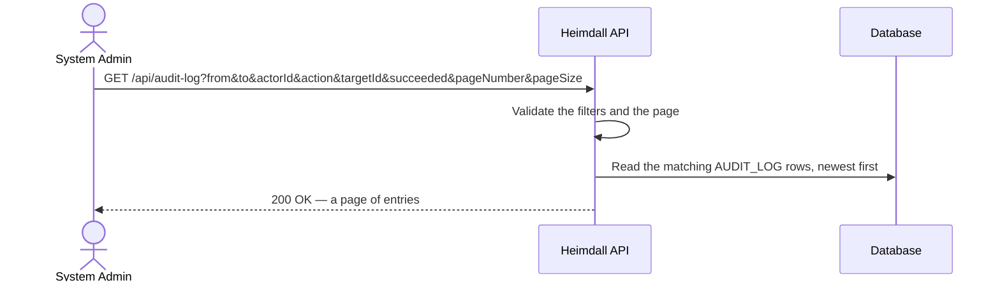
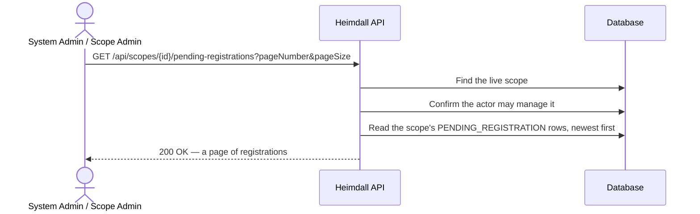
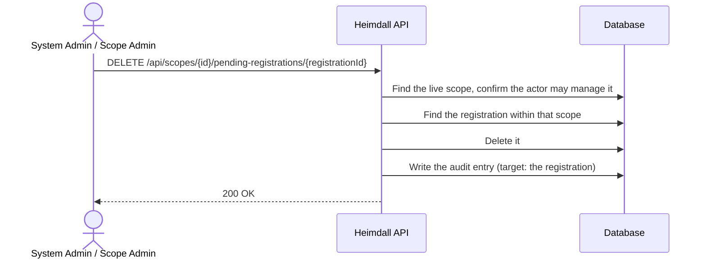
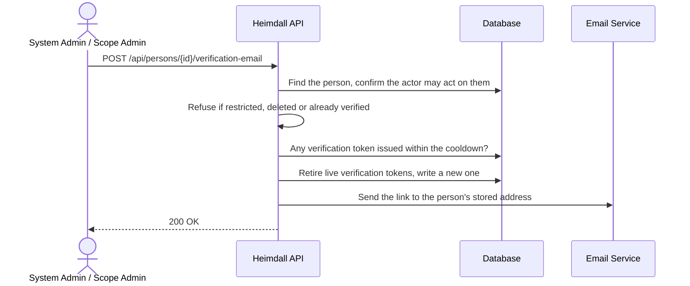
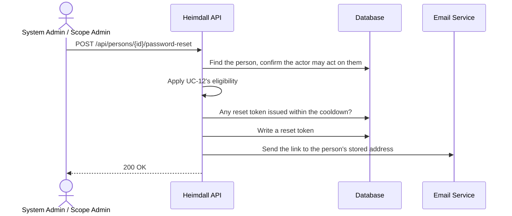

# Audit Trail, Pending Registrations and Admin Account Emails Implementation Plan

> **For agentic workers:** REQUIRED SUB-SKILL: Use superpowers:subagent-driven-development (recommended) or superpowers:executing-plans to implement this plan task-by-task. Steps use checkbox (`- [ ]`) syntax for tracking.

**Goal:** Close three administration gaps as three branches and pull requests: a System-Admin listing of the audit trail (#174, UC-48), listing and discarding a scope's pending self-registrations (#175, UC-49/UC-50), and administrator-initiated verification and password-reset emails under a per-person cooldown (#177, UC-51/UC-52).

**Architecture:** Every addition is the existing CQRS shape. Reads are a query, a `PaginatedQueryValidator`-derived validator, an output, a handler registered against `IPaginatedQueryHandlerAsync`, and a controller action that applies the actor with `HttpContext.ApplyActor`. Writes are commands registered with `AddAuditedCommandHandler`, so each one is audited with its output's `Id` as the target. Role gates stay `[RoleRequirement]` attributes; data-dependent rules (scope ownership, the person's state) stay in handlers through `IScopeOwnershipChecker`. Two small migrations: an index on `audit_log.target_id`, and a backfilled, unique `pending_registration.public_id`. The email cooldown is derived from token rows that already exist, so it needs no schema.

**Tech Stack:** .NET 10, ASP.NET Core, EF Core 10 on PostgreSQL 18 (Npgsql, EFCore.NamingConventions), FluentValidation, xUnit v3 (`xunit.v3.mtp-off`) + Moq, Testcontainers, `ArturRios.*` packages (`Mediator`, `Output`, `Data.Relational.Core`, `Util.Test`, `Util.WebApi`).

**Spec:** `docs/superpowers/specs/2026-10-14-audit-trail-pending-registrations-admin-emails-design.md`

## Decisions made in this plan

The spec leaves these open; the plan fixes them as follows.

1. **Message classes.** UC-48 gets new `AuditMessages` + `AuditMessageMap` (`src/Application/ArturRios.Heimdall.Shared/Messages`), passed by a new `AuditController`. UC-49/UC-50 messages go in `ScopeMessages`/`ScopeMessageMap` (the endpoints live in `ScopeController`, which passes that map) and reuse `ScopeMessages.ScopeNotFound` and `ScopeMessages.NotScopeOwner`. UC-51/UC-52 messages go in `PersonMessages`/`PersonMessageMap` (endpoints in `PersonController`) and reuse `PersonMessages.PersonNotFound` and `AuthMessages.EmailAlreadyVerified`, the latter added to `PersonMessageMap` as `400`.
2. **Message texts.**
   - `AuditMessages.AuditLogRetrieved` = `"Audit log entries retrieved."` (200); `AuditMessages.InvalidDateRange` = `"The end of the date range must not be earlier than its start."` (400). An over-long `action` reuses `PaginationMessages.FilterTooLong`.
   - `ScopeMessages.PendingRegistrationsRetrieved` = `"Pending registrations retrieved."` (200); `ScopeMessages.PendingRegistrationDiscarded` = `"Pending registration discarded."` (200); `ScopeMessages.PendingRegistrationNotFound` = `"Pending registration not found."` (404).
   - `PersonMessages.VerificationEmailSentToPerson` = `"Verification email sent to the person's address."` (200); `PersonMessages.PasswordResetSentToPerson` = `"Password reset email sent to the person's address."` (200); `PersonMessages.NotAuthorizedToEmailPerson` = `"You are not allowed to send email to this person."` (403); `PersonMessages.PersonIsDeleted` = `"This person is deleted, so no email was sent."` (409); `PersonMessages.PersonProcessingRestricted` = `"Processing of this person's data is restricted, so no email was sent."` (409); `PersonMessages.PersonCannotSignIn` = `"This person's account cannot sign in, so no password reset was sent."` (409); `PersonMessages.AccountEmailSentRecently` = `"An email of this kind was sent to this person recently. Try again in a few minutes."` (429).
3. **Cooldown setting.** `HEIMDALL_ADMIN_EMAIL_COOLDOWN_IN_SECONDS`, read by a new `AdminEmailOptions` (`Command/Services`), default `300`. Accepted values are `0` to `86400` seconds (`0` switches the cooldown off); anything unparsable, negative or larger falls back to `300` rather than to "no cooldown".
4. **Order of refusals in UC-51/UC-52:** not found (404) → may not act (403) → restricted (409) → deleted (409) → UC-51 already verified (400) / UC-52 cannot sign in (409) → cooldown (429). Authorization precedes the state checks, as UC-09 does, so a Scope Admin cannot learn the state of persons outside their scopes. A person both restricted and deleted gets the restricted message, matching the order of `PasswordRecoveryProcessor.MayRecover`.
5. **Alternative-flow letters.** AF-48a invalid filters (400), AF-48b not a System Admin (403), AF-48c no match (200, empty). AF-49a/AF-50a scope missing or logically deleted (404), AF-49b/AF-50b not authorized (403), AF-49c none pending (200, empty), AF-50c registration not in that scope (404). AF-51a/AF-52a not found (404), AF-51b/AF-52b may not act (403), AF-51c/AF-52c deleted or restricted (409), AF-51d already verified (400) / AF-52d cannot sign in (409), AF-51e/AF-52e cooldown (429).
6. **Names.** `GET /api/audit-log` → `AuditController.List`, `ListAuditLogQuery`, `AuditLogEntryOutput`. `GET /api/scopes/{id}/pending-registrations` → `ScopeController.ListPendingRegistrations`, `ListPendingRegistrationsQuery`, `PendingRegistrationOutput`. `DELETE /api/scopes/{id}/pending-registrations/{registrationId}` → `DiscardPendingRegistrationCommand`. `POST /api/persons/{id}/verification-email` → `SendPersonVerificationEmailCommand`; `POST /api/persons/{id}/password-reset` → `SendPersonPasswordResetCommand`. The command type names are what the audit trail records as `Action`.
7. **Shared eligibility.** UC-12's rule moves out of `PasswordRecoveryProcessor.MayRecover` into `PasswordRecoveryEligibility.Of(Person)` returning a `RecoveryEligibility` enum (`Eligible`, `Restricted`, `Deleted`, `CannotSignIn`), in `Command/Services`; the processor and UC-52 both call it. The Scope-Admin-may-email rule is `PersonEmailAuthorization.ActorMayEmailAsync`, shared by UC-51 and UC-52.
8. **`MaxConfirmationGuesses`** moves from a private constant of `PendingRegistrationConfirmer` to `PendingRegistration.MaxConfirmationGuesses` (public const, `10`), because the UC-49 listing lives in the Query project, which cannot reference Command.
9. **Instants without an offset.** `from`/`to` bound without a UTC offset are read as UTC (`UtcInstant.Of`) rather than reaching Npgsql as `DateTimeKind.Unspecified`, which it refuses for `timestamptz`.
10. **The `action` filter** is an exact, case-sensitive match; an empty or whitespace-only value is no filter at all.
11. **Migrations:** `AddAuditLogTargetIndex` (Part A) and `AddPendingRegistrationPublicId` (Part B). The latter is hand-edited to backfill with `gen_random_uuid()` and then drop that default, so the model keeps no database default.
12. **Personal data.** `PendingRegistration` joins `PersonalDataPurposeTests.PersonalDataEntities`, and the Data Protection Document §5.1 gains a `PENDING_REGISTRATION` table — the row the spec says names `PublicId` did not exist yet.
13. **"Reaches the logging sender with the person's own address"** is asserted in two halves. Unit tests verify the service is called with the target `Person`, and the existing `EmailVerificationServiceTests`/`PasswordResetServiceTests` pin that the service hands the sender `person.Email`. Functional tests assert the issued token row belongs to the target person. The logging sender writes only `LogSafeEmail.Reference` (NFR-22), so the log cannot be asserted on.
14. **api-client.** A new `http/audit.http` and `bruno/Audit/` folder (folder `seq: 8`). Pending registrations go in `http/scopes.http` and `bruno/Scopes/` (`seq` 8 and 9), with a new `pendingRegistrationId` variable in every environment file. Admin emails go in `http/persons.http` and `bruno/Persons/` (`seq` 14 and 15).
15. **Requirements documents.** The System Requirements Document gains `§3.11 Audit Trail` and `§5.7 Audit Trail Endpoints`. New authorization rows are added to the §7 table only; the mermaid summary above it is not extended, as it was not for the GDPR rows. The Use Case overview diagram in §1.3 is not extended either, matching UC-41 to UC-47.
16. **OpenAPI** is regenerated in each task that changes an endpoint (A2, B2, B3, C2, C3), so every endpoint commit carries its own document. Part B's database tests go in a new file rather than `SchemaTests.cs`, which Part A edits, so the two pull requests do not conflict there.

## Global Constraints

- Work only in the worktree you were given. Never touch `/root/repositories/heimdall-api` itself or any other worktree.
- One branch per part, each cut from an up-to-date `origin/develop`: Part A `feature/uc-48-list-audit-trail` (#174), Part B `feature/uc-49-pending-registrations` (#175), Part C `feature/uc-51-admin-account-emails` (#177). Do not push, do not use `gh`, do not open pull requests, and do not dispatch subagents.
- Read `CONTRIBUTING.md` and `docs/requirements/Development Workflow Document.md` before the first task. The Definition of Done applies: unit tests for every handler's main flow and every AF; functional tests for every endpoint's main flow and every AF, authorization included (401 anonymous, 403 wrong role or non-owning Scope Admin); and the Step 4.1 personal-data check for any migration.
- TDD: write the failing test, run it, and see it fail before writing the code. Test names follow `GivenCondition_WhenAction_ThenOutcome`, the body carries `// Given`, `// When`, `// Then`, and every test has `[UnitFact]`/`[UnitTheory]` or `[FunctionalFact]` (CI fails a test with neither).
- Build: `dotnet build src/ArturRios.Heimdall.sln`, clean before every commit.
- Run test projects **one at a time** (Argon2id OOM-kills parallel runs): `dotnet test <project directory> --no-build`. Clear an orphaned runner with `pkill -f 'testhost[.]dll'`, never `pkill -f testhost`. `tests/Domain/ArturRios.Heimdall.Domain.Tests` reporting "No test is available" is pre-existing (Part B gives it its first tests).
- Functional-test traps: never assert on the gap between two instants stamped in one request; normalise `DataOutput.Timestamp` before comparing whole responses.
- Every write goes through `AddAuditedCommandHandler`, and its output carries the affected entity's `PublicId` as `Id` (the audit target). Reads are not audited.
- Every message a handler returns has an entry in its `*MessageMap` with a comment citing the UC/AF.
- Internal `bigint` ids never leave the data layer (NFR-15); every identifier on an output is a `PublicId`. Actor and route-bound fields on a `[FromQuery]` query are `[JsonIgnore]` and are set by the controller (`HttpContext.ApplyActor`, route values), never bound from the request.
- Every paginated query validates through a `PaginatedQueryValidator<TQuery>` (page size 1 to 100, NFR-10), orders by its sort key with the internal `Id` as tiebreaker, and paginates that ordering with `PaginateAsync(..., orderBy: null)`.
- Audit listing: System Admins only. `audit_log` is shown as stored: no join to persons and no inference from other entries, so a cleared actor reads as `null` (NFR-09, Data Retention Schedule §7.1). `action` is at most 200 characters (the column's length).
- Pending registrations: `PasswordHash`, `Salt` and `TokenHash` are never exposed. `attemptsLeft` = `MaxConfirmationGuesses − FailedAttempts`, never below 0. `expired` = `ExpiresAt <= now`. A registration of another scope is indistinguishable from a missing one (404).
- Admin emails: no body; neither endpoint returns, logs or accepts a token or a password; the link goes only to the person's stored address. At most one email of each kind per person per `AdminEmailCooldown` (default 5 minutes), derived from token rows as `ExpiresAt − TokenLifetime`; the cooldown applies only to these two endpoints, and UC-12/UC-15 are unchanged. No log template may contain `{Email}` (`LogRedactionTests`); use `LogSafeEmail.Reference` and `{EmailRef}`.
- New migrations: `dotnet tool restore` once, then `dotnet ef` with `HEIMDALL_DATA_CONNECTIONSTRING="Host=localhost;Port=5432;Database=heimdall;Username=postgres;Password=postgres"` (a dummy; nothing connects). The generated class's `/// <inheritdoc />` is replaced by a `<summary>`/`<remarks>` doc comment.
- XML doc comments on every new public type and member, citing the UC and FR numbers, at the density of the surrounding code.
- After changing an endpoint: `python scripts/openapi.py`, then `python scripts/openapi.py --check` must pass. Never hand-edit `docs/openapi/heimdall.json`.
- Documentation each part keeps current: Use Case Specification Document (table + mermaid sequence diagram + numbered flow + `AF-nn` table, plus the traceability row), System Requirements Document (FR rows, endpoint tables, §7 authorization table, §9 traceability), the Data Protection Document where personal data is touched, `CHANGELOG.md` `## [Unreleased]` (Keep a Changelog), `docs/content/en/docs/api-reference.md` and the relevant flow page, `api-client/http` and `api-client/bruno`.
- Commits: lowercase Conventional Commit subject of at most 50 characters, imperative, body wrapped at 72. Stage paths explicitly — never `git add -A` or `git add .`. End every commit message with exactly these two lines:
  ```
  Co-Authored-By: Claude Opus 5.5 (1M context) <noreply@anthropic.com>
  Claude-Session: https://claude.ai/code/session_01KU2awQWyVHDRk4zc4mKYjv
  ```
- `python3 scripts/vulnerabilities.py` fails on `develop` today: Microsoft.* packages are at 10.0.12 until the separate `fix/dotnet-10.0.13-security` pull request (10.0.12 → 10.0.13) merges. **Do not bump packages in these branches.** Once that pull request is on `origin/develop`, merge `origin/develop` into the part's branch (see each part's verification) and re-run the gates.

## Review Focus

The five inputs the spec implies but does not test that are most likely to bite a person using this, most likely first. Each line's test is in the named task.

1. **`from`/`to` sent without a UTC offset** (`?from=2026-03-01T09:00:00`, the shape an HTML `datetime-local` input produces) must be read as UTC and answer `200`, not `500` from Npgsql refusing an unspecified `DateTime`. Tests: `UtcInstantTests` (Task A1) and `GivenBoundsWithoutAnOffset_WhenListing_ThenTheyAreReadAsUtc` (Task A2).
2. **An empty or whitespace `action` filter** (`?action=`, what a cleared text box submits) must mean "no filter", not "match nothing". Tests: `GivenABlankActionFilter_WhenListingAuditLog_ThenItIsIgnored` (Task A1) and `GivenABlankActionFilter_WhenListing_ThenItIsIgnored` (Task A2).
3. **A scope whose self-registration has been switched off since people signed up** must still list its pending registrations and let them be discarded; closing sign-up is exactly when an owner wants to clear them. Tests: `GivenAScopeClosedToSelfRegistration_WhenListing_ThenItsPendingRowsAreStillListed` (Task B2) and `GivenAScopeClosedToSelfRegistration_WhenDiscarding_ThenTheRowIsRemoved` (Task B3).
4. **A registration confirmed or purged between the owner's listing and their discard** (the delete loses the race) must answer `404 PendingRegistrationNotFound`, not `409` or `500`. Test: `GivenTheDeleteLosesARace_WhenDiscarding_ThenReturnsPendingRegistrationNotFound` (Task B3).
5. **`HEIMDALL_ADMIN_EMAIL_COOLDOWN_IN_SECONDS` mistyped** (`5m`, `-1`, an absurd number) must fall back to the five-minute default rather than switch the cooldown off or crash start-up. Test: `GivenAnUnusableValue_WhenRead_ThenTheDefaultApplies` (Task C2).

## Notes for the implementer

**Where the pipeline already refuses callers.** `ActorLivenessFilter` answers `401` when a bearer token names a person who does not exist, is logically deleted, or whose role claim has drifted. So a functional test's caller must be a seeded, live person whose role matches the token (`TestTokens.For(person.PublicId, role)`), or one of the fixture's stand-ins (`TestTokens.ForRole(role)`). The *target* of an admin email is not the caller and is not checked by that filter.

**The audit target of a refusal is `null`.** `AuditingCommandHandler` reads the target from the output's `Id`, and a refused command returns no output. Assert on a refusal's audit row by actor and action, not by target.

**`AsyncFakeRepository` resolves no `Include`.** Unit tests set navigations (`ScopeMembership`, `ScopeOwnerships`, each with its `Scope`) on the entities they seed. `CreateAsync` keeps an explicit `Id`.

**Parts are independent.** Each part branches from `origin/develop` and can merge in any order. If another part has merged first, expect trivial conflicts in `CHANGELOG.md`, the requirement documents and `Startup.cs` (keep both sides). If `AppDbContextModelSnapshot.cs` conflicts, keep both entities' configuration, then confirm with `dotnet ef migrations has-pending-model-changes` (the command in Task A2, Step 6). The plan file lives only on Part A's branch: executors of Parts B and C read it from Part A's worktree, or with `git show feature/uc-48-list-audit-trail:docs/superpowers/plans/2026-10-14-audit-trail-pending-registrations-admin-emails.md`.

**Test projects** (the order the verification loops use):

```
tests/Domain/ArturRios.Heimdall.Domain.Tests
tests/Application/ArturRios.Heimdall.Shared.Tests
tests/Application/ArturRios.Heimdall.Query.Tests
tests/Application/ArturRios.Heimdall.Command.Tests
tests/Infrastructure/ArturRios.Heimdall.Data.Tests
tests/Presentation/ArturRios.Heimdall.WebApi.Tests
```

## File map

**Part A — #174, UC-48**
- `src/Application/ArturRios.Heimdall.Shared/Messages/AuditMessages.cs`, `AuditMessageMap.cs` — new: the listing's vocabulary and statuses.
- `src/Application/ArturRios.Heimdall.Query/Input/UtcInstant.cs` — new: reads a bound instant as UTC.
- `src/Application/ArturRios.Heimdall.Query/Input/ListAuditLogQuery.cs`, `Input/Validation/ListAuditLogQueryValidator.cs`, `Output/AuditLogEntryOutput.cs`, `Handlers/ListAuditLogQueryHandler.cs` — new: the query.
- `src/Presentation/ArturRios.Heimdall.WebApi/Controllers/AuditController.cs` — new; `Startup.cs` — registrations.
- `src/Infrastructure/ArturRios.Heimdall.Data/EntityMaps/AuditLogDbMap.cs` + migration `AddAuditLogTargetIndex`.
- Tests: `Shared.Tests/AuditMessageMapTests.cs`, `Shared.Tests/DataAccessMessageMapTests.cs`, `Query.Tests/UtcInstantTests.cs`, `Query.Tests/ListAuditLogQueryHandlerTests.cs`, `WebApi.Tests/AuditControllerListTests.cs`, `WebApi.Tests/SchemaTests.cs`.
- Docs: UC-48, FR-AT-01/02, Data Protection Document note, api-reference, `flows/audit-logging.md`, `api-client/http/audit.http`, `api-client/bruno/Audit/*`, `api-client/README.md`, CHANGELOG.

**Part B — #175, UC-49/UC-50**
- `src/Domain/ArturRios.Heimdall.Domain/Entities/PendingRegistration.cs` — `PublicId`, `MaxConfirmationGuesses`; `PendingRegistrationConfirmer.cs` — uses the moved constant.
- `src/Infrastructure/ArturRios.Heimdall.Data/EntityMaps/PendingRegistrationDbMap.cs` + migration `AddPendingRegistrationPublicId`.
- `ScopeMessages.cs`, `ScopeMessageMap.cs` — three messages.
- Query: `ListPendingRegistrationsQuery`, `ListPendingRegistrationsQueryValidator`, `PendingRegistrationOutput`, `ListPendingRegistrationsQueryHandler`.
- Command: `DiscardPendingRegistrationCommand`, `DiscardPendingRegistrationCommandOutput`, `DiscardPendingRegistrationCommandHandler`.
- `ScopeController.cs`, `Startup.cs`.
- Tests: `Domain.Tests/PendingRegistrationTests.cs`, `WebApi.Tests/PendingRegistrationMigrationTests.cs`, `WebApi.Tests/PersonalDataPurposeTests.cs`, `Query.Tests/ListPendingRegistrationsQueryHandlerTests.cs`, `Command.Tests/DiscardPendingRegistrationCommandHandlerTests.cs`, `WebApi.Tests/ScopeControllerListPendingRegistrationsTests.cs`, `WebApi.Tests/ScopeControllerDiscardPendingRegistrationTests.cs`.
- Docs: Data Protection Document §5.1 and §6, UC-49/UC-50, FR-SR-11/12 and §4.0, `domain-model.md`, api-reference, `api-client` files and environments, CHANGELOG.

**Part C — #177, UC-51/UC-52**
- `src/Application/ArturRios.Heimdall.Command/Services/PasswordRecoveryEligibility.cs` — new shared rule; `PasswordRecoveryProcessor.cs` — uses it.
- `Command/Services/AdminEmailOptions.cs`, `Command/Services/PersonEmailAuthorization.cs` — new.
- Command: `SendPersonVerificationEmailCommand` (+ output, handler), `SendPersonPasswordResetCommand` (+ output, handler).
- `PersonMessages.cs`, `PersonMessageMap.cs`, `PersonController.cs`, `Startup.cs`, `Environments/.env`, `docker-compose.yml`, `docker/*.env.example`.
- Tests: `Command.Tests/PasswordRecoveryEligibilityTests.cs`, `Command.Tests/AdminEmailOptionsTests.cs`, `Command.Tests/SendPersonVerificationEmailCommandHandlerTests.cs`, `Command.Tests/SendPersonPasswordResetCommandHandlerTests.cs`, `WebApi.Tests/PersonControllerSendVerificationEmailTests.cs`, `WebApi.Tests/PersonControllerSendPasswordResetTests.cs`.
- Docs: UC-51/UC-52, FR-EV-06/07, FR-PR-05/06, api-reference, `flows/person-onboarding.md`, `flows/password-recovery.md`, operations/README/getting-started environment tables, `api-client` files, CHANGELOG.

---

# Part A — #174, List the audit trail (UC-48)

Branch: `feature/uc-48-list-audit-trail`. It already exists and carries the approved spec (commit `cff2980`) and this plan; work on it directly.

### Task A1: The audit-trail listing query

**Files:**
- Create: `src/Application/ArturRios.Heimdall.Shared/Messages/AuditMessages.cs`
- Create: `src/Application/ArturRios.Heimdall.Shared/Messages/AuditMessageMap.cs`
- Create: `src/Application/ArturRios.Heimdall.Query/Input/UtcInstant.cs`
- Create: `src/Application/ArturRios.Heimdall.Query/Input/ListAuditLogQuery.cs`
- Create: `src/Application/ArturRios.Heimdall.Query/Input/Validation/ListAuditLogQueryValidator.cs`
- Create: `src/Application/ArturRios.Heimdall.Query/Output/AuditLogEntryOutput.cs`
- Create: `src/Application/ArturRios.Heimdall.Query/Handlers/ListAuditLogQueryHandler.cs`
- Modify: `tests/Application/ArturRios.Heimdall.Shared.Tests/DataAccessMessageMapTests.cs` (`EveryUseCaseMap`)
- Test: `tests/Application/ArturRios.Heimdall.Shared.Tests/AuditMessageMapTests.cs`
- Test: `tests/Application/ArturRios.Heimdall.Query.Tests/UtcInstantTests.cs`
- Test: `tests/Application/ArturRios.Heimdall.Query.Tests/ListAuditLogQueryHandlerTests.cs`

**Interfaces:**
- Consumes: `AuditLog` (`ArturRios.Heimdall.Domain.Entities`: `Id`, `PublicId`, `ActorPersonId`, `ActorRole`, `Action`, `TargetId`, `Succeeded`, `FailureReason`, `CreatedAt`); `IAsyncReadOnlyRepository<AuditLog, long>`; `PaginatedQueryValidator<TQuery>`; `PaginationMessages.FilterTooLong`/`InvalidPageSize`/`InvalidPageNumber`; `DataAccessMessageMap.CombinedWith`; `IActorScoped`.
- Produces (used by Task A2 and the docs):
  - `AuditMessages.AuditLogRetrieved`, `AuditMessages.InvalidDateRange`; `AuditMessageMap.StatusCodes` (`IReadOnlyDictionary<string, int>`).
  - `UtcInstant.Of(DateTime) : DateTime` (namespace `ArturRios.Heimdall.Query.Input`).
  - `ListAuditLogQuery : BaseQuery, IActorScoped` — `DateTime? From`, `DateTime? To`, `Guid? ActorId`, `string? Action`, `Guid? TargetId`, `bool? Succeeded`, `[JsonIgnore] Guid ActingPersonId`, `[JsonIgnore] int ActingRole`.
  - `ListAuditLogQueryValidator : PaginatedQueryValidator<ListAuditLogQuery>`.
  - `AuditLogEntryOutput : QueryOutput` — `Guid Id`, `DateTime RecordedAt`, `Guid? ActorId`, `int? ActorRole`, `string Action`, `Guid? TargetId`, `bool Succeeded`, `string? FailureReason`.
  - `ListAuditLogQueryHandler(IAsyncReadOnlyRepository<AuditLog, long>, IValidator<ListAuditLogQuery>) : IPaginatedQueryHandlerAsync<ListAuditLogQuery, AuditLogEntryOutput>`.

- [ ] **Step 1: Write the failing message-map tests**

In `tests/Application/ArturRios.Heimdall.Shared.Tests/DataAccessMessageMapTests.cs`, add the new map to `EveryUseCaseMap`, after the `ApplicationMessageMap` line:

```csharp
        { nameof(AuditMessageMap), AuditMessageMap.StatusCodes },
```

Create `tests/Application/ArturRios.Heimdall.Shared.Tests/AuditMessageMapTests.cs`:

```csharp
using System.Reflection;
using ArturRios.Heimdall.Shared.Messages;
using ArturRios.Util.Http;
using ArturRios.Util.Test.Attributes;

namespace ArturRios.Heimdall.Shared.Tests;

// Unit tests for AuditMessageMap (UC-48): every message the audit-trail listing can return resolves
// to the status its alternative flow names, so a new message cannot ship answering the resolver's
// 400 default by accident.
public class AuditMessageMapTests
{
    [UnitFact]
    public void GivenEveryAuditMessage_WhenLookedUpInTheMap_ThenEachHasAStatusCode()
    {
        // Given every canonical message AuditMessages declares
        var messages = typeof(AuditMessages)
            .GetFields(BindingFlags.Public | BindingFlags.Static)
            .Where(field => field.IsLiteral)
            .Select(field => (string)field.GetRawConstantValue()!)
            .ToList();

        // When
        var unmapped = messages.Where(message => !AuditMessageMap.StatusCodes.ContainsKey(message)).ToList();

        // Then
        Assert.NotEmpty(messages);
        Assert.Empty(unmapped);
    }

    [UnitFact]
    public void GivenTheListingMessages_WhenResolved_ThenTheyCarryTheirFlowsStatuses()
    {
        // Given / When / Then — main flow and AF-48c answer 200; AF-48a answers 400
        Assert.Equal(HttpStatusCodes.Ok, AuditMessageMap.StatusCodes[AuditMessages.AuditLogRetrieved]);
        Assert.Equal(HttpStatusCodes.BadRequest, AuditMessageMap.StatusCodes[AuditMessages.InvalidDateRange]);
        Assert.Equal(HttpStatusCodes.BadRequest, AuditMessageMap.StatusCodes[PaginationMessages.FilterTooLong]);
        Assert.Equal(HttpStatusCodes.BadRequest, AuditMessageMap.StatusCodes[PaginationMessages.InvalidPageSize]);
        Assert.Equal(HttpStatusCodes.BadRequest, AuditMessageMap.StatusCodes[PaginationMessages.InvalidPageNumber]);
    }
}
```

- [ ] **Step 2: Write the failing query tests**

Create `tests/Application/ArturRios.Heimdall.Query.Tests/UtcInstantTests.cs`:

```csharp
using ArturRios.Heimdall.Query.Input;
using ArturRios.Util.Test.Attributes;

namespace ArturRios.Heimdall.Query.Tests;

// Unit tests for UtcInstant (UC-48 from/to). ASP.NET Core binds an instant with no offset as
// DateTimeKind.Unspecified, which Npgsql refuses for a timestamptz parameter; every instant in this
// API is UTC, so an unspecified one is read as UTC and a local one converted.
public class UtcInstantTests
{
    [UnitFact]
    public void GivenAUtcInstant_WhenNormalised_ThenItIsUnchanged()
    {
        // Given
        var value = new DateTime(2026, 10, 14, 12, 0, 0, DateTimeKind.Utc);

        // When
        var normalised = UtcInstant.Of(value);

        // Then
        Assert.Equal(value, normalised);
        Assert.Equal(DateTimeKind.Utc, normalised.Kind);
    }

    [UnitFact]
    public void GivenAnInstantWithoutAnOffset_WhenNormalised_ThenItIsReadAsUtc()
    {
        // Given what the binder produces from "2026-10-14T12:00:00"
        var value = new DateTime(2026, 10, 14, 12, 0, 0, DateTimeKind.Unspecified);

        // When
        var normalised = UtcInstant.Of(value);

        // Then — the same reading, now marked UTC
        Assert.Equal(value.Ticks, normalised.Ticks);
        Assert.Equal(DateTimeKind.Utc, normalised.Kind);
    }

    [UnitFact]
    public void GivenALocalInstant_WhenNormalised_ThenItIsConvertedToUtc()
    {
        // Given
        var value = new DateTime(2026, 10, 14, 12, 0, 0, DateTimeKind.Local);

        // When
        var normalised = UtcInstant.Of(value);

        // Then
        Assert.Equal(value.ToUniversalTime(), normalised);
        Assert.Equal(DateTimeKind.Utc, normalised.Kind);
    }
}
```

Create `tests/Application/ArturRios.Heimdall.Query.Tests/ListAuditLogQueryHandlerTests.cs`:

```csharp
using ArturRios.Heimdall.Domain.Entities;
using ArturRios.Heimdall.Domain.Enums;
using ArturRios.Heimdall.Query.Handlers;
using ArturRios.Heimdall.Query.Input;
using ArturRios.Heimdall.Query.Input.Validation;
using ArturRios.Heimdall.Shared.Messages;
using ArturRios.Util.Test.Attributes;
using ArturRios.Util.Test.Mock;

namespace ArturRios.Heimdall.Query.Tests;

// Unit tests for ListAuditLogQueryHandler (UC-48, FR-AT-01/02): newest first with the internal id as
// tiebreaker, every filter alone and combined, inclusive bounds, the projection as stored (a cleared
// actor stays null), AF-48a (a backwards range, an over-long action, an out-of-bounds page) and
// AF-48c (nothing matches → an empty page, not a refusal). AF-48b is the endpoint's RoleRequirement
// and is asserted in AuditControllerListTests.
public class ListAuditLogQueryHandlerTests
{
    private static readonly DateTime T0 = new(2026, 10, 1, 12, 0, 0, DateTimeKind.Utc);

    private static AuditLog Entry(
        long id,
        DateTime createdAt,
        string action = "CreateScopeCommand",
        Guid? actor = null,
        int? actorRole = null,
        Guid? target = null,
        bool succeeded = true,
        string? failureReason = null) => new()
    {
        Id = id,
        PublicId = Guid.NewGuid(),
        CreatedAt = createdAt,
        Action = action,
        ActorPersonId = actor,
        ActorRole = actorRole,
        TargetId = target,
        Succeeded = succeeded,
        FailureReason = failureReason
    };

    private static async Task<AsyncFakeRepository<AuditLog, long>> EntriesWith(params AuditLog[] entries)
    {
        var repository = new AsyncFakeRepository<AuditLog, long>();

        foreach (var entry in entries)
        {
            await repository.CreateAsync(entry);
        }

        return repository;
    }

    private static ListAuditLogQueryHandler Handler(AsyncFakeRepository<AuditLog, long> entries) =>
        new(entries, new ListAuditLogQueryValidator());

    private static ListAuditLogQuery Query() => new()
    {
        PageNumber = 1,
        PageSize = 20,
        ActingPersonId = Guid.NewGuid(),
        ActingRole = (int)Roles.SystemAdmin
    };

    [UnitFact]
    public async Task GivenEntries_WhenListingAuditLog_ThenNewestComesFirst()
    {
        // Given three entries an hour apart, stored out of order
        var oldest = Entry(1, T0);
        var newest = Entry(2, T0.AddHours(2));
        var middle = Entry(3, T0.AddHours(1));
        var handler = Handler(await EntriesWith(oldest, newest, middle));

        // When
        var output = await handler.HandleAsync(Query());

        // Then
        Assert.True(output.Success);
        Assert.Contains(AuditMessages.AuditLogRetrieved, output.Messages);
        Assert.Equal(3, output.TotalItems);
        Assert.Equal([newest.PublicId, middle.PublicId, oldest.PublicId], output.Data!.Select(x => x.Id));
    }

    [UnitFact]
    public async Task GivenEntriesRecordedAtOneInstant_WhenListingAuditLog_ThenTheLaterIdComesFirst()
    {
        // Given two entries sharing a timestamp — a command and its side effect can. The id breaks
        // the tie, so a page boundary between them cannot show one twice and the other never.
        var first = Entry(1, T0);
        var second = Entry(2, T0);
        var handler = Handler(await EntriesWith(first, second));

        // When
        var output = await handler.HandleAsync(Query());

        // Then
        Assert.Equal([second.PublicId, first.PublicId], output.Data!.Select(x => x.Id));
    }

    [UnitFact]
    public async Task GivenARefusedEntry_WhenListingAuditLog_ThenEveryFieldIsProjectedAsStored()
    {
        // Given a refusal with an actor, a role, a target and a canonical reason
        var actor = Guid.NewGuid();
        var target = Guid.NewGuid();
        var entry = Entry(
            1, T0, action: "DeletePersonCommand", actor: actor, actorRole: (int)Roles.ScopeAdmin,
            target: target, succeeded: false, failureReason: PersonMessages.NotAuthorizedToDeletePerson);
        var handler = Handler(await EntriesWith(entry));

        // When
        var output = await handler.HandleAsync(Query());

        // Then
        var item = Assert.Single(output.Data!);
        Assert.Equal(entry.PublicId, item.Id);
        Assert.Equal(T0, item.RecordedAt);
        Assert.Equal(actor, item.ActorId);
        Assert.Equal((int)Roles.ScopeAdmin, item.ActorRole);
        Assert.Equal("DeletePersonCommand", item.Action);
        Assert.Equal(target, item.TargetId);
        Assert.False(item.Succeeded);
        Assert.Equal(PersonMessages.NotAuthorizedToDeletePerson, item.FailureReason);
    }

    [UnitFact]
    public async Task GivenAnEntryWhoseActorWasCleared_WhenListingAuditLog_ThenActorFieldsAreNull()
    {
        // Given an entry the retention pass has pseudonymised (NFR-21) — nothing to reconstruct from
        var entry = Entry(1, T0, actor: null, actorRole: null, target: Guid.NewGuid());
        var handler = Handler(await EntriesWith(entry));

        // When
        var output = await handler.HandleAsync(Query());

        // Then
        var item = Assert.Single(output.Data!);
        Assert.Null(item.ActorId);
        Assert.Null(item.ActorRole);
    }

    [UnitFact]
    public async Task GivenFromAndTo_WhenListingAuditLog_ThenBothBoundsAreInclusive()
    {
        // Given one entry just before the range, one on each bound, one just after
        var before = Entry(1, T0.AddSeconds(-1));
        var onFrom = Entry(2, T0);
        var onTo = Entry(3, T0.AddHours(1));
        var after = Entry(4, T0.AddHours(1).AddSeconds(1));
        var handler = Handler(await EntriesWith(before, onFrom, onTo, after));
        var query = Query();
        query.From = T0;
        query.To = T0.AddHours(1);

        // When
        var output = await handler.HandleAsync(query);

        // Then
        Assert.Equal([onTo.PublicId, onFrom.PublicId], output.Data!.Select(x => x.Id));
    }

    [UnitFact]
    public async Task GivenToEqualToFrom_WhenListingAuditLog_ThenTheEntryAtThatInstantIsReturned()
    {
        // Given a range of a single instant — valid, since To is not earlier than From
        var exact = Entry(1, T0);
        var handler = Handler(await EntriesWith(exact, Entry(2, T0.AddSeconds(1))));
        var query = Query();
        query.From = T0;
        query.To = T0;

        // When
        var output = await handler.HandleAsync(query);

        // Then
        Assert.True(output.Success);
        Assert.Equal([exact.PublicId], output.Data!.Select(x => x.Id));
    }

    [UnitFact]
    public async Task GivenBoundsWithoutAnOffset_WhenListingAuditLog_ThenTheyFilterAsUtc()
    {
        // Given From as the binder produces it from "2026-10-01T12:00:00" — no offset
        var onFrom = Entry(1, T0);
        var handler = Handler(await EntriesWith(Entry(2, T0.AddSeconds(-1)), onFrom));
        var query = Query();
        query.From = new DateTime(2026, 10, 1, 12, 0, 0, DateTimeKind.Unspecified);

        // When
        var output = await handler.HandleAsync(query);

        // Then
        Assert.True(output.Success);
        Assert.Equal([onFrom.PublicId], output.Data!.Select(x => x.Id));
    }

    [UnitFact]
    public async Task GivenAnActorFilter_WhenListingAuditLog_ThenOnlyThatActorsEntriesAreReturned()
    {
        // Given entries by two actors and one anonymous entry
        var ana = Guid.NewGuid();
        var anas = Entry(1, T0, actor: ana, actorRole: (int)Roles.SystemAdmin);
        var handler = Handler(await EntriesWith(
            anas, Entry(2, T0, actor: Guid.NewGuid(), actorRole: (int)Roles.ScopeAdmin), Entry(3, T0)));
        var query = Query();
        query.ActorId = ana;

        // When
        var output = await handler.HandleAsync(query);

        // Then
        Assert.Equal([anas.PublicId], output.Data!.Select(x => x.Id));
    }

    [UnitFact]
    public async Task GivenAnActionFilter_WhenListingAuditLog_ThenOnlyThatActionIsReturned()
    {
        // Given two kinds of action
        var create = Entry(1, T0, action: "CreateScopeCommand");
        var handler = Handler(await EntriesWith(create, Entry(2, T0, action: "UpdateScopeCommand")));
        var query = Query();
        query.Action = "CreateScopeCommand";

        // When
        var output = await handler.HandleAsync(query);

        // Then
        Assert.Equal([create.PublicId], output.Data!.Select(x => x.Id));
    }

    [UnitFact]
    public async Task GivenAnActionInAnotherCase_WhenListingAuditLog_ThenNothingMatches()
    {
        // Given the action is matched exactly, as recorded — the command's type name
        var handler = Handler(await EntriesWith(Entry(1, T0, action: "CreateScopeCommand")));
        var query = Query();
        query.Action = "createscopecommand";

        // When
        var output = await handler.HandleAsync(query);

        // Then
        Assert.True(output.Success);
        Assert.Empty(output.Data!);
    }

    [UnitTheory]
    [InlineData("")]
    [InlineData("   ")]
    public async Task GivenABlankActionFilter_WhenListingAuditLog_ThenItIsIgnored(string action)
    {
        // Given what a cleared text box submits
        var handler = Handler(await EntriesWith(
            Entry(1, T0, action: "CreateScopeCommand"), Entry(2, T0, action: "UpdateScopeCommand")));
        var query = Query();
        query.Action = action;

        // When
        var output = await handler.HandleAsync(query);

        // Then — no filter, not "match nothing"
        Assert.True(output.Success);
        Assert.Equal(2, output.TotalItems);
    }

    [UnitFact]
    public async Task GivenATargetFilter_WhenListingAuditLog_ThenOnlyThatTargetsEntriesAreReturned()
    {
        // Given entries about two entities and one with no target
        var target = Guid.NewGuid();
        var about = Entry(1, T0, target: target);
        var handler = Handler(await EntriesWith(about, Entry(2, T0, target: Guid.NewGuid()), Entry(3, T0)));
        var query = Query();
        query.TargetId = target;

        // When
        var output = await handler.HandleAsync(query);

        // Then
        Assert.Equal([about.PublicId], output.Data!.Select(x => x.Id));
    }

    [UnitTheory]
    [InlineData(true)]
    [InlineData(false)]
    public async Task GivenAnOutcomeFilter_WhenListingAuditLog_ThenOnlyThatOutcomeIsReturned(bool succeeded)
    {
        // Given one completed write and one refusal
        var completed = Entry(1, T0, succeeded: true);
        var refused = Entry(2, T0, succeeded: false, failureReason: ScopeMessages.NotScopeOwner);
        var handler = Handler(await EntriesWith(completed, refused));
        var query = Query();
        query.Succeeded = succeeded;

        // When
        var output = await handler.HandleAsync(query);

        // Then
        var expected = succeeded ? completed : refused;
        Assert.Equal([expected.PublicId], output.Data!.Select(x => x.Id));
    }

    [UnitFact]
    public async Task GivenSeveralFilters_WhenListingAuditLog_ThenTheyCombineWithAnd()
    {
        // Given entries matching the actor only, the action only, and both
        var ana = Guid.NewGuid();
        var both = Entry(1, T0, action: "CreateScopeCommand", actor: ana, actorRole: (int)Roles.SystemAdmin);
        var handler = Handler(await EntriesWith(
            both,
            Entry(2, T0, action: "UpdateScopeCommand", actor: ana, actorRole: (int)Roles.SystemAdmin),
            Entry(3, T0, action: "CreateScopeCommand", actor: Guid.NewGuid(), actorRole: (int)Roles.SystemAdmin)));
        var query = Query();
        query.ActorId = ana;
        query.Action = "CreateScopeCommand";

        // When
        var output = await handler.HandleAsync(query);

        // Then
        Assert.Equal([both.PublicId], output.Data!.Select(x => x.Id));
    }

    [UnitFact]
    public async Task GivenNoMatchingEntry_WhenListingAuditLog_ThenAnEmptyPageIsASuccess()
    {
        // Given AF-48c — entries exist, none about this target
        var handler = Handler(await EntriesWith(Entry(1, T0, target: Guid.NewGuid())));
        var query = Query();
        query.TargetId = Guid.NewGuid();

        // When
        var output = await handler.HandleAsync(query);

        // Then
        Assert.True(output.Success);
        Assert.Equal(0, output.TotalItems);
        Assert.Empty(output.Data!);
        Assert.Contains(AuditMessages.AuditLogRetrieved, output.Messages);
    }

    [UnitFact]
    public async Task GivenToEarlierThanFrom_WhenListingAuditLog_ThenReturnsInvalidDateRange()
    {
        // Given AF-48a — a range that runs backwards
        var handler = Handler(await EntriesWith(Entry(1, T0)));
        var query = Query();
        query.From = T0;
        query.To = T0.AddSeconds(-1);

        // When
        var output = await handler.HandleAsync(query);

        // Then
        Assert.False(output.Success);
        Assert.Contains(AuditMessages.InvalidDateRange, output.Errors);
    }

    [UnitFact]
    public async Task GivenAnActionLongerThanTheColumn_WhenListingAuditLog_ThenReturnsFilterTooLong()
    {
        // Given AF-48a — AUDIT_LOG.action holds 200 characters, so 201 could never match
        var handler = Handler(await EntriesWith(Entry(1, T0)));
        var query = Query();
        query.Action = new string('A', 201);

        // When
        var output = await handler.HandleAsync(query);

        // Then
        Assert.False(output.Success);
        Assert.Contains(PaginationMessages.FilterTooLong, output.Errors);
    }

    [UnitFact]
    public async Task GivenAnActionAtTheColumnsLength_WhenListingAuditLog_ThenItIsAccepted()
    {
        // Given the boundary — exactly 200 characters
        var handler = Handler(await EntriesWith(Entry(1, T0)));
        var query = Query();
        query.Action = new string('A', 200);

        // When
        var output = await handler.HandleAsync(query);

        // Then
        Assert.True(output.Success);
        Assert.Empty(output.Data!);
    }

    [UnitFact]
    public async Task GivenPageSizeAboveTheBound_WhenListingAuditLog_ThenReturnsInvalidPageSize()
    {
        // Given AF-48a (NFR-10)
        var handler = Handler(await EntriesWith(Entry(1, T0)));
        var query = Query();
        query.PageSize = 101;

        // When
        var output = await handler.HandleAsync(query);

        // Then
        Assert.False(output.Success);
        Assert.Contains(PaginationMessages.InvalidPageSize, output.Errors);
    }
}
```

- [ ] **Step 3: Run the tests to verify they fail**

```bash
dotnet build src/ArturRios.Heimdall.sln
```

Expected: build FAILS — `AuditMessages`, `AuditMessageMap`, `UtcInstant`, `ListAuditLogQuery`, `ListAuditLogQueryValidator` and `ListAuditLogQueryHandler` do not exist.

- [ ] **Step 4: Add the messages and their status map**

Create `src/Application/ArturRios.Heimdall.Shared/Messages/AuditMessages.cs`:

```csharp
namespace ArturRios.Heimdall.Shared.Messages;

/// <summary>
///     Canonical messages produced by the audit-trail listing (UC-48). Each is mapped to an HTTP status
///     code in <see cref="AuditMessageMap" />.
/// </summary>
/// <remarks>
///     Only the read has messages here. The trail is written by <c>AuditingCommandHandler</c>, which
///     records other use cases' messages and has none of its own.
/// </remarks>
public static class AuditMessages
{
    /// <summary>
    ///     UC-48 main flow and AF-48c: the entries matching the filters were listed — possibly none,
    ///     which is an empty page rather than a refusal.
    /// </summary>
    public const string AuditLogRetrieved = "Audit log entries retrieved.";

    /// <summary>AF-48a: the range's end (<c>To</c>) is earlier than its start (<c>From</c>).</summary>
    public const string InvalidDateRange = "The end of the date range must not be earlier than its start.";
}
```

Create `src/Application/ArturRios.Heimdall.Shared/Messages/AuditMessageMap.cs`:

```csharp
using ArturRios.Util.Http;

namespace ArturRios.Heimdall.Shared.Messages;

/// <summary>
///     Maps each message the audit-trail listing (UC-48) can return to its HTTP status code. Passed to
///     the response resolver by <c>AuditController</c>.
/// </summary>
/// <remarks>
///     AF-48b (a caller who is not a System Admin) has no entry: the endpoint's <c>RoleRequirement</c>
///     answers 403 before the handler runs.
/// </remarks>
public static class AuditMessageMap
{
    public static readonly IReadOnlyDictionary<string, int> StatusCodes =
        DataAccessMessageMap.CombinedWith(new Dictionary<string, int>
        {
            // UC-48 main flow and AF-48c — entries listed, an empty page included.
            [AuditMessages.AuditLogRetrieved] = HttpStatusCodes.Ok,
            // AF-48a — the date range runs backwards.
            [AuditMessages.InvalidDateRange] = HttpStatusCodes.BadRequest,
            // AF-48a (NFR-10) — the page is out of bounds or the action filter is longer than its column.
            [PaginationMessages.InvalidPageNumber] = HttpStatusCodes.BadRequest,
            [PaginationMessages.InvalidPageSize] = HttpStatusCodes.BadRequest,
            [PaginationMessages.FilterTooLong] = HttpStatusCodes.BadRequest
        });
}
```

- [ ] **Step 5: Add the UTC reading of a bound instant**

Create `src/Application/ArturRios.Heimdall.Query/Input/UtcInstant.cs`:

```csharp
namespace ArturRios.Heimdall.Query.Input;

/// <summary>
///     Reads an instant bound from a query string as the UTC instant this API's contract says it is
///     (UC-48's <c>From</c>/<c>To</c>).
/// </summary>
/// <remarks>
///     ASP.NET Core binds <c>2026-10-14T00:00:00Z</c> as UTC but <c>2026-10-14T00:00:00</c>, with no
///     offset, as <see cref="DateTimeKind.Unspecified" />, and Npgsql refuses an unspecified
///     <see cref="DateTime" /> for a <c>timestamp with time zone</c> parameter. Without this an
///     offset-less filter — what an HTML <c>datetime-local</c> input sends — would answer 500.
/// </remarks>
public static class UtcInstant
{
    /// <summary>
    ///     <paramref name="value" /> as UTC: unchanged when it already is, converted when it is local,
    ///     and taken as UTC when it carries no kind at all.
    /// </summary>
    public static DateTime Of(DateTime value) => value.Kind switch
    {
        DateTimeKind.Utc => value,
        DateTimeKind.Local => value.ToUniversalTime(),
        _ => DateTime.SpecifyKind(value, DateTimeKind.Utc)
    };
}
```

- [ ] **Step 6: Add the query, its validator and the output**

Create `src/Application/ArturRios.Heimdall.Query/Input/ListAuditLogQuery.cs`:

```csharp
using System.Text.Json.Serialization;
using ArturRios.Heimdall.Shared.Security;
using ArturRios.Mediator.Query;

namespace ArturRios.Heimdall.Query.Input;

/// <summary>
///     Request to list the audit trail (UC-48, FR-AT-01), newest first. Every filter is optional, and
///     those given combine with AND. <see cref="ActingPersonId" />/<see cref="ActingRole" /> are set by
///     the controller from the authenticated caller and are never bound from the request.
/// </summary>
/// <remarks>
///     There is no scope filter, and cannot be one: <c>AUDIT_LOG</c> has no scope column, and an old
///     row's target may since have been deleted or anonymised, so it cannot be attributed to a scope
///     reliably. That is why the listing is System Admins' only.
/// </remarks>
public class ListAuditLogQuery : BaseQuery, IActorScoped
{
    /// <summary>Earliest recording instant to include (UTC, inclusive).</summary>
    public DateTime? From { get; set; }

    /// <summary>Latest recording instant to include (UTC, inclusive). Must not be earlier than <see cref="From" />.</summary>
    public DateTime? To { get; set; }

    /// <summary>
    ///     The actor's public id. An entry whose actor has been cleared (NFR-21) names nobody, so this
    ///     filter cannot find it.
    /// </summary>
    public Guid? ActorId { get; set; }

    /// <summary>
    ///     The exact action, as recorded — the command's type name, e.g. <c>CreateScopeCommand</c>.
    ///     Matched case-sensitively; empty or whitespace means no filter.
    /// </summary>
    public string? Action { get; set; }

    /// <summary>The affected entity's public id.</summary>
    public Guid? TargetId { get; set; }

    /// <summary><c>true</c> for completed writes, <c>false</c> for refused ones.</summary>
    public bool? Succeeded { get; set; }

    [JsonIgnore]
    public Guid ActingPersonId { get; set; }

    [JsonIgnore]
    public int ActingRole { get; set; }
}
```

Create `src/Application/ArturRios.Heimdall.Query/Input/Validation/ListAuditLogQueryValidator.cs`:

```csharp
using ArturRios.Heimdall.Shared.Messages;
using FluentValidation;

namespace ArturRios.Heimdall.Query.Input.Validation;

/// <summary>Input validation for <see cref="ListAuditLogQuery" /> (UC-48 AF-48a, NFR-10).</summary>
public class ListAuditLogQueryValidator : PaginatedQueryValidator<ListAuditLogQuery>
{
    /// <summary>Matches <c>AuditLog.Action</c>'s <c>[MaxLength]</c>: a longer filter could never match a row.</summary>
    private const int MaxActionLength = 200;

    public ListAuditLogQueryValidator()
    {
        // Compared as UTC on both sides, so an offset-less bound and a "Z" bound compare as the
        // handler will filter with them.
        RuleFor(query => query.To)
            .Must((query, to) =>
                to is null || query.From is null || UtcInstant.Of(to.Value) >= UtcInstant.Of(query.From.Value))
            .WithMessage(AuditMessages.InvalidDateRange);

        RuleFor(query => query.Action)
            .MaximumLength(MaxActionLength)
            .WithMessage(PaginationMessages.FilterTooLong);
    }
}
```

Create `src/Application/ArturRios.Heimdall.Query/Output/AuditLogEntryOutput.cs`:

```csharp
using ArturRios.Mediator.Query;

namespace ArturRios.Heimdall.Query.Output;

/// <summary>
///     One audit-trail entry as stored (UC-48, FR-AT-02). Nothing is joined or inferred: an actor the
///     retention pass has cleared, or that never existed (an anonymous write), is <c>null</c> here too.
/// </summary>
public class AuditLogEntryOutput : QueryOutput
{
    /// <summary>The entry's public id.</summary>
    public Guid Id { get; set; }

    /// <summary>When the entry was recorded (UTC).</summary>
    public DateTime RecordedAt { get; set; }

    /// <summary>The acting person's public id; <c>null</c> for an anonymous write or a cleared attribution.</summary>
    public Guid? ActorId { get; set; }

    /// <summary>The acting person's role value (see <c>Roles</c>); <c>null</c> whenever <see cref="ActorId" /> is.</summary>
    public int? ActorRole { get; set; }

    /// <summary>The command's type name, e.g. <c>CreateScopeCommand</c>.</summary>
    public string Action { get; set; } = string.Empty;

    /// <summary>The affected entity's public id; <c>null</c> when none could be resolved, as for every refusal.</summary>
    public Guid? TargetId { get; set; }

    /// <summary>Whether the write completed; <c>false</c> for a refusal.</summary>
    public bool Succeeded { get; set; }

    /// <summary>A refusal's canonical reason; <c>null</c> on success.</summary>
    public string? FailureReason { get; set; }
}
```

- [ ] **Step 7: Add the handler**

Create `src/Application/ArturRios.Heimdall.Query/Handlers/ListAuditLogQueryHandler.cs`:

```csharp
using ArturRios.Data.Relational.Core.Interfaces;
using ArturRios.Heimdall.Domain.Entities;
using ArturRios.Heimdall.Query.Input;
using ArturRios.Heimdall.Query.Output;
using ArturRios.Heimdall.Shared.Messages;
using ArturRios.Mediator.Query.Interfaces;
using ArturRios.Output;
using FluentValidation;

namespace ArturRios.Heimdall.Query.Handlers;

/// <summary>
///     Handles <see cref="ListAuditLogQuery" /> (UC-48, FR-AT-01/02): the audit trail, newest first,
///     filtered by recording time, actor, action, target and outcome.
/// </summary>
/// <remarks>
///     <para>
///         Authorization is entirely the endpoint's: the only actor is the System Admin, and the
///         <c>RoleRequirement</c> settles it. There is no data-dependent rule left, because the trail
///         has no scope column to scope a Scope Admin's view by.
///     </para>
///     <para>
///         Entries are projected as stored and nothing else is read — no join to <c>PERSON</c>, no
///         inference from neighbouring entries. An attribution cleared under NFR-21 stays cleared
///         here (Data Retention Schedule §7.1); reading the trail must not undo what retention did.
///     </para>
/// </remarks>
public class ListAuditLogQueryHandler(
    IAsyncReadOnlyRepository<AuditLog, long> auditReader,
    IValidator<ListAuditLogQuery> validator)
    : IPaginatedQueryHandlerAsync<ListAuditLogQuery, AuditLogEntryOutput>
{
    public async Task<PaginatedOutput<AuditLogEntryOutput>> HandleAsync(
        ListAuditLogQuery query, CancellationToken cancellationToken = default)
    {
        var output = PaginatedOutput<AuditLogEntryOutput>.New;

        // AF-48a (NFR-10): the range, the action's length and the page, before any query runs.
        var validation = await validator.ValidateAsync(query, cancellationToken);

        if (!validation.IsValid)
        {
            return output.WithErrors(validation.Errors.Select(failure => failure.ErrorMessage));
        }

        var entries = auditReader.Query();

        if (query.From is { } from)
        {
            var fromUtc = UtcInstant.Of(from);
            entries = entries.Where(x => x.CreatedAt >= fromUtc);
        }

        if (query.To is { } to)
        {
            var toUtc = UtcInstant.Of(to);
            entries = entries.Where(x => x.CreatedAt <= toUtc);
        }

        if (query.ActorId is { } actorId)
        {
            entries = entries.Where(x => x.ActorPersonId == actorId);
        }

        // Exact, as recorded. Blank means no filter — what a cleared text box submits.
        if (!string.IsNullOrWhiteSpace(query.Action))
        {
            var action = query.Action;
            entries = entries.Where(x => x.Action == action);
        }

        if (query.TargetId is { } targetId)
        {
            entries = entries.Where(x => x.TargetId == targetId);
        }

        if (query.Succeeded is { } succeeded)
        {
            entries = entries.Where(x => x.Succeeded == succeeded);
        }

        // Newest first, with the internal id as tiebreaker: a command and its audited side effects
        // share an instant often enough that, without it, a page boundary between them could show
        // one entry twice and another never. Ordered on the entity, since the id never reaches the
        // output, then projected and paginated over that ordering.
        var projected = entries
            .OrderByDescending(x => x.CreatedAt)
            .ThenByDescending(x => x.Id)
            .Select(x => new AuditLogEntryOutput
            {
                Id = x.PublicId,
                RecordedAt = x.CreatedAt,
                ActorId = x.ActorPersonId,
                ActorRole = x.ActorRole,
                Action = x.Action,
                TargetId = x.TargetId,
                Succeeded = x.Succeeded,
                FailureReason = x.FailureReason
            });

        var page = await projected.PaginateAsync(query.PageNumber, query.PageSize, orderBy: null);

        return page.WithMessage(AuditMessages.AuditLogRetrieved);
    }
}
```

- [ ] **Step 8: Run the tests to verify they pass**

```bash
dotnet build src/ArturRios.Heimdall.sln
dotnet test tests/Application/ArturRios.Heimdall.Shared.Tests --no-build --filter "FullyQualifiedName~AuditMessageMapTests|FullyQualifiedName~DataAccessMessageMapTests"
dotnet test tests/Application/ArturRios.Heimdall.Query.Tests --no-build --filter "FullyQualifiedName~UtcInstantTests|FullyQualifiedName~ListAuditLogQueryHandlerTests"
```

Expected: build succeeds; all selected tests PASS (Shared: 2 new + the existing map theories now with an `AuditMessageMap` row; Query: 3 + 21).

- [ ] **Step 9: Run the task's full gate**

```bash
dotnet build src/ArturRios.Heimdall.sln
dotnet test tests/Application/ArturRios.Heimdall.Shared.Tests --no-build
dotnet test tests/Application/ArturRios.Heimdall.Query.Tests --no-build
```

Expected: 0 build errors; both projects PASS, run one after the other.

- [ ] **Step 10: Commit**

```bash
git add \
  src/Application/ArturRios.Heimdall.Shared/Messages/AuditMessages.cs \
  src/Application/ArturRios.Heimdall.Shared/Messages/AuditMessageMap.cs \
  src/Application/ArturRios.Heimdall.Query/Input/UtcInstant.cs \
  src/Application/ArturRios.Heimdall.Query/Input/ListAuditLogQuery.cs \
  src/Application/ArturRios.Heimdall.Query/Input/Validation/ListAuditLogQueryValidator.cs \
  src/Application/ArturRios.Heimdall.Query/Output/AuditLogEntryOutput.cs \
  src/Application/ArturRios.Heimdall.Query/Handlers/ListAuditLogQueryHandler.cs \
  tests/Application/ArturRios.Heimdall.Shared.Tests/AuditMessageMapTests.cs \
  tests/Application/ArturRios.Heimdall.Shared.Tests/DataAccessMessageMapTests.cs \
  tests/Application/ArturRios.Heimdall.Query.Tests/UtcInstantTests.cs \
  tests/Application/ArturRios.Heimdall.Query.Tests/ListAuditLogQueryHandlerTests.cs
git commit -F - <<'EOF'
feat: add the audit trail listing query

UC-48's read side: ListAuditLogQuery with optional from/to (UTC,
inclusive), actorId, action (exact), targetId and succeeded filters,
newest first with the internal id as tiebreaker. Entries are projected
as stored, so an attribution cleared under NFR-21 stays null.

Instants bound without an offset are read as UTC, so they cannot reach
Npgsql as unspecified and fail the request.

Co-Authored-By: Claude Opus 5.5 (1M context) <noreply@anthropic.com>
Claude-Session: https://claude.ai/code/session_01KU2awQWyVHDRk4zc4mKYjv
EOF
```

---

### Task A2: `GET /api/audit-log` and the target index

**Files:**
- Create: `src/Presentation/ArturRios.Heimdall.WebApi/Controllers/AuditController.cs`
- Modify: `src/Presentation/ArturRios.Heimdall.WebApi/Startup.cs` (after the `ListErasureRequestsQueryValidator` registration, ~line 348)
- Modify: `src/Infrastructure/ArturRios.Heimdall.Data/EntityMaps/AuditLogDbMap.cs`
- Create (generated, then documented): `src/Infrastructure/ArturRios.Heimdall.Data/Migrations/<timestamp>_AddAuditLogTargetIndex.cs` and its `.Designer.cs`
- Modify (generated): `src/Infrastructure/ArturRios.Heimdall.Data/Migrations/AppDbContextModelSnapshot.cs`
- Modify (generated): `docs/openapi/heimdall.json`
- Test: `tests/Presentation/ArturRios.Heimdall.WebApi.Tests/AuditControllerListTests.cs`
- Test: `tests/Presentation/ArturRios.Heimdall.WebApi.Tests/SchemaTests.cs` (one test added)

**Interfaces:**
- Consumes (Task A1): `ListAuditLogQuery`, `ListAuditLogQueryValidator`, `AuditLogEntryOutput`, `ListAuditLogQueryHandler`, `AuditMessageMap.StatusCodes`, `AuditMessages.InvalidDateRange`. Existing: `QueryMediator.ExecutePaginatedQueryAsync<TQuery, TOutput>`, `HttpContext.ApplyActor`, `ToActionResult(statusMap:)`, `[RoleRequirement]`, `SetGoogleSignInCommand` (the write the functional test audits), `ScopeMessages.NotScopeOwner`.
- Produces: route `GET /api/audit-log`, OpenAPI operation id `Audit_List`; index `ix_audit_log_target_id`. Task A3 documents both.

- [ ] **Step 1: Write the failing functional tests**

Create `tests/Presentation/ArturRios.Heimdall.WebApi.Tests/AuditControllerListTests.cs`:

```csharp
using System.Net;
using ArturRios.Configuration.Enums;
using ArturRios.Heimdall.Command.Input;
using ArturRios.Heimdall.Command.Output;
using ArturRios.Heimdall.Domain.Entities;
using ArturRios.Heimdall.Domain.Enums;
using ArturRios.Heimdall.Query.Output;
using ArturRios.Heimdall.Shared.Messages;
using ArturRios.Heimdall.WebApi.Tests.Support;
using ArturRios.Output;
using ArturRios.Util.Http;
using ArturRios.Util.Test.Attributes;
using ArturRios.Util.Test.Functional;
using Microsoft.EntityFrameworkCore;

namespace ArturRios.Heimdall.WebApi.Tests;

// Functional tests for GET /api/audit-log (UC-48, FR-AT-01/02): an entry written by an earlier request
// in the same test is listed with its actor, action and target; a refusal is listed with its reason;
// a cleared actor reads as null; offset-less bounds and a blank action filter are accepted; AF-48a
// (400), AF-48b (403 for a Scope Admin and a User, 401 anonymous), AF-48c (an empty page); and the
// read itself writes no audit entry.
//
// The trail is shared by the whole suite, so every listing filters by something this test alone owns
// — a seeded actor or a fresh target id.
[Collection(nameof(FunctionalCollection))]
public class AuditControllerListTests(PostgresFixture db) : WebApiTest<Program>(EnvironmentType.Local)
{
    private const string Route = "/api/audit-log";

    private async Task<Scope> SeedScopeAsync()
    {
        await using var context = db.CreateContext();
        var scope = new Scope { PublicId = Guid.NewGuid(), Name = $"scope-{Guid.NewGuid():N}" };
        context.Scopes.Add(scope);
        await context.SaveChangesAsync();
        return scope;
    }

    private async Task<Person> SeedPersonAsync(Roles role)
    {
        await using var context = db.CreateContext();
        var person = new Person
        {
            PublicId = Guid.NewGuid(),
            Name = $"{role}",
            Email = $"audit-{Guid.NewGuid():N}@test.local",
            RoleId = (long)role,
            EmailVerified = true
        };
        context.Persons.Add(person);
        await context.SaveChangesAsync();
        return person;
    }

    /// <summary>Writes an entry directly — the only way to have one whose actor is already cleared.</summary>
    private async Task<AuditLog> SeedEntryAsync(Guid targetId, DateTime createdAt, Guid? actor = null)
    {
        await using var context = db.CreateContext();
        var entry = new AuditLog
        {
            PublicId = Guid.NewGuid(),
            ActorPersonId = actor,
            ActorRole = actor is null ? null : (int)Roles.SystemAdmin,
            Action = "FunctionalSeedCommand",
            TargetId = targetId,
            Succeeded = true,
            CreatedAt = createdAt
        };
        context.AuditLogs.Add(entry);
        await context.SaveChangesAsync();
        return entry;
    }

    /// <summary>
    ///     Switches the gateway to another caller. <c>Authorize</c> adds the header rather than replacing
    ///     it, so a test acting as two people in turn clears the first one.
    /// </summary>
    private void Reauthorize(string authToken)
    {
        Gateway.Client.DefaultRequestHeaders.Remove("Authorization");
        Authorize(authToken);
    }

    private Task<HttpOutput<PaginatedOutput<AuditLogEntryOutput>?>> ListAsync(string filters) =>
        Gateway.GetAsync<PaginatedOutput<AuditLogEntryOutput>>($"{Route}?pageNumber=1&pageSize=20&{filters}");

    [FunctionalFact]
    public async Task GivenAnEarlierWriteInTheSameTest_WhenListingByTarget_ThenTheEntryNamesActorActionAndTarget()
    {
        // Given a System Admin who has just turned Google Sign-In on for a scope
        var admin = await SeedPersonAsync(Roles.SystemAdmin);
        var scope = await SeedScopeAsync();
        Authorize(TestTokens.For(admin.PublicId, (int)Roles.SystemAdmin));
        var write = await Gateway.PutAsync<DataOutput<SetGoogleSignInCommandOutput?>>(
            $"/api/scopes/{scope.PublicId}/google-signin", new { enabled = true });
        Assert.Equal(HttpStatusCode.OK, write.StatusCode);

        // When
        var response = await ListAsync($"action={nameof(SetGoogleSignInCommand)}&targetId={scope.PublicId}");

        // Then
        Assert.Equal(HttpStatusCode.OK, response.StatusCode);
        Assert.Contains(AuditMessages.AuditLogRetrieved, response.Body!.Messages);
        var entry = Assert.Single(response.Body.Data!);
        Assert.Equal(admin.PublicId, entry.ActorId);
        Assert.Equal((int)Roles.SystemAdmin, entry.ActorRole);
        Assert.Equal(nameof(SetGoogleSignInCommand), entry.Action);
        Assert.Equal(scope.PublicId, entry.TargetId);
        Assert.True(entry.Succeeded);
        Assert.Null(entry.FailureReason);
    }

    [FunctionalFact]
    public async Task GivenARefusedWrite_WhenListingRefusalsByActor_ThenItCarriesTheReason()
    {
        // Given a Scope Admin refused a scope they do not own
        var scopeAdmin = await SeedPersonAsync(Roles.ScopeAdmin);
        var scope = await SeedScopeAsync();
        Authorize(TestTokens.For(scopeAdmin.PublicId, (int)Roles.ScopeAdmin));
        var refused = await Gateway.PutAsync<DataOutput<SetGoogleSignInCommandOutput?>>(
            $"/api/scopes/{scope.PublicId}/google-signin", new { enabled = true });
        Assert.Equal(HttpStatusCode.Forbidden, refused.StatusCode);
        Reauthorize(TestTokens.ForRole((int)Roles.SystemAdmin));

        // When
        var response = await ListAsync($"actorId={scopeAdmin.PublicId}&succeeded=false");

        // Then — a refusal has no output, so it names no target
        Assert.Equal(HttpStatusCode.OK, response.StatusCode);
        var entry = Assert.Single(response.Body!.Data!);
        Assert.Equal(nameof(SetGoogleSignInCommand), entry.Action);
        Assert.Equal((int)Roles.ScopeAdmin, entry.ActorRole);
        Assert.False(entry.Succeeded);
        Assert.Equal(ScopeMessages.NotScopeOwner, entry.FailureReason);
        Assert.Null(entry.TargetId);
    }

    [FunctionalFact]
    public async Task GivenAnEntryWhoseActorWasCleared_WhenListed_ThenActorFieldsAreNull()
    {
        // Given an entry as the retention pass leaves it
        var target = Guid.NewGuid();
        var seeded = await SeedEntryAsync(target, DateTime.UtcNow, actor: null);
        Authorize(TestTokens.ForRole((int)Roles.SystemAdmin));

        // When
        var response = await ListAsync($"targetId={target}");

        // Then
        Assert.Equal(HttpStatusCode.OK, response.StatusCode);
        var entry = Assert.Single(response.Body!.Data!);
        Assert.Equal(seeded.PublicId, entry.Id);
        Assert.Null(entry.ActorId);
        Assert.Null(entry.ActorRole);
    }

    [FunctionalFact]
    public async Task GivenBoundsWithoutAnOffset_WhenListing_ThenTheyAreReadAsUtc()
    {
        // Given an entry recorded at 10:00 UTC, and bounds as a datetime-local input sends them
        var target = Guid.NewGuid();
        await SeedEntryAsync(target, new DateTime(2026, 3, 1, 10, 0, 0, DateTimeKind.Utc));
        Authorize(TestTokens.ForRole((int)Roles.SystemAdmin));

        // When
        var inside = await ListAsync($"targetId={target}&from=2026-03-01T09:00:00&to=2026-03-01T11:00:00");
        var outside = await ListAsync($"targetId={target}&from=2026-03-01T10:30:00");

        // Then — 200 both times, not a 500 from an unspecified DateTime
        Assert.Equal(HttpStatusCode.OK, inside.StatusCode);
        Assert.Single(inside.Body!.Data!);
        Assert.Equal(HttpStatusCode.OK, outside.StatusCode);
        Assert.Empty(outside.Body!.Data!);
    }

    [FunctionalFact]
    public async Task GivenABlankActionFilter_WhenListing_ThenItIsIgnored()
    {
        // Given one entry about a fresh target
        var target = Guid.NewGuid();
        await SeedEntryAsync(target, DateTime.UtcNow);
        Authorize(TestTokens.ForRole((int)Roles.SystemAdmin));

        // When — an empty value, and a whitespace one
        var empty = await ListAsync($"targetId={target}&action=");
        var spaces = await ListAsync($"targetId={target}&action=%20%20");

        // Then
        Assert.Equal(HttpStatusCode.OK, empty.StatusCode);
        Assert.Single(empty.Body!.Data!);
        Assert.Equal(HttpStatusCode.OK, spaces.StatusCode);
        Assert.Single(spaces.Body!.Data!);
    }

    [FunctionalFact]
    public async Task GivenToEarlierThanFrom_WhenListing_ThenReturnsBadRequest()
    {
        // Given AF-48a
        Authorize(TestTokens.ForRole((int)Roles.SystemAdmin));

        // When
        var response = await ListAsync("from=2026-03-02T00:00:00Z&to=2026-03-01T00:00:00Z");

        // Then
        Assert.Equal(HttpStatusCode.BadRequest, response.StatusCode);
        Assert.Contains(AuditMessages.InvalidDateRange, response.Body!.Errors);
    }

    [FunctionalFact]
    public async Task GivenNothingMatches_WhenListing_ThenReturnsAnEmptyPage()
    {
        // Given AF-48c — a target nothing was ever done to
        Authorize(TestTokens.ForRole((int)Roles.SystemAdmin));

        // When
        var response = await ListAsync($"targetId={Guid.NewGuid()}");

        // Then
        Assert.Equal(HttpStatusCode.OK, response.StatusCode);
        Assert.Equal(0, response.Body!.TotalItems);
        Assert.Empty(response.Body.Data!);
    }

    [FunctionalFact]
    public async Task GivenAListing_WhenRead_ThenNoAuditEntryIsWritten()
    {
        // Given a System Admin who has done nothing yet
        var admin = await SeedPersonAsync(Roles.SystemAdmin);
        Authorize(TestTokens.For(admin.PublicId, (int)Roles.SystemAdmin));

        // When
        var response = await ListAsync($"targetId={Guid.NewGuid()}");

        // Then — reads are not audited
        Assert.Equal(HttpStatusCode.OK, response.StatusCode);
        await using var context = db.CreateContext();
        Assert.False(await context.AuditLogs.AnyAsync(entry => entry.ActorPersonId == admin.PublicId));
    }

    [FunctionalFact]
    public async Task GivenAScopeAdmin_WhenListing_ThenReturnsForbidden()
    {
        // Given AF-48b — the trail is System Admins' only
        Authorize(TestTokens.ForRole((int)Roles.ScopeAdmin));

        // When
        var response = await ListAsync($"targetId={Guid.NewGuid()}");

        // Then
        Assert.Equal(HttpStatusCode.Forbidden, response.StatusCode);
    }

    [FunctionalFact]
    public async Task GivenAUser_WhenListing_ThenReturnsForbidden()
    {
        // Given AF-48b
        Authorize(TestTokens.ForRole((int)Roles.User));

        // When
        var response = await ListAsync($"targetId={Guid.NewGuid()}");

        // Then
        Assert.Equal(HttpStatusCode.Forbidden, response.StatusCode);
    }

    [FunctionalFact]
    public async Task GivenNoToken_WhenListing_ThenReturnsUnauthorized()
    {
        // Given no bearer token
        // When
        var response = await ListAsync($"targetId={Guid.NewGuid()}");

        // Then
        Assert.Equal(HttpStatusCode.Unauthorized, response.StatusCode);
    }
}
```

In `tests/Presentation/ArturRios.Heimdall.WebApi.Tests/SchemaTests.cs`, add this test after `GivenTheAuditTable_WhenAppending_ThenItIsStillAllowed`:

```csharp
    [FunctionalFact]
    public async Task GivenMigrationsApplied_WhenAuditIndexesInspected_ThenTargetIdIsIndexed()
    {
        // Given the migrated schema. UC-48's "what happened to this entity?" filter reads this index
        // instead of the whole trail.
        await using var connection = new NpgsqlConnection(fixture.ConnectionString);
        await connection.OpenAsync();

        // When
        await using var command = new NpgsqlCommand(
            """
            select indexdef
            from pg_indexes
            where schemaname = 'heimdall' and tablename = 'audit_log' and indexname = 'ix_audit_log_target_id'
            """,
            connection);
        var definition = (string?)await command.ExecuteScalarAsync();

        // Then
        Assert.NotNull(definition);
        Assert.Contains("(target_id)", definition);
    }
```

- [ ] **Step 2: Run the tests to verify they fail**

```bash
dotnet build src/ArturRios.Heimdall.sln
dotnet test tests/Presentation/ArturRios.Heimdall.WebApi.Tests --no-build --filter "FullyQualifiedName~AuditControllerListTests|FullyQualifiedName~GivenMigrationsApplied_WhenAuditIndexesInspected"
```

Expected: build succeeds. Every `AuditControllerListTests` test that expects 200/400/403 FAILS with `NotFound` (no route); `GivenNoToken_WhenListing_ThenReturnsUnauthorized` may already pass (authentication runs before routing gives up). The schema test FAILS: `definition` is null.

- [ ] **Step 3: Add the controller**

Create `src/Presentation/ArturRios.Heimdall.WebApi/Controllers/AuditController.cs`:

```csharp
using ArturRios.Heimdall.Domain.Enums;
using ArturRios.Heimdall.Query.Input;
using ArturRios.Heimdall.Query.Output;
using ArturRios.Heimdall.Shared.Messages;
using ArturRios.Heimdall.WebApi.Security;
using ArturRios.Mediator.Query;
using ArturRios.Output;
using ArturRios.Util.WebApi.AspNetCore;
using ArturRios.Util.WebApi.Security.Attributes;
using Microsoft.AspNetCore.Mvc;

namespace ArturRios.Heimdall.WebApi.Controllers;

[Route("api/audit-log")]
public class AuditController(QueryMediator queryMediator) : Controller
{
    /// <summary>
    ///     Lists the audit trail (UC-48, FR-AT-01/02), newest first. System Admin only. Every filter is
    ///     optional and they combine: <c>from</c>/<c>to</c> bound when an entry was recorded (UTC,
    ///     inclusive), <c>actorId</c> and <c>targetId</c> are public ids, <c>action</c> is the exact
    ///     command type name (e.g. <c>CreateScopeCommand</c>), and <c>succeeded=false</c> lists only
    ///     refusals.
    /// </summary>
    /// <remarks>
    ///     Entries are shown as stored. An actor the retention pass has cleared (NFR-21) is
    ///     <c>null</c> and is never reconstructed, so filtering by <c>actorId</c> cannot find entries
    ///     whose attribution has been cleared. A Scope Admin is refused: the trail has no scope
    ///     column, and an old entry's target may be gone, so it cannot be divided by scope reliably.
    ///     Reading the trail is not itself audited.
    /// </remarks>
    [HttpGet]
    [RoleRequirement((int)Roles.SystemAdmin)]
    public async Task<ActionResult<PaginatedOutput<AuditLogEntryOutput>>> List([FromQuery] ListAuditLogQuery query)
    {
        HttpContext.ApplyActor(query);

        var result = await queryMediator
            .ExecutePaginatedQueryAsync<ListAuditLogQuery, AuditLogEntryOutput>(query);

        return result.ToActionResult(statusMap: AuditMessageMap.StatusCodes);
    }
}
```

- [ ] **Step 4: Register the handler and the validator**

In `src/Presentation/ArturRios.Heimdall.WebApi/Startup.cs`, directly after

```csharp
        Builder.Services
            .AddScoped<IValidator<ListErasureRequestsQuery>, ListErasureRequestsQueryValidator>();
```

add:

```csharp
        // UC-48 (FR-AT-01/02): the audit trail, System Admins only.
        Builder.Services
            .AddScoped<IPaginatedQueryHandlerAsync<ListAuditLogQuery, AuditLogEntryOutput>,
                ListAuditLogQueryHandler>();
        Builder.Services.AddScoped<IValidator<ListAuditLogQuery>, ListAuditLogQueryValidator>();
```

(Every namespace these need is already imported by `Startup.cs`.)

- [ ] **Step 5: Index the target column**

In `src/Infrastructure/ArturRios.Heimdall.Data/EntityMaps/AuditLogDbMap.cs`, after `auditLog.HasIndex(x => x.ActorPersonId);` add:

```csharp
        // UC-48 filters by target ("what happened to this entity?"); without this that is a scan of
        // a table that only grows.
        auditLog.HasIndex(x => x.TargetId);
```

- [ ] **Step 6: Generate the migration and document it**

```bash
dotnet tool restore
dotnet build src/ArturRios.Heimdall.sln
HEIMDALL_DATA_CONNECTIONSTRING="Host=localhost;Port=5432;Database=heimdall;Username=postgres;Password=postgres" \
  dotnet ef migrations add AddAuditLogTargetIndex --output-dir Migrations \
  --project src/Infrastructure/ArturRios.Heimdall.Data \
  --startup-project src/Infrastructure/ArturRios.Heimdall.Data --no-build
```

Expected: `Done.`, and a new `src/Infrastructure/ArturRios.Heimdall.Data/Migrations/<timestamp>_AddAuditLogTargetIndex.cs` (+ `.Designer.cs`), with `AppDbContextModelSnapshot.cs` updated. Its `Up` must be exactly one `CreateIndex` of `ix_audit_log_target_id` on `heimdall.audit_log (target_id)`, and its `Down` the matching `DropIndex`. Anything more means the model drifted: stop and investigate.

Replace the class's `/// <inheritdoc />` (the one directly above `public partial class AddAuditLogTargetIndex : Migration`) with:

```csharp
    /// <summary>
    ///     Indexes AUDIT_LOG.target_id, so UC-48's filter by affected entity (FR-AT-01) reads an index
    ///     rather than the whole trail.
    /// </summary>
    /// <remarks>
    ///     Adding an index is DDL, not a row change, so the append-only triggers installed by
    ///     MakeAuditLogAppendOnly and AllowClearingAuditActor neither see it nor need changing. No
    ///     column is added, so the record of processing (Data Protection Document §5.1) is unchanged.
    /// </remarks>
```

Then confirm the model and the snapshot agree:

```bash
HEIMDALL_DATA_CONNECTIONSTRING="Host=localhost;Port=5432;Database=heimdall;Username=postgres;Password=postgres" \
  dotnet ef migrations has-pending-model-changes \
  --project src/Infrastructure/ArturRios.Heimdall.Data \
  --startup-project src/Infrastructure/ArturRios.Heimdall.Data
```

Expected: `No changes have been made to the model since the last migration.`

- [ ] **Step 7: Run the tests to verify they pass**

```bash
dotnet build src/ArturRios.Heimdall.sln
dotnet test tests/Presentation/ArturRios.Heimdall.WebApi.Tests --no-build --filter "FullyQualifiedName~AuditControllerListTests|FullyQualifiedName~GivenMigrationsApplied_WhenAuditIndexesInspected"
```

Expected: PASS, 12 tests (11 + 1). The fixture migrates its container on start, so the new index is there.

- [ ] **Step 8: Regenerate the OpenAPI document**

```bash
python scripts/openapi.py
python scripts/openapi.py --check
```

Expected: the first rewrites `docs/openapi/heimdall.json` with a `/api/audit-log` `get` (`operationId` `Audit_List`, query parameters `From`, `To`, `ActorId`, `Action`, `TargetId`, `Succeeded`, `PageNumber`, `PageSize`, and no `ActingPersonId`/`ActingRole`); the second exits 0.

- [ ] **Step 9: Run the task's full gate**

```bash
dotnet build src/ArturRios.Heimdall.sln
dotnet test tests/Infrastructure/ArturRios.Heimdall.Data.Tests --no-build
dotnet test tests/Presentation/ArturRios.Heimdall.WebApi.Tests --no-build
```

Expected: 0 build errors; both PASS. `OpenApiContractTests` (inside WebApi.Tests) passes against the regenerated document.

- [ ] **Step 10: Commit**

```bash
git add \
  src/Presentation/ArturRios.Heimdall.WebApi/Controllers/AuditController.cs \
  src/Presentation/ArturRios.Heimdall.WebApi/Startup.cs \
  src/Infrastructure/ArturRios.Heimdall.Data/EntityMaps/AuditLogDbMap.cs \
  src/Infrastructure/ArturRios.Heimdall.Data/Migrations \
  docs/openapi/heimdall.json \
  tests/Presentation/ArturRios.Heimdall.WebApi.Tests/AuditControllerListTests.cs \
  tests/Presentation/ArturRios.Heimdall.WebApi.Tests/SchemaTests.cs
git status --short   # only the files above may be staged
git commit -F - <<'EOF'
feat: expose the audit trail to system admins

GET /api/audit-log (UC-48), System Admin only, answering
ListAuditLogQuery through a new AuditController and AuditMessageMap.
A migration indexes audit_log.target_id so the filter by affected
entity does not scan the table; the append-only triggers are untouched.

Co-Authored-By: Claude Opus 5.5 (1M context) <noreply@anthropic.com>
Claude-Session: https://claude.ai/code/session_01KU2awQWyVHDRk4zc4mKYjv
EOF
```

---

### Task A3: Specify and document UC-48

**Files:**
- Modify: `docs/requirements/Use Case Specification Document.md` (new UC-48 section before `## 3. Use Case — Requirements Traceability`; a traceability row)
- Modify: `docs/requirements/System Requirements Document.md` (new §3.11 after §3.10; new §5.7 after §5.6; §7 table row; §9 row)
- Modify: `docs/requirements/Data Protection Document.md` (§5.1, under the `AUDIT_LOG` table)
- Modify: `docs/content/en/docs/api-reference.md` (new section before `## Health check`)
- Modify: `docs/content/en/docs/flows/audit-logging.md` (new section at the end)
- Create: `api-client/http/audit.http`
- Create: `api-client/bruno/Audit/folder.bru`, `api-client/bruno/Audit/List the audit trail.bru`
- Modify: `api-client/README.md` (the list of subjects)
- Modify: `CHANGELOG.md` (`## [Unreleased]`)

**Interfaces:**
- Consumes: the route, filters and behaviour built in Tasks A1–A2; message texts from Decision 2; AF letters from Decision 5.
- Produces: FR-AT-01 and FR-AT-02, UC-48. Nothing in code depends on this task.

- [ ] **Step 1: Add UC-48 to the Use Case Specification Document**

In `docs/requirements/Use Case Specification Document.md`, insert this section immediately before `## 3. Use Case — Requirements Traceability` (after UC-43's closing `---`):

````markdown
### UC-48: List the Audit Trail

| Field | Value |
| ------- | ------- |
| **ID** | UC-48 |
| **Name** | List the Audit Trail |
| **Actors** | System Admin |
| **Description** | Read the audit trail (NFR-09) through the API via `GET /api/audit-log`, newest first, filtered by when an entry was recorded, by actor, action, target and outcome |
| **Preconditions** | Actor is authenticated as a System Admin |
| **Postconditions** | None; the use case reads, and the read itself is not audited |

**Main Flow:**



1. A System Admin requests the audit trail, optionally filtering by an inclusive range of when entries were recorded (`from`, `to`, UTC; a value without an offset is read as UTC), by the actor's identifier, by the exact action (the command's type name, e.g. `CreateScopeCommand`), by the affected entity's identifier, and by outcome (`succeeded`), and paging the result (FR-AT-01). Filters combine with AND; an empty `action` is no filter.
2. The system validates the request: the range must not run backwards, the action must fit its column (200 characters), and the page must be within NFR-10's bounds.
3. The system returns the matching entries newest first, ties broken by the order they were written, each with its identifier, when it was recorded, the actor and their role, the action, the target, whether it succeeded and, for a refusal, the canonical reason (FR-AT-02).

**Alternative Flows:**

| ID | Condition | Outcome |
| ---- | ----------- | --------- |
| AF-48a | A filter or the page is invalid — the range ends before it starts, the action is longer than 200 characters, or the page is out of bounds | `400 Bad Request` — "The end of the date range must not be earlier than its start." or the pagination message |
| AF-48b | The caller is not a System Admin | `403 Forbidden`; an anonymous caller gets `401 Unauthorized` |
| AF-48c | No entry matches | `200 OK` with an empty page |

> **On cleared actors.** The listing shows each entry as stored and never reconstructs a cleared
> actor — no join to `PERSON`, no inference from other entries (NFR-09, NFR-21, Data Retention
> Schedule §7.1). An entry whose attribution period is over, or whose actor has been anonymised,
> reads `actorId: null`, and filtering by `actorId` cannot find it.
>
> **On Scope Admins.** `AUDIT_LOG` has no scope column, and an old entry's target may since have been
> deleted or anonymised, so the trail cannot be divided by scope reliably. The listing is therefore
> System Admins' only.

---
````

In §3's traceability table, add after the `UC-47` row:

```markdown
| UC-48: List the Audit Trail | FR-AT-01, FR-AT-02, NFR-09, NFR-21 |
```

- [ ] **Step 2: Add FR-AT-01 and FR-AT-02 to the System Requirements Document**

In `docs/requirements/System Requirements Document.md`, insert after the FR-2F-17 row and its blank line, before the `---` that precedes `## 4. Data Model`:

```markdown
### 3.11 Audit Trail

| ID | Requirement | Priority |
| ---- | ------------ | ---------- |
| FR-AT-01 | The system shall allow a `SystemAdmin` to list the audit trail, paginated and newest first (ties broken by write order), optionally filtered by an inclusive range of when entries were recorded (UTC), by the actor's identifier, by the exact action name, by the affected entity's identifier, and by whether the operation succeeded. Filters combine with AND. No other role may read the trail, and reading it is not itself audited | High |
| FR-AT-02 | The audit-trail listing shall show each entry as stored — its identifier, when it was recorded, actor and role, action, target, outcome and canonical failure reason. An actor that is absent or has been cleared (NFR-21) shall be reported as null and never reconstructed from other data | High |
```

After §5.6's table (before the `---` that precedes `## 6. Non-Functional Requirements`), add:

```markdown
### 5.7 Audit Trail Endpoints

| Method | Endpoint | Description | Auth Required |
| -------- | ---------- | ------------- | --------------- |
| GET | `/api/audit-log` | List the audit trail, newest first, filtered by `from`/`to`, `actorId`, `action`, `targetId`, `succeeded` (FR-AT-01, FR-AT-02) | SystemAdmin |
```

In §7's table, after the `| List Outstanding Erasure Requests | ✅ | ❌ | ❌ | ❌ |` row, add:

```markdown
| List the Audit Trail | ✅ | ❌ | ❌ | ❌ |
```

In §9's table, after the `Two-Factor Authentication` row, add:

```markdown
| Audit Trail | FR-AT-01 through FR-AT-02 |
```

- [ ] **Step 3: Note the new reader in the Data Protection Document**

In `docs/requirements/Data Protection Document.md` §5.1, directly after the `AUDIT_LOG` table (before the `> **This table is why NFR-23's columns are here.**` block), insert:

```markdown
**Readable through the API by System Admins (UC-48).** `GET /api/audit-log` shows each entry as
stored: an attribution already cleared reads as `null` and is never reconstructed, whether by a join
to `PERSON` or from neighbouring entries. The endpoint widens who can read the trail — from whoever
can query the database to System Admins — without widening what it says about anyone. No column was
added, so this table is unchanged.
```

- [ ] **Step 4: Add the endpoint to the API reference and the audit-logging page**

In `docs/content/en/docs/api-reference.md`, insert before `## Health check — /api/healthcheck`:

```markdown
## Audit trail — `/api/audit-log`

| Method & path | Who | Use case |
| --- | --- | --- |
| `GET /api/audit-log` | System Admin | UC-48 — the audit trail, newest first; filter by `from`/`to` (UTC, inclusive), `actorId`, `action`, `targetId`, `succeeded` |

An entry is shown as stored: an actor the retention pass has cleared reads as `null`, so filtering by
`actorId` cannot find it. `action` is the command's type name, matched exactly (`CreateScopeCommand`).
A Scope Admin is refused — the trail has no scope column to divide it by.
```

At the end of `docs/content/en/docs/flows/audit-logging.md`, append:

```markdown
## Reading the trail — UC-48

`GET /api/audit-log` lists entries for a System Admin, newest first, with the internal id breaking
ties so a page boundary never repeats or skips an entry. It filters by `from`/`to` (UTC, inclusive; a
value without an offset is read as UTC), `actorId`, `action`, `targetId` and `succeeded`, combined with
AND. `targetId` is indexed (`ix_audit_log_target_id`), so "what happened to this entity?" does not scan
the table.

The listing reads `AUDIT_LOG` and nothing else. A cleared attribution stays cleared: `actorId` and
`actorRole` read `null`, and no join or neighbouring entry is used to put a name back. Listing is a read
and writes no entry of its own.
```

- [ ] **Step 5: Add the HTTP and Bruno requests**

Create `api-client/http/audit.http`:

```
### Audit trail — /api/audit-log
#
# Run auth.http's "Login" first, as a SystemAdmin: the trail is readable by that role alone.

### List the audit trail's refusals (UC-48) — System Admin.
# Newest first. Every filter is optional and they combine: from/to bound when an entry was recorded
# (UTC, inclusive), actorId and targetId are PublicIds, action is the exact command type name, and
# succeeded=false lists only refusals. An actor cleared by the retention pass reads as null.
GET {{host}}/api/audit-log?pageNumber=1&pageSize=20&succeeded=false
Authorization: Bearer {{token}}

### What happened to one scope (UC-48) — System Admin.
GET {{host}}/api/audit-log?pageNumber=1&pageSize=20&targetId={{scopeId}}
Authorization: Bearer {{token}}
```

Create `api-client/bruno/Audit/folder.bru`:

```
meta {
  name: Audit
  seq: 8
}
```

Create `api-client/bruno/Audit/List the audit trail.bru`:

```
meta {
  name: List the audit trail
  type: http
  seq: 1
}

get {
  url: {{host}}/api/audit-log?pageNumber=1&pageSize=20&succeeded=false
  body: none
  auth: inherit
}

docs {
  UC-48. System Admin.

  Newest first. Every filter is optional and they combine: from/to bound when an entry was recorded (UTC, inclusive), actorId and targetId are PublicIds, action is the exact command type name (CreateScopeCommand), and succeeded=false lists only refusals.

  An actor cleared by the retention pass reads as null and is never reconstructed, so filtering by actorId cannot find such entries. Add &targetId={{scopeId}} to see what happened to one scope.
}
```

In `api-client/README.md`, change `subject: authentication, scopes, persons, applications, scope permissions, Google Users, health.` to `subject: authentication, scopes, persons, applications, scope permissions, Google Users, health, audit trail.` Leave the operation count in that paragraph alone: it already disagrees with the collections (the GDPR endpoints are not in them) and fixing it is not this change.

- [ ] **Step 6: Add the CHANGELOG entry**

In `CHANGELOG.md`, under `## [Unreleased]`, add (creating the `### Added` heading if no other part has):

```markdown
### Added

- UC-48: `GET /api/audit-log` lists the audit trail for System Admins, newest first, filterable by when an entry
  was recorded (`from`/`to`, UTC, inclusive), `actorId`, `action` (the command's type name, matched exactly),
  `targetId` and `succeeded`. An actor the retention pass has cleared reads as `null` and is never reconstructed.
  A new migration, `AddAuditLogTargetIndex`, indexes `audit_log.target_id` so filtering by target does not scan
  the table.
```

- [ ] **Step 7: Check the documents**

```bash
grep -n "FR-AT-0" "docs/requirements/System Requirements Document.md" "docs/requirements/Use Case Specification Document.md"
grep -n "UC-48" "docs/requirements/Use Case Specification Document.md" docs/content/en/docs/api-reference.md CHANGELOG.md
```

Expected: FR-AT-01 and FR-AT-02 each defined once in §3.11 and cited in §5.7 and the UC-48 traceability row; UC-48 has one section, one traceability row, one api-reference row and one CHANGELOG entry. Re-read each edited table to confirm its column count is unchanged.

- [ ] **Step 8: Run the gate and commit**

```bash
dotnet build src/ArturRios.Heimdall.sln
dotnet test tests/Presentation/ArturRios.Heimdall.WebApi.Tests --no-build --filter "FullyQualifiedName~PersonalDataPurposeTests"
```

Expected: 0 build errors; PASS (the Data Protection Document still lists every audited column).

```bash
git add \
  "docs/requirements/Use Case Specification Document.md" \
  "docs/requirements/System Requirements Document.md" \
  "docs/requirements/Data Protection Document.md" \
  docs/content/en/docs/api-reference.md \
  docs/content/en/docs/flows/audit-logging.md \
  api-client/http/audit.http \
  api-client/bruno/Audit/folder.bru \
  "api-client/bruno/Audit/List the audit trail.bru" \
  api-client/README.md \
  CHANGELOG.md
git commit -F - <<'EOF'
docs: document the audit trail listing

Specify UC-48 and FR-AT-01/02, note in the Data Protection Document
that System Admins can now read the trail through the API without
learning more than it stores, and add the endpoint to the API
reference, the audit-logging flow page, both API clients and the
changelog.

Co-Authored-By: Claude Opus 5.5 (1M context) <noreply@anthropic.com>
Claude-Session: https://claude.ai/code/session_01KU2awQWyVHDRk4zc4mKYjv
EOF
```

---

## Part A verification

Run from the Part A worktree, in this order, after Task A3.

- [ ] **Build**

```bash
dotnet build src/ArturRios.Heimdall.sln
```

Expected: `Build succeeded`, 0 errors.

- [ ] **Every test project, one at a time, with coverage**

```bash
rm -rf tests/*/*/TestResults
for project in \
  tests/Domain/ArturRios.Heimdall.Domain.Tests \
  tests/Application/ArturRios.Heimdall.Shared.Tests \
  tests/Application/ArturRios.Heimdall.Query.Tests \
  tests/Application/ArturRios.Heimdall.Command.Tests \
  tests/Infrastructure/ArturRios.Heimdall.Data.Tests \
  tests/Presentation/ArturRios.Heimdall.WebApi.Tests; do
  dotnet test "$project" --no-build --collect:"XPlat Code Coverage" || { echo "FAILED: $project"; break; }
done
```

Expected: no `FAILED:` line. Domain.Tests reports "No test is available" (pre-existing). If a runner is left behind after an interruption, `pkill -f 'testhost[.]dll'`.

- [ ] **Coverage report**

```bash
python scripts/coverage.py --report-only
```

Expected: `Report written to docs/coverage-report` and the merged line coverage at or above the 90% floor. It needs ReportGenerator (`dotnet tool install --global dotnet-reportgenerator-globaltool`); if it cannot be installed, record that in the report rather than skipping silently.

- [ ] **OpenAPI is current**

```bash
python scripts/openapi.py --check
```

Expected: exit 0.

- [ ] **Vulnerable dependencies**

```bash
python3 scripts/vulnerabilities.py
```

Expected today: exit 1, listing only Microsoft.* packages at 10.0.12 — `develop`'s pre-existing failure, not this branch's. Do not bump them here. Once `fix/dotnet-10.0.13-security` is on `origin/develop`:

```bash
git fetch origin
git merge --no-ff --no-commit origin/develop
git commit -F - <<'EOF'
chore: merge develop

Bring in the Microsoft.* 10.0.13 security update so the vulnerable
dependency scan passes on this branch.

Co-Authored-By: Claude Opus 5.5 (1M context) <noreply@anthropic.com>
Claude-Session: https://claude.ai/code/session_01KU2awQWyVHDRk4zc4mKYjv
EOF
```

then repeat this whole verification; `vulnerabilities.py` must now exit 0.

---

# Part B — #175, Pending self-registrations (UC-49, UC-50)

Branch: `feature/uc-49-pending-registrations`, created in Task B1 Step 1. This plan is not on that branch — keep reading it from Part A's branch (see *Notes for the implementer*).

### Task B1: Give pending registrations a public id

**Files:**
- Modify: `src/Domain/ArturRios.Heimdall.Domain/Entities/PendingRegistration.cs`
- Modify: `src/Application/ArturRios.Heimdall.Command/Services/PendingRegistrationConfirmer.cs:75-76,106,119`
- Modify: `src/Infrastructure/ArturRios.Heimdall.Data/EntityMaps/PendingRegistrationDbMap.cs`
- Create (generated, then hand-edited): `src/Infrastructure/ArturRios.Heimdall.Data/Migrations/<timestamp>_AddPendingRegistrationPublicId.cs` and its `.Designer.cs`
- Modify (generated): `src/Infrastructure/ArturRios.Heimdall.Data/Migrations/AppDbContextModelSnapshot.cs`
- Modify: `tests/Presentation/ArturRios.Heimdall.WebApi.Tests/PersonalDataPurposeTests.cs` (`PersonalDataEntities`)
- Modify: `docs/requirements/Data Protection Document.md` (§5.1, a `PENDING_REGISTRATION` table)
- Test: `tests/Domain/ArturRios.Heimdall.Domain.Tests/PendingRegistrationTests.cs`
- Test: `tests/Presentation/ArturRios.Heimdall.WebApi.Tests/PendingRegistrationMigrationTests.cs`

**Interfaces:**
- Consumes: `PendingRegistration` (`Id`, `ScopeId`, `Name`, `Email`, `PasswordHash`, `Salt`, `TokenHash`, `ExpiresAt`, `CreatedAt`, `FailedAttempts`, `Scope`); `PostgresFixture.ConnectionString`; `AppDbContext(DbContextOptions<AppDbContext>, ILoggerFactory, DbContextDiagnosticsOptions)`.
- Produces (Tasks B2–B3 rely on these):
  - `PendingRegistration.PublicId : Guid` (defaults to `Guid.NewGuid()`), column `public_id uuid NOT NULL`, unique index `ix_pending_registration_public_id`.
  - `PendingRegistration.MaxConfirmationGuesses : int` = `10` (public const), replacing `PendingRegistrationConfirmer`'s private constant.

- [ ] **Step 1: Create the branch**

From the worktree assigned to Part B (not Part A's):

```bash
git fetch origin
git switch -c feature/uc-49-pending-registrations origin/develop
git log --oneline -1
```

Expected: a new branch at the tip of `origin/develop`.

- [ ] **Step 2: Write the failing tests**

Create `tests/Domain/ArturRios.Heimdall.Domain.Tests/PendingRegistrationTests.cs`:

```csharp
using ArturRios.Heimdall.Domain.Entities;
using ArturRios.Util.Test.Attributes;

namespace ArturRios.Heimdall.Domain.Tests;

// Unit tests for PendingRegistration's administrative reference (UC-49, UC-50) and its guess budget
// (FR-SR-09), now that both are read outside the confirmer.
public class PendingRegistrationTests
{
    [UnitFact]
    public void GivenTwoNewRegistrations_WhenCreated_ThenEachHasItsOwnPublicId()
    {
        // Given / When
        var first = new PendingRegistration();
        var second = new PendingRegistration();

        // Then — random, so it says nothing about the registrant or how many registrations exist
        Assert.NotEqual(Guid.Empty, first.PublicId);
        Assert.NotEqual(first.PublicId, second.PublicId);
    }

    [UnitFact]
    public void GivenTheGuessBudget_WhenRead_ThenItIsTheLoginLockoutThreshold()
    {
        // Given / When / Then — FR-SR-09: ten wrong passwords discard the registration
        Assert.Equal(10, PendingRegistration.MaxConfirmationGuesses);
    }
}
```

Create `tests/Presentation/ArturRios.Heimdall.WebApi.Tests/PendingRegistrationMigrationTests.cs`:

```csharp
using ArturRios.Heimdall.Data.Configuration;
using ArturRios.Heimdall.WebApi.Tests.Support;
using ArturRios.Util.Test.Attributes;
using Microsoft.EntityFrameworkCore;
using Microsoft.EntityFrameworkCore.Infrastructure;
using Microsoft.EntityFrameworkCore.Migrations;
using Microsoft.Extensions.Logging.Abstractions;
using Npgsql;

namespace ArturRios.Heimdall.WebApi.Tests;

// pending_registration.public_id (UC-49, UC-50). The backfill only matters on a database that already
// holds pending registrations, so the first test builds one: a fresh database migrated to just before
// AddPendingRegistrationPublicId, two rows written, then the rest of the migrations applied. The second
// requires the database itself to keep the id unique. Kept apart from SchemaTests so this branch and the
// audit-trail branch do not edit the same file.
[Collection(nameof(FunctionalCollection))]
public class PendingRegistrationMigrationTests(PostgresFixture fixture)
{
    private const string MigrationSuffix = "_AddPendingRegistrationPublicId";

    private static AppDbContext ContextFor(string connectionString) => new(
        new DbContextOptionsBuilder<AppDbContext>().UseNpgsql(connectionString).Options,
        NullLoggerFactory.Instance,
        DbContextDiagnosticsOptions.Disabled);

    private static async Task ExecuteAsync(string connectionString, string sql)
    {
        await using var connection = new NpgsqlConnection(connectionString);
        await connection.OpenAsync();
        await using var command = new NpgsqlCommand(sql, connection);
        await command.ExecuteNonQueryAsync();
    }

    private static async Task<List<Guid>> ReadPublicIdsAsync(string connectionString)
    {
        var ids = new List<Guid>();

        await using var connection = new NpgsqlConnection(connectionString);
        await connection.OpenAsync();
        await using var command = new NpgsqlCommand(
            "select public_id from heimdall.pending_registration", connection);
        await using var reader = await command.ExecuteReaderAsync();

        while (await reader.ReadAsync())
        {
            ids.Add(reader.GetGuid(0));
        }

        return ids;
    }

    private static async Task InsertPendingAsync(string connectionString, Guid publicId)
    {
        await using var connection = new NpgsqlConnection(connectionString);
        await connection.OpenAsync();
        await using var command = new NpgsqlCommand(
            """
            WITH s AS (
                INSERT INTO heimdall.scope (public_id, name) VALUES (gen_random_uuid(), @scopeName)
                RETURNING id)
            INSERT INTO heimdall.pending_registration
                (public_id, scope_id, name, email, password_hash, salt, token_hash, expires_at)
            SELECT @publicId, s.id, 'Registrant', 'registrant@test.local', @bytes, @bytes, @tokenHash,
                   now() + interval '1 hour'
            FROM s
            """,
            connection);
        command.Parameters.AddWithValue("scopeName", $"schema-{Guid.NewGuid():N}");
        command.Parameters.AddWithValue("publicId", publicId);
        command.Parameters.AddWithValue("bytes", new byte[] { 0 });
        command.Parameters.AddWithValue("tokenHash", Guid.NewGuid().ToString("N"));
        await command.ExecuteNonQueryAsync();
    }

    [FunctionalFact]
    public async Task GivenRegistrationsStoredBeforeTheMigration_WhenMigrated_ThenEachHasItsOwnPublicId()
    {
        // Given a fresh database at the migration before this one, holding two pending registrations
        var database = $"heimdall_migration_{Guid.NewGuid():N}";
        await ExecuteAsync(fixture.ConnectionString, $"CREATE DATABASE {database}");
        var connectionString = new NpgsqlConnectionStringBuilder(fixture.ConnectionString)
        {
            Database = database
        }.ConnectionString;

        try
        {
            await using (var context = ContextFor(connectionString))
            {
                var migrations = context.Database.GetMigrations().ToList();
                var index = migrations.FindIndex(name => name.EndsWith(MigrationSuffix, StringComparison.Ordinal));
                Assert.True(index > 0, "AddPendingRegistrationPublicId is not among the migrations.");

                await context.GetService<IMigrator>().MigrateAsync(migrations[index - 1]);
            }

            await ExecuteAsync(
                connectionString,
                """
                WITH s AS (
                    INSERT INTO heimdall.scope (public_id, name) VALUES (gen_random_uuid(), 'migration-scope')
                    RETURNING id)
                INSERT INTO heimdall.pending_registration
                    (scope_id, name, email, password_hash, salt, token_hash, expires_at)
                SELECT s.id, 'Registrant ' || n, 'registrant' || n || '@test.local', '\x00'::bytea,
                       '\x00'::bytea, md5(n::text), now() + interval '1 hour'
                FROM s, generate_series(1, 2) AS n;
                """);

            // When
            await using (var context = ContextFor(connectionString))
            {
                await context.Database.MigrateAsync();
            }

            // Then — both rows backfilled, with distinct, non-empty ids
            var ids = await ReadPublicIdsAsync(connectionString);
            Assert.Equal(2, ids.Count);
            Assert.DoesNotContain(Guid.Empty, ids);
            Assert.Equal(2, ids.Distinct().Count());
        }
        finally
        {
            NpgsqlConnection.ClearAllPools();
            await ExecuteAsync(fixture.ConnectionString, $"DROP DATABASE IF EXISTS {database} WITH (FORCE)");
        }
    }

    [FunctionalFact]
    public async Task GivenTwoRegistrationsWithOnePublicId_WhenInserted_ThenTheDatabaseRefusesTheSecond()
    {
        // Given one row already holding the id
        var publicId = Guid.NewGuid();
        await InsertPendingAsync(fixture.ConnectionString, publicId);

        // When
        var second = await Record.ExceptionAsync(() => InsertPendingAsync(fixture.ConnectionString, publicId));

        // Then
        var failure = Assert.IsType<PostgresException>(second);
        Assert.Equal("23505", failure.SqlState);
        Assert.Equal("ix_pending_registration_public_id", failure.ConstraintName);
    }
}
```

In `tests/Presentation/ArturRios.Heimdall.WebApi.Tests/PersonalDataPurposeTests.cs`, change

```csharp
    private static readonly Type[] PersonalDataEntities = [typeof(Person), typeof(GoogleUser), typeof(AuditLog)];
```

to

```csharp
    private static readonly Type[] PersonalDataEntities =
        [typeof(Person), typeof(GoogleUser), typeof(AuditLog), typeof(PendingRegistration)];
```

and add to the summary of that field, after its first sentence: `` `PendingRegistration` is here because it holds a registrant's name, address and password hash before any account exists. ``

- [ ] **Step 3: Run the tests to verify they fail**

```bash
dotnet build src/ArturRios.Heimdall.sln
```

Expected: build FAILS — `PendingRegistration` has no `PublicId` or `MaxConfirmationGuesses` (Domain.Tests). That is the Domain half failing. Then temporarily confirm the WebApi half by building that project alone:

```bash
dotnet build tests/Presentation/ArturRios.Heimdall.WebApi.Tests
dotnet test tests/Presentation/ArturRios.Heimdall.WebApi.Tests --no-build --filter "FullyQualifiedName~PendingRegistrationMigrationTests|FullyQualifiedName~PersonalDataPurposeTests"
```

Expected: FAIL, 3 tests — the migration is not found (`index > 0` assertion), `public_id` does not exist (insert fails with `42703`, not `23505`), and `PersonalDataPurposeTests` names `PendingRegistration.TokenHash`, `PendingRegistration.ExpiresAt` and `PendingRegistration.FailedAttempts` as missing.

- [ ] **Step 4: Add the id and move the guess budget onto the entity**

In `src/Domain/ArturRios.Heimdall.Domain/Entities/PendingRegistration.cs`, add at the top of the class body (before `ScopeId`):

```csharp
    /// <summary>
    ///     The confirmation-guess budget (FR-SR-09): the login lockout threshold, so a leaked link admits
    ///     no more guesses at the sign-up password than the account itself would. Spent by
    ///     <c>PendingRegistrationConfirmer</c>; what is left is reported by the UC-49 listing.
    /// </summary>
    public const int MaxConfirmationGuesses = 10;

    /// <summary>
    ///     The administrative reference (UC-49, UC-50): how a scope's owners name this registration to
    ///     discard it. Random, so it discloses nothing about the registrant or how many registrations
    ///     exist. The registrant never sees it; their reference is still the mailed token.
    /// </summary>
    public Guid PublicId { get; set; } = Guid.NewGuid();
```

In `src/Application/ArturRios.Heimdall.Command/Services/PendingRegistrationConfirmer.cs`, delete

```csharp
    /// <summary>The login lockout threshold (<c>LoginCommandHandler</c>): the same guess budget.</summary>
    private const int MaxConfirmationGuesses = 10;
```

and replace both remaining uses of `MaxConfirmationGuesses` (in `TryChargePendingRegistrationGuessAsync(pending, MaxConfirmationGuesses)` and in `x.FailedAttempts >= MaxConfirmationGuesses`) with `PendingRegistration.MaxConfirmationGuesses`.

- [ ] **Step 5: Map the column**

In `src/Infrastructure/ArturRios.Heimdall.Data/EntityMaps/PendingRegistrationDbMap.cs`, replace

```csharp
        // Internal bigint Id only; the caller-facing reference is the mailed token (§4.0).
        pending.HasKey(x => x.Id);
```

with

```csharp
        // Internal bigint Id as the key. The registrant's reference is the mailed token; an
        // administrator's is PublicId (UC-49, UC-50; §4.0).
        pending.HasKey(x => x.Id);

        pending.Property(x => x.PublicId).IsRequired();
        pending.HasIndex(x => x.PublicId).IsUnique();
```

- [ ] **Step 6: Generate the migration, make it backfill, and document it**

```bash
dotnet tool restore
dotnet build src/ArturRios.Heimdall.sln
HEIMDALL_DATA_CONNECTIONSTRING="Host=localhost;Port=5432;Database=heimdall;Username=postgres;Password=postgres" \
  dotnet ef migrations add AddPendingRegistrationPublicId --output-dir Migrations \
  --project src/Infrastructure/ArturRios.Heimdall.Data \
  --startup-project src/Infrastructure/ArturRios.Heimdall.Data --no-build
```

Expected: `Done.` The generated `Up` adds `public_id` with `defaultValue: new Guid("00000000-0000-0000-0000-000000000000")` and then creates a unique index — which would fail on any database holding two rows. Replace the whole generated class with:

```csharp
using System;
using Microsoft.EntityFrameworkCore.Migrations;

#nullable disable

namespace ArturRios.Heimdall.Data.Migrations
{
    /// <summary>
    ///     Adds PENDING_REGISTRATION.public_id — the administrative reference by which a scope's owners
    ///     list and discard a self-registration that is waiting for confirmation (UC-49, UC-50) — and
    ///     the unique index that keeps it an identifier.
    /// </summary>
    /// <remarks>
    ///     Existing rows are backfilled with gen_random_uuid(): a constant default, which is what
    ///     scaffolding produces for a non-nullable column, would give every existing row the same id
    ///     and fail the unique index. The default exists only for that backfill and is dropped again,
    ///     so the column matches the model, where the entity supplies the id.
    ///
    ///     The id is random and carries no personal data; its purpose is recorded in §5.1 of the Data
    ///     Protection Document. The row's lifetime is unchanged, so the Data Retention Schedule is too.
    /// </remarks>
    public partial class AddPendingRegistrationPublicId : Migration
    {
        /// <inheritdoc />
        protected override void Up(MigrationBuilder migrationBuilder)
        {
            migrationBuilder.AddColumn<Guid>(
                name: "public_id",
                schema: "heimdall",
                table: "pending_registration",
                type: "uuid",
                nullable: false,
                defaultValueSql: "gen_random_uuid()");

            migrationBuilder.Sql(
                "ALTER TABLE heimdall.pending_registration ALTER COLUMN public_id DROP DEFAULT;");

            migrationBuilder.CreateIndex(
                name: "ix_pending_registration_public_id",
                schema: "heimdall",
                table: "pending_registration",
                column: "public_id",
                unique: true);
        }

        /// <inheritdoc />
        protected override void Down(MigrationBuilder migrationBuilder)
        {
            migrationBuilder.DropIndex(
                name: "ix_pending_registration_public_id",
                schema: "heimdall",
                table: "pending_registration");

            migrationBuilder.DropColumn(
                name: "public_id",
                schema: "heimdall",
                table: "pending_registration");
        }
    }
}
```

Keep the generated file's leading byte-order mark and its file name (only the timestamp prefix is generated). Leave the `.Designer.cs` and the snapshot as generated. Then confirm the hand edit left the model and snapshot in step:

```bash
HEIMDALL_DATA_CONNECTIONSTRING="Host=localhost;Port=5432;Database=heimdall;Username=postgres;Password=postgres" \
  dotnet ef migrations has-pending-model-changes \
  --project src/Infrastructure/ArturRios.Heimdall.Data \
  --startup-project src/Infrastructure/ArturRios.Heimdall.Data
```

Expected: `No changes have been made to the model since the last migration.`

- [ ] **Step 7: Record the table's purposes in the Data Protection Document (Step 4.1)**

In `docs/requirements/Data Protection Document.md` §5.1, insert after the `AUDIT_LOG` table and any paragraph directly under it, before the `> **This table is why NFR-23's columns are here.**` block:

```markdown
### `PENDING_REGISTRATION`

| Column | Purpose |
| --- | --- |
| `PublicId` | The administrative reference a scope's owners list and discard a registration by (UC-49, UC-50). Random, so it discloses nothing by itself; the registrant never sees it |
| `ScopeId` | The scope the registrant asked to join — and so whose owners may see and discard the registration |
| `Name`, `Email` | What the account will be created with once the address is confirmed; the address is also where the confirmation link goes |
| `PasswordHash`, `Salt` | The password chosen at sign-up, so the account can be created with it and confirmation can require it (FR-SR-09). Never reversible to the password |
| `TokenHash` | Recognising the mailed link without storing it (Threat Model TH-14) |
| `ExpiresAt`, `CreatedAt` | Bounding how long the link works, and when the row is purged (Data Retention Schedule) |
| `FailedAttempts` | Bounding guesses at the sign-up password through a leaked link (FR-SR-09, NFR-27) |

A scope's owners and System Admins can read the name, address, timestamps and remaining guesses
through the API (UC-49) — the same name and address they would see in the scope's user list once the
registration is confirmed. The hash, salt and token hash are never returned.
```

Retention needs no new row: the Data Retention Schedule's "Pending registrations" row already covers this table, and its lifetime does not change.

- [ ] **Step 8: Run the tests to verify they pass**

```bash
dotnet build src/ArturRios.Heimdall.sln
dotnet test tests/Domain/ArturRios.Heimdall.Domain.Tests --no-build
dotnet test tests/Presentation/ArturRios.Heimdall.WebApi.Tests --no-build --filter "FullyQualifiedName~PendingRegistrationMigrationTests|FullyQualifiedName~PersonalDataPurposeTests"
```

Expected: Domain.Tests PASS, 2 tests; WebApi selection PASS, 3 tests.

- [ ] **Step 9: Run the task's full gate**

```bash
dotnet test tests/Application/ArturRios.Heimdall.Command.Tests --no-build
dotnet test tests/Infrastructure/ArturRios.Heimdall.Data.Tests --no-build
dotnet test tests/Presentation/ArturRios.Heimdall.WebApi.Tests --no-build
```

Expected: all PASS, one after the other. `PendingRegistrationConfirmerTests` and `AuthControllerConfirmRegistrationTests` prove the moved constant changed nothing; `SchemaTests` still lists `pending_registration`.

- [ ] **Step 10: Commit**

```bash
git add \
  src/Domain/ArturRios.Heimdall.Domain/Entities/PendingRegistration.cs \
  src/Application/ArturRios.Heimdall.Command/Services/PendingRegistrationConfirmer.cs \
  src/Infrastructure/ArturRios.Heimdall.Data/EntityMaps/PendingRegistrationDbMap.cs \
  src/Infrastructure/ArturRios.Heimdall.Data/Migrations \
  "docs/requirements/Data Protection Document.md" \
  tests/Domain/ArturRios.Heimdall.Domain.Tests/PendingRegistrationTests.cs \
  tests/Presentation/ArturRios.Heimdall.WebApi.Tests/PendingRegistrationMigrationTests.cs \
  tests/Presentation/ArturRios.Heimdall.WebApi.Tests/PersonalDataPurposeTests.cs
git status --short   # only the files above may be staged
git commit -F - <<'EOF'
feat: give pending registrations a public id

UC-49 and UC-50 need an administrative reference for a pending
self-registration. AddPendingRegistrationPublicId adds a unique
public_id, backfilling existing rows with gen_random_uuid() before the
index is built. The guess budget moves onto the entity so the listing
can report what is left.

PENDING_REGISTRATION joins PersonalDataPurposeTests, and §5.1 of the
Data Protection Document now states each of its columns' purpose.

Co-Authored-By: Claude Opus 5.5 (1M context) <noreply@anthropic.com>
Claude-Session: https://claude.ai/code/session_01KU2awQWyVHDRk4zc4mKYjv
EOF
```

---

### Task B2: `GET /api/scopes/{id}/pending-registrations` (UC-49)

**Files:**
- Modify: `src/Application/ArturRios.Heimdall.Shared/Messages/ScopeMessages.cs`
- Modify: `src/Application/ArturRios.Heimdall.Shared/Messages/ScopeMessageMap.cs`
- Create: `src/Application/ArturRios.Heimdall.Query/Input/ListPendingRegistrationsQuery.cs`
- Create: `src/Application/ArturRios.Heimdall.Query/Input/Validation/ListPendingRegistrationsQueryValidator.cs`
- Create: `src/Application/ArturRios.Heimdall.Query/Output/PendingRegistrationOutput.cs`
- Create: `src/Application/ArturRios.Heimdall.Query/Handlers/ListPendingRegistrationsQueryHandler.cs`
- Modify: `src/Presentation/ArturRios.Heimdall.WebApi/Startup.cs` (query handler block ~line 320; validator block ~line 357)
- Modify: `src/Presentation/ArturRios.Heimdall.WebApi/Controllers/ScopeController.cs` (new action after `SetEmailLinks`)
- Modify (generated): `docs/openapi/heimdall.json`
- Test: `tests/Application/ArturRios.Heimdall.Query.Tests/ListPendingRegistrationsQueryHandlerTests.cs`
- Test: `tests/Presentation/ArturRios.Heimdall.WebApi.Tests/ScopeControllerListPendingRegistrationsTests.cs`

**Interfaces:**
- Consumes (Task B1): `PendingRegistration.PublicId`, `PendingRegistration.MaxConfirmationGuesses`. Existing: `IAsyncReadOnlyRepository<Scope, long>`, `IAsyncReadOnlyRepository<PendingRegistration, long>`, `IScopeOwnershipChecker.ActorMayManageScopeAsync(int actingRole, Guid actingPersonId, long scopeId) : Task<bool>`, `ScopeMessages.ScopeNotFound`, `ScopeMessages.NotScopeOwner`, `PaginatedQueryValidator<TQuery>`.
- Produces: `ScopeMessages.PendingRegistrationsRetrieved`; `ListPendingRegistrationsQuery : BaseQuery, IActorScoped` (`[JsonIgnore] Guid ScopeId`, `[JsonIgnore] Guid ActingPersonId`, `[JsonIgnore] int ActingRole`); `ListPendingRegistrationsQueryValidator`; `PendingRegistrationOutput : QueryOutput` (`Guid Id`, `string Name`, `string Email`, `DateTime CreatedAt`, `DateTime ExpiresAt`, `int AttemptsLeft`, `bool Expired`); `ListPendingRegistrationsQueryHandler`; route `GET /api/scopes/{id}/pending-registrations` (operation id `Scope_ListPendingRegistrations`). Task B3 discards by the `Id` this returns.

- [ ] **Step 1: Write the failing unit tests**

Create `tests/Application/ArturRios.Heimdall.Query.Tests/ListPendingRegistrationsQueryHandlerTests.cs`:

```csharp
using ArturRios.Data.Relational.Core.Entities;
using ArturRios.Heimdall.Domain.Entities;
using ArturRios.Heimdall.Domain.Enums;
using ArturRios.Heimdall.Query.Handlers;
using ArturRios.Heimdall.Query.Input;
using ArturRios.Heimdall.Query.Input.Validation;
using ArturRios.Heimdall.Query.Output;
using ArturRios.Heimdall.Shared.Messages;
using ArturRios.Heimdall.Shared.Services;
using ArturRios.Util.Test.Attributes;
using ArturRios.Util.Test.Mock;
using Moq;

namespace ArturRios.Heimdall.Query.Tests;

// Unit tests for ListPendingRegistrationsQueryHandler (UC-49, FR-SR-11): one scope's rows only, newest
// first with the id as tiebreaker, the projection (attemptsLeft floored at 0, expired at ExpiresAt <=
// now), a closed scope still listed, AF-49a (unknown or deleted scope), AF-49b (not an owner), AF-49c
// (none pending → empty page) and the page bound.
public class ListPendingRegistrationsQueryHandlerTests
{
    private static readonly DateTime Now = DateTime.UtcNow;

    private static Scope Scope(long id, bool isDeleted = false, bool open = true) => new()
    {
        Id = id,
        PublicId = Guid.NewGuid(),
        Name = $"scope-{id}",
        IsDeleted = isDeleted,
        SelfRegistrationEnabled = open
    };

    private static PendingRegistration Pending(
        long id, Scope scope, DateTime? createdAt = null, DateTime? expiresAt = null, int failedAttempts = 0) => new()
    {
        Id = id,
        PublicId = Guid.NewGuid(),
        ScopeId = scope.Id,
        Scope = scope,
        Name = $"Registrant {id}",
        Email = $"registrant-{id}@test.local",
        PasswordHash = [1],
        Salt = [2],
        TokenHash = $"hash-{id}",
        CreatedAt = createdAt ?? Now.AddMinutes(-id),
        ExpiresAt = expiresAt ?? Now.AddHours(1),
        FailedAttempts = failedAttempts
    };

    private static async Task<AsyncFakeRepository<T, long>> RepositoryWith<T>(params T[] items) where T : Entity<long>
    {
        var repository = new AsyncFakeRepository<T, long>();

        foreach (var item in items)
        {
            await repository.CreateAsync(item);
        }

        return repository;
    }

    private static IScopeOwnershipChecker Ownership(bool allowed)
    {
        var checker = new Mock<IScopeOwnershipChecker>();
        checker
            .Setup(x => x.ActorMayManageScopeAsync(It.IsAny<int>(), It.IsAny<Guid>(), It.IsAny<long>()))
            .ReturnsAsync(allowed);

        return checker.Object;
    }

    private static ListPendingRegistrationsQueryHandler Handler(
        AsyncFakeRepository<Scope, long> scopes,
        AsyncFakeRepository<PendingRegistration, long> pending,
        bool ownershipAllowed = true) =>
        new(scopes, pending, Ownership(ownershipAllowed), new ListPendingRegistrationsQueryValidator());

    private static ListPendingRegistrationsQuery Query(Scope scope, int pageSize = 20) => new()
    {
        ScopeId = scope.PublicId,
        PageNumber = 1,
        PageSize = pageSize,
        ActingPersonId = Guid.NewGuid(),
        ActingRole = (int)Roles.ScopeAdmin
    };

    [UnitFact]
    public async Task GivenPendingRows_WhenListing_ThenOnlyThatScopesRowsAreReturnedNewestFirst()
    {
        // Given two rows in the scope, created ten minutes apart, and one in another scope
        var scope = Scope(1);
        var other = Scope(2);
        var older = Pending(1, scope, createdAt: Now.AddMinutes(-20));
        var newer = Pending(2, scope, createdAt: Now.AddMinutes(-10));
        var handler = Handler(await RepositoryWith(scope, other), await RepositoryWith(older, Pending(3, other), newer));

        // When
        var output = await handler.HandleAsync(Query(scope));

        // Then
        Assert.True(output.Success);
        Assert.Contains(ScopeMessages.PendingRegistrationsRetrieved, output.Messages);
        Assert.Equal(2, output.TotalItems);
        Assert.Equal([newer.PublicId, older.PublicId], output.Data!.Select(x => x.Id));
    }

    [UnitFact]
    public async Task GivenRowsCreatedAtOneInstant_WhenListing_ThenTheLaterIdComesFirst()
    {
        // Given two registrations stored in the same instant
        var scope = Scope(1);
        var first = Pending(1, scope, createdAt: Now);
        var second = Pending(2, scope, createdAt: Now);
        var handler = Handler(await RepositoryWith(scope), await RepositoryWith(first, second));

        // When
        var output = await handler.HandleAsync(Query(scope));

        // Then
        Assert.Equal([second.PublicId, first.PublicId], output.Data!.Select(x => x.Id));
    }

    [UnitFact]
    public async Task GivenARow_WhenListing_ThenItIsProjectedWithoutSecrets()
    {
        // Given one live registration with three wrong guesses spent
        var scope = Scope(1);
        var row = Pending(1, scope, createdAt: Now.AddMinutes(-5), expiresAt: Now.AddHours(23), failedAttempts: 3);
        var handler = Handler(await RepositoryWith(scope), await RepositoryWith(row));

        // When
        var output = await handler.HandleAsync(Query(scope));

        // Then
        var item = Assert.Single(output.Data!);
        Assert.Equal(row.PublicId, item.Id);
        Assert.Equal(row.Name, item.Name);
        Assert.Equal(row.Email, item.Email);
        Assert.Equal(row.CreatedAt, item.CreatedAt);
        Assert.Equal(row.ExpiresAt, item.ExpiresAt);
        Assert.Equal(PendingRegistration.MaxConfirmationGuesses - 3, item.AttemptsLeft);
        Assert.False(item.Expired);
    }

    [UnitFact]
    public void GivenTheOutputType_WhenInspected_ThenItCarriesNoSecretOrCounter()
    {
        // Given / When
        var names = typeof(PendingRegistrationOutput).GetProperties().Select(property => property.Name).ToList();

        // Then — FR-SR-11: never the hash, the salt or the token hash
        Assert.DoesNotContain(nameof(PendingRegistration.PasswordHash), names);
        Assert.DoesNotContain(nameof(PendingRegistration.Salt), names);
        Assert.DoesNotContain(nameof(PendingRegistration.TokenHash), names);
    }

    [UnitTheory]
    [InlineData(10)]
    [InlineData(12)]
    public async Task GivenTheBudgetSpentOrOverspent_WhenListing_ThenAttemptsLeftIsZero(int failedAttempts)
    {
        // Given a row whose budget is spent — or overspent, as parallel guesses can leave it
        var scope = Scope(1);
        var handler = Handler(
            await RepositoryWith(scope), await RepositoryWith(Pending(1, scope, failedAttempts: failedAttempts)));

        // When
        var output = await handler.HandleAsync(Query(scope));

        // Then — never below zero
        Assert.Equal(0, Assert.Single(output.Data!).AttemptsLeft);
    }

    [UnitFact]
    public async Task GivenAnExpiredRow_WhenListing_ThenItIsListedAndMarkedExpired()
    {
        // Given a row past its expiry that the purge has not yet removed
        var scope = Scope(1);
        var handler = Handler(
            await RepositoryWith(scope), await RepositoryWith(Pending(1, scope, expiresAt: Now.AddSeconds(-1))));

        // When
        var output = await handler.HandleAsync(Query(scope));

        // Then
        Assert.True(Assert.Single(output.Data!).Expired);
    }

    [UnitFact]
    public async Task GivenAScopeClosedToSelfRegistration_WhenListing_ThenItsPendingRowsAreStillListed()
    {
        // Given self-registration switched off after someone signed up — exactly when an owner wants
        // to see what is left
        var scope = Scope(1, open: false);
        var row = Pending(1, scope);
        var handler = Handler(await RepositoryWith(scope), await RepositoryWith(row));

        // When
        var output = await handler.HandleAsync(Query(scope));

        // Then
        Assert.True(output.Success);
        Assert.Equal([row.PublicId], output.Data!.Select(x => x.Id));
    }

    [UnitFact]
    public async Task GivenNoPendingRows_WhenListing_ThenAnEmptyPageIsASuccess()
    {
        // Given AF-49c
        var scope = Scope(1);
        var handler = Handler(await RepositoryWith(scope), await RepositoryWith<PendingRegistration>());

        // When
        var output = await handler.HandleAsync(Query(scope));

        // Then
        Assert.True(output.Success);
        Assert.Equal(0, output.TotalItems);
        Assert.Empty(output.Data!);
    }

    [UnitFact]
    public async Task GivenAnUnknownScope_WhenListing_ThenReturnsScopeNotFound()
    {
        // Given AF-49a
        var handler = Handler(await RepositoryWith(Scope(1)), await RepositoryWith<PendingRegistration>());

        // When
        var output = await handler.HandleAsync(Query(Scope(99)));

        // Then
        Assert.False(output.Success);
        Assert.Contains(ScopeMessages.ScopeNotFound, output.Errors);
    }

    [UnitFact]
    public async Task GivenALogicallyDeletedScope_WhenListing_ThenReturnsScopeNotFound()
    {
        // Given AF-49a — answered as the scope's owners listing answers a deleted scope
        var scope = Scope(1, isDeleted: true);
        var handler = Handler(await RepositoryWith(scope), await RepositoryWith(Pending(1, scope)));

        // When
        var output = await handler.HandleAsync(Query(scope));

        // Then
        Assert.Contains(ScopeMessages.ScopeNotFound, output.Errors);
    }

    [UnitFact]
    public async Task GivenACallerWhoDoesNotOwnTheScope_WhenListing_ThenReturnsNotScopeOwner()
    {
        // Given AF-49b
        var scope = Scope(1);
        var handler = Handler(await RepositoryWith(scope), await RepositoryWith(Pending(1, scope)), ownershipAllowed: false);

        // When
        var output = await handler.HandleAsync(Query(scope));

        // Then
        Assert.False(output.Success);
        Assert.Contains(ScopeMessages.NotScopeOwner, output.Errors);
    }

    [UnitFact]
    public async Task GivenPageSizeAboveTheBound_WhenListing_ThenReturnsInvalidPageSize()
    {
        // Given NFR-10
        var scope = Scope(1);
        var handler = Handler(await RepositoryWith(scope), await RepositoryWith<PendingRegistration>());

        // When
        var output = await handler.HandleAsync(Query(scope, pageSize: 101));

        // Then
        Assert.Contains(PaginationMessages.InvalidPageSize, output.Errors);
    }
}
```

- [ ] **Step 2: Write the failing functional tests**

Create `tests/Presentation/ArturRios.Heimdall.WebApi.Tests/ScopeControllerListPendingRegistrationsTests.cs`:

```csharp
using System.Net;
using ArturRios.Configuration.Enums;
using ArturRios.Heimdall.Command.Services;
using ArturRios.Heimdall.Domain.Entities;
using ArturRios.Heimdall.Domain.Enums;
using ArturRios.Heimdall.Query.Output;
using ArturRios.Heimdall.Shared.Messages;
using ArturRios.Heimdall.WebApi.Tests.Support;
using ArturRios.Output;
using ArturRios.Util.Http;
using ArturRios.Util.Test.Attributes;
using ArturRios.Util.Test.Functional;

namespace ArturRios.Heimdall.WebApi.Tests;

// Functional tests for GET /api/scopes/{id}/pending-registrations (UC-49, FR-SR-11): the main flow for
// a System Admin and an owning Scope Admin, the wire never carrying a secret, AF-49a (unknown or deleted
// scope → 404), AF-49b (non-owner → 403), AF-49c (empty page), and the framework's 403 for a User and
// 401 anonymous.
[Collection(nameof(FunctionalCollection))]
public class ScopeControllerListPendingRegistrationsTests(PostgresFixture db) : WebApiTest<Program>(EnvironmentType.Local)
{
    private static string Route(Guid scopeId) => $"/api/scopes/{scopeId}/pending-registrations?pageNumber=1&pageSize=20";

    private async Task<Scope> SeedScopeAsync(bool isDeleted = false, bool open = true)
    {
        await using var context = db.CreateContext();
        var scope = new Scope
        {
            PublicId = Guid.NewGuid(),
            Name = $"scope-{Guid.NewGuid():N}",
            IsDeleted = isDeleted,
            SelfRegistrationEnabled = open
        };
        context.Scopes.Add(scope);
        await context.SaveChangesAsync();
        return scope;
    }

    private async Task<Person> SeedScopeAdminAsync(Scope? ownedScope = null)
    {
        await using var context = db.CreateContext();
        var person = new Person
        {
            PublicId = Guid.NewGuid(),
            Name = "Owner",
            Email = $"owner-{Guid.NewGuid():N}@test.local",
            RoleId = (long)Roles.ScopeAdmin,
            EmailVerified = true
        };
        context.Persons.Add(person);
        await context.SaveChangesAsync();

        if (ownedScope is not null)
        {
            context.ScopeOwners.Add(new ScopeOwner { ScopeId = ownedScope.Id, PersonId = person.Id });
            await context.SaveChangesAsync();
        }

        return person;
    }

    private async Task<PendingRegistration> SeedPendingAsync(Scope scope, DateTime createdAt, int failedAttempts = 0)
    {
        await using var context = db.CreateContext();
        var pending = new PendingRegistration
        {
            ScopeId = scope.Id,
            Name = "Registrant",
            Email = $"registrant-{Guid.NewGuid():N}@test.local",
            PasswordHash = [1],
            Salt = [2],
            TokenHash = SingleUseTokenHash.Of(SingleUseToken.New()),
            CreatedAt = createdAt,
            ExpiresAt = createdAt.AddDays(1),
            FailedAttempts = failedAttempts
        };
        context.PendingRegistrations.Add(pending);
        await context.SaveChangesAsync();
        return pending;
    }

    private Task<HttpOutput<PaginatedOutput<PendingRegistrationOutput>?>> ListAsync(Guid scopeId) =>
        Gateway.GetAsync<PaginatedOutput<PendingRegistrationOutput>>(Route(scopeId));

    [FunctionalFact]
    public async Task GivenSystemAdmin_WhenListing_ThenTheScopesRowsComeBackNewestFirst()
    {
        // Given two registrations in the scope and one in another
        var scope = await SeedScopeAsync();
        var older = await SeedPendingAsync(scope, DateTime.UtcNow.AddMinutes(-20), failedAttempts: 4);
        var newer = await SeedPendingAsync(scope, DateTime.UtcNow.AddMinutes(-10));
        await SeedPendingAsync(await SeedScopeAsync(), DateTime.UtcNow);
        Authorize(TestTokens.ForRole((int)Roles.SystemAdmin));

        // When
        var response = await ListAsync(scope.PublicId);

        // Then
        Assert.Equal(HttpStatusCode.OK, response.StatusCode);
        Assert.Contains(ScopeMessages.PendingRegistrationsRetrieved, response.Body!.Messages);
        Assert.Equal([newer.PublicId, older.PublicId], response.Body.Data!.Select(x => x.Id));
        var oldest = response.Body.Data!.Last();
        Assert.Equal(older.Email, oldest.Email);
        Assert.Equal(PendingRegistration.MaxConfirmationGuesses - 4, oldest.AttemptsLeft);
        Assert.False(oldest.Expired);
    }

    [FunctionalFact]
    public async Task GivenOwningScopeAdmin_WhenListing_ThenTheyMayReadIt()
    {
        // Given an owner of the scope
        var scope = await SeedScopeAsync();
        var owner = await SeedScopeAdminAsync(ownedScope: scope);
        var row = await SeedPendingAsync(scope, DateTime.UtcNow);
        Authorize(TestTokens.For(owner.PublicId, (int)Roles.ScopeAdmin));

        // When
        var response = await ListAsync(scope.PublicId);

        // Then
        Assert.Equal(HttpStatusCode.OK, response.StatusCode);
        Assert.Equal(row.PublicId, Assert.Single(response.Body!.Data!).Id);
    }

    [FunctionalFact]
    public async Task GivenAScopeClosedToSelfRegistration_WhenListing_ThenItsRowsAreStillListed()
    {
        // Given a scope whose sign-up was closed after a registration was stored
        var scope = await SeedScopeAsync(open: false);
        var row = await SeedPendingAsync(scope, DateTime.UtcNow);
        Authorize(TestTokens.ForRole((int)Roles.SystemAdmin));

        // When
        var response = await ListAsync(scope.PublicId);

        // Then
        Assert.Equal(HttpStatusCode.OK, response.StatusCode);
        Assert.Equal(row.PublicId, Assert.Single(response.Body!.Data!).Id);
    }

    [FunctionalFact]
    public async Task GivenARow_WhenListing_ThenTheWireCarriesNoSecret()
    {
        // Given a registration with a hash, a salt and a token hash stored
        var scope = await SeedScopeAsync();
        await SeedPendingAsync(scope, DateTime.UtcNow);
        Authorize(TestTokens.ForRole((int)Roles.SystemAdmin));

        // When — read raw, since the typed body could not show a field it does not declare
        var json = await Gateway.Client.GetStringAsync(Route(scope.PublicId));

        // Then
        Assert.DoesNotContain("passwordHash", json, StringComparison.OrdinalIgnoreCase);
        Assert.DoesNotContain("salt", json, StringComparison.OrdinalIgnoreCase);
        Assert.DoesNotContain("tokenHash", json, StringComparison.OrdinalIgnoreCase);
    }

    [FunctionalFact]
    public async Task GivenNoPendingRows_WhenListing_ThenReturnsAnEmptyPage()
    {
        // Given AF-49c
        var scope = await SeedScopeAsync();
        Authorize(TestTokens.ForRole((int)Roles.SystemAdmin));

        // When
        var response = await ListAsync(scope.PublicId);

        // Then
        Assert.Equal(HttpStatusCode.OK, response.StatusCode);
        Assert.Empty(response.Body!.Data!);
    }

    [FunctionalFact]
    public async Task GivenAnUnknownScope_WhenListing_ThenReturnsNotFound()
    {
        // Given AF-49a
        Authorize(TestTokens.ForRole((int)Roles.SystemAdmin));

        // When
        var response = await ListAsync(Guid.NewGuid());

        // Then
        Assert.Equal(HttpStatusCode.NotFound, response.StatusCode);
        Assert.Contains(ScopeMessages.ScopeNotFound, response.Body!.Errors);
    }

    [FunctionalFact]
    public async Task GivenALogicallyDeletedScope_WhenListing_ThenReturnsNotFound()
    {
        // Given AF-49a
        var scope = await SeedScopeAsync(isDeleted: true);
        Authorize(TestTokens.ForRole((int)Roles.SystemAdmin));

        // When
        var response = await ListAsync(scope.PublicId);

        // Then
        Assert.Equal(HttpStatusCode.NotFound, response.StatusCode);
    }

    [FunctionalFact]
    public async Task GivenAScopeAdminWhoDoesNotOwnTheScope_WhenListing_ThenReturnsForbidden()
    {
        // Given AF-49b — an owner of a different scope
        var scope = await SeedScopeAsync();
        var stranger = await SeedScopeAdminAsync(ownedScope: await SeedScopeAsync());
        await SeedPendingAsync(scope, DateTime.UtcNow);
        Authorize(TestTokens.For(stranger.PublicId, (int)Roles.ScopeAdmin));

        // When
        var response = await ListAsync(scope.PublicId);

        // Then
        Assert.Equal(HttpStatusCode.Forbidden, response.StatusCode);
        Assert.Contains(ScopeMessages.NotScopeOwner, response.Body!.Errors);
    }

    [FunctionalFact]
    public async Task GivenAUser_WhenListing_ThenReturnsForbidden()
    {
        // Given the role gate
        var scope = await SeedScopeAsync();
        Authorize(TestTokens.ForRole((int)Roles.User));

        // When
        var response = await ListAsync(scope.PublicId);

        // Then
        Assert.Equal(HttpStatusCode.Forbidden, response.StatusCode);
    }

    [FunctionalFact]
    public async Task GivenNoToken_WhenListing_ThenReturnsUnauthorized()
    {
        // Given no bearer token
        var scope = await SeedScopeAsync();

        // When
        var response = await ListAsync(scope.PublicId);

        // Then
        Assert.Equal(HttpStatusCode.Unauthorized, response.StatusCode);
    }
}
```

- [ ] **Step 3: Run the tests to verify they fail**

```bash
dotnet build src/ArturRios.Heimdall.sln
```

Expected: build FAILS — `ListPendingRegistrationsQuery`, `ListPendingRegistrationsQueryValidator`, `ListPendingRegistrationsQueryHandler`, `PendingRegistrationOutput` and `ScopeMessages.PendingRegistrationsRetrieved` do not exist.

- [ ] **Step 4: Add the message and its status**

In `src/Application/ArturRios.Heimdall.Shared/Messages/ScopeMessages.cs`, append inside the class:

```csharp
    /// <summary>
    ///     UC-49 main flow and AF-49c: the scope's pending self-registrations were listed — possibly
    ///     none, which is an empty page rather than a refusal.
    /// </summary>
    public const string PendingRegistrationsRetrieved = "Pending registrations retrieved.";
```

In `src/Application/ArturRios.Heimdall.Shared/Messages/ScopeMessageMap.cs`, add before the `// UC-02 read b (NFR-10)` comment:

```csharp
            // UC-49 main flow and AF-49c — pending registrations listed, an empty page included.
            // AF-49a reuses ScopeNotFound (404), AF-49b NotScopeOwner (403), and the page bounds the
            // NFR-10 entries below (400).
            [ScopeMessages.PendingRegistrationsRetrieved] = HttpStatusCodes.Ok,
```

- [ ] **Step 5: Add the query, its validator and the output**

Create `src/Application/ArturRios.Heimdall.Query/Input/ListPendingRegistrationsQuery.cs`:

```csharp
using System.Text.Json.Serialization;
using ArturRios.Heimdall.Shared.Security;
using ArturRios.Mediator.Query;

namespace ArturRios.Heimdall.Query.Input;

/// <summary>
///     Request to list a scope's self-registrations awaiting confirmation (UC-49, FR-SR-11), newest
///     first. <see cref="ScopeId" /> comes from the route and the actor from the bearer token; none of
///     the three is bound from the query string.
/// </summary>
public class ListPendingRegistrationsQuery : BaseQuery, IActorScoped
{
    /// <summary>Public id of the scope whose registrations are listed (from the route).</summary>
    [JsonIgnore]
    public Guid ScopeId { get; set; }

    [JsonIgnore]
    public Guid ActingPersonId { get; set; }

    [JsonIgnore]
    public int ActingRole { get; set; }
}
```

Create `src/Application/ArturRios.Heimdall.Query/Input/Validation/ListPendingRegistrationsQueryValidator.cs`:

```csharp
namespace ArturRios.Heimdall.Query.Input.Validation;

/// <summary>Input validation for <see cref="ListPendingRegistrationsQuery" /> (UC-49, NFR-10).</summary>
/// <remarks>Page bounds only: the listing has no filter.</remarks>
public class ListPendingRegistrationsQueryValidator : PaginatedQueryValidator<ListPendingRegistrationsQuery>;
```

Create `src/Application/ArturRios.Heimdall.Query/Output/PendingRegistrationOutput.cs`:

```csharp
using ArturRios.Mediator.Query;

namespace ArturRios.Heimdall.Query.Output;

/// <summary>
///     One self-registration awaiting confirmation (UC-49, FR-SR-11): what a scope's owners need to
///     recognise it and decide whether to discard it.
/// </summary>
/// <remarks>
///     Deliberately without the password hash, the salt and the token hash. The name and address are
///     what the owners would see in the scope's user list once the link is followed, and a taken
///     address never produces a pending row, so the listing reveals nothing about existing accounts.
/// </remarks>
public class PendingRegistrationOutput : QueryOutput
{
    /// <summary>The registration's public id — what UC-50 discards it by.</summary>
    public Guid Id { get; set; }

    /// <summary>The name the registrant gave.</summary>
    public string Name { get; set; } = string.Empty;

    /// <summary>The address awaiting confirmation.</summary>
    public string Email { get; set; } = string.Empty;

    /// <summary>When the registration was stored.</summary>
    public DateTime CreatedAt { get; set; }

    /// <summary>When its link stops working.</summary>
    public DateTime ExpiresAt { get; set; }

    /// <summary>Wrong passwords the registrant may still try before the registration is discarded (FR-SR-09); never below 0.</summary>
    public int AttemptsLeft { get; set; }

    /// <summary>
    ///     Whether the link has already expired. Such a row stays until the scheduled purge removes it,
    ///     so it is listed and may be discarded like any other.
    /// </summary>
    public bool Expired { get; set; }
}
```

- [ ] **Step 6: Add the handler**

Create `src/Application/ArturRios.Heimdall.Query/Handlers/ListPendingRegistrationsQueryHandler.cs`:

```csharp
using ArturRios.Data.Relational.Core.Interfaces;
using ArturRios.Heimdall.Domain.Entities;
using ArturRios.Heimdall.Query.Input;
using ArturRios.Heimdall.Query.Output;
using ArturRios.Heimdall.Shared.Messages;
using ArturRios.Heimdall.Shared.Services;
using ArturRios.Mediator.Query.Interfaces;
using ArturRios.Output;
using FluentValidation;
using Microsoft.EntityFrameworkCore;

namespace ArturRios.Heimdall.Query.Handlers;

/// <summary>
///     Handles <see cref="ListPendingRegistrationsQuery" /> (UC-49, FR-SR-11): a scope's
///     self-registrations awaiting confirmation, newest first, for a System Admin or an owner of the
///     scope.
/// </summary>
/// <remarks>
///     <para>
///         A missing or logically deleted scope is AF-49a (<c>ScopeNotFound</c>), as for the scope's
///         owners listing; a caller who neither is a System Admin nor owns it is AF-49b
///         (<c>NotScopeOwner</c>).
///     </para>
///     <para>
///         Whether the scope is still open to self-registration does not matter. Closing sign-up is
///         when an owner most wants to see, and clear, what was left behind.
///     </para>
///     <para>
///         FR-SR-06's anti-enumeration guarantee is about the anonymous <c>POST /api/auth/register</c>
///         and is untouched: this listing is authenticated and limited to the scope's owners, and a taken
///         address never produces a pending row.
///     </para>
/// </remarks>
public class ListPendingRegistrationsQueryHandler(
    IAsyncReadOnlyRepository<Scope, long> scopeReader,
    IAsyncReadOnlyRepository<PendingRegistration, long> pendingReader,
    IScopeOwnershipChecker scopeOwnership,
    IValidator<ListPendingRegistrationsQuery> validator)
    : IPaginatedQueryHandlerAsync<ListPendingRegistrationsQuery, PendingRegistrationOutput>
{
    public async Task<PaginatedOutput<PendingRegistrationOutput>> HandleAsync(
        ListPendingRegistrationsQuery query, CancellationToken cancellationToken = default)
    {
        var output = PaginatedOutput<PendingRegistrationOutput>.New;

        // NFR-10: page bounds, before any query runs.
        var validation = await validator.ValidateAsync(query, cancellationToken);

        if (!validation.IsValid)
        {
            return output.WithErrors(validation.Errors.Select(failure => failure.ErrorMessage));
        }

        // AF-49a.
        var scope = await scopeReader.Query()
            .FirstOrDefaultAsync(x => x.PublicId == query.ScopeId && !x.IsDeleted, cancellationToken);

        if (scope is null)
        {
            return output.WithError(ScopeMessages.ScopeNotFound);
        }

        // AF-49b: a System Admin bypasses; anyone else must own the scope.
        if (!await scopeOwnership.ActorMayManageScopeAsync(query.ActingRole, query.ActingPersonId, scope.Id))
        {
            return output.WithError(ScopeMessages.NotScopeOwner);
        }

        // One reading of the clock for every row, so "expired" means the same thing across a page.
        var now = DateTime.UtcNow;
        const int budget = PendingRegistration.MaxConfirmationGuesses;

        // Newest first with the internal id as tiebreaker, ordered on the entity because the id never
        // reaches the output, then projected and paginated over that ordering.
        var projected = pendingReader.Query()
            .Where(x => x.ScopeId == scope.Id)
            .OrderByDescending(x => x.CreatedAt)
            .ThenByDescending(x => x.Id)
            .Select(x => new PendingRegistrationOutput
            {
                Id = x.PublicId,
                Name = x.Name,
                Email = x.Email,
                CreatedAt = x.CreatedAt,
                ExpiresAt = x.ExpiresAt,
                // Parallel wrong guesses can push the count past the budget before the row is
                // discarded (see PendingRegistrationConfirmer), so the remainder is floored at zero.
                AttemptsLeft = x.FailedAttempts >= budget ? 0 : budget - x.FailedAttempts,
                Expired = x.ExpiresAt <= now
            });

        var page = await projected.PaginateAsync(query.PageNumber, query.PageSize, orderBy: null);

        return page.WithMessage(ScopeMessages.PendingRegistrationsRetrieved);
    }
}
```

- [ ] **Step 7: Run the unit tests to verify they pass**

```bash
dotnet build src/ArturRios.Heimdall.sln
dotnet test tests/Application/ArturRios.Heimdall.Query.Tests --no-build --filter "FullyQualifiedName~ListPendingRegistrationsQueryHandlerTests"
```

Expected: PASS, 13 tests.

- [ ] **Step 8: Register the handler and validator, and add the action**

In `src/Presentation/ArturRios.Heimdall.WebApi/Startup.cs`, after the `ListScopeAdminsQueryHandler` registration:

```csharp
        Builder.Services
            .AddScoped<IPaginatedQueryHandlerAsync<ListPendingRegistrationsQuery, PendingRegistrationOutput>,
                ListPendingRegistrationsQueryHandler>();
```

and in the `// NFR-10` validator block, after `ListScopeAdminsQueryValidator`:

```csharp
        Builder.Services
            .AddScoped<IValidator<ListPendingRegistrationsQuery>, ListPendingRegistrationsQueryValidator>();
```

In `src/Presentation/ArturRios.Heimdall.WebApi/Controllers/ScopeController.cs`, add after the `SetEmailLinks` action:

```csharp
    /// <summary>
    ///     Lists the scope's self-registrations awaiting confirmation (UC-49, FR-SR-11), newest first:
    ///     each one's id, name, address, when it was stored and expires, how many wrong passwords it
    ///     may still take, and whether it has already expired. Never the password hash, salt or token.
    ///     The attribute keeps a <c>User</c> out; whether the acting Scope Admin owns the scope
    ///     (AF-49b) and whether the scope is live (AF-49a) are the handler's.
    /// </summary>
    [HttpGet("{id:guid}/pending-registrations")]
    [RoleRequirement((int)Roles.SystemAdmin, (int)Roles.ScopeAdmin)]
    public async Task<ActionResult<PaginatedOutput<PendingRegistrationOutput>>> ListPendingRegistrations(
        Guid id, [FromQuery] ListPendingRegistrationsQuery query)
    {
        query.ScopeId = id;
        HttpContext.ApplyActor(query);

        var result = await queryMediator
            .ExecutePaginatedQueryAsync<ListPendingRegistrationsQuery, PendingRegistrationOutput>(query);

        return result.ToActionResult(statusMap: ScopeMessageMap.StatusCodes);
    }
```

- [ ] **Step 9: Run the functional tests to verify they pass**

```bash
dotnet build src/ArturRios.Heimdall.sln
dotnet test tests/Presentation/ArturRios.Heimdall.WebApi.Tests --no-build --filter "FullyQualifiedName~ScopeControllerListPendingRegistrationsTests"
```

Expected: PASS, 10 tests.

- [ ] **Step 10: Regenerate the OpenAPI document**

```bash
python scripts/openapi.py
python scripts/openapi.py --check
```

Expected: `docs/openapi/heimdall.json` gains `/api/scopes/{id}/pending-registrations` `get` (`operationId` `Scope_ListPendingRegistrations`; query parameters `PageNumber` and `PageSize` only); the check exits 0.

- [ ] **Step 11: Run the task's full gate**

```bash
dotnet build src/ArturRios.Heimdall.sln
dotnet test tests/Application/ArturRios.Heimdall.Shared.Tests --no-build
dotnet test tests/Application/ArturRios.Heimdall.Query.Tests --no-build
dotnet test tests/Presentation/ArturRios.Heimdall.WebApi.Tests --no-build
```

Expected: all PASS, one after the other (`OpenApiContractTests` included).

- [ ] **Step 12: Commit**

```bash
git add \
  src/Application/ArturRios.Heimdall.Shared/Messages/ScopeMessages.cs \
  src/Application/ArturRios.Heimdall.Shared/Messages/ScopeMessageMap.cs \
  src/Application/ArturRios.Heimdall.Query/Input/ListPendingRegistrationsQuery.cs \
  src/Application/ArturRios.Heimdall.Query/Input/Validation/ListPendingRegistrationsQueryValidator.cs \
  src/Application/ArturRios.Heimdall.Query/Output/PendingRegistrationOutput.cs \
  src/Application/ArturRios.Heimdall.Query/Handlers/ListPendingRegistrationsQueryHandler.cs \
  src/Presentation/ArturRios.Heimdall.WebApi/Startup.cs \
  src/Presentation/ArturRios.Heimdall.WebApi/Controllers/ScopeController.cs \
  docs/openapi/heimdall.json \
  tests/Application/ArturRios.Heimdall.Query.Tests/ListPendingRegistrationsQueryHandlerTests.cs \
  tests/Presentation/ArturRios.Heimdall.WebApi.Tests/ScopeControllerListPendingRegistrationsTests.cs
git commit -F - <<'EOF'
feat: list a scope's pending registrations

GET /api/scopes/{id}/pending-registrations (UC-49) for System Admins
and the scope's owners: newest first, with name, address, expiry,
guesses left (never below zero) and whether the link has expired.
The hash, salt and token hash are never returned. A scope closed to
self-registration still lists what it holds.

Co-Authored-By: Claude Opus 5.5 (1M context) <noreply@anthropic.com>
Claude-Session: https://claude.ai/code/session_01KU2awQWyVHDRk4zc4mKYjv
EOF
```

---

### Task B3: `DELETE /api/scopes/{id}/pending-registrations/{registrationId}` (UC-50)

**Files:**
- Modify: `src/Application/ArturRios.Heimdall.Shared/Messages/ScopeMessages.cs`
- Modify: `src/Application/ArturRios.Heimdall.Shared/Messages/ScopeMessageMap.cs`
- Create: `src/Application/ArturRios.Heimdall.Command/Input/DiscardPendingRegistrationCommand.cs`
- Create: `src/Application/ArturRios.Heimdall.Command/Output/DiscardPendingRegistrationCommandOutput.cs`
- Create: `src/Application/ArturRios.Heimdall.Command/Handlers/DiscardPendingRegistrationCommandHandler.cs`
- Modify: `src/Presentation/ArturRios.Heimdall.WebApi/Startup.cs` (after the `SetScopeEmailLinksCommandHandler` registration, ~line 236)
- Modify: `src/Presentation/ArturRios.Heimdall.WebApi/Controllers/ScopeController.cs` (new action after `ListPendingRegistrations`)
- Modify (generated): `docs/openapi/heimdall.json`
- Test: `tests/Application/ArturRios.Heimdall.Command.Tests/DiscardPendingRegistrationCommandHandlerTests.cs`
- Test: `tests/Presentation/ArturRios.Heimdall.WebApi.Tests/ScopeControllerDiscardPendingRegistrationTests.cs`

**Interfaces:**
- Consumes (Task B1): `PendingRegistration.PublicId`. Existing: `IAsyncReadOnlyRepository<Scope, long>`, `IAsyncReadOnlyRepository<PendingRegistration, long>`, `IAsyncRepository<PendingRegistration, long>.DeleteRangeAsync(IEnumerable<long>, CancellationToken) : Task<DataOutput<IEnumerable<long>>>`, `RelationalErrors.ConcurrencyMessage`, `IScopeOwnershipChecker`, `ScopeMessages.ScopeNotFound`/`NotScopeOwner`, `AddAuditedCommandHandler`, `VerifyEmailCommand { Token, Password }` and `AuthMessages.TokenInvalid` (the discarded link's answer).
- Produces: `ScopeMessages.PendingRegistrationDiscarded`, `ScopeMessages.PendingRegistrationNotFound`; `DiscardPendingRegistrationCommand : BaseCommand, IActorScoped` (`Guid ScopeId`, `Guid RegistrationId`, `Guid ActingPersonId`, `int ActingRole`); `DiscardPendingRegistrationCommandOutput : CommandOutput` (`Guid Id`); `DiscardPendingRegistrationCommandHandler`; route `DELETE /api/scopes/{id}/pending-registrations/{registrationId}` (operation id `Scope_DiscardPendingRegistration`); audit action `DiscardPendingRegistrationCommand` with the registration's `PublicId` as target.

- [ ] **Step 1: Write the failing unit tests**

Create `tests/Application/ArturRios.Heimdall.Command.Tests/DiscardPendingRegistrationCommandHandlerTests.cs`:

```csharp
using ArturRios.Data.Relational.Core.Interfaces;
using ArturRios.Data.Relational.Core.Repositories;
using ArturRios.Heimdall.Command.Handlers;
using ArturRios.Heimdall.Command.Input;
using ArturRios.Heimdall.Domain.Entities;
using ArturRios.Heimdall.Domain.Enums;
using ArturRios.Heimdall.Shared.Messages;
using ArturRios.Heimdall.Shared.Services;
using ArturRios.Output;
using ArturRios.Util.Test.Attributes;
using ArturRios.Util.Test.Mock;
using Moq;

namespace ArturRios.Heimdall.Command.Tests;

// Unit tests for DiscardPendingRegistrationCommandHandler (UC-50, FR-SR-12): the row is removed and
// its public id returned as the audit target; a closed scope's row can still be discarded; AF-50a
// (unknown or deleted scope), AF-50b (not an owner), AF-50c (unknown, or belonging to another scope);
// and a delete that loses a race to a confirmation or the purge answers "not found", not a conflict.
public class DiscardPendingRegistrationCommandHandlerTests
{
    // A store whose delete fails as EF reports a row deleted by a concurrent request first.
    private sealed class ConcurrentlyDeletedPendingRepository
        : AsyncFakeRepository<PendingRegistration, long>, IAsyncRepository<PendingRegistration, long>
    {
        Task<DataOutput<IEnumerable<long>>> IAsyncRepository<PendingRegistration, long>.DeleteRangeAsync(
            IEnumerable<long> ids, CancellationToken cancellationToken) =>
            Task.FromResult(DataOutput<IEnumerable<long>>.New.WithError(RelationalErrors.ConcurrencyMessage));
    }

    // A store whose delete fails for a reason that is not a lost race.
    private sealed class FailingDeletePendingRepository
        : AsyncFakeRepository<PendingRegistration, long>, IAsyncRepository<PendingRegistration, long>
    {
        Task<DataOutput<IEnumerable<long>>> IAsyncRepository<PendingRegistration, long>.DeleteRangeAsync(
            IEnumerable<long> ids, CancellationToken cancellationToken) =>
            Task.FromResult(DataOutput<IEnumerable<long>>.New.WithError(RelationalErrors.TransientMessage));
    }

    private static Scope Scope(long id, bool isDeleted = false, bool open = true) => new()
    {
        Id = id,
        PublicId = Guid.NewGuid(),
        Name = $"scope-{id}",
        IsDeleted = isDeleted,
        SelfRegistrationEnabled = open
    };

    private static PendingRegistration Pending(long id, Scope scope) => new()
    {
        Id = id,
        PublicId = Guid.NewGuid(),
        ScopeId = scope.Id,
        Scope = scope,
        Name = $"Registrant {id}",
        Email = $"registrant-{id}@test.local",
        PasswordHash = [1],
        Salt = [2],
        TokenHash = $"hash-{id}",
        CreatedAt = DateTime.UtcNow,
        ExpiresAt = DateTime.UtcNow.AddHours(1)
    };

    private static IScopeOwnershipChecker Ownership(bool allowed)
    {
        var checker = new Mock<IScopeOwnershipChecker>();
        checker
            .Setup(x => x.ActorMayManageScopeAsync(It.IsAny<int>(), It.IsAny<Guid>(), It.IsAny<long>()))
            .ReturnsAsync(allowed);

        return checker.Object;
    }

    private static async Task<AsyncFakeRepository<Scope, long>> ScopesWith(params Scope[] scopes)
    {
        var repository = new AsyncFakeRepository<Scope, long>();

        foreach (var scope in scopes)
        {
            await repository.CreateAsync(scope);
        }

        return repository;
    }

    private static async Task<TRepository> Seed<TRepository>(TRepository repository, params PendingRegistration[] rows)
        where TRepository : AsyncFakeRepository<PendingRegistration, long>
    {
        foreach (var row in rows)
        {
            await repository.CreateAsync(row);
        }

        return repository;
    }

    private static DiscardPendingRegistrationCommandHandler Handler(
        AsyncFakeRepository<Scope, long> scopes,
        AsyncFakeRepository<PendingRegistration, long> pending,
        bool ownershipAllowed = true) =>
        new(scopes, pending, pending, Ownership(ownershipAllowed));

    private static DiscardPendingRegistrationCommand Command(Scope scope, Guid registrationId) => new()
    {
        ScopeId = scope.PublicId,
        RegistrationId = registrationId,
        ActingPersonId = Guid.NewGuid(),
        ActingRole = (int)Roles.ScopeAdmin
    };

    [UnitFact]
    public async Task GivenARegistrationOfTheScope_WhenDiscarding_ThenItIsRemovedAndItsIdReturned()
    {
        // Given
        var scope = Scope(1);
        var row = Pending(1, scope);
        var pending = await Seed(new AsyncFakeRepository<PendingRegistration, long>(), row);
        var handler = Handler(await ScopesWith(scope), pending);

        // When
        var output = await handler.HandleAsync(Command(scope, row.PublicId));

        // Then — the id is what the audit entry names as target
        Assert.True(output.Success);
        Assert.Contains(ScopeMessages.PendingRegistrationDiscarded, output.Messages);
        Assert.Equal(row.PublicId, output.Data!.Id);
        Assert.Empty(pending.Query());
    }

    [UnitFact]
    public async Task GivenAScopeClosedToSelfRegistration_WhenDiscarding_ThenTheRowIsRemoved()
    {
        // Given sign-up closed after the registration was stored
        var scope = Scope(1, open: false);
        var row = Pending(1, scope);
        var pending = await Seed(new AsyncFakeRepository<PendingRegistration, long>(), row);
        var handler = Handler(await ScopesWith(scope), pending);

        // When
        var output = await handler.HandleAsync(Command(scope, row.PublicId));

        // Then
        Assert.True(output.Success);
        Assert.Empty(pending.Query());
    }

    [UnitFact]
    public async Task GivenAnUnknownScope_WhenDiscarding_ThenReturnsScopeNotFound()
    {
        // Given AF-50a
        var scope = Scope(1);
        var row = Pending(1, scope);
        var pending = await Seed(new AsyncFakeRepository<PendingRegistration, long>(), row);
        var handler = Handler(await ScopesWith(scope), pending);

        // When
        var output = await handler.HandleAsync(Command(Scope(99), row.PublicId));

        // Then
        Assert.False(output.Success);
        Assert.Contains(ScopeMessages.ScopeNotFound, output.Errors);
        Assert.Single(pending.Query());
    }

    [UnitFact]
    public async Task GivenALogicallyDeletedScope_WhenDiscarding_ThenReturnsScopeNotFound()
    {
        // Given AF-50a
        var scope = Scope(1, isDeleted: true);
        var row = Pending(1, scope);
        var pending = await Seed(new AsyncFakeRepository<PendingRegistration, long>(), row);
        var handler = Handler(await ScopesWith(scope), pending);

        // When
        var output = await handler.HandleAsync(Command(scope, row.PublicId));

        // Then
        Assert.Contains(ScopeMessages.ScopeNotFound, output.Errors);
        Assert.Single(pending.Query());
    }

    [UnitFact]
    public async Task GivenACallerWhoDoesNotOwnTheScope_WhenDiscarding_ThenReturnsNotScopeOwnerAndKeepsTheRow()
    {
        // Given AF-50b
        var scope = Scope(1);
        var row = Pending(1, scope);
        var pending = await Seed(new AsyncFakeRepository<PendingRegistration, long>(), row);
        var handler = Handler(await ScopesWith(scope), pending, ownershipAllowed: false);

        // When
        var output = await handler.HandleAsync(Command(scope, row.PublicId));

        // Then
        Assert.False(output.Success);
        Assert.Contains(ScopeMessages.NotScopeOwner, output.Errors);
        Assert.Single(pending.Query());
    }

    [UnitFact]
    public async Task GivenARegistrationOfAnotherScope_WhenDiscarding_ThenReturnsNotFoundAndKeepsTheRow()
    {
        // Given AF-50c — the caller owns scope 1; the registration belongs to scope 2. It must look
        // exactly like a missing one.
        var scope = Scope(1);
        var other = Scope(2);
        var row = Pending(1, other);
        var pending = await Seed(new AsyncFakeRepository<PendingRegistration, long>(), row);
        var handler = Handler(await ScopesWith(scope, other), pending);

        // When
        var output = await handler.HandleAsync(Command(scope, row.PublicId));

        // Then
        Assert.False(output.Success);
        Assert.Contains(ScopeMessages.PendingRegistrationNotFound, output.Errors);
        Assert.Single(pending.Query());
    }

    [UnitFact]
    public async Task GivenAnUnknownRegistration_WhenDiscarding_ThenReturnsPendingRegistrationNotFound()
    {
        // Given AF-50c
        var scope = Scope(1);
        var pending = await Seed(new AsyncFakeRepository<PendingRegistration, long>(), Pending(1, scope));
        var handler = Handler(await ScopesWith(scope), pending);

        // When
        var output = await handler.HandleAsync(Command(scope, Guid.NewGuid()));

        // Then
        Assert.Contains(ScopeMessages.PendingRegistrationNotFound, output.Errors);
    }

    [UnitFact]
    public async Task GivenTheDeleteLosesARace_WhenDiscarding_ThenReturnsPendingRegistrationNotFound()
    {
        // Given the row was confirmed or purged between the lookup and the delete
        var scope = Scope(1);
        var row = Pending(1, scope);
        var pending = await Seed(new ConcurrentlyDeletedPendingRepository(), row);
        var handler = Handler(await ScopesWith(scope), pending);

        // When
        var output = await handler.HandleAsync(Command(scope, row.PublicId));

        // Then — the row is gone either way; "not found" is the truth, a conflict would not be
        Assert.False(output.Success);
        Assert.Contains(ScopeMessages.PendingRegistrationNotFound, output.Errors);
        Assert.DoesNotContain(RelationalErrors.ConcurrencyMessage, output.Errors);
    }

    [UnitFact]
    public async Task GivenTheDeleteFailsOtherwise_WhenDiscarding_ThenTheFailureIsReturned()
    {
        // Given the database refuses the delete for another reason
        var scope = Scope(1);
        var row = Pending(1, scope);
        var pending = await Seed(new FailingDeletePendingRepository(), row);
        var handler = Handler(await ScopesWith(scope), pending);

        // When
        var output = await handler.HandleAsync(Command(scope, row.PublicId));

        // Then — classified by DataAccessMessageMap (503), not disguised as not-found
        Assert.False(output.Success);
        Assert.Contains(RelationalErrors.TransientMessage, output.Errors);
    }
}
```

- [ ] **Step 2: Write the failing functional tests**

Create `tests/Presentation/ArturRios.Heimdall.WebApi.Tests/ScopeControllerDiscardPendingRegistrationTests.cs`:

```csharp
using System.Net;
using ArturRios.Configuration.Enums;
using ArturRios.Heimdall.Command.Input;
using ArturRios.Heimdall.Command.Output;
using ArturRios.Heimdall.Command.Services;
using ArturRios.Heimdall.Domain.Entities;
using ArturRios.Heimdall.Domain.Enums;
using ArturRios.Heimdall.Shared.Messages;
using ArturRios.Heimdall.WebApi.Tests.Support;
using ArturRios.Output;
using ArturRios.Util.Http;
using ArturRios.Util.Test.Attributes;
using ArturRios.Util.Test.Functional;
using Microsoft.EntityFrameworkCore;

namespace ArturRios.Heimdall.WebApi.Tests;

// Functional tests for DELETE /api/scopes/{id}/pending-registrations/{registrationId} (UC-50,
// FR-SR-12): the main flow for a System Admin and an owning Scope Admin, the discarded link no longer
// confirming (it answers as any unknown token), the discard audited with the registration as target,
// AF-50a (404), AF-50b (403), AF-50c (another scope's registration → 404, row kept), and the framework's
// 403 for a User and 401 anonymous.
[Collection(nameof(FunctionalCollection))]
public class ScopeControllerDiscardPendingRegistrationTests(PostgresFixture db) : WebApiTest<Program>(EnvironmentType.Local)
{
    private static string Route(Guid scopeId, Guid registrationId) =>
        $"/api/scopes/{scopeId}/pending-registrations/{registrationId}";

    private async Task<Scope> SeedScopeAsync(bool isDeleted = false)
    {
        await using var context = db.CreateContext();
        var scope = new Scope
        {
            PublicId = Guid.NewGuid(),
            Name = $"scope-{Guid.NewGuid():N}",
            IsDeleted = isDeleted,
            SelfRegistrationEnabled = true
        };
        context.Scopes.Add(scope);
        await context.SaveChangesAsync();
        return scope;
    }

    private async Task<Person> SeedPersonAsync(Roles role, Scope? ownedScope = null)
    {
        await using var context = db.CreateContext();
        var person = new Person
        {
            PublicId = Guid.NewGuid(),
            Name = $"{role}",
            Email = $"discard-{Guid.NewGuid():N}@test.local",
            RoleId = (long)role,
            EmailVerified = true
        };
        context.Persons.Add(person);
        await context.SaveChangesAsync();

        if (ownedScope is not null)
        {
            context.ScopeOwners.Add(new ScopeOwner { ScopeId = ownedScope.Id, PersonId = person.Id });
            await context.SaveChangesAsync();
        }

        return person;
    }

    /// <summary>Writes a pending registration directly, returning it and the plaintext token mailed for it.</summary>
    private async Task<(PendingRegistration Row, string Token)> SeedPendingAsync(Scope scope)
    {
        var token = SingleUseToken.New();

        await using var context = db.CreateContext();
        var row = new PendingRegistration
        {
            ScopeId = scope.Id,
            Name = "Registrant",
            Email = $"registrant-{Guid.NewGuid():N}@test.local",
            PasswordHash = [1],
            Salt = [2],
            TokenHash = SingleUseTokenHash.Of(token),
            CreatedAt = DateTime.UtcNow,
            ExpiresAt = DateTime.UtcNow.AddHours(1)
        };
        context.PendingRegistrations.Add(row);
        await context.SaveChangesAsync();

        return (row, token);
    }

    private async Task<bool> StillPendingAsync(PendingRegistration row)
    {
        await using var context = db.CreateContext();
        return await context.PendingRegistrations.AnyAsync(x => x.Id == row.Id);
    }

    private Task<HttpOutput<DataOutput<DiscardPendingRegistrationCommandOutput?>?>> DiscardAsync(
        Guid scopeId, Guid registrationId) =>
        Gateway.DeleteAsync<DataOutput<DiscardPendingRegistrationCommandOutput?>>(Route(scopeId, registrationId));

    [FunctionalFact]
    public async Task GivenSystemAdmin_WhenDiscarding_ThenTheRowIsRemovedAndItsLinkNoLongerConfirms()
    {
        // Given a registration whose link the registrant still holds
        var scope = await SeedScopeAsync();
        var (row, token) = await SeedPendingAsync(scope);
        Authorize(TestTokens.ForRole((int)Roles.SystemAdmin));

        // When
        var response = await DiscardAsync(scope.PublicId, row.PublicId);

        // Then — removed, and following the link behaves as for any unknown token
        Assert.Equal(HttpStatusCode.OK, response.StatusCode);
        Assert.Contains(ScopeMessages.PendingRegistrationDiscarded, response.Body!.Messages);
        Assert.Equal(row.PublicId, response.Body.Data!.Id);
        Assert.False(await StillPendingAsync(row));

        var confirm = await Gateway.PostAsync<DataOutput<VerifyEmailCommandOutput?>>(
            "/api/auth/verify-email", new VerifyEmailCommand { Token = token, Password = "Any-Password-1!" });
        Assert.Equal(HttpStatusCode.BadRequest, confirm.StatusCode);
        Assert.Contains(AuthMessages.TokenInvalid, confirm.Body!.Errors);
    }

    [FunctionalFact]
    public async Task GivenOwningScopeAdmin_WhenDiscarding_ThenTheDiscardIsAuditedWithTheRegistrationAsTarget()
    {
        // Given an owner of the scope
        var scope = await SeedScopeAsync();
        var owner = await SeedPersonAsync(Roles.ScopeAdmin, ownedScope: scope);
        var (row, _) = await SeedPendingAsync(scope);
        Authorize(TestTokens.For(owner.PublicId, (int)Roles.ScopeAdmin));

        // When
        var response = await DiscardAsync(scope.PublicId, row.PublicId);

        // Then
        Assert.Equal(HttpStatusCode.OK, response.StatusCode);
        await using var context = db.CreateContext();
        var entry = await context.AuditLogs.AsNoTracking().SingleAsync(a =>
            a.Action == nameof(DiscardPendingRegistrationCommand) && a.TargetId == row.PublicId);
        Assert.Equal(owner.PublicId, entry.ActorPersonId);
        Assert.True(entry.Succeeded);
    }

    [FunctionalFact]
    public async Task GivenARegistrationOfAnotherScope_WhenDiscarding_ThenReturnsNotFoundAndKeepsIt()
    {
        // Given AF-50c — the caller owns one scope, the registration is another's
        var scope = await SeedScopeAsync();
        var owner = await SeedPersonAsync(Roles.ScopeAdmin, ownedScope: scope);
        var (row, _) = await SeedPendingAsync(await SeedScopeAsync());
        Authorize(TestTokens.For(owner.PublicId, (int)Roles.ScopeAdmin));

        // When
        var response = await DiscardAsync(scope.PublicId, row.PublicId);

        // Then
        Assert.Equal(HttpStatusCode.NotFound, response.StatusCode);
        Assert.Contains(ScopeMessages.PendingRegistrationNotFound, response.Body!.Errors);
        Assert.True(await StillPendingAsync(row));
    }

    [FunctionalFact]
    public async Task GivenAScopeAdminWhoDoesNotOwnTheScope_WhenDiscarding_ThenReturnsForbiddenAndKeepsIt()
    {
        // Given AF-50b
        var scope = await SeedScopeAsync();
        var stranger = await SeedPersonAsync(Roles.ScopeAdmin, ownedScope: await SeedScopeAsync());
        var (row, _) = await SeedPendingAsync(scope);
        Authorize(TestTokens.For(stranger.PublicId, (int)Roles.ScopeAdmin));

        // When
        var response = await DiscardAsync(scope.PublicId, row.PublicId);

        // Then
        Assert.Equal(HttpStatusCode.Forbidden, response.StatusCode);
        Assert.Contains(ScopeMessages.NotScopeOwner, response.Body!.Errors);
        Assert.True(await StillPendingAsync(row));
    }

    [FunctionalFact]
    public async Task GivenAnUnknownScope_WhenDiscarding_ThenReturnsNotFound()
    {
        // Given AF-50a
        Authorize(TestTokens.ForRole((int)Roles.SystemAdmin));

        // When
        var response = await DiscardAsync(Guid.NewGuid(), Guid.NewGuid());

        // Then
        Assert.Equal(HttpStatusCode.NotFound, response.StatusCode);
        Assert.Contains(ScopeMessages.ScopeNotFound, response.Body!.Errors);
    }

    [FunctionalFact]
    public async Task GivenAnUnknownRegistration_WhenDiscarding_ThenReturnsNotFound()
    {
        // Given AF-50c
        var scope = await SeedScopeAsync();
        Authorize(TestTokens.ForRole((int)Roles.SystemAdmin));

        // When
        var response = await DiscardAsync(scope.PublicId, Guid.NewGuid());

        // Then
        Assert.Equal(HttpStatusCode.NotFound, response.StatusCode);
        Assert.Contains(ScopeMessages.PendingRegistrationNotFound, response.Body!.Errors);
    }

    [FunctionalFact]
    public async Task GivenAUser_WhenDiscarding_ThenReturnsForbidden()
    {
        // Given the role gate
        var scope = await SeedScopeAsync();
        var (row, _) = await SeedPendingAsync(scope);
        Authorize(TestTokens.ForRole((int)Roles.User));

        // When
        var response = await DiscardAsync(scope.PublicId, row.PublicId);

        // Then
        Assert.Equal(HttpStatusCode.Forbidden, response.StatusCode);
        Assert.True(await StillPendingAsync(row));
    }

    [FunctionalFact]
    public async Task GivenNoToken_WhenDiscarding_ThenReturnsUnauthorized()
    {
        // Given no bearer token
        var scope = await SeedScopeAsync();
        var (row, _) = await SeedPendingAsync(scope);

        // When
        var response = await DiscardAsync(scope.PublicId, row.PublicId);

        // Then
        Assert.Equal(HttpStatusCode.Unauthorized, response.StatusCode);
        Assert.True(await StillPendingAsync(row));
    }
}
```

- [ ] **Step 3: Run the tests to verify they fail**

```bash
dotnet build src/ArturRios.Heimdall.sln
```

Expected: build FAILS — `DiscardPendingRegistrationCommand`, its output and handler, and the two `ScopeMessages` constants do not exist.

- [ ] **Step 4: Add the messages and their statuses**

In `src/Application/ArturRios.Heimdall.Shared/Messages/ScopeMessages.cs`, append inside the class:

```csharp
    /// <summary>UC-50 main flow: the pending registration was removed, so its link no longer works.</summary>
    public const string PendingRegistrationDiscarded = "Pending registration discarded.";

    /// <summary>
    ///     AF-50c: no pending registration with that id belongs to the scope. A registration of another
    ///     scope answers exactly like a missing one, and so does one confirmed or purged a moment before.
    /// </summary>
    public const string PendingRegistrationNotFound = "Pending registration not found.";
```

In `src/Application/ArturRios.Heimdall.Shared/Messages/ScopeMessageMap.cs`, after the `PendingRegistrationsRetrieved` entry:

```csharp
            // UC-50 main flow — the registration was discarded. AF-50a reuses ScopeNotFound (404) and
            // AF-50b NotScopeOwner (403).
            [ScopeMessages.PendingRegistrationDiscarded] = HttpStatusCodes.Ok,
            // AF-50c — not in this scope, never existed, or already confirmed or purged.
            [ScopeMessages.PendingRegistrationNotFound] = HttpStatusCodes.NotFound,
```

- [ ] **Step 5: Add the command, its output and the handler**

Create `src/Application/ArturRios.Heimdall.Command/Input/DiscardPendingRegistrationCommand.cs`:

```csharp
using ArturRios.Heimdall.Shared.Security;
using ArturRios.Mediator.Command;

namespace ArturRios.Heimdall.Command.Input;

/// <summary>
///     Intent to discard a self-registration that is awaiting confirmation (UC-50, FR-SR-12). Both
///     identifiers come from the route; <see cref="ActingPersonId" />/<see cref="ActingRole" /> are set
///     by the controller from the authenticated caller. There is no body.
/// </summary>
public class DiscardPendingRegistrationCommand : BaseCommand, IActorScoped
{
    /// <summary>Public id of the scope the registration belongs to.</summary>
    public Guid ScopeId { get; set; }

    /// <summary>Public id of the pending registration (UC-49's <c>id</c>).</summary>
    public Guid RegistrationId { get; set; }

    public Guid ActingPersonId { get; set; }

    public int ActingRole { get; set; }
}
```

Create `src/Application/ArturRios.Heimdall.Command/Output/DiscardPendingRegistrationCommandOutput.cs`:

```csharp
using ArturRios.Mediator.Command;

namespace ArturRios.Heimdall.Command.Output;

/// <summary>
///     Result of <see cref="Input.DiscardPendingRegistrationCommand" /> (UC-50). <see cref="Id" /> is the
///     discarded registration's public id, which is also what the audit entry records as its target.
/// </summary>
public class DiscardPendingRegistrationCommandOutput : CommandOutput
{
    /// <summary>Public id of the discarded registration.</summary>
    public Guid Id { get; set; }
}
```

Create `src/Application/ArturRios.Heimdall.Command/Handlers/DiscardPendingRegistrationCommandHandler.cs`:

```csharp
using ArturRios.Data.Relational.Core.Interfaces;
using ArturRios.Data.Relational.Core.Repositories;
using ArturRios.Heimdall.Command.Input;
using ArturRios.Heimdall.Command.Output;
using ArturRios.Heimdall.Domain.Entities;
using ArturRios.Heimdall.Shared.Messages;
using ArturRios.Heimdall.Shared.Services;
using ArturRios.Mediator.Command.Interfaces;
using ArturRios.Output;
using Microsoft.EntityFrameworkCore;

namespace ArturRios.Heimdall.Command.Handlers;

/// <summary>
///     Handles <see cref="DiscardPendingRegistrationCommand" /> (UC-50, FR-SR-12): removes a scope's
///     pending self-registration, so its mailed link stops working and confirming it behaves as for any
///     unknown token (UC-14 AF-14c). The registrant may simply sign up again.
/// </summary>
/// <remarks>
///     <para>
///         Same access rule as UC-49: a System Admin, or an owner of the scope. A missing or logically
///         deleted scope is AF-50a; a caller who may not manage it is AF-50b; a registration that is not
///         this scope's is AF-50c, indistinguishable from one that does not exist.
///     </para>
///     <para>
///         A delete that loses a race — the registrant confirmed, or the purge removed the row, after
///         the lookup — is reported as not found. The row is gone either way, and a conflict would ask
///         the owner to retry something there is nothing left to do.
///     </para>
/// </remarks>
public class DiscardPendingRegistrationCommandHandler(
    IAsyncReadOnlyRepository<Scope, long> scopeReader,
    IAsyncReadOnlyRepository<PendingRegistration, long> pendingReader,
    IAsyncRepository<PendingRegistration, long> pendingWriter,
    IScopeOwnershipChecker scopeOwnership)
    : ICommandHandlerAsync<DiscardPendingRegistrationCommand, DiscardPendingRegistrationCommandOutput>
{
    public async Task<DataOutput<DiscardPendingRegistrationCommandOutput?>> HandleAsync(
        DiscardPendingRegistrationCommand command, CancellationToken cancellationToken = default)
    {
        var output = DataOutput<DiscardPendingRegistrationCommandOutput?>.New;

        // AF-50a.
        var scope = await scopeReader.Query()
            .FirstOrDefaultAsync(x => x.PublicId == command.ScopeId && !x.IsDeleted, cancellationToken);

        if (scope is null)
        {
            return output.WithError(ScopeMessages.ScopeNotFound);
        }

        // AF-50b. Before the registration lookup, so a non-owner cannot learn which ids exist.
        if (!await scopeOwnership.ActorMayManageScopeAsync(command.ActingRole, command.ActingPersonId, scope.Id))
        {
            return output.WithError(ScopeMessages.NotScopeOwner);
        }

        // AF-50c: looked up within the scope, so another scope's registration is simply not found.
        var pending = await pendingReader.Query()
            .FirstOrDefaultAsync(
                x => x.PublicId == command.RegistrationId && x.ScopeId == scope.Id, cancellationToken);

        if (pending is null)
        {
            return output.WithError(ScopeMessages.PendingRegistrationNotFound);
        }

        var removal = await pendingWriter.DeleteRangeAsync([pending.Id], cancellationToken);

        if (!removal.Success)
        {
            return removal.Errors.Contains(RelationalErrors.ConcurrencyMessage)
                ? output.WithError(ScopeMessages.PendingRegistrationNotFound)
                : output.WithErrors(removal.Errors);
        }

        if ((removal.Data?.Count() ?? 0) == 0)
        {
            return output.WithError(ScopeMessages.PendingRegistrationNotFound);
        }

        return output
            .WithData(new DiscardPendingRegistrationCommandOutput { Id = pending.PublicId })
            .WithMessage(ScopeMessages.PendingRegistrationDiscarded);
    }
}
```

- [ ] **Step 6: Run the unit tests to verify they pass**

```bash
dotnet build src/ArturRios.Heimdall.sln
dotnet test tests/Application/ArturRios.Heimdall.Command.Tests --no-build --filter "FullyQualifiedName~DiscardPendingRegistrationCommandHandlerTests"
```

Expected: PASS, 9 tests.

- [ ] **Step 7: Register the handler and add the action**

In `src/Presentation/ArturRios.Heimdall.WebApi/Startup.cs`, after
`Builder.Services.AddAuditedCommandHandler<SetScopeEmailLinksCommand, SetScopeEmailLinksCommandOutput, SetScopeEmailLinksCommandHandler>();` add:

```csharp
        // UC-50 (FR-SR-12): no validator — both identifiers are route values already constrained to
        // GUIDs. Audited like every write, with the registration as target.
        Builder.Services.AddAuditedCommandHandler<DiscardPendingRegistrationCommand, DiscardPendingRegistrationCommandOutput, DiscardPendingRegistrationCommandHandler>();
```

In `src/Presentation/ArturRios.Heimdall.WebApi/Controllers/ScopeController.cs`, add after `ListPendingRegistrations`:

```csharp
    /// <summary>
    ///     Discards one of the scope's self-registrations awaiting confirmation (UC-50, FR-SR-12). Its
    ///     link stops working — following it answers as for any unknown token — and the registrant may
    ///     sign up again. Same actors as the listing; a registration of another scope answers 404 exactly
    ///     like a missing one (AF-50c).
    /// </summary>
    [HttpDelete("{id:guid}/pending-registrations/{registrationId:guid}")]
    [RoleRequirement((int)Roles.SystemAdmin, (int)Roles.ScopeAdmin)]
    public async Task<ActionResult<DataOutput<DiscardPendingRegistrationCommandOutput?>>> DiscardPendingRegistration(
        Guid id, Guid registrationId)
    {
        var command = new DiscardPendingRegistrationCommand { ScopeId = id, RegistrationId = registrationId };
        HttpContext.ApplyActor(command);

        var result = await commandMediator
            .ExecuteCommandAsync<DiscardPendingRegistrationCommand, DiscardPendingRegistrationCommandOutput>(command);

        return result.ToActionResult(statusMap: ScopeMessageMap.StatusCodes);
    }
```

- [ ] **Step 8: Run the functional tests to verify they pass**

```bash
dotnet build src/ArturRios.Heimdall.sln
dotnet test tests/Presentation/ArturRios.Heimdall.WebApi.Tests --no-build --filter "FullyQualifiedName~ScopeControllerDiscardPendingRegistrationTests"
```

Expected: PASS, 8 tests.

- [ ] **Step 9: Regenerate the OpenAPI document**

```bash
python scripts/openapi.py
python scripts/openapi.py --check
```

Expected: the document gains `/api/scopes/{id}/pending-registrations/{registrationId}` `delete` (`operationId` `Scope_DiscardPendingRegistration`); the check exits 0.

- [ ] **Step 10: Run the task's full gate**

```bash
dotnet build src/ArturRios.Heimdall.sln
dotnet test tests/Application/ArturRios.Heimdall.Shared.Tests --no-build
dotnet test tests/Application/ArturRios.Heimdall.Command.Tests --no-build
dotnet test tests/Presentation/ArturRios.Heimdall.WebApi.Tests --no-build
```

Expected: all PASS, one after the other.

- [ ] **Step 11: Commit**

```bash
git add \
  src/Application/ArturRios.Heimdall.Shared/Messages/ScopeMessages.cs \
  src/Application/ArturRios.Heimdall.Shared/Messages/ScopeMessageMap.cs \
  src/Application/ArturRios.Heimdall.Command/Input/DiscardPendingRegistrationCommand.cs \
  src/Application/ArturRios.Heimdall.Command/Output/DiscardPendingRegistrationCommandOutput.cs \
  src/Application/ArturRios.Heimdall.Command/Handlers/DiscardPendingRegistrationCommandHandler.cs \
  src/Presentation/ArturRios.Heimdall.WebApi/Startup.cs \
  src/Presentation/ArturRios.Heimdall.WebApi/Controllers/ScopeController.cs \
  docs/openapi/heimdall.json \
  tests/Application/ArturRios.Heimdall.Command.Tests/DiscardPendingRegistrationCommandHandlerTests.cs \
  tests/Presentation/ArturRios.Heimdall.WebApi.Tests/ScopeControllerDiscardPendingRegistrationTests.cs
git commit -F - <<'EOF'
feat: discard a pending registration

DELETE /api/scopes/{id}/pending-registrations/{registrationId}
(UC-50) for System Admins and the scope's owners. The row is removed,
so its link answers as an unknown token, and the discard is audited
with the registration as target. Another scope's registration, and
one a confirmation or the purge removed first, answer 404.

Co-Authored-By: Claude Opus 5.5 (1M context) <noreply@anthropic.com>
Claude-Session: https://claude.ai/code/session_01KU2awQWyVHDRk4zc4mKYjv
EOF
```

---

### Task B4: Specify and document UC-49 and UC-50

**Files:**
- Modify: `docs/requirements/Use Case Specification Document.md` (UC-49 and UC-50 before `## 3. Use Case — Requirements Traceability`; two traceability rows)
- Modify: `docs/requirements/System Requirements Document.md` (FR-SR-11/12; §4.0 identifier strategy; §4.1 ERD; §5.1 endpoint rows; §7 table rows; §9 row)
- Modify: `docs/requirements/Data Protection Document.md` (§6 Recipients)
- Modify: `docs/content/en/docs/domain-model.md` (the `PublicId` table and the sentence above it)
- Modify: `docs/content/en/docs/api-reference.md` (Scopes table)
- Modify: `api-client/http/scopes.http`, `api-client/http/http-client.env.json`
- Create: `api-client/bruno/Scopes/List pending registrations.bru`, `api-client/bruno/Scopes/Discard a pending registration.bru`
- Modify: `api-client/bruno/environments/Local.bru`, `api-client/bruno/environments/Local HTTPS.bru`
- Modify: `CHANGELOG.md`

**Interfaces:**
- Consumes: the routes and behaviour of Tasks B1–B3; message texts from Decision 2; AF letters from Decision 5.
- Produces: FR-SR-11, FR-SR-12, UC-49, UC-50; the `pendingRegistrationId` client variable.

- [ ] **Step 1: Add UC-49 and UC-50 to the Use Case Specification Document**

In `docs/requirements/Use Case Specification Document.md`, insert immediately before `## 3. Use Case — Requirements Traceability` (after the last use case's closing `---`, which is UC-48's if Part A has merged, otherwise UC-43's):

````markdown
### UC-49: List Pending Registrations

| Field | Value |
| ------- | ------- |
| **ID** | UC-49 |
| **Name** | List Pending Registrations |
| **Actors** | System Admin, Scope Admin |
| **Description** | List the self-registrations (UC-47) of a scope that are awaiting confirmation, via `GET /api/scopes/{id}/pending-registrations` |
| **Preconditions** | Actor is authenticated; the scope exists and is not logically deleted |
| **Postconditions** | None; the use case reads |

**Main Flow:**



1. A System Admin or a Scope Admin requests a scope's pending registrations, paging the result (FR-SR-11).
2. The system confirms the scope exists and is not logically deleted.
3. The system confirms the actor may manage the scope: a System Admin always may; a Scope Admin must own it.
4. The system returns the scope's pending registrations, newest first, each with its identifier, name, address, when it was stored and expires, how many wrong confirmation passwords it may still take (never below zero), and whether it has already expired. Whether the scope is still open to self-registration does not matter. The password hash, salt and token hash are never returned.

**Alternative Flows:**

| ID | Condition | Outcome |
| ---- | ----------- | --------- |
| AF-49a | The scope is not found or is logically deleted | `404 Not Found` — "Scope not found." |
| AF-49b | The actor is neither a System Admin nor an owner of the scope | `403 Forbidden` — "You are not an owner of the target scope."; a `User` is refused `403` by the role gate, an anonymous caller `401` |
| AF-49c | Nothing is pending | `200 OK` with an empty page |

> **On anti-enumeration.** FR-SR-06's guarantee is about the anonymous `POST /api/auth/register`,
> which still answers free and taken addresses alike. This listing is authenticated and limited to
> the scope's owners, who would see the same name and address in their user list once the
> registration is confirmed, and a taken address never produces a pending row — so it reveals
> nothing about existing accounts.

---

### UC-50: Discard a Pending Registration

| Field | Value |
| ------- | ------- |
| **ID** | UC-50 |
| **Name** | Discard a Pending Registration |
| **Actors** | System Admin, Scope Admin |
| **Description** | Remove one of a scope's pending self-registrations, so its link stops working, via `DELETE /api/scopes/{id}/pending-registrations/{registrationId}` |
| **Preconditions** | Actor is authenticated; the scope exists and is not logically deleted; the registration belongs to it |
| **Postconditions** | The registration no longer exists; following its link answers as for any unknown token; the discard is audited with the registration as target |

**Main Flow:**



1. A System Admin or a Scope Admin asks to discard a scope's pending registration, by the identifier UC-49 returned (FR-SR-12).
2. The system confirms the scope exists, is not logically deleted, and that the actor may manage it.
3. The system finds the registration among that scope's.
4. The system deletes it, records the discard in the audit trail with the registration as target (NFR-09), and answers with its identifier. Following its link now behaves as for any unknown token (UC-14 AF-14c); the registrant may sign up again.

**Alternative Flows:**

| ID | Condition | Outcome |
| ---- | ----------- | --------- |
| AF-50a | The scope is not found or is logically deleted | `404 Not Found` — "Scope not found." |
| AF-50b | The actor is neither a System Admin nor an owner of the scope | `403 Forbidden` — "You are not an owner of the target scope."; a `User` `403`, an anonymous caller `401` |
| AF-50c | No registration with that identifier belongs to the scope — it never existed, belongs to another scope, or was confirmed or purged a moment earlier | `404 Not Found` — "Pending registration not found." Nothing is removed |

---
````

In §3's traceability table, append after the last UC row:

```markdown
| UC-49: List Pending Registrations | FR-SR-11 |
| UC-50: Discard a Pending Registration | FR-SR-12, NFR-09 |
```

- [ ] **Step 2: Update the System Requirements Document**

After the FR-SR-10 row in §3.8a, add:

```markdown
| FR-SR-11 | The system shall allow System Admins and the scope's owners to list a scope's pending self-registrations, paginated and newest first, each with its identifier, name, address, creation and expiry times, the wrong confirmation passwords it may still take (never below zero), and whether it has expired — whether or not the scope is still open to self-registration. The password hash, salt and token hash shall never be returned | Medium |
| FR-SR-12 | The system shall allow System Admins and the scope's owners to discard one of a scope's pending self-registrations, removing it so that its link stops working. A registration of another scope shall be answered exactly as a missing one. The discard shall be audited with the registration as target | Medium |
```

In §4.0, replace the sentence that begins `` `PASSWORD_RESET_TOKEN`, `EMAIL_VERIFICATION_TOKEN` and `PENDING_REGISTRATION` use only an internal `bigint Id` `` and ends `of which only the hash is stored).` with:

```markdown
`PASSWORD_RESET_TOKEN` and `EMAIL_VERIFICATION_TOKEN` use only an internal `bigint Id` — they are never addressed by ID at all; the caller-facing reference is the random `Token` string already required by FR-PR-02/FR-EV-02. `PENDING_REGISTRATION` is reached the same way by the registrant — through the mailed token, of which only the hash is stored — and also carries a `PublicId`, the administrative reference by which a scope's owners list and discard it (FR-SR-11, FR-SR-12).
```

In §4.1's `PENDING_REGISTRATION` entity, add after the `bigint Id PK` line:

```
        guid PublicId "Administrative reference for listing and discarding (FR-SR-11, FR-SR-12); the registrant's reference is the token"
```

In §5.1's table, after the `email-links` row, add:

```markdown
| GET | `/api/scopes/{id}/pending-registrations` | List the scope's self-registrations awaiting confirmation (FR-SR-11) | SystemAdmin, existing Owner |
| DELETE | `/api/scopes/{id}/pending-registrations/{registrationId}` | Discard a pending self-registration; its link stops working (FR-SR-12) | SystemAdmin, existing Owner |
```

In §7's table, after the `| Register a Password User | ✅ | ✅ | ✅ | ✅ |` row, add:

```markdown
| List Pending Registrations | ✅ | ✅ (owned scope) | ❌ | ❌ |
| Discard a Pending Registration | ✅ | ✅ (owned scope) | ❌ | ❌ |
```

In §9, change `| Self-Registration | FR-SR-01 through FR-SR-10 |` to `| Self-Registration | FR-SR-01 through FR-SR-12 |`.

- [ ] **Step 3: Update the Data Protection Document's recipients and the domain model page**

In `docs/requirements/Data Protection Document.md` §6, change the row

```markdown
| **Tenant scope organisations** | The identities within their own scope | They are the controller for those; see §3 |
```

to

```markdown
| **Tenant scope organisations** | The identities within their own scope, and the self-registrations awaiting confirmation in it (UC-49: name, address, timestamps, guesses left) | They are the controller for those; see §3 |
```

In `docs/content/en/docs/domain-model.md`, add `PendingRegistration` to the `Has PublicId` column of the table under `## Which entities carry a PublicId` (after `AuditLog`), and to the sentence above it (`` `Scope`, `Role`, `Person`, `Application`, `GoogleUser`, `ScopePermission`, `AuditLog` and `PendingRegistration` follow the addressable pattern``). Then add below the table's bullet list:

```markdown
`PendingRegistration` carries a `PublicId` for administrators only: a scope's owners list and discard
registrations by it (UC-49, UC-50). The registrant never sees it — their reference is the mailed token.
```

- [ ] **Step 4: Update the API reference**

In `docs/content/en/docs/api-reference.md`, add to the Scopes table after the `google-signin` row:

```markdown
| `GET /{id}/pending-registrations` | System Admin + Scope Admin | UC-49 — the self-registrations awaiting confirmation, newest first: name, address, expiry, guesses left; never the hash, salt or token |
| `DELETE /{id}/pending-registrations/{registrationId}` | System Admin + Scope Admin | UC-50 — discard one; its link then answers "Invalid token" and the registrant may sign up again |
```

- [ ] **Step 5: Add the HTTP and Bruno requests**

In `api-client/http/scopes.http`, insert before `### Logically delete a scope (UC-04) — System Admin.`:

```
### List the scope's pending self-registrations (UC-49) — System Admin or the owning Scope Admin.
# Newest first; never the password hash, salt or token. Stores the first one's id as
# pendingRegistrationId for the discard below.
GET {{host}}/api/scopes/{{scopeId}}/pending-registrations?pageNumber=1&pageSize=20
Authorization: Bearer {{token}}

> 

### Discard a pending self-registration (UC-50) — System Admin or the owning Scope Admin.
# Its link stops working; the registrant may sign up again. Another scope's registration answers 404.
DELETE {{host}}/api/scopes/{{scopeId}}/pending-registrations/{{pendingRegistrationId}}
Authorization: Bearer {{token}}

```

In `api-client/http/http-client.env.json`, add `"pendingRegistrationId": "00000000-0000-0000-0000-000000000000",` after the `"personId"` line in both `local` and `local-https`.

Create `api-client/bruno/Scopes/List pending registrations.bru`:

```
meta {
  name: List pending registrations
  type: http
  seq: 8
}

get {
  url: {{host}}/api/scopes/{{scopeId}}/pending-registrations?pageNumber=1&pageSize=20
  body: none
  auth: inherit
}

script:post-response {
  if (res.body.data && res.body.data.length > 0) {
    bru.setEnvVar("pendingRegistrationId", res.body.data[0].id);
  }
}

docs {
  UC-49. System Admin, or the Scope Admin who owns the scope.

  The self-registrations awaiting confirmation, newest first: name, address, when stored and when it expires, wrong passwords it may still take, and whether it has expired. Never the password hash, salt or token. Stores the first one's id as pendingRegistrationId.
}
```

Create `api-client/bruno/Scopes/Discard a pending registration.bru`:

```
meta {
  name: Discard a pending registration
  type: http
  seq: 9
}

delete {
  url: {{host}}/api/scopes/{{scopeId}}/pending-registrations/{{pendingRegistrationId}}
  body: none
  auth: inherit
}

docs {
  UC-50. System Admin, or the Scope Admin who owns the scope.

  Removes the registration, so its link answers "Invalid token"; the registrant may sign up again. A registration of another scope answers 404, exactly like a missing one.
}
```

In `api-client/bruno/environments/Local.bru` and `api-client/bruno/environments/Local HTTPS.bru`, add `  pendingRegistrationId: 00000000-0000-0000-0000-000000000000` after the `personId:` line.

- [ ] **Step 6: Add the CHANGELOG entry**

In `CHANGELOG.md`, under `## [Unreleased]` → `### Added` (create the heading if absent; keep any other part's bullets):

```markdown
- UC-49 and UC-50: a scope's owners and System Admins can list the self-registrations awaiting confirmation
  (`GET /api/scopes/{id}/pending-registrations` — name, address, expiry, guesses left, never the password hash
  or token) and discard one (`DELETE /api/scopes/{id}/pending-registrations/{registrationId}`), after which its
  link answers "Invalid token". Discards are audited. A new migration, `AddPendingRegistrationPublicId`, gives
  each pending registration a random public id, backfilling existing rows.
```

- [ ] **Step 7: Check the documents**

```bash
grep -n "FR-SR-1[12]" "docs/requirements/System Requirements Document.md" "docs/requirements/Use Case Specification Document.md"
grep -n "UC-49\|UC-50" "docs/requirements/Use Case Specification Document.md" docs/content/en/docs/api-reference.md CHANGELOG.md
python3 -c "import json; json.load(open('api-client/http/http-client.env.json'))"
```

Expected: FR-SR-11 and FR-SR-12 each defined once and cited in §5.1 and the traceability rows; one section, one traceability row and one api-reference row per use case; the JSON file parses.

- [ ] **Step 8: Run the gate and commit**

```bash
dotnet build src/ArturRios.Heimdall.sln
dotnet test tests/Presentation/ArturRios.Heimdall.WebApi.Tests --no-build --filter "FullyQualifiedName~PersonalDataPurposeTests"
```

Expected: 0 build errors; PASS.

```bash
git add \
  "docs/requirements/Use Case Specification Document.md" \
  "docs/requirements/System Requirements Document.md" \
  "docs/requirements/Data Protection Document.md" \
  docs/content/en/docs/domain-model.md \
  docs/content/en/docs/api-reference.md \
  api-client/http/scopes.http \
  api-client/http/http-client.env.json \
  "api-client/bruno/Scopes/List pending registrations.bru" \
  "api-client/bruno/Scopes/Discard a pending registration.bru" \
  api-client/bruno/environments/Local.bru \
  "api-client/bruno/environments/Local HTTPS.bru" \
  CHANGELOG.md
git commit -F - <<'EOF'
docs: document the pending registration admin

Specify UC-49 and UC-50 with FR-SR-11/12, record pending_registration's
new administrative id in the identifier strategy, the ERD and the
domain model page, name scope owners as recipients of pending
registrants' details, and add both endpoints to the API reference, the
API clients and the changelog.

Co-Authored-By: Claude Opus 5.5 (1M context) <noreply@anthropic.com>
Claude-Session: https://claude.ai/code/session_01KU2awQWyVHDRk4zc4mKYjv
EOF
```

---

## Part B verification

Run from the Part B worktree after Task B4: the same five checks as **Part A verification** — build; every test project one at a time with `--collect:"XPlat Code Coverage"` (Domain.Tests now runs 2 tests instead of reporting none); `python scripts/coverage.py --report-only`; `python scripts/openapi.py --check`; `python3 scripts/vulnerabilities.py`, with the same expectation and the same `chore: merge develop` step once `fix/dotnet-10.0.13-security` has landed. Run exactly these commands:

```bash
dotnet build src/ArturRios.Heimdall.sln
rm -rf tests/*/*/TestResults
for project in \
  tests/Domain/ArturRios.Heimdall.Domain.Tests \
  tests/Application/ArturRios.Heimdall.Shared.Tests \
  tests/Application/ArturRios.Heimdall.Query.Tests \
  tests/Application/ArturRios.Heimdall.Command.Tests \
  tests/Infrastructure/ArturRios.Heimdall.Data.Tests \
  tests/Presentation/ArturRios.Heimdall.WebApi.Tests; do
  dotnet test "$project" --no-build --collect:"XPlat Code Coverage" || { echo "FAILED: $project"; break; }
done
python scripts/coverage.py --report-only
python scripts/openapi.py --check
python3 scripts/vulnerabilities.py
```

Expected: no `FAILED:` line; coverage at or above 90%; the OpenAPI check exits 0; the vulnerability scan exits 1 on Microsoft.* 10.0.12 only until the security fix is merged in, then 0. If Part A has already merged into `develop` and this branch was cut after it, also run `HEIMDALL_DATA_CONNECTIONSTRING="Host=localhost;Port=5432;Database=heimdall;Username=postgres;Password=postgres" dotnet ef migrations has-pending-model-changes --project src/Infrastructure/ArturRios.Heimdall.Data --startup-project src/Infrastructure/ArturRios.Heimdall.Data` and expect `No changes have been made to the model since the last migration.`

---

# Part C — #177, Admin-initiated account emails (UC-51, UC-52)

Branch: `feature/uc-51-admin-account-emails`, created in Task C1 Step 1. This plan is not on that branch — keep reading it from Part A's branch (see *Notes for the implementer*).

### Task C1: One definition of who may recover a password

**Files:**
- Create: `src/Application/ArturRios.Heimdall.Command/Services/PasswordRecoveryEligibility.cs`
- Modify: `src/Application/ArturRios.Heimdall.Command/Services/PasswordRecoveryProcessor.cs` (`ProcessAsync` and the private `MayRecover`)
- Test: `tests/Application/ArturRios.Heimdall.Command.Tests/PasswordRecoveryEligibilityTests.cs`

**Interfaces:**
- Consumes: `Person` (`ProcessingRestrictedAt`, `IsDeleted`, `RoleId`, `ScopeMembership.Scope.IsDeleted`, `ScopeOwnerships[].Scope.IsDeleted`), `Roles`.
- Produces (Task C3 relies on these):
  - `public enum RecoveryEligibility { Eligible, Restricted, Deleted, CannotSignIn }` (namespace `ArturRios.Heimdall.Command.Services`).
  - `public static class PasswordRecoveryEligibility` with `public static RecoveryEligibility Of(Person person)`. Requires `ScopeMembership.Scope` and `ScopeOwnerships[].Scope` to be loaded.
  - `PasswordRecoveryProcessor` behaviour unchanged (its tests are the proof).

- [ ] **Step 1: Create the branch**

From the worktree assigned to Part C:

```bash
git fetch origin
git switch -c feature/uc-51-admin-account-emails origin/develop
git log --oneline -1
```

Expected: a new branch at the tip of `origin/develop`.

- [ ] **Step 2: Write the failing tests**

Create `tests/Application/ArturRios.Heimdall.Command.Tests/PasswordRecoveryEligibilityTests.cs`:

```csharp
using ArturRios.Heimdall.Command.Services;
using ArturRios.Heimdall.Domain.Entities;
using ArturRios.Heimdall.Domain.Enums;
using ArturRios.Util.Test.Attributes;

namespace ArturRios.Heimdall.Command.Tests;

// Unit tests for PasswordRecoveryEligibility: UC-12's rule for who is worth sending a reset link to,
// now shared with UC-52. It mirrors UC-11's account checks (FR-AU-05/06/07) and NFR-24, and reports
// which one failed so an authenticated caller can be told.
public class PasswordRecoveryEligibilityTests
{
    private static Scope Scope(long id, bool isDeleted = false) =>
        new() { Id = id, PublicId = Guid.NewGuid(), Name = $"scope-{id}", IsDeleted = isDeleted };

    private static Person Person(Roles role, bool isDeleted = false, bool restricted = false) => new()
    {
        Id = 1,
        PublicId = Guid.NewGuid(),
        Name = "person",
        Email = "person@test.local",
        RoleId = (long)role,
        IsDeleted = isDeleted,
        ProcessingRestrictedAt = restricted ? DateTime.UtcNow : null
    };

    private static Person User(Scope scope, bool isDeleted = false, bool restricted = false)
    {
        var person = Person(Roles.User, isDeleted, restricted);
        person.ScopeId = scope.Id;
        person.ScopeMembership = new ScopeUser { ScopeId = scope.Id, Scope = scope };
        return person;
    }

    private static Person ScopeAdmin(params Scope[] owned)
    {
        var person = Person(Roles.ScopeAdmin);
        person.ScopeOwnerships = owned.Select(scope => new ScopeOwner { ScopeId = scope.Id, Scope = scope }).ToList();
        return person;
    }

    [UnitFact]
    public void GivenAUserOfALiveScope_WhenEvaluated_ThenEligible()
    {
        // Given / When
        var eligibility = PasswordRecoveryEligibility.Of(User(Scope(1)));

        // Then
        Assert.Equal(RecoveryEligibility.Eligible, eligibility);
    }

    [UnitFact]
    public void GivenASystemAdmin_WhenEvaluated_ThenEligible()
    {
        // Given / When
        var eligibility = PasswordRecoveryEligibility.Of(Person(Roles.SystemAdmin));

        // Then
        Assert.Equal(RecoveryEligibility.Eligible, eligibility);
    }

    [UnitFact]
    public void GivenAScopeAdminWithOneLiveScope_WhenEvaluated_ThenEligible()
    {
        // Given one deleted and one live owned scope — FR-AU-07 refuses only when all are deleted
        var eligibility = PasswordRecoveryEligibility.Of(ScopeAdmin(Scope(1, isDeleted: true), Scope(2)));

        // Then
        Assert.Equal(RecoveryEligibility.Eligible, eligibility);
    }

    [UnitFact]
    public void GivenARestrictedPerson_WhenEvaluated_ThenRestricted()
    {
        // Given NFR-24 — sending would be processing a restricted identity
        var eligibility = PasswordRecoveryEligibility.Of(User(Scope(1), restricted: true));

        // Then
        Assert.Equal(RecoveryEligibility.Restricted, eligibility);
    }

    [UnitFact]
    public void GivenALogicallyDeletedPerson_WhenEvaluated_ThenDeleted()
    {
        // Given / When
        var eligibility = PasswordRecoveryEligibility.Of(User(Scope(1), isDeleted: true));

        // Then
        Assert.Equal(RecoveryEligibility.Deleted, eligibility);
    }

    [UnitFact]
    public void GivenAPersonBothRestrictedAndDeleted_WhenEvaluated_ThenRestrictedWins()
    {
        // Given both — the restriction is checked first, as UC-12 always has
        var eligibility = PasswordRecoveryEligibility.Of(User(Scope(1), isDeleted: true, restricted: true));

        // Then
        Assert.Equal(RecoveryEligibility.Restricted, eligibility);
    }

    [UnitFact]
    public void GivenAUserWhoseScopeIsDeleted_WhenEvaluated_ThenCannotSignIn()
    {
        // Given FR-AU-06
        var eligibility = PasswordRecoveryEligibility.Of(User(Scope(1, isDeleted: true)));

        // Then
        Assert.Equal(RecoveryEligibility.CannotSignIn, eligibility);
    }

    [UnitFact]
    public void GivenAUserWithNoMembership_WhenEvaluated_ThenCannotSignIn()
    {
        // Given a User with no scope at all — the login could not name one
        var eligibility = PasswordRecoveryEligibility.Of(Person(Roles.User));

        // Then
        Assert.Equal(RecoveryEligibility.CannotSignIn, eligibility);
    }

    [UnitFact]
    public void GivenAScopeAdminWhoseScopesAreAllDeleted_WhenEvaluated_ThenCannotSignIn()
    {
        // Given FR-AU-07
        var eligibility = PasswordRecoveryEligibility.Of(ScopeAdmin(Scope(1, isDeleted: true)));

        // Then
        Assert.Equal(RecoveryEligibility.CannotSignIn, eligibility);
    }

    [UnitFact]
    public void GivenAScopeAdminOwningNothing_WhenEvaluated_ThenCannotSignIn()
    {
        // Given no owned scope — the same answer UC-12 has always given
        var eligibility = PasswordRecoveryEligibility.Of(ScopeAdmin());

        // Then
        Assert.Equal(RecoveryEligibility.CannotSignIn, eligibility);
    }
}
```

- [ ] **Step 3: Run the tests to verify they fail**

```bash
dotnet build src/ArturRios.Heimdall.sln
```

Expected: build FAILS — `PasswordRecoveryEligibility` and `RecoveryEligibility` do not exist.

- [ ] **Step 4: Add the shared rule**

Create `src/Application/ArturRios.Heimdall.Command/Services/PasswordRecoveryEligibility.cs`:

```csharp
using ArturRios.Heimdall.Domain.Entities;
using ArturRios.Heimdall.Domain.Enums;

namespace ArturRios.Heimdall.Command.Services;

/// <summary>The outcome of <see cref="PasswordRecoveryEligibility.Of" />.</summary>
public enum RecoveryEligibility
{
    /// <summary>A reset link would let this person sign in again.</summary>
    Eligible,

    /// <summary>Processing of the person is restricted (NFR-24); sending would be processing them.</summary>
    Restricted,

    /// <summary>The person is logically deleted.</summary>
    Deleted,

    /// <summary>
    ///     The account could not sign in whatever its password: a <c>User</c> whose scope is logically
    ///     deleted or missing (FR-AU-06), or a <c>ScopeAdmin</c> with no live scope (FR-AU-07).
    /// </summary>
    CannotSignIn
}

/// <summary>
///     Who a password-reset link is worth sending to: UC-12's rule, shared with UC-52 so the anonymous
///     recovery and the administrator's request cannot disagree (FR-PR-02, FR-PR-05).
/// </summary>
/// <remarks>
///     It mirrors the account checks UC-11 applies at login: a link is only worth issuing to someone
///     who could use the resulting password. UC-12 needs only yes or no, since it answers every caller
///     alike; UC-52's caller is authenticated and owed the reason, so the outcome names it. The
///     restriction is checked first, as UC-12 always has, so a person both restricted and deleted is
///     reported as restricted.
/// </remarks>
public static class PasswordRecoveryEligibility
{
    /// <summary>
    ///     Evaluates <paramref name="person" />. <c>ScopeMembership.Scope</c> and every
    ///     <c>ScopeOwnerships[].Scope</c> must be loaded.
    /// </summary>
    public static RecoveryEligibility Of(Person person)
    {
        if (person.ProcessingRestrictedAt is not null)
        {
            return RecoveryEligibility.Restricted;
        }

        if (person.IsDeleted)
        {
            return RecoveryEligibility.Deleted;
        }

        var maySignIn = person.RoleId switch
        {
            (long)Roles.User => person.ScopeMembership is { Scope.IsDeleted: false },
            (long)Roles.ScopeAdmin => person.ScopeOwnerships.Any(ownership => !ownership.Scope.IsDeleted),
            _ => true
        };

        return maySignIn ? RecoveryEligibility.Eligible : RecoveryEligibility.CannotSignIn;
    }
}
```

- [ ] **Step 5: Make UC-12 use it**

In `src/Application/ArturRios.Heimdall.Command/Services/PasswordRecoveryProcessor.cs`, replace

```csharp
        if (person is not null && MayRecover(person))
```

with

```csharp
        if (person is not null && PasswordRecoveryEligibility.Of(person) == RecoveryEligibility.Eligible)
```

and delete the whole private `MayRecover` method together with its `<summary>` comment. Leave the `using ArturRios.Heimdall.Domain.Enums;` in place — `FindPersonAsync` still uses `Roles`.

- [ ] **Step 6: Run the tests to verify they pass**

```bash
dotnet build src/ArturRios.Heimdall.sln
dotnet test tests/Application/ArturRios.Heimdall.Command.Tests --no-build --filter "FullyQualifiedName~PasswordRecoveryEligibilityTests|FullyQualifiedName~PasswordRecoveryProcessorTests"
```

Expected: PASS — 10 new tests, and every `PasswordRecoveryProcessorTests` test unchanged and green.

- [ ] **Step 7: Run the task's full gate**

```bash
dotnet build src/ArturRios.Heimdall.sln
dotnet test tests/Application/ArturRios.Heimdall.Command.Tests --no-build
dotnet test tests/Presentation/ArturRios.Heimdall.WebApi.Tests --no-build --filter "FullyQualifiedName~AuthControllerPasswordRecoveryTests|FullyQualifiedName~PasswordRecoveryDispatcherTests"
```

Expected: all PASS.

- [ ] **Step 8: Commit**

```bash
git add \
  src/Application/ArturRios.Heimdall.Command/Services/PasswordRecoveryEligibility.cs \
  src/Application/ArturRios.Heimdall.Command/Services/PasswordRecoveryProcessor.cs \
  tests/Application/ArturRios.Heimdall.Command.Tests/PasswordRecoveryEligibilityTests.cs
git commit -F - <<'EOF'
refactor: share password recovery eligibility

Move UC-12's MayRecover into PasswordRecoveryEligibility.Of, which
names the reason a person cannot be sent a reset link: restricted,
deleted, or an account that could not sign in. UC-52 will need the
reason; UC-12's behaviour is unchanged.

Co-Authored-By: Claude Opus 5.5 (1M context) <noreply@anthropic.com>
Claude-Session: https://claude.ai/code/session_01KU2awQWyVHDRk4zc4mKYjv
EOF
```

---

### Task C2: `POST /api/persons/{id}/verification-email` (UC-51) and the cooldown

**Files:**
- Create: `src/Application/ArturRios.Heimdall.Command/Services/AdminEmailOptions.cs`
- Create: `src/Application/ArturRios.Heimdall.Command/Services/PersonEmailAuthorization.cs`
- Create: `src/Application/ArturRios.Heimdall.Command/Input/SendPersonVerificationEmailCommand.cs`
- Create: `src/Application/ArturRios.Heimdall.Command/Output/SendPersonVerificationEmailCommandOutput.cs`
- Create: `src/Application/ArturRios.Heimdall.Command/Handlers/SendPersonVerificationEmailCommandHandler.cs`
- Modify: `src/Application/ArturRios.Heimdall.Shared/Messages/PersonMessages.cs`
- Modify: `src/Application/ArturRios.Heimdall.Shared/Messages/PersonMessageMap.cs`
- Modify: `src/Presentation/ArturRios.Heimdall.WebApi/Startup.cs` (after `AddScoped<IPasswordResetService, PasswordResetService>()`, ~line 374)
- Modify: `src/Presentation/ArturRios.Heimdall.WebApi/Controllers/PersonController.cs` (new action at the end of the class)
- Modify: `src/Presentation/ArturRios.Heimdall.WebApi/Environments/.env`, `docker-compose.yml`, `docker/local.env.example`, `docker/development.env.example`, `docker/homologation.env.example`, `docker/production.env.example`
- Modify (generated): `docs/openapi/heimdall.json`
- Test: `tests/Application/ArturRios.Heimdall.Command.Tests/AdminEmailOptionsTests.cs`
- Test: `tests/Application/ArturRios.Heimdall.Command.Tests/SendPersonVerificationEmailCommandHandlerTests.cs`
- Test: `tests/Presentation/ArturRios.Heimdall.WebApi.Tests/PersonControllerSendVerificationEmailTests.cs`

**Interfaces:**
- Consumes: `IEmailVerificationService.IssueAndSendAsync(Person) : Task`; `EmailVerificationOptions.TokenLifetime`; `EmailVerificationToken` (`PersonId`, `ExpiresAt`, `Used`); `IScopeOwnershipChecker.ActorMayManageScopeAsync(int, Guid, long) : Task<bool>`; `PersonMessages.PersonNotFound`; `AuthMessages.EmailAlreadyVerified`; `SingleUseTokenHash.Of(string)` (tests).
- Produces (Task C3 relies on these):
  - `AdminEmailOptions` — `const string CooldownVariable = "HEIMDALL_ADMIN_EMAIL_COOLDOWN_IN_SECONDS"`, `TimeSpan Cooldown { get; init; }` (default 5 minutes), `static AdminEmailOptions FromEnvironment()`, `static AdminEmailOptions From(string? configured)`, `DateTime CooldownThreshold(DateTime now, TimeSpan tokenLifetime)` — a token of that lifetime was issued inside the window iff its `ExpiresAt` is later than the threshold. Registered as a singleton.
  - `PersonEmailAuthorization.ActorMayEmailAsync(IScopeOwnershipChecker scopeOwnership, int actingRole, Guid actingPersonId, Person person) : Task<bool>`.
  - `PersonMessages.VerificationEmailSentToPerson`, `NotAuthorizedToEmailPerson`, `PersonIsDeleted`, `PersonProcessingRestricted`, `AccountEmailSentRecently`, all mapped in `PersonMessageMap`, plus `AuthMessages.EmailAlreadyVerified` → 400 there.
  - `SendPersonVerificationEmailCommand : BaseCommand, IActorScoped` (`Guid Id`, `Guid ActingPersonId`, `int ActingRole`); `SendPersonVerificationEmailCommandOutput : CommandOutput` (`Guid Id`); `SendPersonVerificationEmailCommandHandler`; route `POST /api/persons/{id}/verification-email` (operation id `Person_SendVerificationEmail`).

- [ ] **Step 1: Write the failing options tests**

Create `tests/Application/ArturRios.Heimdall.Command.Tests/AdminEmailOptionsTests.cs`:

```csharp
using ArturRios.Heimdall.Command.Services;
using ArturRios.Util.Test.Attributes;

namespace ArturRios.Heimdall.Command.Tests;

// Unit tests for AdminEmailOptions (FR-EV-07, FR-PR-06): the cooldown's reading of
// HEIMDALL_ADMIN_EMAIL_COOLDOWN_IN_SECONDS, which falls back to five minutes for anything unusable
// rather than switching the cooldown off, and the threshold that turns "issued within the window"
// into a comparison on a token's ExpiresAt.
public class AdminEmailOptionsTests
{
    [UnitFact]
    public void GivenNoValue_WhenRead_ThenTheCooldownIsFiveMinutes()
    {
        // Given / When
        var options = AdminEmailOptions.From(null);

        // Then
        Assert.Equal(TimeSpan.FromMinutes(5), options.Cooldown);
    }

    [UnitFact]
    public void GivenSeconds_WhenRead_ThenTheyAreUsed()
    {
        // Given / When
        var options = AdminEmailOptions.From("120");

        // Then
        Assert.Equal(TimeSpan.FromMinutes(2), options.Cooldown);
    }

    [UnitFact]
    public void GivenZero_WhenRead_ThenTheCooldownIsOff()
    {
        // Given / When
        var options = AdminEmailOptions.From("0");

        // Then
        Assert.Equal(TimeSpan.Zero, options.Cooldown);
    }

    [UnitFact]
    public void GivenTheUpperBound_WhenRead_ThenItIsAccepted()
    {
        // Given / When — a day is the longest cooldown accepted
        var options = AdminEmailOptions.From("86400");

        // Then
        Assert.Equal(TimeSpan.FromDays(1), options.Cooldown);
    }

    [UnitTheory]
    [InlineData("")]
    [InlineData("5m")]
    [InlineData("-1")]
    [InlineData("86401")]
    [InlineData("NaN")]
    [InlineData("Infinity")]
    [InlineData("1e300")]
    public void GivenAnUnusableValue_WhenRead_ThenTheDefaultApplies(string configured)
    {
        // Given a mistyped setting
        // When
        var options = AdminEmailOptions.From(configured);

        // Then — the default, not "no cooldown" and not a start-up crash
        Assert.Equal(TimeSpan.FromMinutes(5), options.Cooldown);
    }

    [UnitFact]
    public void GivenAWindow_WhenComputingTheThreshold_ThenItIsNowPlusLifetimeMinusCooldown()
    {
        // Given a token kind living one hour and a five-minute cooldown
        var options = new AdminEmailOptions { Cooldown = TimeSpan.FromMinutes(5) };
        var now = new DateTime(2026, 10, 14, 12, 0, 0, DateTimeKind.Utc);

        // When
        var threshold = options.CooldownThreshold(now, TimeSpan.FromHours(1));

        // Then — a token issued at 11:55 expires at 12:55; any later expiry was issued inside the window
        Assert.Equal(new DateTime(2026, 10, 14, 12, 55, 0, DateTimeKind.Utc), threshold);
    }
}
```

- [ ] **Step 2: Write the failing handler tests**

Create `tests/Application/ArturRios.Heimdall.Command.Tests/SendPersonVerificationEmailCommandHandlerTests.cs`:

```csharp
using ArturRios.Heimdall.Command.Handlers;
using ArturRios.Heimdall.Command.Input;
using ArturRios.Heimdall.Command.Services;
using ArturRios.Heimdall.Domain.Entities;
using ArturRios.Heimdall.Domain.Enums;
using ArturRios.Heimdall.Shared.Messages;
using ArturRios.Heimdall.Shared.Services;
using ArturRios.Util.Test.Attributes;
using ArturRios.Util.Test.Mock;
using Moq;

namespace ArturRios.Heimdall.Command.Tests;

// Unit tests for SendPersonVerificationEmailCommandHandler (UC-51, FR-EV-06/07): the main flow for a
// System Admin and an owning Scope Admin (live links retired, a fresh one issued through the same
// service UC-15 uses), AF-51a (not found), AF-51b (a non-owning Scope Admin, or a Scope Admin aiming at
// anyone but a User), AF-51c (deleted, restricted — restricted first), AF-51d (already verified), and
// AF-51e at both edges of the cooldown window, counting used tokens too.
public class SendPersonVerificationEmailCommandHandlerTests
{
    private static readonly TimeSpan Lifetime = TimeSpan.FromHours(24);
    private static readonly TimeSpan Cooldown = TimeSpan.FromMinutes(5);

    /// <summary>The one scope the acting Scope Admin owns in these tests.</summary>
    private const long OwnedScopeId = 1;

    private sealed record Fixture(
        AsyncFakeRepository<Person, long> Persons,
        AsyncFakeRepository<EmailVerificationToken, long> Tokens,
        Mock<IScopeOwnershipChecker> Ownership,
        Mock<IEmailVerificationService> EmailVerification)
    {
        public SendPersonVerificationEmailCommandHandler Handler() => new(
            Persons,
            Tokens,
            Tokens,
            Ownership.Object,
            EmailVerification.Object,
            new EmailVerificationOptions { TokenLifetime = Lifetime },
            new AdminEmailOptions { Cooldown = Cooldown });
    }

    private static async Task<Fixture> FixtureWith(params Person[] persons)
    {
        var repository = new AsyncFakeRepository<Person, long>();

        foreach (var person in persons)
        {
            await repository.CreateAsync(person);
        }

        var ownership = new Mock<IScopeOwnershipChecker>();
        ownership
            .Setup(x => x.ActorMayManageScopeAsync(It.IsAny<int>(), It.IsAny<Guid>(), It.IsAny<long>()))
            .ReturnsAsync(false);
        ownership
            .Setup(x => x.ActorMayManageScopeAsync((int)Roles.ScopeAdmin, It.IsAny<Guid>(), OwnedScopeId))
            .ReturnsAsync(true);

        return new Fixture(
            repository,
            new AsyncFakeRepository<EmailVerificationToken, long>(),
            ownership,
            new Mock<IEmailVerificationService>());
    }

    private static Person User(
        long id, long scopeId = OwnedScopeId, bool emailVerified = false, bool isDeleted = false, bool restricted = false) => new()
    {
        Id = id,
        PublicId = Guid.NewGuid(),
        Name = $"user-{id}",
        Email = $"user-{id}@test.local",
        RoleId = (long)Roles.User,
        ScopeId = scopeId,
        EmailVerified = emailVerified,
        IsDeleted = isDeleted,
        ProcessingRestrictedAt = restricted ? DateTime.UtcNow : null
    };

    private static Person Administrator(long id, Roles role) => new()
    {
        Id = id,
        PublicId = Guid.NewGuid(),
        Name = $"admin-{id}",
        Email = $"admin-{id}@test.local",
        RoleId = (long)role
    };

    private static SendPersonVerificationEmailCommand Command(Guid id, Roles actingRole = Roles.SystemAdmin) => new()
    {
        Id = id,
        ActingPersonId = Guid.NewGuid(),
        ActingRole = (int)actingRole
    };

    /// <summary>Stores a verification token as if it had been issued <paramref name="ago" /> before now.</summary>
    private static async Task<EmailVerificationToken> TokenIssuedAsync(
        Fixture fixture, Person person, TimeSpan ago, bool used = false)
    {
        var token = new EmailVerificationToken
        {
            PersonId = person.Id,
            Person = person,
            TokenHash = SingleUseTokenHash.Of(Guid.NewGuid().ToString("N")),
            ExpiresAt = DateTime.UtcNow - ago + Lifetime,
            Used = used
        };

        await fixture.Tokens.CreateAsync(token);

        return token;
    }

    private static void NothingSent(Fixture fixture) =>
        fixture.EmailVerification.Verify(x => x.IssueAndSendAsync(It.IsAny<Person>()), Times.Never);

    [UnitFact]
    public async Task GivenASystemAdmin_WhenSending_ThenTheEmailIsIssuedForThePerson()
    {
        // Given an unverified User and no earlier link
        var target = User(10);
        var fixture = await FixtureWith(target);

        // When
        var output = await fixture.Handler().HandleAsync(Command(target.PublicId));

        // Then — the same service UC-15 uses, so the link uses the scope's EmailVerificationUrl
        Assert.True(output.Success);
        Assert.Contains(PersonMessages.VerificationEmailSentToPerson, output.Messages);
        Assert.Equal(target.PublicId, output.Data!.Id);
        fixture.EmailVerification.Verify(x => x.IssueAndSendAsync(target), Times.Once);
    }

    [UnitFact]
    public async Task GivenAScopeAdminOwningTheUsersScope_WhenSending_ThenTheEmailIsSent()
    {
        // Given a User of the scope the actor owns
        var target = User(10, scopeId: OwnedScopeId);
        var fixture = await FixtureWith(target);

        // When
        var output = await fixture.Handler().HandleAsync(Command(target.PublicId, Roles.ScopeAdmin));

        // Then
        Assert.True(output.Success);
        fixture.EmailVerification.Verify(x => x.IssueAndSendAsync(target), Times.Once);
    }

    [UnitFact]
    public async Task GivenAScopeAdminNotOwningTheUsersScope_WhenSending_ThenReturnsNotAuthorized()
    {
        // Given AF-51b — a User of scope 2
        var target = User(10, scopeId: 2);
        var fixture = await FixtureWith(target);

        // When
        var output = await fixture.Handler().HandleAsync(Command(target.PublicId, Roles.ScopeAdmin));

        // Then
        Assert.False(output.Success);
        Assert.Contains(PersonMessages.NotAuthorizedToEmailPerson, output.Errors);
        NothingSent(fixture);
    }

    [UnitFact]
    public async Task GivenAScopeAdminTargetingAnAdministrator_WhenSending_ThenReturnsNotAuthorized()
    {
        // Given AF-51b — a Scope Admin may act on Users only, whatever they co-own
        var target = Administrator(10, Roles.ScopeAdmin);
        var fixture = await FixtureWith(target);

        // When
        var output = await fixture.Handler().HandleAsync(Command(target.PublicId, Roles.ScopeAdmin));

        // Then
        Assert.Contains(PersonMessages.NotAuthorizedToEmailPerson, output.Errors);
        NothingSent(fixture);
    }

    [UnitFact]
    public async Task GivenAnUnknownPerson_WhenSending_ThenReturnsPersonNotFound()
    {
        // Given AF-51a — also how a Google User's id answers: they are not persons
        var fixture = await FixtureWith(User(10));

        // When
        var output = await fixture.Handler().HandleAsync(Command(Guid.NewGuid()));

        // Then
        Assert.False(output.Success);
        Assert.Contains(PersonMessages.PersonNotFound, output.Errors);
        NothingSent(fixture);
    }

    [UnitFact]
    public async Task GivenALogicallyDeletedPerson_WhenSending_ThenReturnsPersonIsDeleted()
    {
        // Given AF-51c
        var target = User(10, isDeleted: true);
        var fixture = await FixtureWith(target);

        // When
        var output = await fixture.Handler().HandleAsync(Command(target.PublicId));

        // Then
        Assert.Contains(PersonMessages.PersonIsDeleted, output.Errors);
        NothingSent(fixture);
    }

    [UnitFact]
    public async Task GivenARestrictedPerson_WhenSending_ThenReturnsPersonProcessingRestricted()
    {
        // Given AF-51c — sending would be processing a restricted identity (NFR-24)
        var target = User(10, restricted: true);
        var fixture = await FixtureWith(target);

        // When
        var output = await fixture.Handler().HandleAsync(Command(target.PublicId));

        // Then
        Assert.Contains(PersonMessages.PersonProcessingRestricted, output.Errors);
        NothingSent(fixture);
    }

    [UnitFact]
    public async Task GivenAPersonBothRestrictedAndDeleted_WhenSending_ThenTheRestrictionIsReported()
    {
        // Given both — the restriction is checked first, as for UC-52
        var target = User(10, isDeleted: true, restricted: true);
        var fixture = await FixtureWith(target);

        // When
        var output = await fixture.Handler().HandleAsync(Command(target.PublicId));

        // Then
        Assert.Contains(PersonMessages.PersonProcessingRestricted, output.Errors);
        Assert.DoesNotContain(PersonMessages.PersonIsDeleted, output.Errors);
    }

    [UnitFact]
    public async Task GivenAnOwningScopeAdminAndADeletedUser_WhenSending_ThenReturnsPersonIsDeleted()
    {
        // Given authorization passes before the state is examined — an owner may learn their own
        // User is deleted; nobody else learns anything (AF-51b answers first for them)
        var target = User(10, scopeId: OwnedScopeId, isDeleted: true);
        var fixture = await FixtureWith(target);

        // When
        var output = await fixture.Handler().HandleAsync(Command(target.PublicId, Roles.ScopeAdmin));

        // Then
        Assert.Contains(PersonMessages.PersonIsDeleted, output.Errors);
    }

    [UnitFact]
    public async Task GivenAVerifiedAddress_WhenSending_ThenReturnsEmailAlreadyVerified()
    {
        // Given AF-51d — the refusal UC-15 gives
        var target = User(10, emailVerified: true);
        var fixture = await FixtureWith(target);

        // When
        var output = await fixture.Handler().HandleAsync(Command(target.PublicId));

        // Then
        Assert.Contains(AuthMessages.EmailAlreadyVerified, output.Errors);
        NothingSent(fixture);
    }

    [UnitFact]
    public async Task GivenALinkIssuedJustInsideTheWindow_WhenSending_ThenReturnsAccountEmailSentRecently()
    {
        // Given AF-51e — a link issued 4m50s ago, with a five-minute cooldown
        var target = User(10);
        var fixture = await FixtureWith(target);
        var recent = await TokenIssuedAsync(fixture, target, TimeSpan.FromMinutes(4) + TimeSpan.FromSeconds(50));

        // When
        var output = await fixture.Handler().HandleAsync(Command(target.PublicId));

        // Then — nothing sent, and the outstanding link is left working
        Assert.False(output.Success);
        Assert.Contains(PersonMessages.AccountEmailSentRecently, output.Errors);
        NothingSent(fixture);
        Assert.False(recent.Used);
    }

    [UnitFact]
    public async Task GivenALinkIssuedJustOutsideTheWindow_WhenSending_ThenItIsRetiredAndAFreshOneSent()
    {
        // Given a live link issued 5m10s ago
        var target = User(10);
        var fixture = await FixtureWith(target);
        var older = await TokenIssuedAsync(fixture, target, TimeSpan.FromMinutes(5) + TimeSpan.FromSeconds(10));

        // When
        var output = await fixture.Handler().HandleAsync(Command(target.PublicId));

        // Then — as UC-15 does, only the new link will work
        Assert.True(output.Success);
        Assert.True(older.Used);
        fixture.EmailVerification.Verify(x => x.IssueAndSendAsync(target), Times.Once);
    }

    [UnitFact]
    public async Task GivenAUsedLinkInsideTheWindow_WhenSending_ThenTheCooldownStillRuns()
    {
        // Given a link issued a minute ago and already used or superseded — an email was still sent
        var target = User(10);
        var fixture = await FixtureWith(target);
        await TokenIssuedAsync(fixture, target, TimeSpan.FromMinutes(1), used: true);

        // When
        var output = await fixture.Handler().HandleAsync(Command(target.PublicId));

        // Then
        Assert.Contains(PersonMessages.AccountEmailSentRecently, output.Errors);
        NothingSent(fixture);
    }

    [UnitFact]
    public async Task GivenAnotherPersonsRecentLink_WhenSending_ThenTheCooldownDoesNotApply()
    {
        // Given the cooldown is per person
        var target = User(10);
        var other = User(11);
        var fixture = await FixtureWith(target, other);
        await TokenIssuedAsync(fixture, other, TimeSpan.FromMinutes(1));

        // When
        var output = await fixture.Handler().HandleAsync(Command(target.PublicId));

        // Then
        Assert.True(output.Success);
    }
}
```

- [ ] **Step 3: Write the failing functional tests**

Create `tests/Presentation/ArturRios.Heimdall.WebApi.Tests/PersonControllerSendVerificationEmailTests.cs`:

```csharp
using System.Net;
using System.Net.Http.Json;
using ArturRios.Configuration.Enums;
using ArturRios.Heimdall.Command.Input;
using ArturRios.Heimdall.Command.Output;
using ArturRios.Heimdall.Domain.Entities;
using ArturRios.Heimdall.Domain.Enums;
using ArturRios.Heimdall.Shared.Messages;
using ArturRios.Heimdall.WebApi.Tests.Support;
using ArturRios.Output;
using ArturRios.Util.Http;
using ArturRios.Util.Test.Attributes;
using ArturRios.Util.Test.Functional;
using Microsoft.EntityFrameworkCore;

namespace ArturRios.Heimdall.WebApi.Tests;

// Functional tests for POST /api/persons/{id}/verification-email (UC-51, FR-EV-06/07): the main flow
// for a System Admin and an owning Scope Admin, a live token issued for the target and none returned,
// the send audited with the admin as actor and the person as target, AF-51a (unknown id, a Google
// User's id), AF-51b (non-owning Scope Admin, a Scope Admin aiming at an administrator), AF-51c
// (deleted, restricted), AF-51d (verified), AF-51e (a second request inside the cooldown), and the
// framework's 403 for a User and 401 anonymous.
//
// The logging sender writes only a pseudonymous reference to the address (NFR-22), so "the email went
// to the person" is asserted through the token row, which only the target's own send creates.
[Collection(nameof(FunctionalCollection))]
public class PersonControllerSendVerificationEmailTests(PostgresFixture db) : WebApiTest<Program>(EnvironmentType.Local)
{
    private static string Route(Guid personId) => $"/api/persons/{personId}/verification-email";

    private async Task<Scope> SeedScopeAsync()
    {
        await using var context = db.CreateContext();
        var scope = new Scope { PublicId = Guid.NewGuid(), Name = $"scope-{Guid.NewGuid():N}" };
        context.Scopes.Add(scope);
        await context.SaveChangesAsync();
        return scope;
    }

    private async Task<Person> SeedPersonAsync(
        Roles role,
        Scope? memberOf = null,
        Scope? ownerOf = null,
        bool emailVerified = false,
        bool isDeleted = false,
        bool restricted = false)
    {
        await using var context = db.CreateContext();
        var person = new Person
        {
            PublicId = Guid.NewGuid(),
            Name = $"{role}",
            Email = $"email-{Guid.NewGuid():N}@test.local",
            RoleId = (long)role,
            EmailVerified = emailVerified,
            IsDeleted = isDeleted,
            ProcessingRestrictedAt = restricted ? DateTime.UtcNow : null,
            RestrictionGround = restricted ? (int)RestrictionGrounds.AccuracyContested : null
        };
        context.Persons.Add(person);
        await context.SaveChangesAsync();

        if (memberOf is not null)
        {
            context.ScopeUsers.Add(new ScopeUser { ScopeId = memberOf.Id, PersonId = person.Id });
            person.ScopeId = memberOf.Id;
            await context.SaveChangesAsync();
        }

        if (ownerOf is not null)
        {
            context.ScopeOwners.Add(new ScopeOwner { ScopeId = ownerOf.Id, PersonId = person.Id });
            await context.SaveChangesAsync();
        }

        return person;
    }

    private async Task<int> LiveTokenCountAsync(Person person)
    {
        await using var context = db.CreateContext();
        var now = DateTime.UtcNow;
        return await context.EmailVerificationTokens
            .CountAsync(token => token.PersonId == person.Id && !token.Used && token.ExpiresAt > now);
    }

    private Task<HttpOutput<DataOutput<SendPersonVerificationEmailCommandOutput?>?>> SendAsync(Guid personId) =>
        Gateway.PostAsync<DataOutput<SendPersonVerificationEmailCommandOutput?>>(Route(personId), new { });

    [FunctionalFact]
    public async Task GivenSystemAdmin_WhenSending_ThenALiveTokenIsIssuedForThePerson()
    {
        // Given an unverified User
        var target = await SeedPersonAsync(Roles.User, memberOf: await SeedScopeAsync());
        Authorize(TestTokens.ForRole((int)Roles.SystemAdmin));

        // When
        var response = await SendAsync(target.PublicId);

        // Then
        Assert.Equal(HttpStatusCode.OK, response.StatusCode);
        Assert.Contains(PersonMessages.VerificationEmailSentToPerson, response.Body!.Messages);
        Assert.Equal(target.PublicId, response.Body.Data!.Id);
        Assert.Equal(1, await LiveTokenCountAsync(target));
    }

    [FunctionalFact]
    public async Task GivenSystemAdmin_WhenSending_ThenTheResponseCarriesNoToken()
    {
        // Given
        var target = await SeedPersonAsync(Roles.ScopeAdmin);
        Authorize(TestTokens.ForRole((int)Roles.SystemAdmin));

        // When — read raw, so a field the typed body does not declare would still show
        var raw = await Gateway.Client.PostAsync(Route(target.PublicId), JsonContent.Create(new { }));
        var json = await raw.Content.ReadAsStringAsync();

        // Then
        Assert.Equal(HttpStatusCode.OK, raw.StatusCode);
        Assert.DoesNotContain("token", json, StringComparison.OrdinalIgnoreCase);
    }

    [FunctionalFact]
    public async Task GivenASuccessfulSend_WhenAudited_ThenTheEntryNamesTheAdminAndThePerson()
    {
        // Given a seeded System Admin, so the actor can be asserted
        var admin = await SeedPersonAsync(Roles.SystemAdmin, emailVerified: true);
        var target = await SeedPersonAsync(Roles.User, memberOf: await SeedScopeAsync());
        Authorize(TestTokens.For(admin.PublicId, (int)Roles.SystemAdmin));

        // When
        var response = await SendAsync(target.PublicId);

        // Then
        Assert.Equal(HttpStatusCode.OK, response.StatusCode);
        await using var context = db.CreateContext();
        var entry = await context.AuditLogs.AsNoTracking().SingleAsync(a =>
            a.Action == nameof(SendPersonVerificationEmailCommand) && a.TargetId == target.PublicId);
        Assert.Equal(admin.PublicId, entry.ActorPersonId);
        Assert.True(entry.Succeeded);
    }

    [FunctionalFact]
    public async Task GivenOwningScopeAdmin_WhenSendingToAUserOfTheirScope_ThenItIsSent()
    {
        // Given an owner and a User of the same scope
        var scope = await SeedScopeAsync();
        var owner = await SeedPersonAsync(Roles.ScopeAdmin, ownerOf: scope, emailVerified: true);
        var target = await SeedPersonAsync(Roles.User, memberOf: scope);
        Authorize(TestTokens.For(owner.PublicId, (int)Roles.ScopeAdmin));

        // When
        var response = await SendAsync(target.PublicId);

        // Then
        Assert.Equal(HttpStatusCode.OK, response.StatusCode);
        Assert.Equal(1, await LiveTokenCountAsync(target));
    }

    [FunctionalFact]
    public async Task GivenScopeAdmin_WhenSendingToAUserOfAnotherScope_ThenReturnsForbidden()
    {
        // Given AF-51b
        var owner = await SeedPersonAsync(Roles.ScopeAdmin, ownerOf: await SeedScopeAsync(), emailVerified: true);
        var target = await SeedPersonAsync(Roles.User, memberOf: await SeedScopeAsync());
        Authorize(TestTokens.For(owner.PublicId, (int)Roles.ScopeAdmin));

        // When
        var response = await SendAsync(target.PublicId);

        // Then
        Assert.Equal(HttpStatusCode.Forbidden, response.StatusCode);
        Assert.Contains(PersonMessages.NotAuthorizedToEmailPerson, response.Body!.Errors);
        Assert.Equal(0, await LiveTokenCountAsync(target));
    }

    [FunctionalFact]
    public async Task GivenScopeAdmin_WhenSendingToAnotherScopeAdmin_ThenReturnsForbidden()
    {
        // Given AF-51b — a co-owner is not a User
        var scope = await SeedScopeAsync();
        var owner = await SeedPersonAsync(Roles.ScopeAdmin, ownerOf: scope, emailVerified: true);
        var coOwner = await SeedPersonAsync(Roles.ScopeAdmin, ownerOf: scope);
        Authorize(TestTokens.For(owner.PublicId, (int)Roles.ScopeAdmin));

        // When
        var response = await SendAsync(coOwner.PublicId);

        // Then
        Assert.Equal(HttpStatusCode.Forbidden, response.StatusCode);
    }

    [FunctionalFact]
    public async Task GivenAnUnknownId_WhenSending_ThenReturnsNotFound()
    {
        // Given AF-51a
        Authorize(TestTokens.ForRole((int)Roles.SystemAdmin));

        // When
        var response = await SendAsync(Guid.NewGuid());

        // Then
        Assert.Equal(HttpStatusCode.NotFound, response.StatusCode);
        Assert.Contains(PersonMessages.PersonNotFound, response.Body!.Errors);
    }

    [FunctionalFact]
    public async Task GivenAGoogleUsersId_WhenSending_ThenReturnsNotFound()
    {
        // Given AF-51a — Google Users are not persons and have no verification email
        var scope = await SeedScopeAsync();
        await using var context = db.CreateContext();
        var googleUser = new GoogleUser
        {
            PublicId = Guid.NewGuid(),
            GoogleId = $"google-sub-{Guid.NewGuid():N}",
            Name = "Google Signer",
            Email = $"signer-{Guid.NewGuid():N}@gmail.test",
            EmailVerified = true,
            ScopeId = scope.Id
        };
        context.GoogleUsers.Add(googleUser);
        await context.SaveChangesAsync();
        Authorize(TestTokens.ForRole((int)Roles.SystemAdmin));

        // When
        var response = await SendAsync(googleUser.PublicId);

        // Then
        Assert.Equal(HttpStatusCode.NotFound, response.StatusCode);
    }

    [FunctionalFact]
    public async Task GivenALogicallyDeletedPerson_WhenSending_ThenReturnsConflict()
    {
        // Given AF-51c
        var target = await SeedPersonAsync(Roles.User, memberOf: await SeedScopeAsync(), isDeleted: true);
        Authorize(TestTokens.ForRole((int)Roles.SystemAdmin));

        // When
        var response = await SendAsync(target.PublicId);

        // Then
        Assert.Equal(HttpStatusCode.Conflict, response.StatusCode);
        Assert.Contains(PersonMessages.PersonIsDeleted, response.Body!.Errors);
        Assert.Equal(0, await LiveTokenCountAsync(target));
    }

    [FunctionalFact]
    public async Task GivenARestrictedPerson_WhenSending_ThenReturnsConflict()
    {
        // Given AF-51c (NFR-24)
        var target = await SeedPersonAsync(Roles.User, memberOf: await SeedScopeAsync(), restricted: true);
        Authorize(TestTokens.ForRole((int)Roles.SystemAdmin));

        // When
        var response = await SendAsync(target.PublicId);

        // Then
        Assert.Equal(HttpStatusCode.Conflict, response.StatusCode);
        Assert.Contains(PersonMessages.PersonProcessingRestricted, response.Body!.Errors);
    }

    [FunctionalFact]
    public async Task GivenAVerifiedAddress_WhenSending_ThenReturnsBadRequest()
    {
        // Given AF-51d
        var target = await SeedPersonAsync(Roles.User, memberOf: await SeedScopeAsync(), emailVerified: true);
        Authorize(TestTokens.ForRole((int)Roles.SystemAdmin));

        // When
        var response = await SendAsync(target.PublicId);

        // Then
        Assert.Equal(HttpStatusCode.BadRequest, response.StatusCode);
        Assert.Contains(AuthMessages.EmailAlreadyVerified, response.Body!.Errors);
    }

    [FunctionalFact]
    public async Task GivenASecondRequestInsideTheCooldown_WhenSending_ThenReturnsTooManyRequestsAndSendsNothing()
    {
        // Given AF-51e — a first send has just succeeded
        var admin = await SeedPersonAsync(Roles.SystemAdmin, emailVerified: true);
        var target = await SeedPersonAsync(Roles.User, memberOf: await SeedScopeAsync());
        Authorize(TestTokens.For(admin.PublicId, (int)Roles.SystemAdmin));
        Assert.Equal(HttpStatusCode.OK, (await SendAsync(target.PublicId)).StatusCode);

        // When
        var response = await SendAsync(target.PublicId);

        // Then — still exactly the first link, and the refusal is in the trail
        Assert.Equal(HttpStatusCode.TooManyRequests, response.StatusCode);
        Assert.Contains(PersonMessages.AccountEmailSentRecently, response.Body!.Errors);
        Assert.Equal(1, await LiveTokenCountAsync(target));

        await using var context = db.CreateContext();
        var refusal = await context.AuditLogs.AsNoTracking().SingleAsync(a =>
            a.Action == nameof(SendPersonVerificationEmailCommand) && a.ActorPersonId == admin.PublicId && !a.Succeeded);
        Assert.Equal(PersonMessages.AccountEmailSentRecently, refusal.FailureReason);
    }

    [FunctionalFact]
    public async Task GivenAUser_WhenSending_ThenReturnsForbidden()
    {
        // Given the role gate
        var target = await SeedPersonAsync(Roles.User, memberOf: await SeedScopeAsync());
        Authorize(TestTokens.ForRole((int)Roles.User));

        // When
        var response = await SendAsync(target.PublicId);

        // Then
        Assert.Equal(HttpStatusCode.Forbidden, response.StatusCode);
    }

    [FunctionalFact]
    public async Task GivenNoToken_WhenSending_ThenReturnsUnauthorized()
    {
        // Given no bearer token
        // When
        var response = await SendAsync(Guid.NewGuid());

        // Then
        Assert.Equal(HttpStatusCode.Unauthorized, response.StatusCode);
    }
}
```

- [ ] **Step 4: Run the tests to verify they fail**

```bash
dotnet build src/ArturRios.Heimdall.sln
```

Expected: build FAILS — `AdminEmailOptions`, `SendPersonVerificationEmailCommand`, its output and handler, and the new `PersonMessages` constants do not exist.

- [ ] **Step 5: Add the cooldown options and the shared authorization rule**

Create `src/Application/ArturRios.Heimdall.Command/Services/AdminEmailOptions.cs`:

```csharp
using System.Globalization;

namespace ArturRios.Heimdall.Command.Services;

/// <summary>
///     The per-person cooldown on administrator-initiated account email (FR-EV-07, FR-PR-06): at most
///     one email of each kind per person per <see cref="Cooldown" />, whoever asks. Read from
///     <c>HEIMDALL_ADMIN_EMAIL_COOLDOWN_IN_SECONDS</c>; five minutes by default.
/// </summary>
/// <remarks>
///     <para>
///         The cooldown is derived, not stored. A token's issue time is its <c>ExpiresAt</c> minus its
///         kind's lifetime, so "an email of this kind went to this person within the window" is a
///         comparison on token rows that already exist — self-service sends (UC-12, UC-15) included,
///         and whether or not the token has since been used. Changing a token lifetime shifts the
///         derived times of tokens already issued; on a five-minute window that is accepted.
///     </para>
///     <para>
///         Values from 0 to 86400 seconds are accepted, and 0 switches the cooldown off. Anything
///         else — unparsable, negative, larger — falls back to the default rather than to no cooldown
///         at all, because a typo should not remove a protection.
///     </para>
/// </remarks>
public class AdminEmailOptions
{
    public const string CooldownVariable = "HEIMDALL_ADMIN_EMAIL_COOLDOWN_IN_SECONDS";

    private const double DefaultCooldownSeconds = 300;
    private const double MaxCooldownSeconds = 86400;

    /// <summary>The window within which a second email of one kind to one person is refused.</summary>
    public TimeSpan Cooldown { get; init; } = TimeSpan.FromSeconds(DefaultCooldownSeconds);

    public static AdminEmailOptions FromEnvironment() => From(Environment.GetEnvironmentVariable(CooldownVariable));

    /// <summary>Reads a configured number of seconds, falling back to the default when it is unusable.</summary>
    public static AdminEmailOptions From(string? configured)
    {
        var seconds =
            double.TryParse(configured, NumberStyles.Float, CultureInfo.InvariantCulture, out var value)
            && value is >= 0 and <= MaxCooldownSeconds
                ? value
                : DefaultCooldownSeconds;

        return new AdminEmailOptions { Cooldown = TimeSpan.FromSeconds(seconds) };
    }

    /// <summary>
    ///     For a token kind living <paramref name="tokenLifetime" />: a token of that kind was issued
    ///     inside the cooldown window if and only if its <c>ExpiresAt</c> is later than this.
    /// </summary>
    public DateTime CooldownThreshold(DateTime now, TimeSpan tokenLifetime) => now + tokenLifetime - Cooldown;
}
```

Create `src/Application/ArturRios.Heimdall.Command/Services/PersonEmailAuthorization.cs`:

```csharp
using ArturRios.Heimdall.Domain.Entities;
using ArturRios.Heimdall.Domain.Enums;
using ArturRios.Heimdall.Shared.Services;

namespace ArturRios.Heimdall.Command.Services;

/// <summary>
///     Who may have an account email sent to whom (UC-51, UC-52, AF-51b/AF-52b): a System Admin to any
///     person; a Scope Admin only to a <c>User</c> of a scope they own. Shared by both use cases so they
///     cannot drift apart.
/// </summary>
public static class PersonEmailAuthorization
{
    /// <summary>
    ///     Whether the actor may act on <paramref name="person" />. A Scope Admin aiming at anyone but a
    ///     <c>User</c> is refused without a database read; for a <c>User</c>, ownership of
    ///     <c>Person.ScopeId</c> is asked of <paramref name="scopeOwnership" />.
    /// </summary>
    public static async Task<bool> ActorMayEmailAsync(
        IScopeOwnershipChecker scopeOwnership, int actingRole, Guid actingPersonId, Person person)
    {
        if (actingRole == (int)Roles.SystemAdmin)
        {
            return true;
        }

        if (actingRole != (int)Roles.ScopeAdmin
            || person.RoleId != (long)Roles.User
            || person.ScopeId is not { } scopeId)
        {
            return false;
        }

        return await scopeOwnership.ActorMayManageScopeAsync(actingRole, actingPersonId, scopeId);
    }
}
```

- [ ] **Step 6: Add the messages and their statuses**

In `src/Application/ArturRios.Heimdall.Shared/Messages/PersonMessages.cs`, append inside the class:

```csharp
    /// <summary>UC-51 main flow: a verification email was handed to the sender for the person's own address.</summary>
    public const string VerificationEmailSentToPerson = "Verification email sent to the person's address.";

    /// <summary>
    ///     AF-51b / AF-52b: the caller may not have email sent to this person — a Scope Admin aiming at
    ///     anyone but a <c>User</c> of a scope they own.
    /// </summary>
    public const string NotAuthorizedToEmailPerson = "You are not allowed to send email to this person.";

    /// <summary>AF-51c / AF-52c: the person is logically deleted, so nothing was sent.</summary>
    public const string PersonIsDeleted = "This person is deleted, so no email was sent.";

    /// <summary>
    ///     AF-51c / AF-52c: the person's processing is restricted (NFR-24). Sending would be processing
    ///     them, and the address may be the very thing whose accuracy is contested.
    /// </summary>
    public const string PersonProcessingRestricted =
        "Processing of this person's data is restricted, so no email was sent.";

    /// <summary>
    ///     AF-51e / AF-52e: an email of the same kind went to this person within the cooldown
    ///     (FR-EV-07, FR-PR-06), so nothing was sent.
    /// </summary>
    public const string AccountEmailSentRecently =
        "An email of this kind was sent to this person recently. Try again in a few minutes.";
```

In `src/Application/ArturRios.Heimdall.Shared/Messages/PersonMessageMap.cs`, add before the `// UC-07 reads b/c (NFR-10)` comment:

```csharp
            // UC-51 main flow — the verification email was handed to the sender. AF-51a reuses
            // PersonNotFound (404).
            [PersonMessages.VerificationEmailSentToPerson] = HttpStatusCodes.Ok,
            // AF-51b / AF-52b — the caller may not email this person.
            [PersonMessages.NotAuthorizedToEmailPerson] = HttpStatusCodes.Forbidden,
            // AF-51c / AF-52c — deleted, or restricted (NFR-24).
            [PersonMessages.PersonIsDeleted] = HttpStatusCodes.Conflict,
            [PersonMessages.PersonProcessingRestricted] = HttpStatusCodes.Conflict,
            // AF-51d — already verified; the refusal UC-15 gives, so the same status here.
            [AuthMessages.EmailAlreadyVerified] = HttpStatusCodes.BadRequest,
            // AF-51e / AF-52e — the per-person cooldown is running (FR-EV-07, FR-PR-06).
            [PersonMessages.AccountEmailSentRecently] = HttpStatusCodes.TooManyRequests,
```

- [ ] **Step 7: Add the command, its output and the handler**

Create `src/Application/ArturRios.Heimdall.Command/Input/SendPersonVerificationEmailCommand.cs`:

```csharp
using ArturRios.Heimdall.Shared.Security;
using ArturRios.Mediator.Command;

namespace ArturRios.Heimdall.Command.Input;

/// <summary>
///     Intent to send a verification email on a person's behalf (UC-51, FR-EV-06). The person is
///     <see cref="Id" />, from the route; <see cref="ActingPersonId" />/<see cref="ActingRole" /> are
///     set by the controller from the caller. There is no body: the link goes only to the person's
///     stored address, so nothing a caller could send would be used.
/// </summary>
public class SendPersonVerificationEmailCommand : BaseCommand, IActorScoped
{
    /// <summary>Public id of the person to email.</summary>
    public Guid Id { get; set; }

    public Guid ActingPersonId { get; set; }

    public int ActingRole { get; set; }
}
```

Create `src/Application/ArturRios.Heimdall.Command/Output/SendPersonVerificationEmailCommandOutput.cs`:

```csharp
using ArturRios.Mediator.Command;

namespace ArturRios.Heimdall.Command.Output;

/// <summary>
///     Result of <see cref="Input.SendPersonVerificationEmailCommand" /> (UC-51). Only the person's
///     public id — the audit target. Never the token: it goes to the mailbox and nowhere else.
/// </summary>
public class SendPersonVerificationEmailCommandOutput : CommandOutput
{
    /// <summary>Public id of the person emailed.</summary>
    public Guid Id { get; set; }
}
```

Create `src/Application/ArturRios.Heimdall.Command/Handlers/SendPersonVerificationEmailCommandHandler.cs`:

```csharp
using ArturRios.Data.Relational.Core.Interfaces;
using ArturRios.Heimdall.Command.Input;
using ArturRios.Heimdall.Command.Output;
using ArturRios.Heimdall.Command.Services;
using ArturRios.Heimdall.Domain.Entities;
using ArturRios.Heimdall.Shared.Messages;
using ArturRios.Heimdall.Shared.Services;
using ArturRios.Mediator.Command.Interfaces;
using ArturRios.Output;
using Microsoft.EntityFrameworkCore;

namespace ArturRios.Heimdall.Command.Handlers;

/// <summary>
///     Handles <see cref="SendPersonVerificationEmailCommand" /> (UC-51, FR-EV-06/07): an administrator
///     has a fresh verification link mailed to a person's own address.
/// </summary>
/// <remarks>
///     <para>
///         Refusals, in order: not found (AF-51a); the caller may not act on this person (AF-51b);
///         restricted, then deleted (AF-51c); already verified (AF-51d); the cooldown is running
///         (AF-51e). Authorization comes before the state checks, as UC-09's does, so a Scope Admin
///         learns nothing about persons outside their scopes.
///     </para>
///     <para>
///         The send itself is UC-15's: every live link is retired, then
///         <see cref="IEmailVerificationService" /> issues and mails a new one, so the link uses the
///         scope's <c>EmailVerificationUrl</c> exactly as self-service does. The token never appears
///         in the output or in a log. A Mailgun failure is swallowed by the sender as everywhere else,
///         so success means the email was handed over, not delivered.
///     </para>
/// </remarks>
public class SendPersonVerificationEmailCommandHandler(
    IAsyncReadOnlyRepository<Person, long> personReader,
    IAsyncReadOnlyRepository<EmailVerificationToken, long> tokenReader,
    IAsyncRepository<EmailVerificationToken, long> tokenWriter,
    IScopeOwnershipChecker scopeOwnership,
    IEmailVerificationService emailVerification,
    EmailVerificationOptions verificationOptions,
    AdminEmailOptions adminEmailOptions)
    : ICommandHandlerAsync<SendPersonVerificationEmailCommand, SendPersonVerificationEmailCommandOutput>
{
    public async Task<DataOutput<SendPersonVerificationEmailCommandOutput?>> HandleAsync(
        SendPersonVerificationEmailCommand command, CancellationToken cancellationToken = default)
    {
        var output = DataOutput<SendPersonVerificationEmailCommandOutput?>.New;

        // AF-51a. No !IsDeleted filter: a logically deleted person is found and refused by AF-51c,
        // after authorization. A Google User's id misses — they are not persons.
        var person = await personReader.Query()
            .FirstOrDefaultAsync(x => x.PublicId == command.Id, cancellationToken);

        if (person is null)
        {
            return output.WithError(PersonMessages.PersonNotFound);
        }

        // AF-51b.
        if (!await PersonEmailAuthorization.ActorMayEmailAsync(
                scopeOwnership, command.ActingRole, command.ActingPersonId, person))
        {
            return output.WithError(PersonMessages.NotAuthorizedToEmailPerson);
        }

        // AF-51c. The restriction first, as UC-12/UC-52 check it (NFR-24).
        if (person.ProcessingRestrictedAt is not null)
        {
            return output.WithError(PersonMessages.PersonProcessingRestricted);
        }

        if (person.IsDeleted)
        {
            return output.WithError(PersonMessages.PersonIsDeleted);
        }

        // AF-51d.
        if (person.EmailVerified)
        {
            return output.WithError(AuthMessages.EmailAlreadyVerified);
        }

        // AF-51e. Any verification token issued for the person inside the window — used, superseded
        // or live, self-service or not — means one was sent recently.
        var now = DateTime.UtcNow;
        var threshold = adminEmailOptions.CooldownThreshold(now, verificationOptions.TokenLifetime);

        if (await tokenReader.Query().AnyAsync(x => x.PersonId == person.Id && x.ExpiresAt > threshold, cancellationToken))
        {
            return output.WithError(PersonMessages.AccountEmailSentRecently);
        }

        // As UC-15 step 3: retire every live link, so the new one is the only one that works.
        var retirement = await RetireLiveTokensAsync(person, now);

        if (retirement is not null)
        {
            return output.WithErrors(retirement);
        }

        await emailVerification.IssueAndSendAsync(person);

        return output
            .WithData(new SendPersonVerificationEmailCommandOutput { Id = person.PublicId })
            .WithMessage(PersonMessages.VerificationEmailSentToPerson);
    }

    /// <summary>
    ///     Marks the person's live verification tokens used, with the same boundaries as UC-15's
    ///     <c>ResendVerificationEmailCommandHandler</c>: expired tokens are left alone, and nobody
    ///     else's are touched.
    /// </summary>
    private async Task<IEnumerable<string>?> RetireLiveTokensAsync(Person person, DateTime now)
    {
        var live = await tokenReader.Query()
            .Where(x => x.PersonId == person.Id && !x.Used && x.ExpiresAt > now)
            .ToListAsync();

        foreach (var outstanding in live)
        {
            outstanding.Used = true;

            var update = await tokenWriter.UpdateAsync(outstanding);

            if (!update.Success)
            {
                return update.Errors;
            }
        }

        return null;
    }
}
```

- [ ] **Step 8: Run the unit tests to verify they pass**

```bash
dotnet build src/ArturRios.Heimdall.sln
dotnet test tests/Application/ArturRios.Heimdall.Command.Tests --no-build --filter "FullyQualifiedName~AdminEmailOptionsTests|FullyQualifiedName~SendPersonVerificationEmailCommandHandlerTests"
```

Expected: PASS — 12 options cases and 14 handler tests.

- [ ] **Step 9: Register, route and configure**

In `src/Presentation/ArturRios.Heimdall.WebApi/Startup.cs`, directly after `Builder.Services.AddScoped<IPasswordResetService, PasswordResetService>();` add:

```csharp
        // UC-51/UC-52 (FR-EV-07, FR-PR-06): the per-person cooldown on administrator-initiated email,
        // read once at start-up like the token lifetimes it is compared against.
        Builder.Services.AddSingleton(AdminEmailOptions.FromEnvironment());
        // UC-51: no validator — the only input is the route's person id, already constrained to a GUID.
        Builder.Services.AddAuditedCommandHandler<SendPersonVerificationEmailCommand, SendPersonVerificationEmailCommandOutput, SendPersonVerificationEmailCommandHandler>();
```

In `src/Presentation/ArturRios.Heimdall.WebApi/Controllers/PersonController.cs`, append at the end of the class:

```csharp
    /// <summary>
    ///     Has a fresh verification link mailed to a person's own address (UC-51, FR-EV-06): outstanding
    ///     links are retired first, as UC-15 does, and the link uses the scope's verification URL. A
    ///     System Admin may ask for any person; a Scope Admin only for a <c>User</c> of a scope they own
    ///     (AF-51b). No body; the token is never returned.
    /// </summary>
    /// <remarks>
    ///     Refused when the person is deleted or restricted (409, AF-51c) or already verified (400,
    ///     AF-51d), and with 429 when an email of this kind went to them within the cooldown,
    ///     <c>HEIMDALL_ADMIN_EMAIL_COOLDOWN_IN_SECONDS</c> (five minutes by default, AF-51e). 200 means
    ///     the email was handed to the sender.
    /// </remarks>
    [HttpPost("persons/{id:guid}/verification-email")]
    [RoleRequirement((int)Roles.SystemAdmin, (int)Roles.ScopeAdmin)]
    public async Task<ActionResult<DataOutput<SendPersonVerificationEmailCommandOutput?>>> SendVerificationEmail(Guid id)
    {
        var command = new SendPersonVerificationEmailCommand { Id = id };
        HttpContext.ApplyActor(command);

        var result = await commandMediator
            .ExecuteCommandAsync<SendPersonVerificationEmailCommand, SendPersonVerificationEmailCommandOutput>(command);

        return result.ToActionResult(statusMap: PersonMessageMap.StatusCodes);
    }
```

Pass the variable through to every deployment:
- `src/Presentation/ArturRios.Heimdall.WebApi/Environments/.env` — after the `HEIMDALL_PASSWORD_RESET_URL=[[password-reset-url]]` line, add `HEIMDALL_ADMIN_EMAIL_COOLDOWN_IN_SECONDS=[[admin-email-cooldown-in-seconds]]`. Edit in place; the file starts with a byte-order mark that must stay.
- `docker-compose.yml` — after the `HEIMDALL_PASSWORD_RESET_TOKEN_EXPIRATION_IN_SECONDS: ${HEIMDALL_PASSWORD_RESET_TOKEN_EXPIRATION_IN_SECONDS:-}` line, add `      HEIMDALL_ADMIN_EMAIL_COOLDOWN_IN_SECONDS: ${HEIMDALL_ADMIN_EMAIL_COOLDOWN_IN_SECONDS:-}`.
- `docker/local.env.example`, `docker/development.env.example`, `docker/homologation.env.example`, `docker/production.env.example` — after the `HEIMDALL_PASSWORD_RESET_TOKEN_EXPIRATION_IN_SECONDS=` line in each, add `HEIMDALL_ADMIN_EMAIL_COOLDOWN_IN_SECONDS=`.

- [ ] **Step 10: Run the functional tests to verify they pass**

```bash
dotnet build src/ArturRios.Heimdall.sln
dotnet test tests/Presentation/ArturRios.Heimdall.WebApi.Tests --no-build --filter "FullyQualifiedName~PersonControllerSendVerificationEmailTests"
```

Expected: PASS, 14 tests.

- [ ] **Step 11: Regenerate the OpenAPI document**

```bash
python scripts/openapi.py
python scripts/openapi.py --check
```

Expected: the document gains `/api/persons/{id}/verification-email` `post` (`operationId` `Person_SendVerificationEmail`, no request body); the check exits 0.

- [ ] **Step 12: Run the task's full gate**

```bash
dotnet build src/ArturRios.Heimdall.sln
dotnet test tests/Application/ArturRios.Heimdall.Shared.Tests --no-build
dotnet test tests/Application/ArturRios.Heimdall.Command.Tests --no-build
dotnet test tests/Presentation/ArturRios.Heimdall.WebApi.Tests --no-build
```

Expected: all PASS, one after the other (`LogRedactionTests` included — no new log template names `{Email}`).

- [ ] **Step 13: Commit**

```bash
git add \
  src/Application/ArturRios.Heimdall.Command/Services/AdminEmailOptions.cs \
  src/Application/ArturRios.Heimdall.Command/Services/PersonEmailAuthorization.cs \
  src/Application/ArturRios.Heimdall.Command/Input/SendPersonVerificationEmailCommand.cs \
  src/Application/ArturRios.Heimdall.Command/Output/SendPersonVerificationEmailCommandOutput.cs \
  src/Application/ArturRios.Heimdall.Command/Handlers/SendPersonVerificationEmailCommandHandler.cs \
  src/Application/ArturRios.Heimdall.Shared/Messages/PersonMessages.cs \
  src/Application/ArturRios.Heimdall.Shared/Messages/PersonMessageMap.cs \
  src/Presentation/ArturRios.Heimdall.WebApi/Startup.cs \
  src/Presentation/ArturRios.Heimdall.WebApi/Controllers/PersonController.cs \
  src/Presentation/ArturRios.Heimdall.WebApi/Environments/.env \
  docker-compose.yml \
  docker/local.env.example \
  docker/development.env.example \
  docker/homologation.env.example \
  docker/production.env.example \
  docs/openapi/heimdall.json \
  tests/Application/ArturRios.Heimdall.Command.Tests/AdminEmailOptionsTests.cs \
  tests/Application/ArturRios.Heimdall.Command.Tests/SendPersonVerificationEmailCommandHandlerTests.cs \
  tests/Presentation/ArturRios.Heimdall.WebApi.Tests/PersonControllerSendVerificationEmailTests.cs
git commit -F - <<'EOF'
feat: send a verification email for a person

POST /api/persons/{id}/verification-email (UC-51): a System Admin for
anyone, a Scope Admin for Users of scopes they own. Live links are
retired and a fresh one is mailed through the service UC-15 uses.
Refused for deleted or restricted persons (409), a verified address
(400), and within the per-person cooldown (429), derived from token
rows and set by HEIMDALL_ADMIN_EMAIL_COOLDOWN_IN_SECONDS.

Co-Authored-By: Claude Opus 5.5 (1M context) <noreply@anthropic.com>
Claude-Session: https://claude.ai/code/session_01KU2awQWyVHDRk4zc4mKYjv
EOF
```

---

### Task C3: `POST /api/persons/{id}/password-reset` (UC-52)

**Files:**
- Create: `src/Application/ArturRios.Heimdall.Command/Input/SendPersonPasswordResetCommand.cs`
- Create: `src/Application/ArturRios.Heimdall.Command/Output/SendPersonPasswordResetCommandOutput.cs`
- Create: `src/Application/ArturRios.Heimdall.Command/Handlers/SendPersonPasswordResetCommandHandler.cs`
- Modify: `src/Application/ArturRios.Heimdall.Shared/Messages/PersonMessages.cs`
- Modify: `src/Application/ArturRios.Heimdall.Shared/Messages/PersonMessageMap.cs`
- Modify: `src/Presentation/ArturRios.Heimdall.WebApi/Startup.cs` (after the UC-51 registration from Task C2)
- Modify: `src/Presentation/ArturRios.Heimdall.WebApi/Controllers/PersonController.cs` (new action after `SendVerificationEmail`)
- Modify (generated): `docs/openapi/heimdall.json`
- Test: `tests/Application/ArturRios.Heimdall.Command.Tests/SendPersonPasswordResetCommandHandlerTests.cs`
- Test: `tests/Presentation/ArturRios.Heimdall.WebApi.Tests/PersonControllerSendPasswordResetTests.cs`

**Interfaces:**
- Consumes (Task C1): `PasswordRecoveryEligibility.Of(Person) : RecoveryEligibility` (`Eligible`, `Restricted`, `Deleted`, `CannotSignIn`). (Task C2): `AdminEmailOptions.CooldownThreshold(DateTime, TimeSpan)`, `PersonEmailAuthorization.ActorMayEmailAsync(...)`, `PersonMessages.NotAuthorizedToEmailPerson`/`PersonIsDeleted`/`PersonProcessingRestricted`/`AccountEmailSentRecently`. Existing: `IPasswordResetService.IssueAndSendAsync(Person) : Task`, `PasswordResetOptions.TokenLifetime`, `PasswordResetToken` (`PersonId`, `ExpiresAt`, `Used`), `PersonMessages.PersonNotFound`.
- Produces: `PersonMessages.PasswordResetSentToPerson`, `PersonMessages.PersonCannotSignIn` (mapped); `SendPersonPasswordResetCommand : BaseCommand, IActorScoped` (`Guid Id`, `Guid ActingPersonId`, `int ActingRole`); `SendPersonPasswordResetCommandOutput : CommandOutput` (`Guid Id`); `SendPersonPasswordResetCommandHandler`; route `POST /api/persons/{id}/password-reset` (operation id `Person_SendPasswordReset`).

- [ ] **Step 1: Write the failing handler tests**

Create `tests/Application/ArturRios.Heimdall.Command.Tests/SendPersonPasswordResetCommandHandlerTests.cs`:

```csharp
using ArturRios.Heimdall.Command.Handlers;
using ArturRios.Heimdall.Command.Input;
using ArturRios.Heimdall.Command.Services;
using ArturRios.Heimdall.Domain.Entities;
using ArturRios.Heimdall.Domain.Enums;
using ArturRios.Heimdall.Shared.Messages;
using ArturRios.Heimdall.Shared.Services;
using ArturRios.Util.Test.Attributes;
using ArturRios.Util.Test.Mock;
using Moq;

namespace ArturRios.Heimdall.Command.Tests;

// Unit tests for SendPersonPasswordResetCommandHandler (UC-52, FR-PR-05/06): the main flow for a System
// Admin and an owning Scope Admin (sent directly, not through UC-12's anonymous queue, and earlier live
// links left as UC-12 leaves them), AF-52a, AF-52b, AF-52c (restricted, deleted), AF-52d (UC-12's
// "could not sign in": a User whose scope is deleted, a Scope Admin with no live scope), and AF-52e at
// both edges of the cooldown, counting used tokens too.
public class SendPersonPasswordResetCommandHandlerTests
{
    private static readonly TimeSpan Lifetime = TimeSpan.FromHours(1);
    private static readonly TimeSpan Cooldown = TimeSpan.FromMinutes(5);

    /// <summary>The one scope the acting Scope Admin owns in these tests.</summary>
    private const long OwnedScopeId = 1;

    private sealed record Fixture(
        AsyncFakeRepository<Person, long> Persons,
        AsyncFakeRepository<PasswordResetToken, long> Tokens,
        Mock<IScopeOwnershipChecker> Ownership,
        Mock<IPasswordResetService> PasswordReset)
    {
        public SendPersonPasswordResetCommandHandler Handler() => new(
            Persons,
            Tokens,
            Ownership.Object,
            PasswordReset.Object,
            new PasswordResetOptions { TokenLifetime = Lifetime },
            new AdminEmailOptions { Cooldown = Cooldown });
    }

    private static async Task<Fixture> FixtureWith(params Person[] persons)
    {
        var repository = new AsyncFakeRepository<Person, long>();

        foreach (var person in persons)
        {
            await repository.CreateAsync(person);
        }

        var ownership = new Mock<IScopeOwnershipChecker>();
        ownership
            .Setup(x => x.ActorMayManageScopeAsync(It.IsAny<int>(), It.IsAny<Guid>(), It.IsAny<long>()))
            .ReturnsAsync(false);
        ownership
            .Setup(x => x.ActorMayManageScopeAsync((int)Roles.ScopeAdmin, It.IsAny<Guid>(), OwnedScopeId))
            .ReturnsAsync(true);

        return new Fixture(
            repository,
            new AsyncFakeRepository<PasswordResetToken, long>(),
            ownership,
            new Mock<IPasswordResetService>());
    }

    private static Scope Scope(long id, bool isDeleted = false) =>
        new() { Id = id, PublicId = Guid.NewGuid(), Name = $"scope-{id}", IsDeleted = isDeleted };

    private static Person User(long id, Scope scope, bool isDeleted = false, bool restricted = false) => new()
    {
        Id = id,
        PublicId = Guid.NewGuid(),
        Name = $"user-{id}",
        Email = $"user-{id}@test.local",
        RoleId = (long)Roles.User,
        ScopeId = scope.Id,
        ScopeMembership = new ScopeUser { ScopeId = scope.Id, Scope = scope },
        IsDeleted = isDeleted,
        ProcessingRestrictedAt = restricted ? DateTime.UtcNow : null
    };

    private static Person ScopeAdmin(long id, params Scope[] owned) => new()
    {
        Id = id,
        PublicId = Guid.NewGuid(),
        Name = $"admin-{id}",
        Email = $"admin-{id}@test.local",
        RoleId = (long)Roles.ScopeAdmin,
        ScopeOwnerships = owned.Select(scope => new ScopeOwner { ScopeId = scope.Id, Scope = scope }).ToList()
    };

    private static SendPersonPasswordResetCommand Command(Guid id, Roles actingRole = Roles.SystemAdmin) => new()
    {
        Id = id,
        ActingPersonId = Guid.NewGuid(),
        ActingRole = (int)actingRole
    };

    /// <summary>Stores a reset token as if it had been issued <paramref name="ago" /> before now.</summary>
    private static async Task<PasswordResetToken> TokenIssuedAsync(
        Fixture fixture, Person person, TimeSpan ago, bool used = false)
    {
        var token = new PasswordResetToken
        {
            PersonId = person.Id,
            Person = person,
            TokenHash = SingleUseTokenHash.Of(Guid.NewGuid().ToString("N")),
            ExpiresAt = DateTime.UtcNow - ago + Lifetime,
            Used = used
        };

        await fixture.Tokens.CreateAsync(token);

        return token;
    }

    private static void NothingSent(Fixture fixture) =>
        fixture.PasswordReset.Verify(x => x.IssueAndSendAsync(It.IsAny<Person>()), Times.Never);

    [UnitFact]
    public async Task GivenASystemAdmin_WhenSending_ThenTheResetIsIssuedForThePerson()
    {
        // Given a User of a live scope
        var target = User(10, Scope(OwnedScopeId));
        var fixture = await FixtureWith(target);

        // When
        var output = await fixture.Handler().HandleAsync(Command(target.PublicId));

        // Then — directly, through the service UC-12's processor uses
        Assert.True(output.Success);
        Assert.Contains(PersonMessages.PasswordResetSentToPerson, output.Messages);
        Assert.Equal(target.PublicId, output.Data!.Id);
        fixture.PasswordReset.Verify(x => x.IssueAndSendAsync(target), Times.Once);
    }

    [UnitFact]
    public async Task GivenAScopeAdminOwningTheUsersScope_WhenSending_ThenTheResetIsSent()
    {
        // Given
        var target = User(10, Scope(OwnedScopeId));
        var fixture = await FixtureWith(target);

        // When
        var output = await fixture.Handler().HandleAsync(Command(target.PublicId, Roles.ScopeAdmin));

        // Then
        Assert.True(output.Success);
        fixture.PasswordReset.Verify(x => x.IssueAndSendAsync(target), Times.Once);
    }

    [UnitFact]
    public async Task GivenAScopeAdminNotOwningTheUsersScope_WhenSending_ThenReturnsNotAuthorized()
    {
        // Given AF-52b
        var target = User(10, Scope(2));
        var fixture = await FixtureWith(target);

        // When
        var output = await fixture.Handler().HandleAsync(Command(target.PublicId, Roles.ScopeAdmin));

        // Then
        Assert.Contains(PersonMessages.NotAuthorizedToEmailPerson, output.Errors);
        NothingSent(fixture);
    }

    [UnitFact]
    public async Task GivenAScopeAdminTargetingAnAdministrator_WhenSending_ThenReturnsNotAuthorized()
    {
        // Given AF-52b
        var target = ScopeAdmin(10, Scope(OwnedScopeId));
        var fixture = await FixtureWith(target);

        // When
        var output = await fixture.Handler().HandleAsync(Command(target.PublicId, Roles.ScopeAdmin));

        // Then
        Assert.Contains(PersonMessages.NotAuthorizedToEmailPerson, output.Errors);
        NothingSent(fixture);
    }

    [UnitFact]
    public async Task GivenAnUnknownPerson_WhenSending_ThenReturnsPersonNotFound()
    {
        // Given AF-52a
        var fixture = await FixtureWith(User(10, Scope(OwnedScopeId)));

        // When
        var output = await fixture.Handler().HandleAsync(Command(Guid.NewGuid()));

        // Then
        Assert.Contains(PersonMessages.PersonNotFound, output.Errors);
        NothingSent(fixture);
    }

    [UnitFact]
    public async Task GivenARestrictedPerson_WhenSending_ThenReturnsPersonProcessingRestricted()
    {
        // Given AF-52c (NFR-24)
        var target = User(10, Scope(OwnedScopeId), restricted: true);
        var fixture = await FixtureWith(target);

        // When
        var output = await fixture.Handler().HandleAsync(Command(target.PublicId));

        // Then
        Assert.Contains(PersonMessages.PersonProcessingRestricted, output.Errors);
        NothingSent(fixture);
    }

    [UnitFact]
    public async Task GivenALogicallyDeletedPerson_WhenSending_ThenReturnsPersonIsDeleted()
    {
        // Given AF-52c
        var target = User(10, Scope(OwnedScopeId), isDeleted: true);
        var fixture = await FixtureWith(target);

        // When
        var output = await fixture.Handler().HandleAsync(Command(target.PublicId));

        // Then
        Assert.Contains(PersonMessages.PersonIsDeleted, output.Errors);
        NothingSent(fixture);
    }

    [UnitFact]
    public async Task GivenAUserWhoseScopeIsDeleted_WhenSending_ThenReturnsPersonCannotSignIn()
    {
        // Given AF-52d — FR-AU-06 would refuse the login whatever the password
        var target = User(10, Scope(OwnedScopeId, isDeleted: true));
        var fixture = await FixtureWith(target);

        // When
        var output = await fixture.Handler().HandleAsync(Command(target.PublicId));

        // Then
        Assert.Contains(PersonMessages.PersonCannotSignIn, output.Errors);
        NothingSent(fixture);
    }

    [UnitFact]
    public async Task GivenAScopeAdminWithNoLiveScope_WhenSending_ThenReturnsPersonCannotSignIn()
    {
        // Given AF-52d — FR-AU-07
        var target = ScopeAdmin(10, Scope(5, isDeleted: true));
        var fixture = await FixtureWith(target);

        // When
        var output = await fixture.Handler().HandleAsync(Command(target.PublicId));

        // Then
        Assert.Contains(PersonMessages.PersonCannotSignIn, output.Errors);
        NothingSent(fixture);
    }

    [UnitFact]
    public async Task GivenAResetIssuedJustInsideTheWindow_WhenSending_ThenReturnsAccountEmailSentRecently()
    {
        // Given AF-52e — a reset issued 4m50s ago, with a five-minute cooldown
        var target = User(10, Scope(OwnedScopeId));
        var fixture = await FixtureWith(target);
        await TokenIssuedAsync(fixture, target, TimeSpan.FromMinutes(4) + TimeSpan.FromSeconds(50));

        // When
        var output = await fixture.Handler().HandleAsync(Command(target.PublicId));

        // Then
        Assert.Contains(PersonMessages.AccountEmailSentRecently, output.Errors);
        NothingSent(fixture);
    }

    [UnitFact]
    public async Task GivenAResetIssuedJustOutsideTheWindow_WhenSending_ThenItIsSentAndTheOlderLinkIsLeftAlone()
    {
        // Given a live reset issued 5m10s ago
        var target = User(10, Scope(OwnedScopeId));
        var fixture = await FixtureWith(target);
        var older = await TokenIssuedAsync(fixture, target, TimeSpan.FromMinutes(5) + TimeSpan.FromSeconds(10));

        // When
        var output = await fixture.Handler().HandleAsync(Command(target.PublicId));

        // Then — existing live reset tokens are left as IssueAndSendAsync leaves them for UC-12
        Assert.True(output.Success);
        Assert.False(older.Used);
        fixture.PasswordReset.Verify(x => x.IssueAndSendAsync(target), Times.Once);
    }

    [UnitFact]
    public async Task GivenAUsedResetInsideTheWindow_WhenSending_ThenTheCooldownStillRuns()
    {
        // Given a reset issued a minute ago and already used
        var target = User(10, Scope(OwnedScopeId));
        var fixture = await FixtureWith(target);
        await TokenIssuedAsync(fixture, target, TimeSpan.FromMinutes(1), used: true);

        // When
        var output = await fixture.Handler().HandleAsync(Command(target.PublicId));

        // Then
        Assert.Contains(PersonMessages.AccountEmailSentRecently, output.Errors);
        NothingSent(fixture);
    }

    [UnitFact]
    public async Task GivenAnotherPersonsRecentReset_WhenSending_ThenTheCooldownDoesNotApply()
    {
        // Given the cooldown is per person
        var scope = Scope(OwnedScopeId);
        var target = User(10, scope);
        var other = User(11, scope);
        var fixture = await FixtureWith(target, other);
        await TokenIssuedAsync(fixture, other, TimeSpan.FromMinutes(1));

        // When
        var output = await fixture.Handler().HandleAsync(Command(target.PublicId));

        // Then
        Assert.True(output.Success);
    }
}
```

- [ ] **Step 2: Write the failing functional tests**

Create `tests/Presentation/ArturRios.Heimdall.WebApi.Tests/PersonControllerSendPasswordResetTests.cs`:

```csharp
using System.Net;
using System.Net.Http.Json;
using ArturRios.Configuration.Enums;
using ArturRios.Heimdall.Command.Input;
using ArturRios.Heimdall.Command.Output;
using ArturRios.Heimdall.Domain.Entities;
using ArturRios.Heimdall.Domain.Enums;
using ArturRios.Heimdall.Shared.Messages;
using ArturRios.Heimdall.WebApi.Tests.Support;
using ArturRios.Output;
using ArturRios.Util.Http;
using ArturRios.Util.Test.Attributes;
using ArturRios.Util.Test.Functional;
using Microsoft.EntityFrameworkCore;

namespace ArturRios.Heimdall.WebApi.Tests;

// Functional tests for POST /api/persons/{id}/password-reset (UC-52, FR-PR-05/06): the main flow for a
// System Admin and an owning Scope Admin, a live reset token issued for the target and none returned,
// the send audited with the admin as actor and the person as target, AF-52a (404), AF-52b (403), AF-52c
// (deleted, restricted → 409), AF-52d (a User whose scope is deleted → 409), AF-52e (429), and the
// framework's 403 for a User and 401 anonymous.
[Collection(nameof(FunctionalCollection))]
public class PersonControllerSendPasswordResetTests(PostgresFixture db) : WebApiTest<Program>(EnvironmentType.Local)
{
    private static string Route(Guid personId) => $"/api/persons/{personId}/password-reset";

    private async Task<Scope> SeedScopeAsync(bool isDeleted = false)
    {
        await using var context = db.CreateContext();
        var scope = new Scope { PublicId = Guid.NewGuid(), Name = $"scope-{Guid.NewGuid():N}", IsDeleted = isDeleted };
        context.Scopes.Add(scope);
        await context.SaveChangesAsync();
        return scope;
    }

    private async Task<Person> SeedPersonAsync(
        Roles role, Scope? memberOf = null, Scope? ownerOf = null, bool isDeleted = false, bool restricted = false)
    {
        await using var context = db.CreateContext();
        var person = new Person
        {
            PublicId = Guid.NewGuid(),
            Name = $"{role}",
            Email = $"reset-{Guid.NewGuid():N}@test.local",
            RoleId = (long)role,
            EmailVerified = true,
            IsDeleted = isDeleted,
            ProcessingRestrictedAt = restricted ? DateTime.UtcNow : null,
            RestrictionGround = restricted ? (int)RestrictionGrounds.AccuracyContested : null
        };
        context.Persons.Add(person);
        await context.SaveChangesAsync();

        if (memberOf is not null)
        {
            context.ScopeUsers.Add(new ScopeUser { ScopeId = memberOf.Id, PersonId = person.Id });
            person.ScopeId = memberOf.Id;
            await context.SaveChangesAsync();
        }

        if (ownerOf is not null)
        {
            context.ScopeOwners.Add(new ScopeOwner { ScopeId = ownerOf.Id, PersonId = person.Id });
            await context.SaveChangesAsync();
        }

        return person;
    }

    private async Task<int> LiveTokenCountAsync(Person person)
    {
        await using var context = db.CreateContext();
        var now = DateTime.UtcNow;
        return await context.PasswordResetTokens
            .CountAsync(token => token.PersonId == person.Id && !token.Used && token.ExpiresAt > now);
    }

    private Task<HttpOutput<DataOutput<SendPersonPasswordResetCommandOutput?>?>> SendAsync(Guid personId) =>
        Gateway.PostAsync<DataOutput<SendPersonPasswordResetCommandOutput?>>(Route(personId), new { });

    [FunctionalFact]
    public async Task GivenSystemAdmin_WhenSending_ThenALiveResetTokenIsIssuedForThePerson()
    {
        // Given a User of a live scope
        var target = await SeedPersonAsync(Roles.User, memberOf: await SeedScopeAsync());
        Authorize(TestTokens.ForRole((int)Roles.SystemAdmin));

        // When
        var response = await SendAsync(target.PublicId);

        // Then — answered after the send, not queued as UC-12 is
        Assert.Equal(HttpStatusCode.OK, response.StatusCode);
        Assert.Contains(PersonMessages.PasswordResetSentToPerson, response.Body!.Messages);
        Assert.Equal(target.PublicId, response.Body.Data!.Id);
        Assert.Equal(1, await LiveTokenCountAsync(target));
    }

    [FunctionalFact]
    public async Task GivenSystemAdmin_WhenSending_ThenTheResponseCarriesNoToken()
    {
        // Given a System Admin as target — any person may be reset by a System Admin
        var target = await SeedPersonAsync(Roles.SystemAdmin);
        Authorize(TestTokens.ForRole((int)Roles.SystemAdmin));

        // When
        var raw = await Gateway.Client.PostAsync(Route(target.PublicId), JsonContent.Create(new { }));
        var json = await raw.Content.ReadAsStringAsync();

        // Then
        Assert.Equal(HttpStatusCode.OK, raw.StatusCode);
        Assert.DoesNotContain("token", json, StringComparison.OrdinalIgnoreCase);
        Assert.DoesNotContain("password\"", json, StringComparison.OrdinalIgnoreCase);
    }

    [FunctionalFact]
    public async Task GivenASuccessfulSend_WhenAudited_ThenTheEntryNamesTheAdminAndThePerson()
    {
        // Given a seeded System Admin
        var admin = await SeedPersonAsync(Roles.SystemAdmin);
        var target = await SeedPersonAsync(Roles.User, memberOf: await SeedScopeAsync());
        Authorize(TestTokens.For(admin.PublicId, (int)Roles.SystemAdmin));

        // When
        var response = await SendAsync(target.PublicId);

        // Then
        Assert.Equal(HttpStatusCode.OK, response.StatusCode);
        await using var context = db.CreateContext();
        var entry = await context.AuditLogs.AsNoTracking().SingleAsync(a =>
            a.Action == nameof(SendPersonPasswordResetCommand) && a.TargetId == target.PublicId);
        Assert.Equal(admin.PublicId, entry.ActorPersonId);
    }

    [FunctionalFact]
    public async Task GivenOwningScopeAdmin_WhenSendingToAUserOfTheirScope_ThenItIsSent()
    {
        // Given
        var scope = await SeedScopeAsync();
        var owner = await SeedPersonAsync(Roles.ScopeAdmin, ownerOf: scope);
        var target = await SeedPersonAsync(Roles.User, memberOf: scope);
        Authorize(TestTokens.For(owner.PublicId, (int)Roles.ScopeAdmin));

        // When
        var response = await SendAsync(target.PublicId);

        // Then
        Assert.Equal(HttpStatusCode.OK, response.StatusCode);
        Assert.Equal(1, await LiveTokenCountAsync(target));
    }

    [FunctionalFact]
    public async Task GivenScopeAdmin_WhenSendingToAUserOfAnotherScope_ThenReturnsForbidden()
    {
        // Given AF-52b
        var owner = await SeedPersonAsync(Roles.ScopeAdmin, ownerOf: await SeedScopeAsync());
        var target = await SeedPersonAsync(Roles.User, memberOf: await SeedScopeAsync());
        Authorize(TestTokens.For(owner.PublicId, (int)Roles.ScopeAdmin));

        // When
        var response = await SendAsync(target.PublicId);

        // Then
        Assert.Equal(HttpStatusCode.Forbidden, response.StatusCode);
        Assert.Contains(PersonMessages.NotAuthorizedToEmailPerson, response.Body!.Errors);
        Assert.Equal(0, await LiveTokenCountAsync(target));
    }

    [FunctionalFact]
    public async Task GivenAnUnknownId_WhenSending_ThenReturnsNotFound()
    {
        // Given AF-52a
        Authorize(TestTokens.ForRole((int)Roles.SystemAdmin));

        // When
        var response = await SendAsync(Guid.NewGuid());

        // Then
        Assert.Equal(HttpStatusCode.NotFound, response.StatusCode);
        Assert.Contains(PersonMessages.PersonNotFound, response.Body!.Errors);
    }

    [FunctionalFact]
    public async Task GivenALogicallyDeletedPerson_WhenSending_ThenReturnsConflict()
    {
        // Given AF-52c
        var target = await SeedPersonAsync(Roles.User, memberOf: await SeedScopeAsync(), isDeleted: true);
        Authorize(TestTokens.ForRole((int)Roles.SystemAdmin));

        // When
        var response = await SendAsync(target.PublicId);

        // Then
        Assert.Equal(HttpStatusCode.Conflict, response.StatusCode);
        Assert.Contains(PersonMessages.PersonIsDeleted, response.Body!.Errors);
    }

    [FunctionalFact]
    public async Task GivenARestrictedPerson_WhenSending_ThenReturnsConflict()
    {
        // Given AF-52c (NFR-24)
        var target = await SeedPersonAsync(Roles.User, memberOf: await SeedScopeAsync(), restricted: true);
        Authorize(TestTokens.ForRole((int)Roles.SystemAdmin));

        // When
        var response = await SendAsync(target.PublicId);

        // Then
        Assert.Equal(HttpStatusCode.Conflict, response.StatusCode);
        Assert.Contains(PersonMessages.PersonProcessingRestricted, response.Body!.Errors);
    }

    [FunctionalFact]
    public async Task GivenAUserWhoseScopeIsDeleted_WhenSending_ThenReturnsConflict()
    {
        // Given AF-52d — a live User of a logically deleted scope could not sign in
        var target = await SeedPersonAsync(Roles.User, memberOf: await SeedScopeAsync(isDeleted: true));
        Authorize(TestTokens.ForRole((int)Roles.SystemAdmin));

        // When
        var response = await SendAsync(target.PublicId);

        // Then
        Assert.Equal(HttpStatusCode.Conflict, response.StatusCode);
        Assert.Contains(PersonMessages.PersonCannotSignIn, response.Body!.Errors);
        Assert.Equal(0, await LiveTokenCountAsync(target));
    }

    [FunctionalFact]
    public async Task GivenASecondRequestInsideTheCooldown_WhenSending_ThenReturnsTooManyRequests()
    {
        // Given AF-52e — a first send has just succeeded
        var target = await SeedPersonAsync(Roles.User, memberOf: await SeedScopeAsync());
        Authorize(TestTokens.ForRole((int)Roles.SystemAdmin));
        Assert.Equal(HttpStatusCode.OK, (await SendAsync(target.PublicId)).StatusCode);

        // When
        var response = await SendAsync(target.PublicId);

        // Then — nothing more sent
        Assert.Equal(HttpStatusCode.TooManyRequests, response.StatusCode);
        Assert.Contains(PersonMessages.AccountEmailSentRecently, response.Body!.Errors);
        Assert.Equal(1, await LiveTokenCountAsync(target));
    }

    [FunctionalFact]
    public async Task GivenAUser_WhenSending_ThenReturnsForbidden()
    {
        // Given the role gate
        var target = await SeedPersonAsync(Roles.User, memberOf: await SeedScopeAsync());
        Authorize(TestTokens.ForRole((int)Roles.User));

        // When
        var response = await SendAsync(target.PublicId);

        // Then
        Assert.Equal(HttpStatusCode.Forbidden, response.StatusCode);
    }

    [FunctionalFact]
    public async Task GivenNoToken_WhenSending_ThenReturnsUnauthorized()
    {
        // Given no bearer token
        // When
        var response = await SendAsync(Guid.NewGuid());

        // Then
        Assert.Equal(HttpStatusCode.Unauthorized, response.StatusCode);
    }
}
```

- [ ] **Step 3: Run the tests to verify they fail**

```bash
dotnet build src/ArturRios.Heimdall.sln
```

Expected: build FAILS — `SendPersonPasswordResetCommand`, its output and handler, `PersonMessages.PasswordResetSentToPerson` and `PersonMessages.PersonCannotSignIn` do not exist.

- [ ] **Step 4: Add the messages and their statuses**

In `src/Application/ArturRios.Heimdall.Shared/Messages/PersonMessages.cs`, append inside the class:

```csharp
    /// <summary>UC-52 main flow: a password-reset email was handed to the sender for the person's own address.</summary>
    public const string PasswordResetSentToPerson = "Password reset email sent to the person's address.";

    /// <summary>
    ///     AF-52d: the account could not sign in whatever its password — a <c>User</c> whose scope is
    ///     logically deleted, or a <c>ScopeAdmin</c> with no live scope (FR-AU-06/07) — so a reset link
    ///     would help nobody and none was sent.
    /// </summary>
    public const string PersonCannotSignIn = "This person's account cannot sign in, so no password reset was sent.";
```

In `src/Application/ArturRios.Heimdall.Shared/Messages/PersonMessageMap.cs`, after the `VerificationEmailSentToPerson` entry from Task C2:

```csharp
            // UC-52 main flow — the reset email was handed to the sender. AF-52a reuses PersonNotFound
            // (404); AF-52b, AF-52c and AF-52e share UC-51's entries below.
            [PersonMessages.PasswordResetSentToPerson] = HttpStatusCodes.Ok,
            // AF-52d — the account cannot sign in (FR-AU-06/07).
            [PersonMessages.PersonCannotSignIn] = HttpStatusCodes.Conflict,
```

- [ ] **Step 5: Add the command, its output and the handler**

Create `src/Application/ArturRios.Heimdall.Command/Input/SendPersonPasswordResetCommand.cs`:

```csharp
using ArturRios.Heimdall.Shared.Security;
using ArturRios.Mediator.Command;

namespace ArturRios.Heimdall.Command.Input;

/// <summary>
///     Intent to send a password-reset email on a person's behalf (UC-52, FR-PR-05). The person is
///     <see cref="Id" />, from the route; <see cref="ActingPersonId" />/<see cref="ActingRole" /> are
///     set by the controller from the caller. There is no body, and no password is ever accepted: the
///     person sets one themselves through the link (UC-13).
/// </summary>
public class SendPersonPasswordResetCommand : BaseCommand, IActorScoped
{
    /// <summary>Public id of the person to email.</summary>
    public Guid Id { get; set; }

    public Guid ActingPersonId { get; set; }

    public int ActingRole { get; set; }
}
```

Create `src/Application/ArturRios.Heimdall.Command/Output/SendPersonPasswordResetCommandOutput.cs`:

```csharp
using ArturRios.Mediator.Command;

namespace ArturRios.Heimdall.Command.Output;

/// <summary>
///     Result of <see cref="Input.SendPersonPasswordResetCommand" /> (UC-52). Only the person's public
///     id — the audit target. Never the token, which would let the caller set the person's password.
/// </summary>
public class SendPersonPasswordResetCommandOutput : CommandOutput
{
    /// <summary>Public id of the person emailed.</summary>
    public Guid Id { get; set; }
}
```

Create `src/Application/ArturRios.Heimdall.Command/Handlers/SendPersonPasswordResetCommandHandler.cs`:

```csharp
using ArturRios.Data.Relational.Core.Interfaces;
using ArturRios.Heimdall.Command.Input;
using ArturRios.Heimdall.Command.Output;
using ArturRios.Heimdall.Command.Services;
using ArturRios.Heimdall.Domain.Entities;
using ArturRios.Heimdall.Shared.Messages;
using ArturRios.Heimdall.Shared.Services;
using ArturRios.Mediator.Command.Interfaces;
using ArturRios.Output;
using Microsoft.EntityFrameworkCore;

namespace ArturRios.Heimdall.Command.Handlers;

/// <summary>
///     Handles <see cref="SendPersonPasswordResetCommand" /> (UC-52, FR-PR-05/06): an administrator has
///     a password-reset link mailed to a person's own address.
/// </summary>
/// <remarks>
///     <para>
///         Eligibility is UC-12's, through <see cref="PasswordRecoveryEligibility" />, so the anonymous
///         recovery and this request cannot disagree about who may recover. Refusals, in order: not
///         found (AF-52a); the caller may not act on this person (AF-52b); restricted, then deleted
///         (AF-52c); the account could not sign in (AF-52d); the cooldown is running (AF-52e).
///     </para>
///     <para>
///         The send is made here, not through UC-12's anonymous queue: that queue exists so an
///         anonymous caller cannot tell a registered address from an unknown one by timing, and an
///         authenticated administrator is owed a real answer instead. Earlier live reset links are left
///         as <see cref="IPasswordResetService.IssueAndSendAsync" /> leaves them for UC-12.
///     </para>
/// </remarks>
public class SendPersonPasswordResetCommandHandler(
    IAsyncReadOnlyRepository<Person, long> personReader,
    IAsyncReadOnlyRepository<PasswordResetToken, long> tokenReader,
    IScopeOwnershipChecker scopeOwnership,
    IPasswordResetService passwordReset,
    PasswordResetOptions resetOptions,
    AdminEmailOptions adminEmailOptions)
    : ICommandHandlerAsync<SendPersonPasswordResetCommand, SendPersonPasswordResetCommandOutput>
{
    public async Task<DataOutput<SendPersonPasswordResetCommandOutput?>> HandleAsync(
        SendPersonPasswordResetCommand command, CancellationToken cancellationToken = default)
    {
        var output = DataOutput<SendPersonPasswordResetCommandOutput?>.New;

        // AF-52a. Both scope navigations are loaded: the eligibility rule reads them.
        var person = await personReader.Query()
            .Include(x => x.ScopeMembership)
            .ThenInclude(membership => membership!.Scope)
            .Include(x => x.ScopeOwnerships)
            .ThenInclude(ownership => ownership.Scope)
            .FirstOrDefaultAsync(x => x.PublicId == command.Id, cancellationToken);

        if (person is null)
        {
            return output.WithError(PersonMessages.PersonNotFound);
        }

        // AF-52b.
        if (!await PersonEmailAuthorization.ActorMayEmailAsync(
                scopeOwnership, command.ActingRole, command.ActingPersonId, person))
        {
            return output.WithError(PersonMessages.NotAuthorizedToEmailPerson);
        }

        // AF-52c and AF-52d: UC-12's rule, reported rather than silently applied.
        switch (PasswordRecoveryEligibility.Of(person))
        {
            case RecoveryEligibility.Restricted:
                return output.WithError(PersonMessages.PersonProcessingRestricted);
            case RecoveryEligibility.Deleted:
                return output.WithError(PersonMessages.PersonIsDeleted);
            case RecoveryEligibility.CannotSignIn:
                return output.WithError(PersonMessages.PersonCannotSignIn);
        }

        // AF-52e. Any reset token issued for the person inside the window — UC-12's included, used
        // or not — means one was sent recently.
        var threshold = adminEmailOptions.CooldownThreshold(DateTime.UtcNow, resetOptions.TokenLifetime);

        if (await tokenReader.Query().AnyAsync(x => x.PersonId == person.Id && x.ExpiresAt > threshold, cancellationToken))
        {
            return output.WithError(PersonMessages.AccountEmailSentRecently);
        }

        await passwordReset.IssueAndSendAsync(person);

        return output
            .WithData(new SendPersonPasswordResetCommandOutput { Id = person.PublicId })
            .WithMessage(PersonMessages.PasswordResetSentToPerson);
    }
}
```

- [ ] **Step 6: Run the unit tests to verify they pass**

```bash
dotnet build src/ArturRios.Heimdall.sln
dotnet test tests/Application/ArturRios.Heimdall.Command.Tests --no-build --filter "FullyQualifiedName~SendPersonPasswordResetCommandHandlerTests"
```

Expected: PASS, 13 tests.

- [ ] **Step 7: Register and route**

In `src/Presentation/ArturRios.Heimdall.WebApi/Startup.cs`, directly after the `SendPersonVerificationEmailCommandHandler` registration from Task C2:

```csharp
        // UC-52: no validator either — the route's person id is the whole of the input.
        Builder.Services.AddAuditedCommandHandler<SendPersonPasswordResetCommand, SendPersonPasswordResetCommandOutput, SendPersonPasswordResetCommandHandler>();
```

In `src/Presentation/ArturRios.Heimdall.WebApi/Controllers/PersonController.cs`, after `SendVerificationEmail`:

```csharp
    /// <summary>
    ///     Has a password-reset link mailed to a person's own address (UC-52, FR-PR-05). A System Admin
    ///     may ask for any person; a Scope Admin only for a <c>User</c> of a scope they own (AF-52b). No
    ///     body; neither a token nor a password is accepted or returned.
    /// </summary>
    /// <remarks>
    ///     Eligibility is UC-12's: refused (409) when the person is deleted or restricted (AF-52c) or
    ///     their account could not sign in — a User whose scope is deleted, a Scope Admin with no live
    ///     scope (AF-52d). 429 when a reset went to them within the cooldown (AF-52e). Unlike UC-12 the
    ///     send is not queued: the caller is authenticated and owed a real answer. 200 means the email
    ///     was handed to the sender.
    /// </remarks>
    [HttpPost("persons/{id:guid}/password-reset")]
    [RoleRequirement((int)Roles.SystemAdmin, (int)Roles.ScopeAdmin)]
    public async Task<ActionResult<DataOutput<SendPersonPasswordResetCommandOutput?>>> SendPasswordReset(Guid id)
    {
        var command = new SendPersonPasswordResetCommand { Id = id };
        HttpContext.ApplyActor(command);

        var result = await commandMediator
            .ExecuteCommandAsync<SendPersonPasswordResetCommand, SendPersonPasswordResetCommandOutput>(command);

        return result.ToActionResult(statusMap: PersonMessageMap.StatusCodes);
    }
```

- [ ] **Step 8: Run the functional tests to verify they pass**

```bash
dotnet build src/ArturRios.Heimdall.sln
dotnet test tests/Presentation/ArturRios.Heimdall.WebApi.Tests --no-build --filter "FullyQualifiedName~PersonControllerSendPasswordResetTests"
```

Expected: PASS, 12 tests.

- [ ] **Step 9: Regenerate the OpenAPI document**

```bash
python scripts/openapi.py
python scripts/openapi.py --check
```

Expected: the document gains `/api/persons/{id}/password-reset` `post` (`operationId` `Person_SendPasswordReset`, no request body); the check exits 0.

- [ ] **Step 10: Run the task's full gate**

```bash
dotnet build src/ArturRios.Heimdall.sln
dotnet test tests/Application/ArturRios.Heimdall.Shared.Tests --no-build
dotnet test tests/Application/ArturRios.Heimdall.Command.Tests --no-build
dotnet test tests/Presentation/ArturRios.Heimdall.WebApi.Tests --no-build
```

Expected: all PASS, one after the other.

- [ ] **Step 11: Commit**

```bash
git add \
  src/Application/ArturRios.Heimdall.Command/Input/SendPersonPasswordResetCommand.cs \
  src/Application/ArturRios.Heimdall.Command/Output/SendPersonPasswordResetCommandOutput.cs \
  src/Application/ArturRios.Heimdall.Command/Handlers/SendPersonPasswordResetCommandHandler.cs \
  src/Application/ArturRios.Heimdall.Shared/Messages/PersonMessages.cs \
  src/Application/ArturRios.Heimdall.Shared/Messages/PersonMessageMap.cs \
  src/Presentation/ArturRios.Heimdall.WebApi/Startup.cs \
  src/Presentation/ArturRios.Heimdall.WebApi/Controllers/PersonController.cs \
  docs/openapi/heimdall.json \
  tests/Application/ArturRios.Heimdall.Command.Tests/SendPersonPasswordResetCommandHandlerTests.cs \
  tests/Presentation/ArturRios.Heimdall.WebApi.Tests/PersonControllerSendPasswordResetTests.cs
git commit -F - <<'EOF'
feat: send a password reset for a person

POST /api/persons/{id}/password-reset (UC-52), for the same callers as
UC-51. Eligibility is UC-12's shared rule, reported to the caller:
deleted or restricted (409), an account that could not sign in (409).
The link is sent directly rather than queued, and the per-person
cooldown applies (429).

Co-Authored-By: Claude Opus 5.5 (1M context) <noreply@anthropic.com>
Claude-Session: https://claude.ai/code/session_01KU2awQWyVHDRk4zc4mKYjv
EOF
```

---

### Task C4: Specify and document UC-51 and UC-52

**Files:**
- Modify: `docs/requirements/Use Case Specification Document.md` (UC-51 and UC-52 before `## 3. Use Case — Requirements Traceability`; two traceability rows)
- Modify: `docs/requirements/System Requirements Document.md` (FR-PR-05/06, FR-EV-06/07; §5.2 rows; §7 rows; §9 rows)
- Modify: `docs/content/en/docs/api-reference.md` (Persons table)
- Modify: `docs/content/en/docs/flows/person-onboarding.md`, `docs/content/en/docs/flows/password-recovery.md`
- Modify: `docs/content/en/docs/operations.md` (`## Environment variables at a glance`), `docs/content/en/docs/getting-started.md` (optional variables table), `README.md` (optional variables table)
- Modify: `api-client/http/persons.http`
- Create: `api-client/bruno/Persons/Send a verification email.bru`, `api-client/bruno/Persons/Send a password reset.bru`
- Modify: `CHANGELOG.md`

**Interfaces:**
- Consumes: the routes and behaviour of Tasks C1–C3; `HEIMDALL_ADMIN_EMAIL_COOLDOWN_IN_SECONDS` (Decision 3); message texts (Decision 2); AF letters (Decision 5).
- Produces: FR-EV-06, FR-EV-07, FR-PR-05, FR-PR-06, UC-51, UC-52.

- [ ] **Step 1: Add UC-51 and UC-52 to the Use Case Specification Document**

Insert immediately before `## 3. Use Case — Requirements Traceability` (after the last use case's closing `---`):

````markdown
### UC-51: Send a Verification Email on a Person's Behalf

| Field | Value |
| ------- | ------- |
| **ID** | UC-51 |
| **Name** | Send a Verification Email on a Person's Behalf |
| **Actors** | System Admin, Scope Admin, Email Service |
| **Description** | An administrator has a fresh verification link mailed to a person's own address, via `POST /api/persons/{id}/verification-email` |
| **Preconditions** | Actor is authenticated; the person exists; a Scope Admin acts only on a `User` of a scope they own |
| **Postconditions** | The person's live verification links are retired and a new one is mailed to their stored address; the request is audited with the person as target |

**Main Flow:**



1. A System Admin or a Scope Admin asks for a verification email for a person, by the person's identifier; there is no body (FR-EV-06).
2. The system finds the person and confirms the actor may act on them: a System Admin on anyone; a Scope Admin only on a `User` of a scope they own.
3. The system refuses a person whose processing is restricted (NFR-24), who is logically deleted, or whose address is already verified.
4. The system refuses if a verification email went to this person within the cooldown — any verification token issued for them in that window, by anyone, used or not (FR-EV-07).
5. As UC-15 does, the system retires the person's live verification tokens, issues a new one and mails its link to the person's stored address, using the scope's verification URL when it has one.
6. The system answers with a fixed message; the token is never returned, logged or accepted.

**Alternative Flows:**

| ID | Condition | Outcome |
| ---- | ----------- | --------- |
| AF-51a | No person has that identifier (including a Google User's identifier) | `404 Not Found` — "Person not found." |
| AF-51b | The actor may not act on this person — a Scope Admin aiming at anyone but a `User` of a scope they own | `403 Forbidden` — "You are not allowed to send email to this person."; a `User` is refused `403` by the role gate, an anonymous caller `401` |
| AF-51c | The person's processing is restricted, or they are logically deleted | `409 Conflict` — "Processing of this person's data is restricted, so no email was sent." or "This person is deleted, so no email was sent." |
| AF-51d | The address is already verified | `400 Bad Request` — "Email already verified." |
| AF-51e | A verification email went to this person within the cooldown (`HEIMDALL_ADMIN_EMAIL_COOLDOWN_IN_SECONDS`, 5 minutes by default) | `429 Too Many Requests` — "An email of this kind was sent to this person recently. Try again in a few minutes." Nothing is sent |

> **On delivery.** `200` means the email was handed to the sender. A delivery failure is logged and
> swallowed, as for every email this API sends.

---

### UC-52: Send a Password Reset on a Person's Behalf

| Field | Value |
| ------- | ------- |
| **ID** | UC-52 |
| **Name** | Send a Password Reset on a Person's Behalf |
| **Actors** | System Admin, Scope Admin, Email Service |
| **Description** | An administrator has a password-reset link mailed to a person's own address, via `POST /api/persons/{id}/password-reset` |
| **Preconditions** | Actor is authenticated; the person exists and could sign in (UC-12's eligibility); a Scope Admin acts only on a `User` of a scope they own |
| **Postconditions** | A new reset token exists for the person and its link was mailed to their stored address; the request is audited with the person as target |

**Main Flow:**



1. A System Admin or a Scope Admin asks for a password reset for a person, by the person's identifier; there is no body (FR-PR-05).
2. The system finds the person and confirms the actor may act on them, as UC-51.
3. The system applies UC-12's eligibility, shared with it: the person's processing must not be restricted, the person must not be logically deleted, and the account must be able to sign in — a `User`'s scope live, a `ScopeAdmin` owning at least one live scope.
4. The system refuses if a reset email went to this person within the cooldown — any reset token issued for them in that window, by anyone, used or not (FR-PR-06).
5. The system issues a reset token and mails its link to the person's stored address, using the scope's reset URL when it has one. Unlike UC-12 the work is not queued: the caller is authenticated and is owed a real answer. Earlier live reset links are left as UC-12 leaves them.
6. The system answers with a fixed message; neither a token nor a password is returned, logged or accepted.

**Alternative Flows:**

| ID | Condition | Outcome |
| ---- | ----------- | --------- |
| AF-52a | No person has that identifier | `404 Not Found` — "Person not found." |
| AF-52b | The actor may not act on this person | `403 Forbidden` — "You are not allowed to send email to this person."; a `User` `403`, an anonymous caller `401` |
| AF-52c | The person's processing is restricted, or they are logically deleted | `409 Conflict` — the restricted or deleted message of AF-51c |
| AF-52d | The account cannot sign in — a `User` whose scope is logically deleted, or a `ScopeAdmin` with no live scope | `409 Conflict` — "This person's account cannot sign in, so no password reset was sent." |
| AF-52e | A reset email went to this person within the cooldown | `429 Too Many Requests` — "An email of this kind was sent to this person recently. Try again in a few minutes." Nothing is sent |

---
````

In §3's traceability table, append after the last UC row:

```markdown
| UC-51: Send a Verification Email on a Person's Behalf | FR-EV-06, FR-EV-07, NFR-24 |
| UC-52: Send a Password Reset on a Person's Behalf | FR-PR-05, FR-PR-06, NFR-24 |
```

- [ ] **Step 2: Update the System Requirements Document**

After the FR-PR-04 row in §3.5, add:

```markdown
| FR-PR-05 | The system shall allow a `SystemAdmin` for any person, and a `ScopeAdmin` for a `User` of a scope they own, to have a password-reset link sent to the person's own stored address. Eligibility shall be FR-PR-02's: a person whose processing is restricted, who is logically deleted, or whose account could not sign in (FR-AU-06, FR-AU-07) shall be refused, with the reason. No token or password shall be returned, logged or accepted | Medium |
| FR-PR-06 | At most one password-reset email per person shall be sent through FR-PR-05 within a configurable cooldown (5 minutes by default, `HEIMDALL_ADMIN_EMAIL_COOLDOWN_IN_SECONDS`), counting every reset token issued for the person in that window, whoever caused it and whether or not it was used. A request inside the window shall be refused and nothing sent | Medium |
```

After the FR-EV-05 row in §3.6, add:

```markdown
| FR-EV-06 | The system shall allow a `SystemAdmin` for any person, and a `ScopeAdmin` for a `User` of a scope they own, to have a fresh verification link sent to the person's own stored address, retiring their live links as FR-EV-04 does. A person whose processing is restricted, who is logically deleted, or whose address is already verified shall be refused. No token shall be returned, logged or accepted | Medium |
| FR-EV-07 | At most one verification email per person shall be sent through FR-EV-06 within the cooldown of FR-PR-06, counting every verification token issued for the person in that window, whoever caused it and whether or not it was used. A request inside the window shall be refused and nothing sent | Medium |
```

In §5.2's table, after the `DELETE /api/persons/{id}/hard` row, add:

```markdown
| POST | `/api/persons/{id}/verification-email` | Send a fresh verification link to the person's own address (FR-EV-06, FR-EV-07) | SystemAdmin, ScopeAdmin (Users of an owned scope) |
| POST | `/api/persons/{id}/password-reset` | Send a password-reset link to the person's own address (FR-PR-05, FR-PR-06) | SystemAdmin, ScopeAdmin (Users of an owned scope) |
```

In §7's table, after the `| Email Verification | ✅ | ✅ | ✅ | ❌ |` row, add:

```markdown
| Send a Verification Email on a Person's Behalf | ✅ | ✅ (Users of owned scope) | ❌ | ❌ |
| Send a Password Reset on a Person's Behalf | ✅ | ✅ (Users of owned scope) | ❌ | ❌ |
```

In §9, change `| Password Recovery | FR-PR-01 through FR-PR-04 |` to `FR-PR-06`, and `| Email Verification | FR-EV-01 through FR-EV-05 |` to `FR-EV-07`.

- [ ] **Step 3: Update the API reference and the flow pages**

In `docs/content/en/docs/api-reference.md`, add to the Persons table after the `DELETE /persons/{id}/hard` row:

```markdown
| `POST /persons/{id}/verification-email` | System Admin + Scope Admin | UC-51 — mail a fresh verification link to the person's own address; a Scope Admin only for Users of scopes they own; 429 within the cooldown |
| `POST /persons/{id}/password-reset` | System Admin + Scope Admin | UC-52 — mail a password-reset link to the person's own address, with UC-12's eligibility; 429 within the cooldown |
```

At the end of `docs/content/en/docs/flows/person-onboarding.md`'s `## Replacing a lost link — UC-15` section (before `## Without mail credentials`), add:

```markdown
### An administrator resending it — UC-51

A System Admin, or the owner of a User's scope, can ask for the link on the person's behalf with
`POST /api/persons/{id}/verification-email`. It is UC-15's send — live links retired, a new one mailed
to the person's own address — refused for a deleted or restricted person (409) or a verified address
(400). At most one such email goes to a person per `HEIMDALL_ADMIN_EMAIL_COOLDOWN_IN_SECONDS` (five
minutes by default), counting the person's own resends too; a request inside the window answers 429
and sends nothing.
```

At the end of `docs/content/en/docs/flows/password-recovery.md`'s `## Requesting a link — UC-12` section (before `## Setting the new password — UC-13`), add:

```markdown
### An administrator sending the link — UC-52

`POST /api/persons/{id}/password-reset` lets a System Admin, or the owner of a User's scope, have the
link mailed to the person's own address. Eligibility is UC-12's, from the same code — but because the
caller is authenticated, a refusal is reported instead of hidden: 409 for a deleted or restricted
person, or one whose account could not sign in. The send is not queued, since there is no anonymous
caller to protect from a timing difference. The same per-person cooldown as UC-51 applies (429).
```

- [ ] **Step 4: Document the new setting**

In `docs/content/en/docs/operations.md`, in the `## Environment variables at a glance` table, add after the `HEIMDALL_PASSWORD_RESET_TOKEN_EXPIRATION_IN_SECONDS` row:

```markdown
| `HEIMDALL_ADMIN_EMAIL_COOLDOWN_IN_SECONDS` | | `300`; `0` → no cooldown; outside 0–86400 → `300` |
```

In `docs/content/en/docs/getting-started.md`'s optional-variables table and in `README.md`'s, add after the `HEIMDALL_PASSWORD_RESET_TOKEN_EXPIRATION_IN_SECONDS` row:

```markdown
| `HEIMDALL_ADMIN_EMAIL_COOLDOWN_IN_SECONDS` | `300` (5 minutes) — at most one administrator-initiated verification or reset email per person per window; `0` turns it off |
```

- [ ] **Step 5: Add the HTTP and Bruno requests**

In `api-client/http/persons.http`, insert before `### Remove an owner from a scope (UC-22)`:

```
### Send a person a fresh verification link (UC-51) — System Admin, or the owning Scope Admin for a User.
# No body. Retires their live links and mails a new one to their own address. 409 when deleted or
# restricted, 400 when already verified, 429 within the cooldown (5 minutes by default).
POST {{host}}/api/persons/{{scopeUserId}}/verification-email
Authorization: Bearer {{token}}

### Send a person a password-reset link (UC-52) — System Admin, or the owning Scope Admin for a User.
# No body. UC-12's eligibility, but refusals are reported: 409 when deleted, restricted, or unable to
# sign in. 429 within the cooldown.
POST {{host}}/api/persons/{{scopeUserId}}/password-reset
Authorization: Bearer {{token}}

```

Create `api-client/bruno/Persons/Send a verification email.bru`:

```
meta {
  name: Send a verification email
  type: http
  seq: 14
}

post {
  url: {{host}}/api/persons/{{scopeUserId}}/verification-email
  body: none
  auth: inherit
}

docs {
  UC-51. System Admin for anyone; a Scope Admin only for a User of a scope they own.

  No body. Retires the person's live verification links and mails a fresh one to their own address. 409 when the person is deleted or restricted, 400 when already verified, 429 when an email of this kind went to them within HEIMDALL_ADMIN_EMAIL_COOLDOWN_IN_SECONDS (5 minutes by default).
}
```

Create `api-client/bruno/Persons/Send a password reset.bru`:

```
meta {
  name: Send a password reset
  type: http
  seq: 15
}

post {
  url: {{host}}/api/persons/{{scopeUserId}}/password-reset
  body: none
  auth: inherit
}

docs {
  UC-52. System Admin for anyone; a Scope Admin only for a User of a scope they own.

  No body. Mails a password-reset link to the person's own address, with UC-12's eligibility: 409 when the person is deleted, restricted, or could not sign in. 429 within the cooldown.
}
```

- [ ] **Step 6: Add the CHANGELOG entry**

In `CHANGELOG.md`, under `## [Unreleased]` → `### Added` (create the heading if absent; keep any other part's bullets):

```markdown
- UC-51 and UC-52: an administrator can have a verification link (`POST /api/persons/{id}/verification-email`) or
  a password-reset link (`POST /api/persons/{id}/password-reset`) mailed to a person's own address — a System
  Admin for anyone, a Scope Admin for Users of scopes they own. No token is ever returned. Deleted or restricted
  persons are refused (`409`), as are a verified address (`400`) and, for a reset, an account that could not sign
  in (`409`, UC-12's rule, now shared). At most one email of each kind per person per cooldown: a repeat answers
  `429`. **Operators:** the new optional `HEIMDALL_ADMIN_EMAIL_COOLDOWN_IN_SECONDS` sets it (default `300`, `0`
  turns it off); `docker-compose.yml` passes it through.
```

- [ ] **Step 7: Check the documents**

```bash
grep -n "FR-EV-0[67]\|FR-PR-0[56]" "docs/requirements/System Requirements Document.md" "docs/requirements/Use Case Specification Document.md"
grep -n "UC-51\|UC-52" "docs/requirements/Use Case Specification Document.md" docs/content/en/docs/api-reference.md CHANGELOG.md
grep -rn "HEIMDALL_ADMIN_EMAIL_COOLDOWN_IN_SECONDS" README.md docs/content/en/docs docker-compose.yml docker src/Presentation/ArturRios.Heimdall.WebApi/Environments/.env
```

Expected: each new FR defined once and cited in §5.2 and the traceability rows; one section, one traceability row and one api-reference row per use case; the variable in the README, getting-started, operations, the compose file, all four `docker/*.env.example` files and the `.env` template.

- [ ] **Step 8: Run the gate and commit**

```bash
dotnet build src/ArturRios.Heimdall.sln
dotnet test tests/Presentation/ArturRios.Heimdall.WebApi.Tests --no-build --filter "FullyQualifiedName~PersonalDataPurposeTests|FullyQualifiedName~LogRedactionTests"
```

Expected: 0 build errors; PASS.

```bash
git add \
  "docs/requirements/Use Case Specification Document.md" \
  "docs/requirements/System Requirements Document.md" \
  docs/content/en/docs/api-reference.md \
  docs/content/en/docs/flows/person-onboarding.md \
  docs/content/en/docs/flows/password-recovery.md \
  docs/content/en/docs/operations.md \
  docs/content/en/docs/getting-started.md \
  README.md \
  api-client/http/persons.http \
  "api-client/bruno/Persons/Send a verification email.bru" \
  "api-client/bruno/Persons/Send a password reset.bru" \
  CHANGELOG.md
git commit -F - <<'EOF'
docs: document admin-initiated account emails

Specify UC-51 and UC-52 with FR-EV-06/07 and FR-PR-05/06, describe
both sends on the onboarding and recovery flow pages, list
HEIMDALL_ADMIN_EMAIL_COOLDOWN_IN_SECONDS with the other settings, and
add both endpoints to the API reference, the API clients and the
changelog.

Co-Authored-By: Claude Opus 5.5 (1M context) <noreply@anthropic.com>
Claude-Session: https://claude.ai/code/session_01KU2awQWyVHDRk4zc4mKYjv
EOF
```

---

## Part C verification

Run from the Part C worktree after Task C4 — the same checks as Part A's:

```bash
dotnet build src/ArturRios.Heimdall.sln
rm -rf tests/*/*/TestResults
for project in \
  tests/Domain/ArturRios.Heimdall.Domain.Tests \
  tests/Application/ArturRios.Heimdall.Shared.Tests \
  tests/Application/ArturRios.Heimdall.Query.Tests \
  tests/Application/ArturRios.Heimdall.Command.Tests \
  tests/Infrastructure/ArturRios.Heimdall.Data.Tests \
  tests/Presentation/ArturRios.Heimdall.WebApi.Tests; do
  dotnet test "$project" --no-build --collect:"XPlat Code Coverage" || { echo "FAILED: $project"; break; }
done
python scripts/coverage.py --report-only
python scripts/openapi.py --check
python3 scripts/vulnerabilities.py
```

Expected: no `FAILED:` line (Domain.Tests reports "No test is available" unless Part B is already on `develop`); merged line coverage at or above 90%; the OpenAPI check exits 0; the vulnerability scan exits 1 on Microsoft.* 10.0.12 only, until `fix/dotnet-10.0.13-security` has merged into `develop` — then run the `chore: merge develop` step from Part A's verification on this branch, repeat these checks, and expect it to exit 0.
